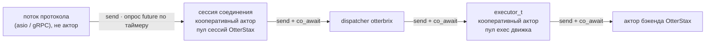

# Встраивание actor-zeta в долгоживущий хост: что нужно от библиотеки

> **Статус:** предложение, для обсуждения с мейнтейнерами actor-zeta.
>
> **Кому:** мейнтейнерам `otterbrix/actor-zeta`.
>
> **База:** тег `2.0.0` (`9009d5b`) и открытый PR #185 «Actor as a pull-driven generator» (ветка `actor-generator`,
> голова `c54a96c`). Просьбы к otterbrix — в [`otterbrix-embedding.md`](otterbrix-embedding.md).

Нотация ссылок:

- `az:<path>:<line>` — `header/actor-zeta/<path>` на теге `2.0.0`;
- `az185:<path>:<line>` — тот же путь на `c54a96c` (PR #185); `az185-doc:` — `docs/LIFECYCLE.md`, `az185-cl:` —
  `CHANGELOG.md` там же; `az185-test:` — `test/<path>`;
- `ob:<path>:<line>` — otterbrix `61aa43d6` (PR #850); `otx:<path>` — OtterStax, только как иллюстрация.

Шаблон записи: **Просим** → **Зачем** (сценарий хоста) → **Доказательство** (код со ссылками) → **Критерии
приёмки**; строка **Обход хоста** — только если обход есть. Приоритеты: **P1** — хост работает правильно, но платит
(CPU, задержка, непонятная ошибка) или держит обход; **P2** — по желанию.

---

## 1. Контекст

**OtterStax** — SQL-сервер федеративных запросов (MySQL, PostgreSQL, Arrow Flight SQL, Spark Connect). Запрос
выполняет встроенный движок **otterbrix**; таблицы удалённых баз (MySQL, PostgreSQL, ClickHouse) движок читает и
пишет сообщениями актору бэкенда, который реализует OtterStax. Сервер живёт неделями и держит много соединений.

actor-zeta работает на двух уровнях одного процесса:

- **otterbrix**: dispatcher, исполнители (`executor_t` — кооперативный актор), диск, WAL, индексы — акторы на пулах
  `sharing_scheduler`.
- **OtterStax**: у каждого клиентского соединения — сессия (кооперативный актор) на пуле сессий; акторы бэкендов — на
  своём пуле.

Пулы создаёт OtterStax. Свои (сессии, бэкенды) он запускает и останавливает сам. Три пула движка (`general` / `exec`
/ `disk`) он только создаёт: запускает и останавливает их движок (`ob:services/engine/engine.cpp:906-908`, `:962-964`),
и один пул на две роли движок не принимает (`ob:services/engine/engine.cpp:191-198`). Эта модель остаётся: общих пулов
движка и хоста не будет. Потоки протоколов (asio, gRPC) — не акторы: ответ сессии они получают опросом `unique_future`.

На каждой стрелке ожидающая сторона ждёт `unique_future`. Задачи ниже — о том, как это ожидание устроено, как
отвечает сам актор, что видно на конце цепочки при ошибке и как живут пулы.

## 2. Сводная таблица

| ID | P | Суть | Issue / PR |
|---|---|---|---|
| AZ-waker | P1 | settle будит ожидающего: waker на `unique_future` | #186 |
| AZ-park | P1 | кооперативный актор на неготовом future паркуется, а не крутит пул | продолжение #186 (п. 5) |
| AZ-answer-later | P1 | метод кооперативного актора отвечает позже, не держа ход (promise ответа) | issue не заведено |
| AZ-await-outcome | P1 | дождаться исхода future (значение / код / исключение), а не падать на коде ошибки | issue не заведено |
| AZ-pool-lifecycle | P1 | `stop()` в любом состоянии, перезапуск пула (или явный запрет) | issue не заведено |
| AZ-thread-start | P1 | отказ ОС создать поток — ошибка `start()`, а не `std::system_error` | #188 |
| AZ-exception | P2 | исключение из метода видно потребителю без переброса, свой код вместо `errc::interrupted` | issue не заведено |
| AZ-release | — | `actor-zeta/2.0.0` в conan-remote | сделано (§4) |
| AZ-teardown | — | уничтожить актора на живом пуле | сделано в #185: `close()` (§4) |

Состояние issue на 2026-11-02: PR #185, #186, #187, #188, #189 открыты.

---

## 3. Задачи

### AZ-waker — settle будит ожидающего (#186) (P1)

**Просим** (как в #186). `unique_future<T>::set_waker(...)`: один объект с `void wake() noexcept`, который только
сигнализирует (семафор, постановка задачи в планировщик, `asio::post`) и не читает значение. Регистрация — тем же
CAS «зарегистрировать, затем перепроверить», что у `co_await`: если future уже готов, вызывающий видит это сразу и
`wake()` не зовётся. `settle()` забирает waker до публикации флагов, затем один раз вызывает `wake()` на потоке
производителя. Ожидающий, уничтоженный раньше, получает безвредный поздний `wake()`.

**Зачем.** Каждый, кто ждёт future вне актора, выбирает между задержкой и CPU. Потоки протоколов OtterStax опрашивают
future сессии по таймеру: шаг 1 мс (MySQL, PostgreSQL, Flight SQL), у Spark — пауза от 16 мкс до 1 мс
(`otx:frontend/common/asio_future_bridge.hpp`, `otx:frontend/spark_connect_server/await_future.hpp`). Циклы dispatcher,
диска и WAL otterbrix опрашивают готовность по своим интервалам (otterbrix #693, этап 2; `otterbrix-embedding.md`,
OTB-notify). Waker нужен и для AZ-park.

**Доказательство.**
- `settle()` только ставит флаги: «The continuation is NOT taken or resumed here» (`az:detail/future.hpp:112-126`,
  `az185:detail/future.hpp:116-130`); `set_value` — «Producer side; never resumes the continuation»
  (`az:detail/shared_state.hpp:60-66`, `az185:detail/shared_state.hpp:66-83`); `release_promise` — флаги
  (`az185:detail/shared_state.hpp:145-159`).
- Всё, что возвращает `send()`, завершается одними флагами (`az185:detail/future_awaiters.hpp:21-23`); будит только
  `final_suspend` метода-корутины (`az185:detail/future.hpp:284-326`). В PR #185 это правило записано:
  «Results never wake anyone» (`az185-doc:15-16`).
- Блокирующих `get()` / `wait()` нет, `co_await` вне актора запрещён — это намеренный дизайн, вернуть их не просим:
  с waker'ом хост сам построит и блокирующее ожидание, и мост в свой event loop.
- PR #185 удаляет `intrusive_ptr` и `ref_counted` (`az185-cl:17-20`), на которых #186 держит waker: владение нужно
  выразить иначе (§6, вопрос 2).

**Критерии приёмки.** Waker, зарегистрированный до и после `set_value` / `error` / исключения, срабатывает ровно один
раз и только когда `is_ready()` уже true; после отпускания future `wake()` не вызывается (ASAN). Внешний поток,
ждущий future через waker на семафоре, не тратит CPU и просыпается за микросекунды после `set_value`.

### AZ-park — актор на неготовом future паркуется (P1)

**Просим.** Кооперативный актор, чьё поведение стоит на `co_await` неготового future, регистрирует на нём waker
(AZ-waker), чей `wake()` ставит актора в его пул захватом бита `scheduled` (как для нового сообщения), и отвечает
пулу «ждёт», а не «перепоставь меня». Результат, пришедший до регистрации, продолжает актора сразу (тот же CAS).
Вложенные корутины регистрируют waker на самом глубоком ожидаемом future.

**Зачем.** В OtterStax на каждый statement так ждут два актора: сессия (ответ движка) и `executor_t` (удалённые
источники). Оба крутят свои пулы всё время ожидания.

- Statement, задержанный на бэкенде на 1 с (скрытый тест `[.engine-defect-otb-notify]`,
  `otx:tests/session/test_session_lifetime.cpp`; macOS, 18 ядер; пул сессий — 4 потока, пул исполнителей — 2):
  **3,36–3,39 CPU-секунды** за секунду ожидания (без statement'а — 0,033); сессия делает **~210 000 `resume()` в
  секунду**; 4 потока пула сессий ≈ 1,07 ядра, 2 потока пула исполнителей ≈ 1,03 ядра.
- Бенчмарк JOIN'ов между базами (Docker, 18 CPU, медианы 5 повторов), профиль perf на JOIN'ах с ClickHouse:
  **40 % сэмплов** — планировщик (`pthread_cond_signal` в `work_sharing::enqueue` ← `resume_job_later` 24,1 %,
  `pthread_cond_wait` в `dequeue` 10,2 %, `sched_yield` в `worker::run` 5,8 %). У baseline (OtterStax до переноса
  выполнения на движок, без ожидания на future) — 0 %.

Медианы, мс. «Сейчас» — actor-zeta 2.0.0. «Без опроса» — эксперимент (в код не вошёл): сессия на `resume` без
обработанных сообщений засыпает на 50 мкс вместо немедленной перепостановки.

| JOIN | baseline | сейчас | без опроса | сейчас к без опроса | сейчас к baseline |
|---|---:|---:|---:|---:|---:|
| ClickHouse ⋈ MySQL | 890,9 | 1085,7 | 875,9 | +24 % | +22 % |
| ClickHouse ⋈ PostgreSQL | 878,7 | 1081,4 | 879,0 | +23 % | +23 % |
| MySQL ⋈ ClickHouse | 898,0 | 1088,2 | 867,2 | +25 % | +21 % |
| PostgreSQL ⋈ ClickHouse | 893,7 | 1082,1 | 870,3 | +24 % | +21 % |
| MySQL ⋈ PostgreSQL | 24,7 | 16,2 | 22,1 | −27 % | −34 % |
| PostgreSQL ⋈ MySQL | 22,8 | 17,3 | 25,5 | −32 % | −24 % |
| три базы, вариант 1 | 445,6 | 523,0 | 494,0 | +6 % | +17 % |
| три базы, вариант 2 | 162,9 | 194,3 | 160,7 | +21 % | +19 % |

Длинные JOIN'ы с ClickHouse без опроса возвращаются к baseline; короткие показывают, что опрос с паузой — не решение
(16,2 → 22,1 мс): нужно пробуждение, а не другой интервал. Замеры сняты на otterbrix `46fba865`; модель ожидания в
PR #185 та же (ниже).

**Доказательство.**
- 2.0.0: на неготовом future `resume_impl` отвечает `resume` с `keep_scheduled` (`az:actor/cooperative_actor.hpp:345-356`);
  «on `resume` the caller must re-enqueue this actor; nobody else will» (`:204-205`).
- PR #185: вердикт по умолчанию `resume` (`az185:actor/cooperative_actor.hpp:198`), «a suspended behavior keeps the
  turn» (`:201`), цикл поведения на занятом `behavior` отдаёт `co_yield step{handled, true}` (`:288-307`, `:304`);
  `az185-doc:59-60`: «A behavior suspended on a `co_await` keeps its actor in the run queue».
- Worker на `resume` без обработанных сообщений делает `yield` и перепоставляет задачу (`az:scheduler/worker.hpp:72-83`,
  `az185:scheduler/worker.hpp:73-83`) → `enqueue`: mutex, `push_back`, `notify_one` (`az185:scheduler/policy/work_sharing.hpp:81-87`,
  `:99-102`). Каждый `notify_one` будит другой worker, тот снова видит неготовый future.
- Другой политики нет: `sharing_scheduler = scheduler_t<work_sharing>` (`az:scheduler/sharing_scheduler.hpp:8`, так же
  на `c54a96c`).

**Обход хоста.** Корректного нет: флаг готовности пишет `settle()` внутри библиотеки. Сессия оставляет простой
`co_await`; скрытый тест описывает правильное поведение.

**Критерии приёмки.** Актор ждёт future, который завершат через 1 с: за секунду пул делает O(1) `resume()` этого
актора; после `set_value` актор продолжает в пределах микросекунд. Future, завершённый между проверкой и регистрацией
waker'а, продолжает актора (стресс под TSAN, 100 прогонов). У хоста: `[.engine-defect-otb-notify]` зелёный (меньше
0,5 CPU-секунды за секунду ожидания), JOIN'ы с ClickHouse — на уровне baseline, короткие — не медленнее, чем сейчас.

### AZ-answer-later — ответить позже, не держа ход (P1)

**Просим.** Публичный способ для метода кооперативного актора отдать ответ позже: метод получает promise ответа
(«отвечу сам»), сохраняет его и возвращает ход; актор берёт следующее сообщение; promise завершается позже — с
любого потока или из другого метода. Нужны правила времени жизни: promise, уничтоженный без значения, отвечает
`broken_pipe`, как сейчас; `close()` ждёт или отклоняет невыполненные обещания.

**Зачем.** Актор бэкенда OtterStax (контракт хранилища otterbrix, `otterbrix-embedding.md`, §1) получает сообщения от
всех executor'ов движка и обязан отвечать, не блокируя отправителя (`ob:docs/embedding-host-api.md:127-140`). Каждое
сообщение — удалённый запрос на десятки миллисекунд и дольше. Если метод кооперативного актора ждёт этот запрос
`co_await`'ом, актор держит ход до ответа, и все соединения всех клиентов к этому бэкенду выполняются по одному.

**Доказательство.**
- `dispatch()` берёт promise ответа, ждёт future метода и только потом завершает promise:
  `az185:actor/dispatch.hpp:100-103` (`get_result_promise`, `transfer_ownership`), `:114-115`
  (`detail::settled<value_type> outcome{...}; co_await outcome;`), `:116-124`. На 2.0.0 — `az:actor/dispatch.hpp:98-116`.
  Пока ждёт, поведение занято, и актор держит ход (`az185:actor/cooperative_actor.hpp:288-307`).
- `response_promise` / `make_response_promise` нет ни на одной ревизии. Есть низкоуровневый путь «роутера»:
  публичные `message::get_result_promise<T>()` и `transfer_ownership()` (`az185:mailbox/message.hpp:84`, `:87-89`,
  `:177-181`; `az185-cl:87-89`), но для кооперативного актора он не описан и не покрыт тестами, а `promise(state_type*)`
  назван «Non-owning view» (`az185:detail/future.hpp:43`).

**Обход хоста.** Свой `actor_mixin` с собственным потоком-циклом: `enqueue_impl` кладёт сообщение во входящую очередь,
цикл запускает поведения и возобновляет корутины, чей ответ готов. Так устроены диск otterbrix
(`ob:services/disk/manager_disk.hpp:293`) и тестовый бэкенд otterbrix (`ob:integration/cpp/test/test_host_actor.hpp:110`,
`ob:docs/embedding-host-api.md:130-132`). Это лишний поток на актор и свой цикл опроса.

**Критерии приёмки.** Кооперативный актор принимает 100 сообщений, на каждое обещает ответ и отвечает через 10 мс с
другого потока: все 100 ответов приходят через ≈ 10 мс, а не 1 с; обещание, уничтоженное без значения, — `broken_pipe`;
`close()` с невыполненным обещанием ведёт себя по описанному правилу (ASAN / TSAN чисты).

### AZ-await-outcome — дождаться исхода (P1)

**Просим.** Публичный способ дождаться future внутри актора, не забирая значение и не падая на коде ошибки:
сделать публичным `settled<U>` из PR #185 или `co_await std::move(f).outcome()` → значение | код | исключение.

**Зачем.** Акторы хоста ждут ответов движка и друг друга. Сообщение, которое уничтожили необработанным (mailbox
закрыт, актор умирает), завершает promise кодом `operation_canceled`; promise без значения — `broken_pipe`. Актор,
ждущий такой ответ простым `co_await`, роняет весь сервер со всеми соединениями. Нужно превратить это в ошибку
statement'а.

**Доказательство.** `co_await` на future с кодом ошибки без исключения → `refuse_valueless_extraction("co_await")`
(`az:detail/future_awaiters.hpp:87-90`, `az185:detail/future_awaiters.hpp:104-107`) → `std::abort()`
(`az:detail/result_storage.hpp:18-26`, так же на `c54a96c`). `settled<U>` в PR #185 — в `namespace detail`
(`az185:detail/future_awaiters.hpp:49-57`, `await_transform` — `:118-141`), им пользуется только `dispatch()`
(`az185:actor/dispatch.hpp:114-115`).

**Обход хоста.** Строгий порядок завершения процесса: соединения и их сессии закрываются раньше движка
(`otx:main.cpp`); любая отправка движку после начала его закрытия — `abort()`.

**Критерии приёмки.** Актор A ждёт исход ответа актора B; B закрыт, не обработав сообщение; A получает
`operation_canceled`, процесс жив. Значение и исключение отдаются без потерь. Обычный `co_await` не меняется.

### AZ-pool-lifecycle — `stop()` в любом состоянии, перезапуск (P1)

**Просим.**
1. `stop()` у незапущенного пула и повторный `stop()` — пустая операция.
2. `start()` после `stop()` поднимает ровно N потоков без утечки, или явно отказывает (assert в debug, ошибка в release).
3. Описать в API, что `stop()` выбрасывает задачи из очереди без `resume()`: принятые сообщения не выполнятся, их future
   ждут до уничтожения актора.
4. По желанию: `bool running() const noexcept`.

**Зачем.** OtterStax сам управляет пулами сессий и бэкендов и хочет простых правил: `stop()` можно вызвать на пути
ошибки, когда пул так и не запустился; повторный `stop()` ничего не делает. Сейчас ошибка в порядке вызовов — UB или
зависание на выходе процесса. То же ограничение заставляет otterbrix отказывать в одном пуле на две роли
(`ob:services/engine/engine.cpp:191-198`: «it would be started and stopped twice»).

**Доказательство.**
- 2.0.0: `stop()` незапущенного индексирует пустой вектор — `worker_by_id(i)` → `workers_[x].get()`
  (`az:scheduler/scheduler.hpp:40`, `:85-87`, вектор — `:117`); повторный `stop()` ставит задачу завершения в общую
  очередь и вечно ждёт (`:90-93`); `start()` после `stop()` добавляет N worker'ов к старым и запускает все 2N
  (`:52-58`), следующий `stop()` шлёт N задач, `join` (`:97-99`) висит.
- PR #185 (`c54a96c`): `workers_` — сырой массив, `nullptr` до `start()` (`az185:scheduler/scheduler.hpp:120`);
  `stop()` незапущенного пула разыменовывает null (`:95-96`, `workers_[i]->external_enqueue(&sh)`); повторный `stop()`
  висит на `wait_for_completion` без живых потоков (`:96-97`); `start()` после `stop()` затирает `workers_` новым
  массивом (`:62-63`) — старые N worker'ов не освобождаются (утечка; `~scheduler_t` освобождает только текущий,
  `:35-42`), потоков при этом N. Очередь при `stop()` выбрасывается без `resume()` (`:104-108`) без комментария о
  семантике; запрет записан только правилом «`start()` once, `stop()` exactly once» (`az185-cl:327-328`), не проверкой.
- Узнать, запущен ли пул, нельзя (ни на одной ревизии).

**Обход хоста.** Флаг «запущен» на каждый свой пул, `stop()` только при поднятом флаге (`otx:runtime/runtime.cpp`).

**Критерии приёмки.** `stop()` у созданного пула и `stop(); stop();` завершаются сразу (ASAN / UBSAN чисты);
`start(); stop(); start();` — ровно N потоков, без утечки; пять циклов подряд не растят число потоков и памяти.

### AZ-thread-start — отказ ОС создать поток (#188) (P1)

**Просим** (как в #188). `start()` пула возвращает ошибку, если ОС не создала поток: уже запущенные потоки
останавливаются и присоединяются; путь закреплён тестом.

**Зачем.** OtterStax и otterbrix собираются без исключений на своих путях ошибок. Сейчас из-за этого otterbrix в C ABI
завершает процесс при отказе создать поток планировщика (`ob:docs/embedding-host-api.md:601-603`), а хост не может
ответить «не хватает ресурсов» на старте.

**Доказательство.** `worker::start()` → `launch_thread` → `std::thread{...}` (`az:scheduler/worker.hpp:28-31`,
`az185:scheduler/worker.hpp:28-31`, `az185:detail/launch_thread.hpp:14-21`): конструктор бросает `std::system_error`,
перехвата нет. В PR #185 потоки запускаются по одному (`az185:scheduler/scheduler.hpp:68-70`): при броске уже
запущенные остаются joinable, и `~scheduler_t` вызывает `std::terminate` (комментарий `:33-34`).

**Критерии приёмки.** Тест с подменой запуска потока, отказывающей на k-м worker'е: `start()` возвращает ошибку,
потоков не остаётся, деструктор пула не вызывает `terminate`.

### AZ-exception — исключение видно потребителю (P2)

**Просим.** Неброскового доступа к исключению у `unique_future`: `has_exception()` и `exception()` (в сборке без
исключений — false / пусто); свой код ошибки (категория actor-zeta, `unhandled_exception`) вместо
`std::errc::interrupted`.

**Зачем.** Понижено до P2: движок otterbrix на `61aa43d6` не бросает (CI-проверка «без исключений»,
`ob:scripts/CI/run-check-no-exceptions.sh`), так что исключение до потоков протоколов OtterStax почти не доходит. Но
если дойдёт, потребитель по документированному протоколу опроса видит только «Interrupted system call» — его нельзя
отличить от `EINTR` производителя.

**Доказательство.** `set_exception` сохраняет `exception_ptr` и ставит `errc::interrupted`
(`az:detail/shared_state.hpp:79-84`, `az185:detail/shared_state.hpp:86-90`); геттеров исключения нет, публичный API
future — `take_ready`, `is_ready`, `failed`, `error`, `detach` (`az185:detail/future.hpp:182-239`); исключение
достаётся только перебросом из `take_ready()` (`az185-doc:123`).

**Обход хоста.** На `errc::interrupted` потоки протоколов подставляют свой текст «an exception escaped the actor
running it» (`otx:frontend/common/asio_future_bridge.hpp`).

**Критерии приёмки.** Метод бросает `runtime_error("boom")`: потребитель видит `failed()`, `has_exception()`, и
`rethrow_exception(f.exception())` даёт `boom` без `take_ready()`; `promise::error(errc::interrupted)` и исключение
различимы; сборка без исключений компилируется.

---

## 4. Сделано

| ID | Где | Что |
|---|---|---|
| AZ-release | conan-remote `conan.otterbrix.com` | `actor-zeta/2.0.0#887bc992cac0ead59e5bdf5c90c844f4`; OtterStax пинит эту ревизию (`otx:conanfile.py`). Просьба: не перевыпускать `2.0.0` с другой ревизией рецепта |
| AZ-teardown (#187) | PR #185: `az185:actor/cooperative_actor.hpp:231-259`, тест `az185-test:close/main.cpp:194-251` | `close()` → future: «Once one is ready, no job for this actor exists or can appear: delete is safe while the scheduler runs» (`:231-235`); тест удаляет актора на работающем пуле (`:246`). Хосту этого достаточно. Остаток (не просим): `delete` без `close()` при задаче в очереди — по-прежнему use-after-free (`az185-doc:92`), а future `close()` может не стать готовым, если поведение ждёт производителя, которого никто не запустит (`az185-doc:77-78`) |

## 5. Связанные, не наши

| Issue | Суть | Отношение к OtterStax |
|---|---|---|
| #189 | публичный предикат «этот future кто-то ждёт» (`unique_future::is_awaited()` / `promise::is_awaited()`) | OtterStax его не просит; совместим с AZ-waker (тот же `continuation_`) |

## 6. Что проверили и не просим

| Что | Почему |
|---|---|
| Блокирующие `get()` / `wait()` | намеренный дизайн; с waker'ом хост строит блокирующее ожидание сам |
| `co_await` на `unique_future` вне актора | намеренный дизайн; мост в event loop хоста — `asio::post` из `wake()` |
| Исключение из `behavior()` печатается и выбрасывается | задокументировано; хост кладёт работу в методы |
| Раскладка `shared_state` зависит от `-fexceptions` | задокументировано; хост собирает actor-zeta в том же режиме |
| Общие пулы движка и хоста | otterbrix сам запускает и останавливает свои пулы (`ob:services/engine/engine.cpp:906-908`, `:962-964`); OtterStax держит отдельные |

## 7. Открытые вопросы

1. **AZ-waker / AZ-park.** Регистрировать waker на каждом `co_await` или только когда future не готов при первой
   проверке?
2. **AZ-waker.** Без `intrusive_ptr` (PR #185): чем владеть waker'ом — подсчёт ссылок у хоста или `shared_state`
   держит его по значению?
3. **AZ-answer-later.** Обещание ответа как публичный тип рядом с `dispatch()` или документированный путь
   `get_result_promise` / `transfer_ownership` для кооперативного актора?
4. **AZ-pool-lifecycle.** Поддерживать перезапуск пула или явно запретить `start()` после `stop()`?
5. **AZ-await-outcome / AZ-exception.** Один тип исхода для `co_await` и внешнего опроса или два API?
