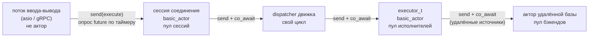
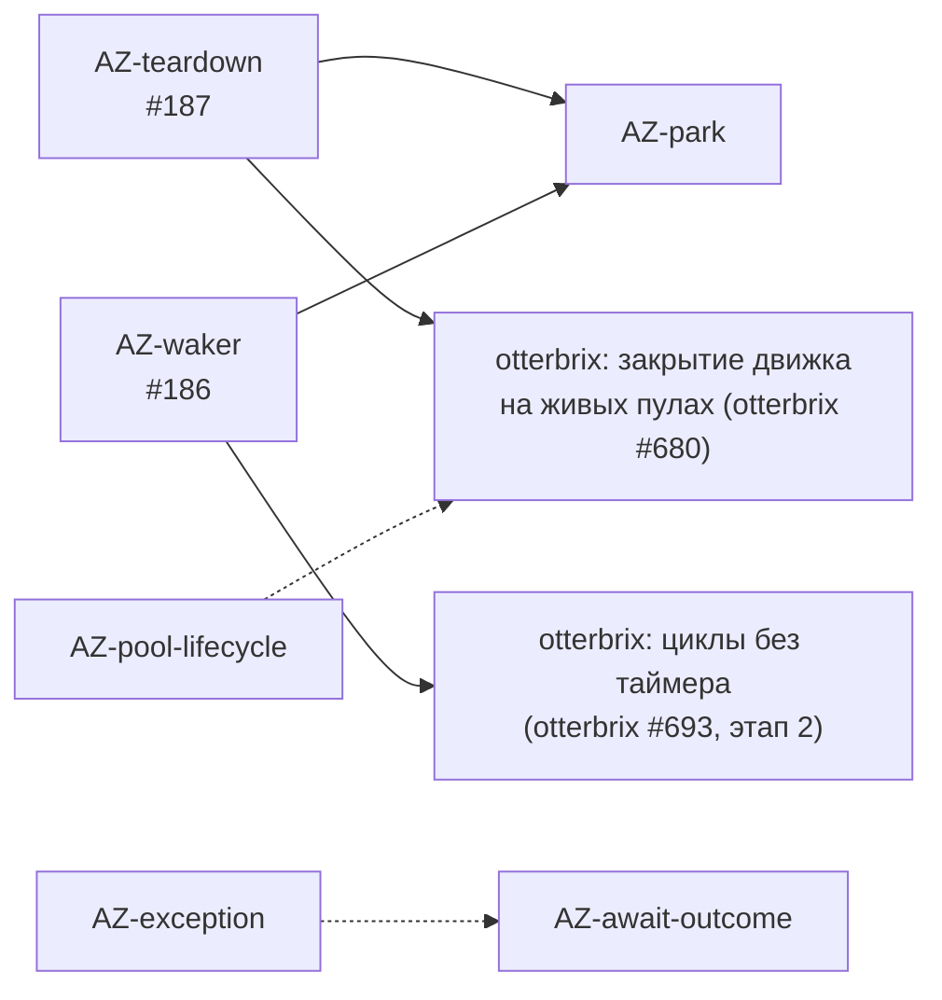
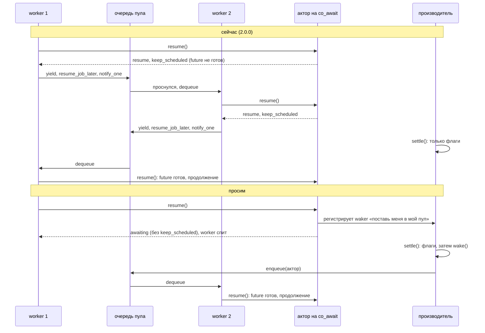

# Встраивание actor-zeta в долгоживущий хост: что нужно от библиотеки

> **Статус:** предложение, для обсуждения с мейнтейнерами actor-zeta.
>
> **Кому:** мейнтейнерам actor-zeta (`otterbrix/actor-zeta`; старый адрес `cyberduckninja/actor-zeta` перенаправляет
> туда же).
>
> **База:** тег `2.0.0` (коммит `9009d5b7`; `master` на 2026-10-12 совпадает с тегом). Все утверждения о коде
> проверены по исходникам conan-пакета `actor-zeta/2.0.0`. Открытый PR #185 (голова `23d40de2`) учтён там, где он
> меняет картину.
>
> Документ читается сам по себе: контекст встраивания и словарь — в §1, задачи — в §3. Знать код OtterStax или
> otterbrix не нужно; ссылки на него даны только как иллюстрация того, как хост обходится сейчас.

Нотация ссылок:

- `az:<path>:<line>` — `header/actor-zeta/<path>` на теге `2.0.0`;
- `az-guide:<line>` — `PROMISE_FUTURE_GUIDE.md` на теге `2.0.0`;
- `az-pr185:<path>` — тот же путь в PR #185 (голова `23d40de2`);
- `otx:<path>` — OtterStax (рабочее дерево, ветка `docs/otterbrix-embedding-proposal`), только для иллюстрации.

Как читать задачу: **проблема** (что в библиотеке, со ссылками) → **зачем хосту** → **что хост делает сейчас вместо**
→ **просим** → **критерии приёмки** → **что изменится у хоста** → **зависимости**. Приоритеты:

- **P0** — без задачи хост не может прийти к целевой схеме (общие пулы на весь процесс);
- **P1** — хост работает правильно, но платит за отсутствие задачи (CPU, задержка, непонятная ошибка) или держит
  обход;
- **P2** — по желанию.

---

## 1. Контекст

### 1.1 Кто встраивает actor-zeta и как

**OtterStax** — SQL-сервер федеративных запросов. Клиенты подключаются по протоколам MySQL, PostgreSQL, Arrow Flight
SQL и Spark Connect; запрос выполняет встроенный SQL-движок **otterbrix**, а таблицы удалённых баз (MySQL,
PostgreSQL, ClickHouse) движок читает и пишет через точки расширения, которые реализует OtterStax. Сервер живёт
долго (дни и недели) и обслуживает много соединений одновременно.

actor-zeta используется на двух уровнях одного процесса:

- **otterbrix** построен на actor-zeta: его dispatcher, исполнители запросов (`executor_t`, это `basic_actor`, то есть
  `cooperative_actor`), агенты диска, WAL и индексов — акторы на пулах `sharing_scheduler`.
- **OtterStax** сам тоже хост actor-zeta: у каждого клиентского соединения есть своя **сессия** — `basic_actor` на
  пуле сессий; есть акторы удалённых баз (по одному на тип базы) на своём пуле.

Пулы создаёт OtterStax. Сейчас их пять: три он отдаёт движку (движок сам вызывает у них `start()` и `stop()`), два
запускает и останавливает сам. Целевая схема — **один набор пулов на процесс**, общий для движка и акторов хоста;
создаёт, запускает и останавливает пулы только хост; движок можно закрыть и открыть заново на живых пулах.

Код, который принимает соединения (asio и gRPC), акторами не является: это потоки ввода-вывода. Ответ сессии они
получают через `unique_future`, опрашивая `is_ready()` / `failed()` / `take_ready()` по таймеру — другого способа для
кода вне актора в 2.0.0 нет (`az:detail/future_awaiters.hpp:172-175`).

Путь одного SQL-statement'а:

На каждой стрелке ожидающая сторона ждёт `unique_future`. Задачи этого документа — о том, как это ожидание
устроено, что происходит с ошибкой на конце цепочки и как живут пулы.

### 1.2 Словарь

| Термин | Что значит здесь |
|---|---|
| **хост** | программа, которая встраивает библиотеку: создаёт пулы, спавнит акторов, ждёт их ответов. Здесь — OtterStax (и otterbrix как хост actor-zeta для своих акторов) |
| **пул** | `scheduler::sharing_scheduler` = `scheduler_t<work_sharing>` (`az:scheduler/sharing_scheduler.hpp:8`): N потоков-worker'ов и одна общая очередь задач |
| **задача (job)** | `job_ptr` — узел очереди с сырым указателем на актора (`az:scheduler/job_ptr.hpp:37`); worker вызывает у него `resume()` |
| **кооперативный актор** | `cooperative_actor` (`basic_actor`): одно поведение (`behavior()`) за раз; пока поведение стоит на `co_await`, следующее сообщение не берётся |
| **future / promise / shared_state** | `unique_future<T>`, `promise<T>` и их общее состояние `detail::shared_state<T>` с флагами готовности |
| **settle** | завершение promise: записать значение, код ошибки или исключение и поднять флаг `promise_released` (`az:detail/future.hpp:112-126`) |
| **внешний потребитель** | код вне актора (поток ввода-вывода, поток хоста), который ждёт future |
| **опрос** | ожидание готовности повторной проверкой флага: у актора — перепостановкой в очередь пула, у внешнего потребителя — по таймеру |
| **перепостановка** | worker снова кладёт задачу актора в очередь пула (`resume_job_later`) |
| **waker** | объект, который settle вызывает один раз, чтобы разбудить ожидающего (предлагается в #186) |
| **statement** | один SQL-оператор клиента; сессия выполняет их строго по одному |

---

## 2. Задачи

| ID | Суть | Приоритет | Issue / PR | Состояние |
|---|---|---|---|---|
| AZ-release | `actor-zeta/2.0.0` в conan-remote `conan.otterbrix.com` | P0 | — | **сделано**: в remote есть `actor-zeta/2.0.0#887bc992…` (проверено 2026-10-12) |
| AZ-teardown | уничтожить актора, чья задача стоит в очереди живого пула, — use-after-free | P0 | #187 (открыт) | PR #185 вводит `close()`, но этот случай откладывает |
| AZ-pool-lifecycle | перезапуск пула; `stop()` у незапущенного и повторный `stop()` | P1 | issue не заведено | PR #185 исправляет `stop()` у незапущенного, перезапуск — нет |
| AZ-waker | settle будит ожидающего: waker на `unique_future` | P1 | #186 (открыт) | в PR #185 нет («Results never wake anyone») |
| AZ-park | кооперативный актор на неготовом future паркуется, а не крутит пул | P1 | issue не заведено (продолжение #186, п. 5) | ждёт AZ-waker и AZ-teardown |
| AZ-exception | исключение из метода актора доходит до получателя целиком, а не только кодом `errc::interrupted` | P1 | issue не заведено | в PR #185 не меняется |
| AZ-await-outcome | `co_await` на future, завершённом кодом ошибки без исключения, роняет процесс; нужен способ дождаться исхода | P1 | issue не заведено | в PR #185 есть внутренний `detail::settled<U>` |

Номера issue и PR проверены через GitHub API 2026-10-12: #186 и #187 открыты и про то, что здесь написано; PR #185
открыт.

Порядок, в котором задачи зависят друг от друга:

Сплошная стрелка — «нужно до», пунктир — «удобно делать вместе».

---

## 3. Описание задач

### 3.1 AZ-release — 2.0.0 в conan-remote (P0, сделано)

**Проблема.** OtterStax и otterbrix берут зависимости из conan-remote `conan.otterbrix.com`. Пока actor-zeta `2.0.0`
не было в remote, образы Docker и CI не могли собрать ни otterbrix, ни OtterStax.

**Проверка (2026-10-12).** `conan search 'actor-zeta/*' -r otterbrix` показывает `actor-zeta/2.0.0`; ревизия рецепта
`887bc992cac0ead59e5bdf5c90c844f4` (загружена 2026-09-24), готовый бинарь — Linux x86_64, gcc 13, Release,
`exceptions_disable=False`. Остальные конфигурации собираются из рецепта (`--build missing`); исходники рецепт берёт
из архива тега на GitHub.

**Что хост делает сейчас.** OtterStax пинит `actor-zeta/2.0.0#887bc992cac0ead59e5bdf5c90c844f4`
(`otx:conanfile.py:59`) и берёт его из remote как любую зависимость; бинаря под нужную конфигурацию нет — собирает из
рецепта через `--build missing`. Локальный архив рецептов (`otx:scripts/conan/export_local_packages.sh`) actor-zeta
больше не содержит, в нём остался только otterbrix (OTB-tag). Из исходников actor-zeta собирается ещё в TSAN-сборке —
ради инструментирования `-fsanitize=thread`, к этому обходу отношения не имеет.

**Просим.** Не перевыпускать `2.0.0` с другой ревизией рецепта (хост может запинить `#887bc992…`); релизы с задачами
ниже выкладывать туда же.

**Критерии приёмки.** Выполнены: `conan install` с `actor-zeta/2.0.0` разрешается из remote.

**Что изменится у хоста.** Уже изменилось: actor-zeta убран из локальной сборки рецептов. Когда в remote появится
тег otterbrix, OtterStax удалит и её.

**Зависимости:** нет.

### 3.2 AZ-teardown — уничтожение актора с задачей в очереди живого пула (#187) (P0)

**Проблема.**

- Задача в очереди хранит сырой указатель на актора (`az:scheduler/job_ptr.hpp:37`) и вызывает
  `static_cast<T*>(ptr)->resume(...)` (`az:scheduler/job_ptr.hpp:15-19`). Узел очереди строится из этого указателя
  (`az:scheduler/policy/work_sharing.hpp:42-52`).
- Пока поведение актора стоит на `co_await` неготового future, `resume()` отвечает `resume` с `keep_scheduled`
  (`az:actor/cooperative_actor.hpp:345-356`), и worker тут же ставит задачу обратно (`az:scheduler/worker.hpp:72-83`).
  То есть у ждущего актора задача почти всегда в очереди.
- Деструктор `~cooperative_actor` ждёт только, пока актор не `running` и пока нет отправителей в процессе отправки
  (`wait_for_activity_to_drain`, `az:actor/cooperative_actor.hpp:561-589`). Бит `scheduled` он не ждёт. Затем он пишет
  итоговое состояние в память, которую сейчас освободят (`az:actor/cooperative_actor.hpp:499-512`). Следующий
  `dequeue` вызывает `resume()` на освобождённом объекте; проверка `is_destroying` в начале `resume_impl`
  (`az:actor/cooperative_actor.hpp:322`) читает тот же освобождённый объект.

**Зачем хосту.** Целевая схема хоста — пулы общие для движка и акторов хоста и живут весь процесс. Движок, который
закрывается на таких пулах, должен уничтожить своих акторов, не останавливая пулы: остановить их нельзя, на них
работают акторы хоста. Сейчас это use-after-free.

**Что хост делает сейчас вместо.** otterbrix не попадает в ошибку по одной причине: при закрытии он останавливает
все свои пулы до того, как умирает хоть один актор, а `stop()` выбрасывает задачи из очереди, не вызывая `resume()`
(`az:scheduler/scheduler.hpp:101-105`). Поэтому OtterStax держит для движка три отдельных пула, которые «одалживает»
одному движку; второй движок требует нового набора пулов (`otx:runtime/runtime.cpp`, `lend_engine_pools`).

**Просим.** Один из вариантов из #187:

- (a) `~cooperative_actor` ждёт и `!scheduled`: задача из очереди должна выполниться и ответить `done` (нужен живой
  пул);
- (b) `job_ptr` держит ссылку на актора, и память освобождает последний узел очереди.

PR #185 добавляет `close()` → `unique_future<void>` («после готовности этого future уничтожать актора безопасно,
пока планировщик работает»), но случай «задача актора ещё в очереди работающего планировщика» в описании PR прямо
отложен: «the actor cannot detect it; the rule is `close()` or `stop()` first». Для хоста достаточно любого из двух:
либо исправления (a) / (b), либо гарантии, что после готовности `close()` в очереди не осталось задачи актора, — с
тестом ниже.

**Критерии приёмки.** Тест actor-zeta, красный на 2.0.0: пул работает, обработчик стоит на `co_await` неготового
future; актор уничтожается; пул работает ещё N мс; затем `stop()`. ASAN не сообщает heap-use-after-free в
`resume_impl`.

**Что изменится у хоста.** otterbrix перестаёт останавливать пулы при закрытии движка (это otterbrix #680, он прямо
зависит от #187). OtterStax переходит на один набор пулов для движка и своих акторов и убирает учёт «одолжены /
израсходованы».

**Зависимости:** нет. От этой задачи зависят AZ-park (#186 п. 5 прямо ссылается на неё) и otterbrix #680.

### 3.3 AZ-pool-lifecycle — перезапуск пула и `stop()` вне пары с `start()` (P1, issue не заведено)

**Проблема** (по коду 2.0.0 и PR #185; запуском не проверяли).

- **`stop()` у незапущенного пула.** `workers_` заполняет только `start()` (`az:scheduler/scheduler.hpp:47-59`).
  `stop()` перебирает `i < num_workers()` и берёт `worker_by_id(i)` = `workers_[i].get()`
  (`az:scheduler/scheduler.hpp:39-41`, `:85-89`) — у незапущенного пула это индекс за концом пустого вектора, то есть
  неопределённое поведение.
- **Повторный `stop()`.** Второй `stop()` кладёт задачу завершения в общую очередь и ждёт её выполнения
  (`az:scheduler/scheduler.hpp:90-95`), но потоков уже нет — ожидание вечное.
- **Перезапуск.** `stop()` не очищает `workers_`. Повторный `start()` добавляет N новых worker'ов и вызывает `start()`
  у **всех** элементов `workers_` (`az:scheduler/scheduler.hpp:52-58`), в том числе у старых, чьи потоки уже
  присоединены: проверка `this_thread_.get_id() == std::thread::id{}` (`az:scheduler/worker.hpp:29`) у
  присоединённого потока проходит. Получается 2N потоков. Следующий `stop()` отправляет только N задач завершения
  (`az:scheduler/scheduler.hpp:85-95`), и `join()` (`:97-99`) ждёт вечно оставшиеся N потоков, спящих в `dequeue`
  (`az:scheduler/policy/work_sharing.hpp:60-65`).
- **Что `stop()` делает с очередью.** Задачи, оставшиеся в очереди, выбрасываются без `resume()`
  (`az:scheduler/scheduler.hpp:101-105`). Это намеренно, но нигде не сказано в API: хост узнаёт об этом, только когда
  актор, чья задача была в очереди, не выполнил уже принятое сообщение.
- Узнать у пула, запущен ли он, нельзя.
- PR #185: `stop()` перебирает сам `workers_` (`az-pr185:scheduler/scheduler.hpp`), так что `stop()` у незапущенного
  пула становится пустой операцией. Перезапуск там по-прежнему запускает старых worker'ов вместе с новыми: число
  потоков растёт на N с каждым циклом.

**Зачем хосту.** Хост управляет пулами сам и хочет простых правил: `stop()` можно вызвать в любом состоянии (в том
числе на пути ошибки, когда пул так и не запустился), повторный `stop()` — ничего не делает, пул после `stop()` можно
запустить снова (или это явно запрещено и проверяется). Сейчас любая ошибка в порядке вызовов — это UB или
зависание при завершении процесса.

**Что хост делает сейчас вместо.** OtterStax хранит для каждого своего пула флаг «запущен» и вызывает `stop()` только
при поднятом флаге (`otx:runtime/runtime.cpp`, `stop_sessions` / `stop_backends`); для пулов движка — отдельный
автомат состояний «свежий / одолжен / израсходован», а повторное открытие движка требует новых пулов. Обход локальный,
поэтому P1.

**Просим.**

1. `stop()` у незапущенного пула и повторный `stop()` — пустая операция.
2. `stop()` очищает `workers_`, так что `start()` после `stop()` поднимает ровно N потоков. Если перезапуск не
   поддерживается намеренно — `start()` после `stop()` должен явно отказывать (assert в debug и ошибка в release), а
   не запускать старых worker'ов.
3. Описать в API, что `stop()` выбрасывает задачи из очереди без `resume()`.
4. По желанию: `bool running() const noexcept`.

**Критерии приёмки.**

- `stop()` у только что созданного пула и `stop(); stop();` завершаются сразу, ASAN / UBSAN чисты.
- `start(); stop(); start();` — ровно N живых потоков; `stop()` после этого завершается.
- Пять циклов `start()` / `stop()` подряд не увеличивают число потоков.

**Что изменится у хоста.** Уходят флаги «запущен» и автомат состояний пулов движка; один и тот же набор пулов можно
пережить через несколько открытий движка.

**Зависимости:** нет. Удобно делать вместе с AZ-teardown: обе задачи — про жизнь пула, который переживает акторов.

### 3.4 AZ-waker — settle будит ожидающего (#186) (P1)

**Проблема.** Завершение promise никого не будит.

- `promise::settle()` поднимает флаги и не трогает ни продолжение, ни планировщик: «The continuation is NOT taken or
  resumed here» (`az:detail/future.hpp:112-126`); `shared_state::set_value` — «Producer side; never resumes the
  continuation» (`az:detail/shared_state.hpp:60-66`); `release_promise()` только меняет флаги
  (`az:detail/shared_state.hpp:139-153`).
- Продолжение (`continuation_`), которое регистрирует ожидающий (`az:detail/future_awaiters.hpp:21-47`), возобновляет
  только метод-корутина производителя на своём `final_suspend` (`az:detail/future.hpp:281-319`). Всё, что возвращает
  `send()`, завершается одними флагами (комментарий `az:detail/future_awaiters.hpp:21-23`).
- Внешнему потребителю библиотека оставляет только опрос: блокирующих `get()` / `wait()` нет, `co_await` вне актора
  запрещён (CHANGELOG, раздел Unreleased: «Blocking `unique_future` API», «`co_await` on a `unique_future<T>` from a
  non-actor coroutine»; `az:detail/future_awaiters.hpp:172-175`: «External loops POLL»). Оба запрета — намеренный
  дизайн, и мы не просим их вернуть: с waker'ом хост сам построит и блокирующее ожидание, и мост в свой event loop.

**Зачем хосту.** Каждый, кто ждёт future вне актора, платит выбором между задержкой и CPU:

- потоки ввода-вывода OtterStax опрашивают future сессии по таймеру: шаг 1 мс (MySQL, PostgreSQL, Flight SQL) или пауза,
  растущая от 16 мкс до 1 мс (Spark Connect). Ответ клиенту приходит с задержкой до 1 мс, а короткая пауза в начале
  тратит CPU;
- циклы dispatcher'а, диска, WAL и индексов otterbrix спят 5 мкс, пока что-то в полёте, и 10 мс в простое; ответ,
  завершённый на другом потоке, они замечают только на следующем тике (подробно — в #186 и otterbrix #693);
- ожидание хоста вне акторов в otterbrix — сон 100 мкс между проверками.

**Что хост делает сейчас вместо.** Опрос по таймеру (`otx:frontend/common/asio_future_bridge.hpp`,
`otx:frontend/spark_connect_server/await_future.hpp`). Корректной альтернативы снаружи библиотеки нет: флаг готовности
пишет `settle()` внутри actor-zeta, и узнать о нём можно только прочитав его.

**Просим** (как в #186):

1. `unique_future<T>::set_waker(...)` (или `on_ready`) — один объект с `void wake() noexcept`, который может только
   сигнализировать (счётчик и condition variable, семафор, постановка задачи в планировщик, `asio::post`), не читает
   значение и не выполняет код пользователя. Регистрация — тем же «зарегистрировать, затем перепроверить» CAS, что в
   `future_await_suspend_cas` (`az:detail/future_awaiters.hpp:26-47`): если future уже завершён, вызывающий видит это
   сразу, и `wake()` не вызывается.
2. `settle()` забирает waker до `release_promise()`, публикует `promise_released` как сейчас, затем один раз вызывает
   `wake()` на потоке производителя и отпускает свою ссылку. Если future уже отпущен — waker отпускается без вызова.
3. Время жизни waker'а не зависит от ожидающего: ожидающий, уничтоженный раньше, получает безвредный поздний `wake()`.

В #186 waker держится `intrusive_ptr<waker>`. PR #185 удаляет `intrusive_ptr` и `ref_counted`; если #185 вливается
первым, владение waker'ом нужно выразить по-другому (например, waker с подсчётом ссылок, который хост реализует сам).

**Критерии приёмки.**

- Unit-тест actor-zeta: waker, зарегистрированный до и после `set_value` / `error` / `exception`, срабатывает ровно один
  раз и только после того, как `is_ready()` стал true; после отпускания future `wake()` не вызывается; ожидающий,
  уничтоженный с неготовым future, не трогается (ASAN).
- Внешний поток, ждущий future через waker на семафоре, не тратит CPU, пока future не готов, и просыпается за время
  порядка микросекунд после `set_value`.

**Что изменится у хоста.** Потоки ввода-вывода OtterStax переходят с таймера на `asio::post` из `wake()`: ответ без
задержки 1 мс и без работы, пока ждём. otterbrix убирает таймеры из своих циклов (otterbrix #693, этап 2) и сон 100
мкс из ожидания хоста.

**Зависимости:** нет. От неё зависит AZ-park.

### 3.5 AZ-park — актор на неготовом future паркуется (P1, issue не заведено; продолжение #186 п. 5)

**Проблема.** Кооперативный актор, чьё поведение стоит на `co_await` неготового future, не паркуется, а крутит пул.

- `resume_impl` на неготовом future отвечает `resume` с `keep_scheduled` (`az:actor/cooperative_actor.hpp:345-356`,
  `:379-393`). Это обязательство: «on `resume` the caller must re-enqueue this actor; nobody else will (future
  completion is flag-only)» (`az:actor/cooperative_actor.hpp:204-205`); `awaiting` здесь запрещён, потому что будить
  актора некому (`:341-344`).
- Worker на `resume` без обработанных сообщений делает `std::this_thread::yield()` и сразу перепоставляет задачу
  (`az:scheduler/worker.hpp:72-83`): `resume_job_later` → `work_sharing::enqueue` — mutex, `push_back`,
  `cv.notify_one()` (`az:scheduler/policy/work_sharing.hpp:34-40`, `:55-57`). Каждое `notify_one` будит другой спящий
  worker пула, тот берёт задачу, снова видит неготовый future — и так по кругу.
- Другой политики планировщика нет: `sharing_scheduler` — единственный (`az:scheduler/sharing_scheduler.hpp:8`).
- В PR #185 модель та же: «A suspended behavior keeps the turn (verdict `resume`)», «Results never wake anyone».

Как это выглядит сейчас и как должно быть:

**Зачем хосту (замеры).** В процессе OtterStax ждут так два актора на каждый statement: сессия соединения (ждёт ответа
движка, пока statement выполняется) и `executor_t` движка (ждёт удалённые источники данных). Оба крутят свои пулы
всё время ожидания.

- **Простой statement, задержанный на удалённой базе на 1 с** (`otx:tests/session/test_session_lifetime.cpp`, скрытый
  тест `[.engine-defect-otb-notify]`; macOS, 18 ядер; пул сессий — 4 потока, пул исполнителей — 2): процесс тратит
  **3,36–3,39 CPU-секунды** за эту секунду ожидания (без statement'а — 0,033). Сессия делает **~210 000 `resume()` в
  секунду**. По `sample`: 4 потока пула сессий ≈ 1,07 ядра (`sched_yield`, `pthread_cond_signal`), 2 потока пула
  исполнителей с `executor_t` ≈ 1,03 ядра.
- **Бенчмарк JOIN'ов между базами** (Docker, 18 CPU; 5 повторов, медианы). Профиль perf на JOIN'ах с ClickHouse:
  **40 % сэмплов** приходится на планировщик — `pthread_cond_signal` в `work_sharing::enqueue` ← `resume_job_later`
  (24,1 %), `pthread_cond_wait` в `dequeue` (10,2 %), `sched_yield` в `worker::run` (5,8 %). До переноса OtterStax на
  движок (baseline — тот же бенчмарк на версии OtterStax, где запрос выполнял свой планировщик без ожидания на
  future) этих сэмплов было 0 %. Сам JOIN при этом получает на 17 % больше сэмплов на ту же работу: крутящиеся
  worker'ы отнимают у него ядро.

Медианы, мс. «Сейчас» — actor-zeta 2.0.0 как есть. «Без опроса» — эксперимент, в код не вошёл: сессия на ответ
`resume` без обработанных сообщений засыпает на 50 мкс вместо немедленной перепостановки (то есть опрос заменён
опросом с паузой).

| JOIN | baseline | сейчас | без опроса | сейчас к без опроса | сейчас к baseline |
|---|---:|---:|---:|---:|---:|
| ClickHouse ⋈ MySQL | 890,9 | 1085,7 | 875,9 | +24 % | +22 % |
| ClickHouse ⋈ PostgreSQL | 878,7 | 1081,4 | 879,0 | +23 % | +23 % |
| MySQL ⋈ ClickHouse | 898,0 | 1088,2 | 867,2 | +25 % | +21 % |
| PostgreSQL ⋈ ClickHouse | 893,7 | 1082,1 | 870,3 | +24 % | +21 % |
| MySQL ⋈ PostgreSQL | 24,7 | 16,2 | 22,1 | −27 % | −34 % |
| PostgreSQL ⋈ MySQL | 22,8 | 17,3 | 25,5 | −32 % | −24 % |
| три базы, вариант 1 | 445,6 | 523,0 | 494,0 | +6 % | +17 % |
| три базы, вариант 2 | 162,9 | 194,3 | 160,7 | +21 % | +19 % |

Что из этого следует:

- длинные JOIN'ы с ClickHouse (около секунды) без опроса возвращаются к baseline (≈ 870–880 мс против 880–900), а
  сейчас они медленнее на 21–23 % baseline и на 23–25 % варианта без опроса;
- короткие JOIN'ы (десятки мс) показывают, почему опрос с паузой — не решение: пауза добавляет задержку к каждому
  ожиданию (16,2 → 22,1 мс). Нужно пробуждение, а не другой интервал опроса.

**Что хост делает сейчас вместо.** Ничего: корректного обхода снаружи библиотеки нет. Проверенные варианты:

- продолжение в `continuation_` — его возобновил бы только производитель, и на своём потоке; библиотека это намеренно
  не допускает для `send()`;
- ответ сообщением в mailbox сессии — у отправителя (движка) нет адреса для ответа, а наблюдать готовность, чтобы
  отправить сообщение, снова пришлось бы опросом;
- отдать ожидание потоку ввода-вывода — сессия обязана выполнять statement'ы по одному и сопровождать транзакцию после
  ответа, а поток ввода-вывода сам опрашивает по таймеру;
- пауза в `resume` сессии — тот же опрос с задержкой (таблица выше).

Сессия оставляет простой `co_await`; скрытый тест `[.engine-defect-otb-notify]` описывает правильное поведение.

**Просим.** Кооперативный актор, чьё поведение стоит на неготовом future, регистрирует на нём waker (AZ-waker), чей
`wake()` ставит актора в его пул — захватом бита `scheduled`, как это делает `leave_and_maybe_schedule` для нового
сообщения (`az:actor/cooperative_actor.hpp:533-557`), — и отвечает `awaiting` без `keep_scheduled`. Если результат
появился до регистрации, актор продолжает сразу (тот же CAS, что в `future_await_suspend_cas`). Цепочка вложенных
корутин регистрирует waker на самом глубоком ожидаемом future (тот, что уже публикуется в `awaited_flags_`,
`az:detail/future_awaiters.hpp:115-147`).

**Критерии приёмки.**

- Тест actor-zeta: актор ждёт future, который завершат через 1 с; за эту секунду пул выполняет O(1) вызовов
  `resume()` этого актора, а не сотни тысяч; после `set_value` актор продолжает в пределах микросекунд.
- Нет потерянных пробуждений: future, завершённый между проверкой и регистрацией waker'а, продолжает актора
  (стресс-тест под TSAN, 100 прогонов подряд).
- Актор, уничтоженный с зарегистрированным waker'ом, не трогается (ASAN; вместе с AZ-teardown).
- У хоста: скрытый `[.engine-defect-otb-notify]` зелёный — за секунду ожидания statement'а процесс тратит меньше 0,5
  CPU-секунды (сейчас 3,4); JOIN'ы с ClickHouse из таблицы — на уровне baseline (≈ 870–890 мс), короткие — не
  медленнее, чем сейчас (≈ 16–17 мс).

**Что изменится у хоста.** В коде сессии ничего: тот же `co_await` перестаёт крутить пул. Исполнители движка так же
перестают занимать свой пул, пока ждут удалённые данные. Снимаем точку со скрытого теста.

**Зависимости:** AZ-waker; AZ-teardown (в #186 п. 5 это условие записано прямо: актор, чья задача может оказаться в
очереди после пробуждения, должен безопасно уничтожаться).

### 3.6 AZ-exception — исключение доходит до получателя целиком (P1, issue не заведено)

**Проблема.** Что происходит с исключением, брошенным в методе актора (сборка с исключениями, как у conan-пакета по
умолчанию: `exceptions_disable=False`):

1. Метод — корутина `unique_future<T>`. Её `unhandled_exception()` кладёт `std::current_exception()` в своё
   `shared_state` (`az:detail/future.hpp:321-332`). `set_exception` сохраняет `exception_ptr` **и** ставит код
   `std::errc::interrupted` с флагом ошибки (`az:detail/shared_state.hpp:79-84`).
2. `dispatch()` ждёт метод `co_await`'ом; `await_resume` перебрасывает исключение (`az:detail/future_awaiters.hpp:85-86`),
   `catch (...)` в `dispatch()` передаёт его в promise ответа: `result_promise.exception(std::current_exception())`
   (`az:actor/dispatch.hpp:104-122`). Так исключение переходит к вызывающему актору.
3. Вызывающий актор, который ждёт ответ `co_await`'ом, снова получает его перебросом (`az:detail/future_awaiters.hpp:85-86`).
   Если он его не ловит, шаги 1–2 повторяются, и исключение поднимается по цепочке акторов дальше.
4. **Внешний потребитель** (не актор) по документированному протоколу опрашивает `is_ready()`, затем `failed()` и
   только при `!failed()` вызывает `take_ready()` (`az:detail/future_awaiters.hpp:172-175`; таблица API —
   `az-guide:57-66`; раздел Do / Don't — `az-guide:128`: «Gate `take_ready()` on `is_ready() && !failed()`»). Для future с исключением `failed()` = true, а
   `error()` возвращает `errc::interrupted` — его текст «Interrupted system call». Само исключение достаётся только
   перебросом из `take_ready()` (`az:detail/future.hpp:178-184`), то есть вопреки документированному протоколу.
   Неброскового способа узнать, что внутри исключение, и получить его (`has_exception()`, `exception_ptr`) нет.
5. Код `errc::interrupted` позаимствован у POSIX (`EINTR`): по нему нельзя отличить «внутри исключение» от
   производителя, который сам вызвал `promise::error(std::errc::interrupted)`.
6. Исключение из самого `behavior()` (не из метода) печатается в stderr и выбрасывается
   (`az:detail/behavior_t.hpp:49-77`) — это задокументировано (`az-guide:115-121`), и здесь мы ничего не просим.

Итог: в actor-zeta исключение не теряется — оно лежит в `shared_state`, — но потребитель, который следует
документированному протоколу опроса, видит только «Interrupted system call».

**Зачем хосту.** На конце цепочки всегда внешний потребитель: поток ввода-вывода, который отвечает клиенту. Пример,
который мы получили в OtterStax: prepared-запрос `SELECT $1 FROM t` (параметр без типа) вызывает в валидаторе
otterbrix `std::bad_variant_access`; исключение поднимается через executor, dispatcher и сессию, и клиент получает
«Interrupted system call» — по такому тексту нельзя понять, что не так с запросом. (То, что движок вообще не должен
выпускать исключение за границу statement'а, — отдельная просьба к otterbrix; эта задача — о том, чтобы хост мог
показать понятную ошибку, когда исключение всё-таки дошло.)

**Что хост делает сейчас вместо.** Потоки ввода-вывода OtterStax опрашивают `failed()` / `error()` и на
`errc::interrupted` подставляют свой текст «the statement failed without an answer: an exception escaped the actor
running it» (`otx:frontend/common/asio_future_bridge.hpp`). Тип и `what()` исключения клиенту не доходят.

**Просим.**

1. Неброскового доступа к исключению у `unique_future`: `bool has_exception() const noexcept` и
   `std::exception_ptr exception() const noexcept` (в сборке без исключений — всегда false / пустой). Документировать в
   протоколе опроса: «`failed()` → `has_exception()` ? `exception()` : `error()`».
2. Свой код ошибки вместо `std::errc::interrupted` — например, категория `actor_zeta::error_category()` со значением
   `unhandled_exception`, чьё `message()` говорит, что производитель завершился исключением. Тогда `error()` у такого
   future нельзя спутать с `EINTR`.
3. По желанию: сохранять в `shared_state` и `what()` (строкой на ресурсе состояния), чтобы потребитель в сборке без
   RTTI или без желания перебрасывать мог показать текст.

**Критерии приёмки.**

- Метод актора бросает `std::runtime_error("boom")`; внешний потребитель видит `failed()`, `has_exception()`, а
  `std::rethrow_exception(f.exception())` даёт `runtime_error` с текстом `boom` — без вызова `take_ready()`.
- Тот же случай через два актора (A ждёт B `co_await`'ом, B бросает, A не ловит): потребитель A видит исходное
  исключение.
- `promise::error(std::errc::interrupted)` и исключение различимы по `error()` / `has_exception()`.
- Сборка без исключений компилируется, `has_exception()` всегда false.

**Что изменится у хоста.** Потоки ввода-вывода показывают клиенту тип и текст исключения (например, «internal error:
bad_variant_access in …») вместо подставленного текста; код опроса проверяет `has_exception()`, а не сравнивает код с
`errc::interrupted`.

**Зависимости:** нет. Удобно делать вместе с AZ-await-outcome: обе задачи — про то, как получатель видит исход.

### 3.7 AZ-await-outcome — дождаться исхода, а не только значения (P1, issue не заведено)

**Проблема.**

- `co_await` на future, завершённом кодом ошибки без исключения, вызывает `refuse_valueless_extraction("co_await")`
  (`az:detail/future_awaiters.hpp:87-90`), а она — `std::abort()` (`az:detail/result_storage.hpp:18-26`). Это
  задокументировано: «refuses (aborts) if the future settled without a value» (`az-guide:59`).
- Такой исход бывает не только по вине получателя. Сообщение, которое уничтожили, не обработав (mailbox закрыт,
  актор умирает), завершает свой promise кодом `operation_canceled` (`az:mailbox/message.hpp:57-64`); promise,
  уничтоженный без значения, — кодом `broken_pipe` (`az:detail/future.hpp:104-110`).
- Внутри актора проверить это заранее нельзя: `failed()` до `co_await` видит только уже завершённый future, а если
  future завершится ошибкой, пока актор ждёт, `co_await` уронит процесс. Поставить `co_await` на что-то, что вернёт
  исход целиком, библиотека не даёт: других `await_transform`, кроме `unique_future<U>&&`, нет
  (`az:detail/future_awaiters.hpp:63-113`).
- PR #185 добавляет внутренний `detail::settled<U>`: `co_await` на нём ждёт future и оставляет его готовым, не забирая
  значение, «so an error code can be passed on, not refused» (`az-pr185:detail/future_awaiters.hpp`). Им пользуется
  только `dispatch()`; в публичном API его нет.

**Зачем хосту.** Акторы хоста ждут ответов движка и друг друга. В целевой схеме (общие пулы, AZ-teardown) движок
закрывается, пока акторы хоста живы; сообщение, которое движок не успел обработать, завершится `operation_canceled`, и
актор хоста, ждущий его `co_await`'ом, уронит весь сервер со всеми соединениями. Хосту нужно обработать это как
ошибку statement'а.

**Что хост делает сейчас вместо.** Строгий порядок завершения процесса: сначала закрываются все соединения и их
сессии дожидаются своих statement'ов, только потом закрывается движок (`otx:main.cpp`, модули уничтожаются в обратном
порядке). Порядок держится на дисциплине; любая отправка движку после начала его закрытия — `abort()`.

**Просим.** Публичный способ дождаться исхода внутри актора, не забирая значение и не падая на ошибке. Например:

- сделать публичным `settled<U>` из PR #185 (`co_await actor_zeta::settled{std::move(f)}`, после чего у `f` можно
  спросить `failed()` / `error()` / `has_exception()` и забрать значение), или
- `co_await std::move(f).outcome()` → `outcome<T>` = значение | код ошибки | `exception_ptr`.

**Критерии приёмки.**

- Актор A ждёт исход ответа актора B; B уничтожается, не обработав сообщение; A получает `operation_canceled`, процесс
  жив.
- Тот же способ для future, завершённого значением и исключением, отдаёт их без потерь.
- Обычный `co_await std::move(f)` ведёт себя как раньше.

**Что изменится у хоста.** Ожидание ответов движка в сессии и акторах хоста идёт через исход; закрытие движка раньше
сессий превращается в ошибку statement'а («engine is shutting down»), а не в `abort()`.

**Зависимости:** нет; связана с AZ-exception (то же представление исхода) и AZ-teardown (там этот случай становится
обычным).

---

## 4. Что проверили и не просим

| Что | Почему не просим |
|---|---|
| Нет блокирующих `get()` / `wait()` у `unique_future` | Намеренный дизайн 2.0.0 (CHANGELOG, Unreleased). С waker'ом (AZ-waker) хост сам строит блокирующее ожидание на своём семафоре |
| `co_await` на `unique_future` вне актора запрещён | Намеренный дизайн: чужая корутина возобновляла бы фрейм актора на чужом потоке. Мост в event loop хоста строится на waker'е (`asio::post` из `wake()`) |
| Исключение из `behavior()` печатается и выбрасывается | Задокументировано; хост кладёт работу в методы, где исключение доходит до вызывающего |
| Раскладка `shared_state` зависит от `-fexceptions` (ODR, `az:detail/shared_state.hpp:20-21`) | Задокументировано; хост собирает actor-zeta с тем же режимом исключений (`exceptions_disable=False`) |
| Деструктор актора ждёт активности до 30 с и затем `std::terminate()` (`az:actor/cooperative_actor.hpp:561-589`) | На практике не встречали; станет важнее вместе с AZ-teardown, тогда и обсудим |

---

## 5. Открытые вопросы

1. **AZ-teardown.** Вариант (a) (деструктор ждёт `!scheduled`) или (b) (`job_ptr` держит ссылку)? Как это сочетается
   с `close()` из PR #185?
2. **AZ-waker.** Если PR #185 убирает `intrusive_ptr`, чем владеть waker'ом: подсчёт ссылок у хоста, или
   `shared_state` держит waker по значению (одна аллокация на future)?
3. **AZ-park.** Регистрировать waker на каждом `co_await` (одна атомарная операция на ожидание) или только когда
   future не готов при первой проверке?
4. **AZ-pool-lifecycle.** Поддерживать перезапуск пула или явно запретить `start()` после `stop()`?
5. **AZ-exception / AZ-await-outcome.** Один тип исхода (`outcome<T>`) для внешнего опроса и для `co_await`, или два
   отдельных API?

---

Для сведения: просьбы OtterStax к otterbrix описаны в [`otterbrix-embedding.md`](otterbrix-embedding.md), внутренний
план OtterStax — в [`scheduler-to-otterbrix-migration.md`](scheduler-to-otterbrix-migration.md). Для понимания этого
документа они не нужны.
