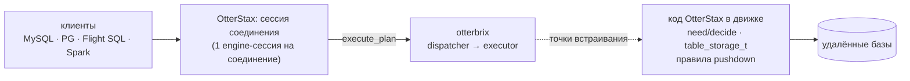
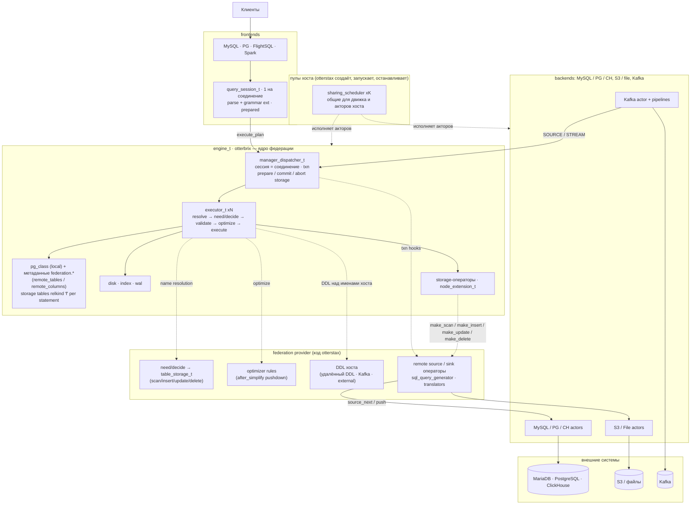

# Встраивание otterbrix в OtterStax: что ещё нужно от движка

> **Статус:** предложение, для обсуждения с мейнтейнерами otterbrix.
>
> **Кому:** мейнтейнерам otterbrix (engine, dispatcher, planner, executor, transformer). Просьбы к actor-zeta вынесены
> в отдельный документ [`actor-zeta.md`](actor-zeta.md); здесь о них — по абзацу там, где задача otterbrix от них
> зависит.
>
> **База:** ветка otterbrix `feat/otterstax-embedding` (`46fba865`). OtterStax уже перенесён на её API целиком: движок
> открыт через `open_engine` с хуками хоста, каждое соединение — своя engine-сессия, удалённые таблицы читаются и
> пишутся через `table_storage_t` и правило pushdown (рабочее дерево ветки OtterStax `docs/otterbrix-embedding-proposal`,
> не закоммичено; собрано на локальном пакете `1.0.0b2-embedding.46fba865` и actor-zeta `2.0.0`). Этот документ
> описывает только то, чего на ветке ещё нет. OtterStax потребляет otterbrix только по релизному тегу (OTB-tag).
>
> **Контракт хоста на ветке:** `docs/embedding-host-api.md` в репозитории otterbrix (в conan-пакете его нет; здесь
> он не пересказывается).
>
> Документ читается сам по себе: что такое OtterStax и как он встраивает движок — §1.1, словарь — §1.2. Код OtterStax
> знать не нужно: ссылки `otx:` только показывают, как хост обходится сейчас.

Нотация ссылок: `fe:<path>:<line>` — otterbrix на `46fba865` (`feat/otterstax-embedding`; проверено по исходникам
conan-пакета `1.0.0b2-embedding.46fba865`); `pr-677:<path>:<line>` — otterbrix PR #677 (голова `3acc4cbb`);
`az:<path>:<line>` — `header/actor-zeta/<path>` пакета actor-zeta `2.0.0` (только там, где задача otterbrix упирается
в поведение actor-zeta); `otx:<path>` — OtterStax, рабочее дерево (иллюстрация).

Номера issue и PR (`#663`, `#677` и т. д. — `otterbrix/otterbrix`; `actor-zeta#186`, `#187` —
`otterbrix/actor-zeta`) проверены через GitHub API 2026-10-12: все существуют и про то, что о них написано.

Для сведения: внутренний план работ OtterStax (этапы, пакеты работ WP) —
[`scheduler-to-otterbrix-migration.md`](scheduler-to-otterbrix-migration.md); ID задач в нём те же. Для понимания этого
документа он не нужен.

Как читать задачу: **проблема** (что на ветке, со ссылками) → **зачем нам** → **что OtterStax делает сейчас вместо**
→ **просим** → **критерии приёмки** → **что изменится у нас после**. Приоритеты:

- **P0** — без задачи нельзя закончить целевую архитектуру, или в OtterStax ради её отсутствия живёт временный путь;
- **P1** — важно, но OtterStax работает правильно без неё (или обход маленький и локальный);
- **P2** — по желанию.

---

## 1. Контекст

### 1.1 Что такое OtterStax и как он встраивает otterbrix

**OtterStax** — SQL-сервер федеративных запросов. Клиенты подключаются по протоколам MySQL, PostgreSQL, Arrow Flight
SQL и Spark Connect и пишут обычный SQL, в котором могут встречаться таблицы удалённых баз (MySQL / MariaDB,
PostgreSQL, ClickHouse). Удалённая таблица называется полным именем `uid.db.schema.table`, где `uid` — имя
подключения из конфигурации сервера (например, `sales.bill.public.orders`). Кроме удалённых, есть обычные таблицы,
которые хранит сам движок, и внешние источники (S3, файлы, Kafka).

Каждый statement выполняет **встроенный otterbrix**: OtterStax открывает движок в своём процессе (`open_engine`) и
отдаёт ему SQL каждого соединения. Чего движок не знает — удалённые таблицы, — он узнаёт у OtterStax через точки
встраивания, описанные в §1.4: разрешение имён (`need` / `decide`), хранилище (`table_storage_t`) с операторами
чтения и записи, правила оптимизатора (pushdown). Так JOIN удалённой таблицы с локальной, запрос к двум разным
удалённым базам и запись из одной базы в другую выполняются одним планом движка.



Сервер живёт долго и обслуживает много соединений одновременно; движок и акторы OtterStax работают в одном процессе
на пулах actor-zeta, которые создаёт OtterStax.

### 1.2 Словарь

| Термин | Что значит здесь |
|---|---|
| **хост** | программа, которая встраивает otterbrix, — здесь OtterStax |
| **uid** | имя подключения к удалённой базе из конфигурации OtterStax; первая часть 4-частного имени `uid.db.schema.table` |
| **бэкенд** | удалённая база (MySQL / MariaDB, PostgreSQL, ClickHouse), на которой OtterStax выполняет SQL |
| **storage-таблица** | таблица, которой владеет хост: движок узнаёт её через `decide` на один statement (relkind `'f'`) и читает / пишет через `table_storage_t` хоста |
| **federation** | служебная база OtterStax внутри движка: `federation.remote_tables`, `federation.remote_columns` — описания удалённых таблиц, которые читает `need` |
| **pushdown** | замена поддерева плана одним SQL-запросом к бэкенду (правило хоста + `node_extension_t`) |
| **sink** | оператор хоста, в который движок пишет строки (INSERT / UPDATE / DELETE в storage-таблицу) |
| **сессия OtterStax** | объект соединения клиента (`query_session_t`, актор actor-zeta): разбирает текст, держит prepared statements, шлёт планы в движок, ведёт по одному statement'у за раз |
| **engine-сессия** | `session_id_t` движка; у каждого соединения OtterStax своя |
| **этап, WP** | этапы и пакеты работ внутреннего плана OtterStax; в этом документе — только чтобы показать, какой шаг OtterStax ждёт какой задачи (§1.5) |
| **baseline** | замеры OtterStax на коммите `e150549`, до переноса выполнения на движок (запрос выполнял собственный планировщик OtterStax) |

### 1.3 Что уже сделано

**На ветке otterbrix** (из документа убрано): `open_engine`, `make_log`, конфигурация пула executor'ов, `need` /
`decide` + `table_storage_t`, правила оптимизатора по стадиям, `node_extension_t`, sink'и записи в storage,
`affected_rows()` в cursor, семантика транзакций PostgreSQL, round-robin выбор executor'а, actor-zeta 2.0, исправления
багов (в том числе агрегаты над константами, JOIN с пустой build-стороной — тест OtterStax `[engine-defect-d1]` зелёный).

Режим MySQL с откатом только упавшего statement'а (бывший OTB-txn-mode) больше не просим: OtterStax выбрал семантику
PostgreSQL для всех протоколов.

**На стороне OtterStax на этом API:**

- процесс собран в `main.cpp` из `runtime_t → remote_backends_t → engine_t` и локальных переменных после них (пулы и
  память → соединения с бэкендами → движок → акторы S3 / file / Kafka → фабрика сессий → серверы протоколов);
- одна engine-сессия на клиентское соединение; BEGIN / COMMIT / ROLLBACK над таблицами движка работают на всех
  протоколах с семантикой PostgreSQL;
- удалённые таблицы — строки базы `federation` в движке (`servers`, `remote_tables`, `remote_columns` с позицией
  колонки в первичном ключе); движок узнаёт их через `need` / `decide` как relkind `'f'` на один statement;
- блок запроса над одной удалённой таблицей уходит на бэкенд одним SQL правилом `after_simplify` и `node_extension_t`;
  JOIN, смешанные запросы и всё, что диалект не выражает, движок выполняет над `make_scan` и sink'ами;
- запись: `INSERT … VALUES` / `INSERT … SELECT` одной базы и простой UPDATE / DELETE — одним удалённым statement'ом;
  из локальной таблицы — через insert-sink; UPDATE / DELETE, которые решает движок, — построчно по первичному ключу;
- describe для prepare — план-only EXPLAIN движка;
- предзагрузка данных в `node_raw_data`, собственный каталог, зеркала таблиц, `Scheduler` / `Worker` удалены.

Временные пути OtterStax, которые держатся только из-за отсутствия задач ниже, описаны в самих задачах: у каждой есть
строка «что сейчас делаем вместо».

### 1.4 Модель встраивания на ветке (кратко)

Для OtterStax важно:

- **Открытие.** `open_engine(resource, schedulers, config, log, primitives)`; `primitives_t{optimizer_rules,
  name_resolution{need, decide}}` читается один раз и копируется в каждый executor
  (`fe:components/planner/host_hooks.hpp:84-93`).
- **Имена.** Если после каталога в statement'е остались неразрешённые имена, executor зовёт `need` (хост возвращает
  логические планы чтения своих таблиц — у нас `federation.remote_columns`), выполняет их в снимке statement'а, затем
  зовёт `decide`: на каждое имя `{columns, table_storage}` или «не моё» (`fe:services/collection/executor.cpp:515-552`;
  вызовы — `:521`, `:538`). Неразрешённое имя в SELECT приходит целиком, со слотом uid. Флаг `explicit_transaction`
  у `decide` = `!plan.commits_when_done` (`fe:services/collection/executor.cpp:538`), то есть он поднят и в явном
  `BEGIN`, и при `autocommit = off`.
- **Storage.** `table_storage_t` живёт один statement и строит операторы `make_scan` / `make_insert` / `make_update` /
  `make_delete`; `owner()` — тег хоста, по нему правило узнаёт свои таблицы
  (`fe:components/logical_plan/table_storage.hpp:30-61`). Транзакционных методов у него нет.
- **Pushdown.** Правило хоста (`optimizer_rule_t{stage, apply}`) получает только resource и дерево
  (`fe:components/planner/host_hooks.hpp:30-32`) и может заменить поддерево своим `node_extension_t`; оператор узла
  строит функция хоста при построении физического плана, с параметрами statement'а в контексте
  (`fe:components/physical_plan_generator/create_plan.cpp:202-220`).
- **Ограничения для хоста.**
  - Хуки — указатели на функции без состояния; их зовут с нескольких потоков executor'ов одновременно.
  - `need` / `decide` синхронные и не должны блокировать поток: схему удалённой таблицы OtterStax узнаёт заранее (на
    старте) или после ошибки «does not exist» с повтором statement'а.
  - Движок сам вызывает `start()` / `stop()` у переданных пулов (`fe:services/engine/engine.cpp:799-801`, `:854-856`) —
    OTB-embed-pools.
  - DDL до хоста не доходит (`fe:services/collection/executor.cpp:1100`) — OTB-storage-ddl.

### 1.5 Этапы OtterStax и что им нужно

Этапы — шаги переноса OtterStax на движок. Таблица показывает, какие задачи ниже блокируют какой шаг.

| Этап | Суть | Состояние у OtterStax | Нужно от otterbrix |
|---|---|---|---|
| 1 | перенос на API ветки: `open_engine`, прямой send в dispatcher, сессия на соединение, каталог `federation.*` | сделан в коде | **OTB-tag** (блокер), OTB-embed-pools, OTB-resolve-uid; желательно OTB-session, OTB-session-settings, OTB-txn-status, OTB-reply, OTB-cancel |
| 2 | полные сканы удалённых таблиц через `make_scan` | сделан | желательно OTB-notify |
| 3 | запись, pushdown, DDL, S3 / файлы / Kafka через движок | pushdown и запись (без транзакции) сделаны | **OTB-txn-storage**, **OTB-storage-ddl**, **OTB-dml-uid**; желательно OTB-describe, OTB-host-ctx, OTB-rule-params, OTB-sink-count, CTAS, OTB-sink-root |
| 4 | удаление старого пути | сделано, кроме S3 / файлов / Kafka | ничего нового |

---

## 2. Целевая схема



Пунктирные стрелки от движка — точки встраивания, которые реализует OtterStax. Сплошные — сообщения акторов. Из
пунктирных сейчас есть `name resolution`, `optimize` и `make_*`; нет `txn hooks` (OTB-txn-storage) и `DDL над именами
хоста` (OTB-storage-ddl), а пулы общие только после OTB-embed-pools.

---

## 3. Оставшиеся задачи

| ID | Суть | Приоритет | Этап OtterStax | Изменение в этой редакции |
|---|---|---|---|---|
| OTB-tag | релизный тег линии b2 с `feat/otterstax-embedding` в conan-remote | P0 | 1 (блокер) | уточнено: actor-zeta `2.0.0` в remote уже есть (проверено), нужен только тег otterbrix |
| OTB-txn-storage | хуки транзакций хранилищ (#663): prepare / commit / abort, которые ведёт dispatcher | P0 | 3 | уточнено: без них BEGIN не покрывает удалённые таблицы, а построчная запись не защищена от параллельного изменения неключевых колонок |
| OTB-storage-ddl | DDL над именами хоста отдаётся хосту | P0 | 3 | уточнено: сейчас удалённый DDL выполняет сессия напрямую |
| OTB-dml-uid | слот uid на цели INSERT / UPDATE / DELETE | P0 | 3 | **новая** |
| OTB-resolve-uid | баг G1: локальная таблица перехватывает имя с uid / schema | P0 | 1 | — |
| OTB-embed-pools | пулы создаёт, запускает и останавливает хост; `open_engine` без исключений; проверка `log_t` (#680, #686) | P0 | 1 | уточнено: actor-zeta#187 — use-after-free при уничтожении актора на живом пуле (от него зависит #680); перезапуск пула в actor-zeta отдельной issue не заведён |
| OTB-session | `close_session`: явное закрытие сессии движка | P1 (было P0) | 1 | понижено: ROLLBACK от хоста по исходникам снимает всё состояние сессии |
| OTB-session-settings | `SET` / `SHOW` на сессию (`autocommit`, `TIME ZONE`) без записи в `pg_settings`, таймаут простоя в транзакции | P1 (было в OTB-session, P0) | 1 | выделено из OTB-session; добавлены `SHOW` и «не сохранять после рестарта» |
| OTB-txn-status | статус транзакции сессии: idle / в блоке / провален | P1 | 1 | уточнено: OtterStax сейчас выводит его сам |
| OTB-cancel | отмена выполняющегося statement'а | P1 | 1 | **новая** |
| OTB-describe | схема результата и типы `$n` без выполнения | P1 (было P0) | 3 | понижено: план-only EXPLAIN закрыл основное |
| OTB-reply | OID созданного объекта в cursor; план из `(node, params)` без ручного копирования `catalog_resolves` | P1 | 1 | — |
| OTB-notify | циклы dispatcher'а / disk / WAL и `wait_ready` без опроса по таймеру (#693, этап 2) + параллельные build-стороны | P1 | 2 | уточнено: пробуждение по готовности future и парковка ждущего актора — просьбы к actor-zeta (#186 и продолжение), вынесены в `actor-zeta.md`; здесь — часть otterbrix |
| OTB-host-ctx | контекст statement'а (сессия, транзакция, настройки) в `need` / `decide` / правилах | P1 | 3 | уточнено: закрепление соединения теперь появится только вместе с OTB-txn-storage |
| OTB-rule-params | параметры statement'а в правиле оптимизатора или «спланируй поддерево» как часть API хоста | P1 | 3 | **новая** |
| OTB-sink-count | счётчик записи DML с storage-sink'ом — у sink'а | P1 | 3 | **новая** |
| CTAS | `CREATE TABLE … AS SELECT` (#675) | P1 | 3 | — |
| OTB-sink-root | корень statement'а — sink без таблицы (`COPY (…) TO`) | P1 | 3 | — |
| OTB-null-operand | оператор без операнда (`SELECT ? + 1`) роняет процесс по SIGSEGV в трансляторе | P1 | 1 | **новая** |
| OTB-select-param | `SELECT $1` без типа: `bad_variant_access` в валидаторе, клиент получает `interrupted`; исключения не ловятся на границе statement'а | P1 | 1 | уточнено: исключение, поднявшееся из executor'а, пропускает `finish_failed_statement_` dispatcher'а |
| OTB-hash-join-cast | приведение ключей к общему типу отключает hash join, JOIN становится nested-loop | P1 | 2 | **новая** |
| OTB-order-qualifier | ORDER BY над группой ищет ключ среди выходов по имени без квалификатора: `ORDER BY o.name` сортирует по `c.name`; скрытый ключ сортировки приходит клиенту лишним столбцом | P1 | 1 | **новая** |
| OTB-order-alias | ORDER BY по псевдониму выхода в блоке без группы (`SELECT a + 1 AS x … ORDER BY x`) — ошибка `path: 'x' was not found` | P1 | 1 | **новая** |
| OTB-numeric-literal | число, за которым сразу идут буквы, разбирается как число и псевдоним: `SELECT 0x41` → столбец `x41` со значением 0 | P1 | 1 | **новая** |
| OTB-savepoint | SAVEPOINT / RELEASE / ROLLBACK TO | P2 | 1 | **новая** |
| OTB-struct-eq | `complex_logical_type::operator==` не сравнивает имена полей STRUCT | P2 | — | **новая** |
| OTB-alter-if-not-exists | `ALTER TABLE … ADD COLUMN IF NOT EXISTS` | P2 | — | **новая** |
| OTB-implicit-cast | признак «приведение вставил движок, а не пользователь» у выражения приведения | P2 | 3 | **новая** |
| OTB-block-uninit | неинициализированные байты в блоке, который пишет `checksum_and_write` (Valgrind) | P2 | — | **новая** |
| OTB-decimal-cast | `logical_value_t::cast_as` не приводит DECIMAL к DECIMAL другой ширины / масштаба и молча отвечает NULL | P2 | 3 | **новая** |
| OTB-bytes-literal | байтовый литерал (`X'..'` или `'\x..'::bytea`), приведение строки к BLOB и физический тип у BLOB | P2 | 1 | **новая** |
| OTB-nul-text | байт 0 в тексте запроса или в литерале (`E'a\000b'`) молча обрезает текст или значение | P2 | 1 | **новая** |
| OTB-eviction-queue | очереди вытеснения буферного пула копят до ~37 тыс. мёртвых узлов каждая (порог `purge` — 32 768), freelist boost их не отдаёт: ~30 МБ, которые сервер держит без нагрузки | P2 | — | **новая** |
| OTB-scalar-subquery-type | describe statement'а с `$n` отвечает колонку скалярного подзапроса в списке выборки типом NA | P2 | 3 | **новая** |
| OTB-pushdown-offers | структурированные pushdown-предложения на `table_storage_t` (#695) | P2 | 3 | — |
| OTB-sink-flush | порог flush'а storage-sink'а на statement | P2 | 3 | — |
| OTB-sched-load | выбор executor'а по нагрузке (по желанию) | P2 | — | — |
| Позже | PREPARE (#682), streaming cursor (#683), STREAM/SOURCE (#684) | P2 | — | — |

Из списка ничего не убрано: база та же (`46fba865`), сделанных с прошлой редакции задач нет. OTB-session разделён на две задачи (закрытие сессии и настройки на сессию). По итогам проверки в Docker добавлены четыре задачи: OTB-null-operand, OTB-select-param, OTB-hash-join-cast (P1) и OTB-block-uninit (P2); по сверке `conform_to_result` с исходниками otterbrix — OTB-decimal-cast (P2). По ошибкам, найденным при исправлениях
фронтендов, добавлены ещё пять: OTB-order-qualifier, OTB-order-alias, OTB-numeric-literal (P1), OTB-bytes-literal и
OTB-nul-text (P2); каждая проверена по исходникам и запуском на сервере OtterStax с движком `46fba865`. По замеру памяти сервера под
Flight SQL добавлена OTB-eviction-queue (P2): проверена профилем кучи и по исходникам. Когда OtterStax убрал из сессии свой
describe скалярных подзапросов, добавлена OTB-scalar-subquery-type (P2): проверена по исходникам. Просьбы к actor-zeta (пробуждение
по готовности future, уничтожение актора на живом пуле, перезапуск пула, доступ к исключению) вынесены в
[`actor-zeta.md`](actor-zeta.md); задачи otterbrix, которые от них зависят, говорят об этом своим абзацем.

---

## 4. Задачи

### 4.1 OTB-tag — релизный тег с ветки (P0)

**Проблема.** OtterStax потребляет otterbrix только по тегу из conan-remote `https://conan.otterbrix.com`, запиненному
по ревизии рецепта (`otx:conanfile.py:57`). Всё из §1.4 есть только на `feat/otterstax-embedding`.

**Что сейчас делаем вместо.** Собираемся на локальном пакете `1.0.0b2-embedding.46fba865`; Docker-образы собирают
otterbrix из архива рецептов (`otx:scripts/conan/export_local_packages.sh`), actor-zeta берут из remote. CI собрать это
не может: архива otterbrix в чистом checkout нет.

**Зависит от actor-zeta: уже выполнено.** actor-zeta `2.0.0`, которого требует ветка, в remote уже есть: `conan search`
по `conan.otterbrix.com` показывает `actor-zeta/2.0.0#887bc992…` (загружен 2026-09-24, бинарь Linux x86_64 gcc 13
Release, остальные конфигурации собираются из рецепта); проверено 2026-10-12. Подробнее — `actor-zeta.md`, AZ-release.

**Просим.** Влить ветку и выпустить тег линии `1.0.0b2-*`, требующий `actor-zeta/2.0.0`. Ветку лучше влить раньше PR
#677: он ответвлён до работ по встраиванию, пробное слияние `46fba865` с `pr-677` даёт конфликты в 72 файлах. Почему
порядок важен для транзакций — в OTB-txn-storage.

**Критерии приёмки.** OtterStax собирается с `otterbrix/<tag>` и `actor-zeta/2.0.0` из remote.

**Что изменится у нас.** Удаляются `scripts/conan/`, `.conan-local/` и сборка рецептов в Dockerfile; CI снова
собирает образы; закрывается последний пункт критериев готовности этапа 1.

**Зависимости:** нет.

### 4.2 OTB-txn-storage — хуки транзакций хранилищ (#663) (P0)

**Проблема (на ветке)**
- У `table_storage_t` есть только `owner()` и `make_*` (`fe:components/logical_plan/table_storage.hpp:30-61`); в
  `primitives_t` — только правила и `need` / `decide` (`fe:components/planner/host_hooks.hpp:84-93`). Места, где
  движок сообщает хосту «транзакция сессии фиксируется / откатывается», нет: COMMIT и ROLLBACK dispatcher'а трогают
  только диапазоны движка и `txn_manager_` (`fe:services/dispatcher/dispatcher.cpp:1156-1184`, `:1212-1219`,
  `:1268-1275`).
- `decide` узнаёт о транзакции только флагом и решает сам; комментарий так и говорит: «ROLLBACK does not undo what the
  storage wrote (#663)» (`fe:components/planner/host_hooks.hpp:56-62`).
- UPDATE / DELETE, чей sink сбрасывается посреди скана (`dml_flush_row_threshold`,
  `fe:services/collection/executor.cpp:2425-2440`), может остаться записанным наполовину, если поздний раунд упал.
- Запись в storage идёт мимо WAL, индексов и MVCC движка, так что изоляция движка её не покрывает.

**Зачем нам.** Без хуков `BEGIN … ROLLBACK` не откатывает запись в MySQL / PostgreSQL: транзакция клиента покрывает
только таблицы движка.

Вторая причина — построчные UPDATE / DELETE удалённой таблицы, которые движок не смог отдать бэкенду одним
statement'ом. Движок читает строки сканом, затем storage меняет каждую по первичному ключу
(`otx:otterbrix/federation/remote_storage.cpp`). Между чтением и записью проходит время, и проверить, что строка за это
время не изменилась, без транзакции нельзя:
- удаление строки и смена её ключа ловятся: оператор затрагивает 0 строк, и storage отвечает `write_conflict`;
- изменение неключевых колонок другим клиентом не ловится: наш UPDATE перезаписывает его значения (lost update).

Закрыть это можно только внутри транзакции бэкенда, которая охватывает и скан, и запись: читать с `SELECT … FOR UPDATE`
или сравнивать при записи прочитанные значения неключевых колонок. И то и другое требует, чтобы скан и запись шли на
одном соединении в одной транзакции — именно это дают хуки.

**Что сейчас делаем вместо.** Запись в удалённую таблицу внутри `BEGIN` фиксируется на бэкенде сразу (в autocommit
бэкенда), так же — построчные UPDATE / DELETE. Код закрепления соединения бэкенда за транзакцией
(`connectors/common/lease_registry`), написанный заранее, удалён: напишем заново под эти хуки, чтобы его форма
следовала контракту otterbrix, а не догадке о нём.

**Что нужно (итоговый дизайн)**
1. **Ведёт dispatcher.** Транзакцию storage открывает первая запись в него внутри транзакции сессии (явной или
   statement-scope при autocommit); dispatcher завершает её на COMMIT, ROLLBACK, ошибке statement'а и закрытии
   сессии (OTB-session).
2. **Три фазы с самого начала.** Все асинхронные (future), с ключом `(session, transaction_id)`:
   - `prepare` — может отказать; вызывается до WAL commit marker'а. Отказ превращает COMMIT в ROLLBACK с ошибкой
     storage.
   - `commit` — после marker'а; отказать уже не может (что делать с его ошибкой — открытый вопрос, §5).
   - `abort` — ровно один раз: ROLLBACK, упавший statement в явной транзакции (до перевода сессии в
     `failed_sessions_`), отказ на commit, закрытие сессии, таймаут простоя.
3. **Пока одна цель записи на транзакцию.** Каждый сервер storage — отдельная цель. Запись во вторую цель движок
   отклоняет понятной ошибкой, и транзакция переходит в aborted (семантика PG). Это правило Trino: транзакция пишет в
   один каталог. Читать можно откуда угодно.
4. **Позже — несколько целей через двухфазный коммит** на тех же хуках: `prepare` = MySQL `XA PREPARE` / PostgreSQL
   `PREPARE TRANSACTION`, `commit` = `XA COMMIT` / `COMMIT PREPARED`, `abort` = `XA ROLLBACK` / `ROLLBACK PREPARED`.
   Сигнатуры хуков для этого не меняются.
5. **Конфликты.** Serialization failure или deadlock удалённой СУБД storage возвращает как `write_conflict`
   (`fe:core/result_wrapper.hpp:66`) — тем же кодом #677 сообщает о локальных конфликтах. Движок доносит код до
   cursor'а без изменений, фронтенды OtterStax отдают его как SQLSTATE `40001`.

**Связь с PR #677.** #677 («Concurrent transactions») добавляет snapshot isolation, конфликты записи и повторную
проверку ограничений при commit только для таблиц движка; storage-хуков в нём нет (PR ответвлён до встраивания). Но
его COMMIT уже устроен так, как нужно: фаза, которая может отказать до WAL marker'а
(`pr-677:components/physical_plan/operators/operator_commit_transaction.cpp:74-100`), WAL marker — последний шаг, который
может упасть (`:195-213`), единая точка отката `refuse_` → `revert_transaction`
(`pr-677:components/physical_plan/operators/transaction_teardown.cpp:31-60`). Предлагаем: `prepare` storage — в фазу
отказа перед WAL marker'ом, `abort` — в `refuse_` / `revert_transaction`, `commit` — после marker'а. Порядок слияния:
ветка встраивания (OTB-tag), потом #677, потом хуки.

**Критерии приёмки**
- `BEGIN; INSERT INTO remote …; ROLLBACK` → тестовый storage видит один `abort`, ни одного `commit`.
- `prepare` с отказом → COMMIT отвечает ошибкой storage, локальные записи откатаны, `abort` вызван один раз.
- Отказ WAL после `prepare` → `abort`, не `commit`.
- Упавший statement в явной транзакции → один `abort`; последующий ROLLBACK второй раз его не вызывает.
- UPDATE с промежуточным flush'ем и ошибкой во втором раунде → `abort`, частичной записи у тестового storage нет.
- Запись в две цели в одной транзакции → отказ на второй.
- `write_conflict` из storage → в cursor'е `write_conflict`.
- Скан и sink одного statement'а внутри транзакции получают один и тот же ключ `(session, transaction_id)`, так что
  storage может выполнить их на одном соединении бэкенда.

**Что изменится у нас.** Удалённая запись идёт в транзакции клиента: соединение бэкенда закрепляется за транзакцией
при первой записи (пишем заново), BEGIN / COMMIT / ROLLBACK бэкенда — из хуков; ClickHouse отказывает в `prepare`.
Уходит временный путь «запись внутри BEGIN фиксируется сразу». Построчный UPDATE / DELETE идёт в транзакции бэкенда:
скан читает строки с блокировкой (`FOR UPDATE`), запись — на том же соединении, и lost update по неключевым колонкам
исчезает.

**Зависимости:** OTB-tag (слияние до #677); OTB-host-ctx (хукам нужна сессия).

### 4.3 OTB-storage-ddl — DDL над именами хоста (P0)

**Проблема (на ветке)**
- Хосту отдаются только имена statement'ов без DDL: `host_resolves_names = !needs_ddl_txn || create_view`
  (`fe:services/collection/executor.cpp:1100`), где `needs_ddl_txn` — CREATE TABLE / CONSTRAINT / SEQUENCE / VIEW /
  MACRO / TYPE / INDEX / DATABASE, DROP, ALTER TABLE (`:975-980`). `CREATE TABLE m2.shop.t …`, `DROP TABLE …`,
  `ALTER TABLE …` над удалённым именем либо выполняется как локальный DDL (если имя совпало с локальным — OTB-resolve-uid),
  либо отклоняется.
- Собственный DDL хоста движку некуда передать: узла «DDL хоста» нет, а `node_extension_t` валидатор не знает
  (ветка `default` — `fe:services/dispatcher/validate_logical_plan.cpp:2541-2545`).

**Зачем нам.** Удалённый DDL, Kafka `CREATE / DROP SOURCE | STREAM` и регистрация external tables должны идти тем же
путём, что всё остальное, — через движок, в транзакции сессии, вместе с записью метаданных `federation.*`.

**Что сейчас делаем вместо.** Сессия сама узнаёт удалённую цель `CREATE` / `DROP TABLE`, `CREATE` / `DROP INDEX` по
разобранному имени, генерирует DDL в диалекте бэкенда, выполняет его на бэкенде (вне транзакции клиента) и затем
обновляет `federation.*` (`otx:session/query_session.cpp`, `execute_ddl`). `ALTER TABLE` над удалённым именем не
поддержан. Kafka DDL и external tables — прямые вызовы акторов из сессии.

**Просим.** Движок отдаёт хосту DDL над именами, которыми владеет хост: CREATE / DROP / ALTER над именем, которое
каталог не разрешил (или по зарегистрированному префиксу uid), и DDL хоста из его parser extension. Хост отвечает
оператором, выполняющим DDL, или «не моё». DDL идёт в транзакции сессии, так что хост может записать свои метаданные
в той же транзакции.

**Критерии приёмки**
- `CREATE TABLE m2.shop.t (…)` / `DROP TABLE m2.shop.t` / `ALTER TABLE m2.shop.t …` доходят до хука хоста с полным
  именем; локальный каталог не меняется.
- DDL из parser extension выполняется оператором хоста; ошибка хоста приходит в cursor как есть.
- DDL над локальным именем хост не видит.
- ROLLBACK явной транзакции откатывает записи хоста в его таблицы, сделанные этим DDL.

**Что изменится у нас.** Из сессии уходят разбор удалённой цели DDL и прямой вызов `execute_ddl`; появляется
`ALTER TABLE` над удалённой таблицей; Kafka DDL и external tables переходят в движок (вместе с CTAS и OTB-sink-root).

**Зависимости:** OTB-resolve-uid (чтобы чужое имя не стало локальным DDL).

### 4.4 OTB-dml-uid — слот uid на цели INSERT / UPDATE / DELETE (P0, новая)

**Проблема (на ветке)**
- Цели INSERT / UPDATE / DELETE транслятор ставит через `set_target(..., target_slots::relation_with_schema)`
  (`fe:components/sql/transformer/impl/transform_insert.cpp:590`, `:600`; `transform_update.cpp:92`;
  `transform_delete.cpp:29`, `:74`). `set_target` копирует на узел только базу, схему и имя; слот uid на узел не
  попадает, а имя с uid записывается в `catalog_resolves_.external_targets`
  (`fe:components/sql/transformer/transformer.hpp:425-443`).
- `enrich_plan` безусловно отклоняет такие цели: «names a uid or schema segment, which this catalog has no place for»
  (`fe:services/dispatcher/enrich_logical_plan.cpp:613-620`, `:1269-1288`, вызов `:1299`). У SELECT, для сравнения,
  имя остаётся на узле целиком (`fe:components/sql/transformer/impl/transform_select.cpp:147-168`).
- Тестов на цель DML из 4 частей на ветке нет.

**Зачем нам.** Федеративное имя OtterStax — `uid.db.schema.table`. Запись по такому имени должна идти тем же путём,
что чтение: `need` / `decide` → storage → правило pushdown или sink.

**Что сейчас делаем вместо.** Цель из 3 частей (`uid.db.table`, движок читает её как `database.schema.table`) доходит до
федерации и работает полностью. Цель из 4 частей сессия перехватывает до движка: генерирует statement в диалекте
бэкенда и выполняет его напрямую (`otx:session/query_session.cpp`, `run_remote_dml`); источник с другого сервера или
локальный — отказ; `RETURNING` — отказ (бэкенд отвечает только числом строк).

**Просим.** Транслятор сохраняет слот uid на цели INSERT / UPDATE / DELETE (как у SELECT), а такая цель, не
разрешённая каталогом, идёт хосту через `need` / `decide`; отказ — только если хост ответил «не моё».

**Критерии приёмки**
- `INSERT INTO sales.bill.public.orders VALUES (…)`, `UPDATE sales.bill.public.orders SET …`,
  `DELETE FROM sales.bill.public.orders WHERE …` доходят до `decide` с полным именем и пишут через storage.
- `RETURNING` над такой целью работает через движок.
- Хост ответил «не моё» → прежняя ошибка про uid-сегмент.

**Что изменится у нас.** Удаляется `run_remote_dml` и поле `dml_target` парсера; `RETURNING` по 4-частной цели
начинает работать; источник любого вида (локальный, другой сервер) — как у 3-частной цели.

**Зависимости:** нет (с OTB-resolve-uid — чтобы локальная таблица не перехватила цель).

### 4.5 OTB-resolve-uid — локальная таблица перехватывает чужое имя (баг G1) (P0)

**Проблема (на ветке)**
- Грамматика раскладывает имя так: 3 части — `database.schema.name`, 4 части — `uid.database.schema.name`; в запросе
  на разрешение лежат все слоты (`fe:components/logical_plan/node_catalog_resolve.hpp:103-107`).
- Каталог ищет таблицу только по `(database, relation)`: `operator_resolve_table_t` читает только `dbname` и `relname`
  (`fe:components/physical_plan/operators/operator_resolve_table.cpp:115-159`); `table_md(dbname, relname)` тоже
  (`fe:components/logical_plan/node_catalog_resolve.cpp:167`). Заголовок говорит это прямо: «The catalog looks a table up
  by database.name only».
- Хосту уходят только имена без `table_md` (`fe:services/dispatcher/enrich_logical_plan.cpp:690-704`).
- Итог: локальная `bill.orders` молча отвечает на `sales.bill.public.orders` локальными строками; локальная
  `sales.orders` перехватывает `sales.bill.orders`, после чего statement отклоняется из-за слота schema, а хост имени
  не видит.

**Зачем нам.** Запрос к удалённому серверу не должен без ошибки возвращать чужие (локальные) данные.

**Что сейчас делаем вместо.** Пользовательский DDL над базой с именем подключения отклоняется (`otx:catalog/ownership.*`);
база-зеркало старой версии удаляется на старте. Не закрыто: пользовательская база с именем удалённой базы
(`CREATE DATABASE bill`) перехватывает имя. Закреплено скрытым тестом `[.engine-defect-uid-capture]`
(`otx:tests/federation/test_federation_engine.cpp`).

**Просим.** Имя, чьи дополнительные квалификаторы (uid, schema) не совпадают с локальной relation, остаётся
неразрешённым и идёт хосту через `need` / `decide`. Если хост ответил «не моё», ошибка та же, что сейчас.

**Критерии приёмки**
- Локальная `bill.orders` есть; `SELECT … FROM sales.bill.public.orders` доходит до `need` / `decide` целиком; при «не
  моё» — «does not exist», локальные строки не возвращаются.
- Локальная `sales.orders` есть; `sales.bill.orders` доходит до хоста.
- `bill.orders` и `orders` по-прежнему разрешаются локально, хост не вызывается.

**Что изменится у нас.** Снимаем точку со скрытого теста; ограничение «база с именем удалённой базы» уходит из
документации.

**Зависимости:** нет.

### 4.6 OTB-embed-pools — пулы принадлежат хосту (#680, #686) (P0)

**Проблема (на ветке)**
- Контракт: «The host owns the pools … the engine starts them when it opens and stops each exactly once while shutting
  down» (`fe:services/engine/engine.hpp:19-25`); `open_engine` вызывает `start()` у трёх пулов
  (`fe:services/engine/engine.cpp:799-801`), shutdown — `stop()` (`:854-856`). Пул, общий с акторами хоста, передать
  нельзя: движок остановит его под ними; один пул на три роли движок запустил бы трижды.
- Уничтожить своих акторов, не останавливая пулы, движок сейчас не может: в actor-zeta это use-after-free (абзац
  «Зависит от actor-zeta» ниже). Остановка пулов до смерти акторов (`fe:services/engine/engine.cpp:854-856`) — то, что
  сейчас эту ошибку обходит.
- В `fe:services/engine/engine.cpp` нет ни одного `try` / `catch`: `std::bad_alloc` и `std::system_error` из создания
  частей движка и потоков выходят из `open_engine` исключением.
- `log_t::is_valid()` есть (`fe:components/log/log.hpp:32`), но `open_engine` её не зовёт, а одноаргументные помощники
  лога разыменовывают логгер без проверки. Указатели пулов тоже не проверяются.
- `_sync`-методы bootstrap'а публичны, хотя легальны только до запуска акторов (#686).

**Зачем нам.** Решение OtterStax: пулы создаёт, запускает и останавливает хост, движок и акторы хоста делят их
(число потоков задаёт одна конфигурация).

**Что сейчас делаем вместо.** `runtime_t` держит отдельные пулы сессий и бэкендов (их запускает сам) и три пула
движка, которые только создаёт и «одалживает» одному движку: их запускает и останавливает движок, второй движок
требует второго `runtime_t` (`otx:runtime/runtime.hpp`). `engine_t::open` сам ловит исключения `open_engine` и
проверяет `log_t`, чтобы вернуть пулы незапущенными.

**Что нужно**
1. Пулы создаёт, настраивает, запускает и останавливает хост; движок только спавнит на них своих акторов. Один и тот же
   пул можно передать на все роли `schedulers_t`.
2. Shutdown движка останавливает только своих акторов (fence, финальный CHECKPOINT, пока пулы работают, дождаться своих
   fire-and-forget отправок, снять акторов). Это #680.
3. `open_engine` возвращает ошибку вместо исключения; частично собранный движок разбирается, пулы хоста не трогаются.
4. `open_engine` проверяет аргументы: пустой `log_t` и нулевой указатель пула — `invalid_parameter`.
5. `_sync`-методы — непубличные (friend `open_engine`), #686.

**Зависит от actor-zeta.** Пункт 2 требует, чтобы актора можно было уничтожить, пока его задача ещё стоит в очереди
работающего пула. В actor-zeta `2.0.0` это use-after-free: задача держит сырой указатель на актора, а деструктор
`cooperative_actor` не ждёт бита `scheduled` (actor-zeta#187, открыт; #680 прямо от него зависит). Отдельно: пул
actor-zeta `2.0.0` нельзя перезапустить и нельзя остановить, не запустив (`stop()` у незапущенного пула индексирует
пустой вектор, повторный `stop()` зависает, `start()` после `stop()` поднимает 2N потоков —
`az:scheduler/scheduler.hpp:39-106`); issue на это не заведено. Для этой задачи перезапуск не обязателен — движок
просто перестаёт вызывать `start()` / `stop()`, — но без него хост вынужден сам помнить состояние каждого пула.
Подробно, с критериями приёмки, — `actor-zeta.md`, AZ-teardown и AZ-pool-lifecycle.

**Критерии приёмки**
- Движок открыт на одном пуле хоста, на котором работают и акторы хоста; после закрытия движка акторы хоста продолжают
  работать; движок открывается снова на тех же пулах.
- Движок уничтожается посреди авто-чекпоинта, пулы работают ещё ≥ 1 с: ASAN / TSAN чисты.
- Отказ создания потока или выделения памяти — `open_engine` возвращает ошибку, потоков движка не остаётся.
- `open_engine` с пустым `log_t` возвращает `invalid_parameter`.

**Что изменится у нас.** `runtime_t` теряет состояние «одолжены / израсходованы» и отдельные пулы движка; один набор
пулов на процесс; из `engine_t::open` уходят `try` / `catch` и проверка лога.

**Зависимости:** actor-zeta#187 (через #680).

### 4.7 OTB-session — закрытие сессии движка (P1, было P0)

**Проблема (на ветке)**
- API закрытия сессии нет (в `services/`, `components/`, `integration/`, `core/` нет `close_session` и похожего). Своя
  C++-обёртка otterbrix закрывает соединение просто statement'ом `ROLLBACK;`
  (`fe:integration/cpp/connection.cpp:28-35`).
- Состояние по id сессии — `session_order_`, `failed_sessions_` и открытая транзакция в `txn_manager_`
  (`fe:services/dispatcher/dispatcher.hpp:269-271`). ROLLBACK снимает его всё: транзакцию и отметку failed
  (`fe:services/dispatcher/dispatcher.cpp:982-989`), очередь — когда statement'ов нет (`:1133-1136`). Без ROLLBACK
  открытая транзакция живёт вечно и держит горизонт MVCC.

**Поправка к прошлой редакции.** Утверждение «после ROLLBACK при закрытии в движке остаётся учёт id сессии» по
исходникам не подтверждается: после успешного ROLLBACK по id сессии в движке ничего не остаётся. Поэтому задача
понижена до P1.

**Зачем нам.** Явное, идемпотентное закрытие, которому не нужна очередь statement'ов сессии: закрыть сессию, когда
на ней ещё что-то выполняется или когда пул сессий уже остановлен, и (после OTB-txn-storage) гарантированно вызвать
`abort` хранилищ.

**Что сейчас делаем вместо.** `query_session_t::close()` ставит в очередь `end_session`, который шлёт ROLLBACK, если
блок открыт (`otx:session/query_session.cpp`). Не откатывается сессия, чью задачу выбросил остановленный пул при
shutdown; движок в этот момент тоже закрывается, так что незафиксированная транзакция теряется вместе с ним.

**Предложение / API sketch**
```cpp
unique_future<void> close_session(session_id_t session);
// ROLLBACK of the open transaction (storage abort included, OTB-txn-storage), drop the failed_sessions_ entry and
// the session queue. Idempotent. Statements still queued for the session get an error.
```

**Критерии приёмки**
- `BEGIN; INSERT …;` → `close_session` → строка не видна, горизонт продвигается.
- `BEGIN; INSERT INTO <storage-таблица> …;` → `close_session` → storage получает `abort` ровно один раз.
- `close_session` неизвестной или закрытой сессии — no-op; statement в очереди получает ошибку.

**Что изменится у нас.** `end_session` заменяется одним вызовом `close_session` из `close()`; закрытие не зависит от
очереди сессии.

**Зависимости:** нет (abort storage — когда будет OTB-txn-storage).

### 4.8 OTB-session-settings — настройки на сессию и таймаут простоя (P1)

**Проблема (на ветке)**
- Настройки глобальные: `// TODO: settings for the session`, `session_settings(session)` возвращает
  `default_settings_` (`fe:services/dispatcher/dispatcher.hpp:276-283`); `SET` меняет глобальный кэш для всех сессий
  (`fe:services/dispatcher/dispatcher.cpp:476-492`). По `autocommit` выбирается scope транзакции (`:991-992`), так
  что `SET autocommit = 0` в одной сессии меняет поведение всех.
- Таймаутов (`idle_in_transaction`, `statement_timeout`, `lock_timeout`) нет.

**Зачем нам.** MySQL-клиенты шлют `SET autocommit = 0` сразу после подключения; часовой пояс — настройка соединения.
Открытая и брошенная транзакция должна откатываться сама.

- Принятый `SET` пишется в `pg_settings` и переживает рестарт движка.
- `SHOW` транслятор не поддерживает: драйверы, которые шлют его при подключении (например,
  `SHOW transaction_isolation`), получают ошибку, а внутри транзакции она проваливает блок.

**Зачем нам.** MySQL-клиенты шлют `SET autocommit = 0` сразу после подключения; часовой пояс — настройка соединения.
Открытая и брошенная транзакция должна откатываться сама.

**Что сейчас делаем вместо.** Сессия OtterStax не пускает в движок ни один `SET` / `RESET` (любой параметр, на всех
протоколах) и отвечает OK без эффекта (`otx:session/statement_kind.{hpp,cpp}`, `is_setting_statement`), иначе
настройка одного клиента поменялась бы у всех и сохранилась бы после рестарта. Открытый блок такой `SET` не
проваливает. `SHOW` уходит в движок и получает ошибку. Таймаута простоя нет; Spark закрывает сессию после
`session_timeout_s` без запросов (это откатывает её блок).

**Просим.** `session_settings(session)` — настройки сессии или значения по умолчанию; `SET` / `RESET` меняют только
свою сессию и не пишутся в `pg_settings` (сохранять значение по умолчанию — отдельная команда, аналог
`ALTER SYSTEM`). `SHOW <параметр>` отдаёт значение сессии. Таймаут простоя в транзакции: dispatcher откатывает (с
`abort` storage) транзакцию сессии, у которой нет statement'ов дольше порога, с отдельным кодом ошибки (аналог
`idle_in_transaction_session_timeout` в PG).

**Критерии приёмки**
- `SET TIME ZONE` и `SET autocommit = off` в сессии A не меняют поведение сессии B.
- После `SET` и рестарта движка значение по умолчанию прежнее.
- `SHOW timezone` в сессии A после `SET TIME ZONE` в A отдаёт новое значение, в сессии B — старое.
- Таймаут 100 мс: `BEGIN; INSERT` → пауза 200 мс → следующий statement получает ошибку таймаута, данных нет.

**Что изменится у нас.** Фильтр `SET` в сессии удаляется: `SET` уходит в движок и начинает действовать; `SHOW`
отвечает; часовой пояс сессии виден правилу pushdown (через OTB-host-ctx).

**Зависимости:** нет.

### 4.9 OTB-txn-status — статус транзакции сессии (P1)

**Проблема (на ветке).** Внутри dispatcher'а статус известен (открытая транзакция в `txn_manager_`, упавшая — в
`failed_sessions_`), наружу не отдаётся: в cursor'е только данные, ошибка, `affected_rows()` / `is_write()`
(`fe:components/cursor/cursor.hpp:22-75`); запроса статуса у dispatcher'а нет (`fe:services/dispatcher/dispatcher.hpp:149-166`).

**Зачем нам.** PostgreSQL `ReadyForQuery` несёт статус `I` / `T` / `E`; MySQL-фронтенду нужно отличать COMMIT
провалившегося блока; Flight SQL отклоняет оставленный открытым BEGIN.

**Что сейчас делаем вместо.** Сессия повторяет правила dispatcher'а чистой функцией (`otx:session/transaction_state.hpp`,
`next_transaction_state`) по виду каждого statement'а и его исходу. Это дублирование логики движка: любое изменение
правил в otterbrix надо повторить у нас.

**Просим.** Статус транзакции сессии после каждого statement'а: поле cursor'а `transaction_status()` с
`{idle, in_transaction, failed}` (или запрос к dispatcher'у по session id).

**Критерии приёмки.** `SELECT 1` → idle; `BEGIN` → in_transaction; ошибка внутри → failed; `ROLLBACK` → idle; при
`autocommit = off` (OTB-session-settings) первый statement → in_transaction.

**Что изменится у нас.** Удаляется `transaction_state.hpp`; статус берётся из ответа движка.

**Зависимости:** нет.

### 4.10 OTB-cancel — отмена выполняющегося statement'а (P1, новая)

**Проблема (на ветке).** API отмены нет: по `cancel` / `interrupt` / `kill` в `services/`, `components/`,
`integration/cpp` находятся только комментарии про отмену в ящике актора индекса. Ближайшее — `begin_shutdown`,
который отклоняет новые statement'ы (`fe:services/dispatcher/dispatcher.cpp:446-451`).

**Зачем нам.** Таймаут ожидания у фронтенда, PG `CancelRequest`, Spark `Interrupt` должны останавливать statement, а
не только перестать его ждать: иначе он держит executor и соединение бэкенда до конца.

**Что сейчас делаем вместо.** Statement, у которого истёк таймаут ожидания, выполняется до конца. Внутри явной
транзакции фронтенд проваливает блок (`query_session_t::fail_transaction`), чтобы COMMIT не зафиксировал то, что
клиенту назвали отменённым; вне блока autocommit-statement фиксируется сам.

**Просим.** `cancel_statement(session)` (или по id statement'а): executor прекращает pump, закрывает операторы
(в том числе storage-операторы хоста), statement отвечает ошибкой отмены; внутри явной транзакции блок становится
failed, как при любой ошибке.

**Критерии приёмки.** Долгий скан storage-таблицы с задержкой отменяется за время одной порции; оператор хоста
получает закрытие; следующий statement сессии выполняется; внутри блока — failed до ROLLBACK.

**Что изменится у нас.** Таймауты фронтендов, PG `CancelRequest` и Spark `Interrupt` отменяют statement; обход через
`fail_transaction` при таймауте уходит.

**Зависимости:** нет.

### 4.11 OTB-describe — схема результата без выполнения (P1, было P0)

**Проблема (на ветке).** У `explain_type` три значения: `none`, `plan`, `analyze`
(`fe:components/logical_plan/execution_plan.hpp:41-46`); режима describe нет. План-only EXPLAIN — полный statement:
имена разрешаются (с `need` / `decide`), строится физический план (`fe:services/collection/executor.cpp:304-317`); при
этом узлы плана переписываются на месте (правила оптимизатора).

**Почему понижено.** OtterStax описывает statement план-only EXPLAIN'ом: удалённые колонки берутся из
`federation.remote_columns`, бэкенд не спрашивается, типы — типы движка. Это закрыло основной случай.

**Что сейчас делаем вместо (остаток).** EXPLAIN портит план, поэтому описываем **второй** разбор текста, а первый
храним для выполнения. Для statement'а с несвязанными `$n` и для UNION / INTERSECT / EXCEPT EXPLAIN не годится — там
пробы `LIMIT 0` по каждой таблице корня и сборка схемы проекции у нас (`otx:otterbrix/schema/schema_utils.*`).

**Предложение.** `explain_type::describe`: resolve (включая `need` / `decide`) → validate → optimize, без физического
плана и без вызовов `make_*`; cursor несёт колонки результата и типы `$n`; несвязанные `$n` допустимы; план не
изменяется.

**Критерии приёмки**
- `SELECT` с JOIN, агрегатами, VIEW, CTE, UNION: те же типы и имена, что `type_data()` выполнения.
- DML с `RETURNING` описывается без записи и без WAL.
- Над storage-таблицей не вызывается ни один `make_*`.
- Несвязанные `$n` не мешают; `$n` в позиции с известным типом получает этот тип.

**Что изменится у нас.** Уходят второй разбор для describe, пробы `LIMIT 0` и большая часть `schema_utils`.

**Зависимости:** нет.

### 4.12 OTB-reply — OID и повторное выполнение плана (P1)

**Проблема (на ветке)**
- В cursor нет OID созданного объекта (`fe:components/cursor/cursor.hpp:22-75`; `created_storage_oids` есть только
  внутри `pipeline::context_t`, `fe:components/context/context.hpp:64`).
- Конструктор `execution_plan_t(resource, node, params)` не заполняет `catalog_resolves`
  (`fe:components/logical_plan/execution_plan.hpp:51`, `:64`; тела — `execution_plan.cpp:5-13`).

**Что сейчас делаем вместо.** Загрузка файла в таблицу (`CREATE EXTERNAL TABLE`) читает `table_oid()` с отправленного
узла `node_create_collection_t` после ответа движка (`otx:otterbrix/operators/engine_requests.cpp`,
`create_collection`); `catalog_resolves` копируются в план руками (`statement_plan`, и после Bind — в сессии).

**Просим.** `created_objects()` в cursor: `{kind, dbname, name, oid}` для CREATE TABLE / VIEW / INDEX / …; план из
`(node, params)` соблюдает CHECK и FK, один `execution_plan_t` выполняется дважды с одинаковым результатом.

**Критерии приёмки.** `CREATE TABLE` возвращает OID в ответе; тест на CHECK / FK без копирования resolves.

**Что изменится у нас.** Уходят чтение OID с отправленного узла и ручное копирование `catalog_resolves`.

**Зависимости:** нет.

### 4.13 OTB-notify — циклы без опроса по таймеру, параллельные build-стороны (P1)

**Проблема (на ветке).** Готовность future никого не будит: её находят только опросом, и опрашивают все, кто ждёт.

- **Циклы менеджеров.** Циклы dispatcher'а, disk и WAL перебирают `is_awaited_ready()` и спят `pump.in_flight`
  (5 мкс), пока что-то в полёте, иначе `pump.idle` (10 мс) (`fe:services/dispatcher/dispatcher.cpp:141-211`,
  `wait_for` — `:207`; `fe:services/disk/manager_disk.cpp:371-425`; `fe:services/wal/manager_wal_replicate.cpp:175-240`;
  значения — `fe:components/configuration/configuration.hpp:55-58`). Ответ, завершённый на другом потоке, цикл
  замечает только на следующем тике. Это #693, этап 2 («wait on wakers instead of polling»).
- **Ожидание вне акторов.** `wait_ready` спит 100 мкс между проверками (`fe:core/executor.hpp:53-61`).
- **Исполнитель.** `executor_t` — `basic_actor` (`fe:services/collection/executor.hpp:151-153`); пока он ждёт удалённые
  источники (`await_opened_`, `fe:services/collection/executor.cpp:2501-2524`), его пул крутится (см. абзац про
  actor-zeta ниже).
- **Build-стороны по очереди.** `materialize_build_sides_` ждёт build-стороны JOIN'а по одной
  (`fe:services/collection/executor.cpp:2444-2458`); `await_opened_` тоже ждёт открытые источники по одному
  (`:2501-2524`), хотя запросы к ним уже идут вместе.

**Зависит от actor-zeta.** Причина опроса — в actor-zeta `2.0.0`: завершение promise (`settle()`) только поднимает
флаги и никого не будит, а кооперативный актор, чьё поведение стоит на `co_await` неготового future, не паркуется —
он отвечает пулу «перепоставь меня», и worker тут же ставит его задачу обратно, будя другой worker
(`az:actor/cooperative_actor.hpp:341-356`, `az:scheduler/worker.hpp:72-83`). Нужны две вещи: waker на `unique_future`,
который `settle()` вызывает один раз (actor-zeta#186, открыт), и парковка ждущего актора с пробуждением через этот
waker (продолжение #186, issue не заведено; требует actor-zeta#187). Первое нужно циклам otterbrix из этой задачи,
второе убирает кручение `executor_t` и акторов хоста без изменений в otterbrix. Подробно, с разбором кода и критериями
приёмки, — `actor-zeta.md`, AZ-waker и AZ-park.

**Зачем нам (замеры).** Сессия OtterStax — тоже кооперативный актор: пока движок выполняет statement, она ждёт его
future `co_await`'ом и крутит свой пул так же, как `executor_t` — свой.

- Statement, задержанный на бэкенде на 1 с (скрытый тест `[.engine-defect-otb-notify]`,
  `otx:tests/session/test_session_lifetime.cpp`; macOS, 18 ядер): процесс тратит **3,36–3,39 CPU-секунды** за секунду
  ожидания (без statement'а — 0,033). По `sample`: 4 потока пула сессий ≈ 1,07 ядра, 2 потока пула исполнителей с
  `executor_t` ≈ 1,03 ядра, цикл dispatcher'а ≈ 4 %.
- Бенчмарк JOIN'ов между базами (Docker, 18 CPU, медианы 5 повторов): 40 % сэмплов perf — планировщик actor-zeta
  (`notify_one` при перепостановке, `cond_wait`, `sched_yield`); у baseline — 0 %. JOIN'ы с ClickHouse (около 1 с)
  медленнее baseline на 21–23 % (1081–1088 мс против 879–898). В эксперименте, где сессия вместо немедленной
  перепостановки засыпает на 50 мкс, они возвращаются к baseline (867–879 мс), зато короткие JOIN'ы замедляются
  (16,2 → 22,1 мс): нужно пробуждение, а не другой интервал опроса. Полная таблица — в `actor-zeta.md`, AZ-park.
- JOIN K удалённых таблиц платит за материализацию каждой стороны последовательно.

**Что сейчас делаем вместо.** Ничего не обходим: корректного способа на стороне хоста нет — флаг готовности ответа
движка пишет actor-zeta, и узнать о нём можно только прочитав его. Сессия оставляет простой `co_await`; скрытый тест
`[.engine-defect-otb-notify]` описывает правильное поведение. Потоки протоколов (не акторы) опрашивают future сессии
по таймеру 1 мс (`otx:frontend/common/asio_future_bridge.hpp`). Удалённые запросы перекрываются и так: оператор
скана хоста стартует запрос к бэкенду уже в `open()`.

**Просим (otterbrix).**
1. Когда в actor-zeta появится waker (#186): циклы dispatcher'а / disk / WAL / index будятся им (`wake_loop_()`) вместо
   сна `pump.in_flight`, `pump_intervals_t` и его проверка на старте уходят (#693, этап 2); `wait_ready` ждёт на
   семафоре, который будит waker, а не спит 100 мкс.
2. Независимые build-стороны и открытые источники — сначала запустить все, потом ждать все. Это от actor-zeta не
   зависит.

**Критерии приёмки.** Простаивающий движок — около 0 пробуждений циклов в секунду. JOIN из 4 storage-таблиц с
задержкой 50 мс у каждой — ≈ 50 мс + ε, а не 200 мс. Вместе с парковкой актора в actor-zeta: скрытый
`[.engine-defect-otb-notify]` зелёный (меньше 0,5 CPU-секунды за секунду ожидания statement'а, сейчас 3,4), JOIN'ы с
ClickHouse — на уровне baseline (≈ 870–890 мс), короткие — не медленнее, чем сейчас (≈ 16–17 мс).

**Что изменится у нас.** В коде сессии ничего: тот же `co_await` перестаёт крутить пул. Потоки протоколов переходят с
таймера на `asio::post` из waker'а. Снимаем точку с `[.engine-defect-otb-notify]`.

**Зависимости:** actor-zeta#186 (пункт 1), продолжение #186 и actor-zeta#187 (кручение актора); #693.

### 4.14 OTB-host-ctx — контекст statement'а в хуках (P1)

**Проблема.** `need`, `decide` и правила получают только resource, дерево и имена
(`fe:components/planner/host_hooks.hpp:32`, `:42-62`); сессия есть в `resolve_external_names_`, но дальше не
передаётся (`fe:services/collection/executor.cpp:516-538`). Операторы видят `pipeline::context_t::session`
(`fe:components/context/context.hpp:33`), а `context_storage_t`, который получают `make_*`, сессии не несёт
(`fe:services/collection/context_storage.hpp:18-48`).

**Зачем нам.** После OTB-txn-storage storage должен писать на соединение, закреплённое за транзакцией сессии;
правило pushdown должно учитывать настройки сессии (часовой пояс в удалённом SQL).

**Что сейчас делаем вместо.** Не нужно, пока нет транзакций хранилищ и настроек на сессию: каждый удалённый
statement берёт соединение из пула.

**Предложение.** `const statement_context_t&` с `session_id_t`, `transaction_id`, флагом явной транзакции и
`session_settings` — в сигнатурах хуков и в `context_storage_t`.

**Критерии приёмки.** Две сессии одновременно разрешают одно имя; `decide` и `make_*` каждой видят свою сессию; флаг
`explicit_transaction` переезжает в контекст.

**Что изменится у нас.** Закрепление соединения (пишем вместе с OTB-txn-storage) берёт сессию из контекста.

**Зависимости:** нет; нужен для OTB-txn-storage.

### 4.15 OTB-rule-params — параметры в правиле оптимизатора (P1, новая)

**Проблема (на ветке).** Правило получает только дерево: «reads a parameter's value at run time from the operator's
context, so it gets the tree only» (`fe:components/planner/host_hooks.hpp:30-32`); `optimize()` получает параметры, но
правилам их не передаёт (`fe:components/planner/optimizer.cpp:22`, `optimizer.hpp:32-38`). Функция, которая строит
физический план поддерева, `services::planner::create_plan`
(`fe:components/physical_plan_generator/create_plan.hpp:28-32`), достижима (все заголовки ставятся в пакет), но в
описании API хоста (`host_hooks.hpp`, `engine.hpp`) её нет.

**Зачем нам.** Можно ли выразить блок одним удалённым SQL, иногда зависит от значения параметра: у INTERVAL, UUID, NaN /
бесконечности в MySQL нет литерала в диалекте.

**Что сейчас делаем вместо.** Правило решает, генерируя SQL с `?` вместо каждого параметра; фабрика оператора при
построении плана генерирует SQL снова, уже со значениями, и если значение не записывается литералом — сама строит план
заменённого поддерева движка через `services::planner::create_plan` (`otx:otterbrix/federation/rules/pushdown.cpp`).
То есть зависим от недокументированной функции.

**Просим (одно из двух).** Передавать правилу значения и типы параметров statement'а; или объявить «спланируй это
поддерево» (`create_plan` или её обёртку) частью API хоста с гарантией совместимости.

**Критерии приёмки.** Правило видит значения связанных `$n` (или API планирования поддерева описан в
`host_hooks.hpp` / `embedding-host-api.md` и покрыт тестом хоста).

**Что изменится у нас.** Правило сразу оставляет движку блок, который не выражается литералами, и фабрика больше не
строит план сама (первый вариант), или вызов `create_plan` становится законным (второй).

**Зависимости:** нет.

### 4.16 OTB-sink-count — счётчик записи DML с storage-sink'ом (P1, новая)

**Проблема (на ветке).** Операторы INSERT / UPDATE / DELETE с storage-sink'ом прибавляют к своему счётчику размер
порции, переданной sink'у, до завершения его асинхронной работы, и проверяют у sink'а только ошибку:
`fe:components/physical_plan/operators/operator_insert.cpp:164-175`, `operator_update.cpp:505-518`,
`operator_delete.cpp:337-355`. `written()` у sink'а есть (он `operator_t`, `fe:components/physical_plan/operators/operator.hpp:184`),
но его никто не читает. На локальном пути счётчик, наоборот, берётся у хранилища (`operator_insert.cpp:216`, `:235`).

**Зачем нам.** `affected_rows` клиенту должен говорить, сколько строк изменил бэкенд, а не сколько строк движок
отдал sink'у.

**Что сейчас делаем вместо.** Для UPDATE / DELETE каждый построчный statement обязан изменить ровно одну строку
(иначе ошибка), так что счётчики совпадают. Для INSERT счётчик бэкенда не сравниваем.

**Просим.** Брать счётчик у sink'а (`storage_sink_->written()` после `await_async_and_resume`), как на локальном пути
у хранилища.

**Критерии приёмки.** Тестовый sink, записавший меньше строк, чем получил, → `affected_rows()` = его `written()`.

**Что изменится у нас.** Sinks сообщают ответ бэкенда; в документации уходит оговорка про счётчик INSERT.

**Зависимости:** нет.

### 4.17 CTAS — `CREATE TABLE … AS SELECT` (#675) (P1)

**Проблема (на ветке).** `CREATE TABLE … AS SELECT` отклоняется в трансляторе: «CREATE TABLE AS is not supported yet
(#675)»; поддержан только `CREATE MATERIALIZED VIEW` (`fe:components/sql/transformer/transformer.cpp:207-216`).

**Зачем нам.** `CREATE EXTERNAL TABLE db.t WITH (location = …, format = …)` — это `CREATE TABLE db.t AS SELECT * FROM
<скан S3 / file storage>`; так же — `CREATE TABLE … AS SELECT` из удалённых таблиц.

**Что сейчас делаем вместо.** `CREATE EXTERNAL TABLE` — прямой вызов `S3Manager` / `FileManager` из сессии; загрузка
идёт на собственной engine-сессии FileManager, вне транзакции клиента.

**Просим.** Колонки и типы — из валидированной схемы SELECT, создание и вставка — одна транзакция, источником может
быть storage-таблица.

**Критерии приёмки.** CTAS из локальной таблицы, из storage-таблицы и из JOIN локальной со storage; ошибка чтения
storage на середине — таблицы нет, строк нет.

**Что изменится у нас.** `CREATE EXTERNAL TABLE` переходит в движок (вместе с OTB-storage-ddl для регистрации
источника); загрузка — в транзакции клиента.

**Зависимости:** нет.

### 4.18 OTB-sink-root — sink без таблицы в корне statement'а (P1)

**Проблема (на ветке).** `COPY (SELECT …) TO 's3://…'` — statement, в корне которого sink, а не таблица.
`node_extension_t` с потомком — sink (`fe:components/logical_plan/node_extension.hpp:41-44`), но вставлять его может
только правило оптимизатора в уже валидированное дерево. План, который хост строит сам с `node_extension_t` в корне,
попадает в ветку `default` валидатора: `assert(false)` / `unimplemented_yet`
(`fe:services/dispatcher/validate_logical_plan.cpp:2541-2545`); валидация идёт до оптимизации
(`fe:services/collection/executor.cpp:1407`, `:1469`, `:1799`).

**Что сейчас делаем вместо.** `COPY … TO` — внутренний SELECT разбирается заново и выполняется на engine-сессии
FileManager, результат пишет FileManager / S3Manager; вне транзакции клиента.

**Просим (небольшое).** Принимать от хоста план с `node_extension_t` в корне и одним потомком: валидировать потомка,
выходные колонки брать у узла-расширения, считать statement записью.

**Критерии приёмки.** `COPY (SELECT … JOIN …) TO <storage>` через план хоста: потомок валидирован и оптимизирован,
sink получает все строки, `affected_rows()` = числу строк.

**Что изменится у нас.** `COPY … TO` переходит в движок, в транзакцию клиента.

**Зависимости:** нет.

### 4.19 OTB-null-operand — оператор без операнда роняет процесс (P1, новая)

**Проблема (на ветке).** Грамматика разрешает оператору стоять без левого операнда (префиксная форма
`qual_Op a_expr`) или без правого (постфиксная `a_expr qual_Op`); пропущенный операнд в узле `A_Expr` остаётся
`NULL` (`fe:components/sql/parser/gram.y:13633-13636`). `?` для лексера — обычный символ оператора
(`fe:components/sql/parser/scan.l:354`), а транслятор отдаёт операторы `?`, `?|`, `?&` (проверка ключа в jsonb) в
`transform_jsonb_exists` (`fe:components/sql/transformer/impl/transfrom_common.cpp:827-828`). Та сразу читает тег
левого операнда, не проверив его на `NULL` (`:1262-1263`; `nodeTag` — это чтение поля по указателю,
`fe:components/sql/parser/nodes/nodes.h:592`). Правый операнд так же без проверки уходит в `get_str_value`, которая
первым делом читает его тег (`:1276`, `:616-617`).

Итог: `SELECT ? + 1 FROM t` разбирается как `?(+1)` — префиксный `?` без левого операнда, — и весь процесс падает по
SIGSEGV вместе со всеми соединениями. Мы получили это в проверке в Docker. По коду так же без проверки читает левый
операнд `collect_jsonb_path` (`:1189-1190`), через которую идут операторы навигации по jsonb (`->`, `->>`, `#>`,
`#>>`); запуском это не проверяли.

**Зачем нам.** Текст запроса приходит от клиента, и никакой текст не должен ронять сервер. `?` — заполнитель параметра у
драйверов MySQL, JDBC, ODBC, поэтому такой текст — не экзотика: его может прислать любой клиент, перепутавший
протокол или диалект.

**Что сейчас делаем вместо.** MySQL-фронтенд читает каждый текст по лексическим правилам MySQL и пишет его в форме
движка до того, как его увидит сессия (`otx:frontend/mysql_server/protocol/lexer.cpp`, `to_engine_text`). В тексте
prepared-запроса (`COM_STMT_PREPARE`) `?` вне литерала, идентификатора и комментария становится `$n`. В тексте обычного
запроса (`COM_QUERY`) такой `?` — ошибка разбора `ER_PARSE_ERROR` (1064), как отвечает сам MySQL; до движка текст не
доходит. Раньше `COM_QUERY` передавал текст как есть, и `SELECT ? + 1 FROM t` по протоколу MySQL ронял процесс так же,
как по остальным путям. Остальные пути — простой запрос и Parse PostgreSQL, Flight SQL, Spark `spark.sql()` — текст не
переписывают (это родной синтаксис движка), и от падения их ничего не защищает.

**Просим.** Проверять отсутствующий операнд в `transform_jsonb_exists` и `collect_jsonb_path` (и во всех ветках
`AEXPR_OP`, которые читают `lexpr` / `rexpr`) и отвечать `sql_parse_error`, например «operator ? needs two
operands». Общий принцип: транслятор не разыменовывает узел дерева разбора, не проверив его, — на любой текст он
отвечает результатом или ошибкой разбора.

**Критерии приёмки.** `SELECT ? + 1 FROM t` и `SELECT j ? FROM t` → ошибка разбора, процесс жив; `SELECT j ? 'k'
FROM t` работает как раньше. Тест, который прогоняет транслятор по префиксной и постфиксной форме каждого
поддержанного оператора, не падает.

**Что изменится у нас.** Сервер больше не падает от текста запроса ни на одном протоколе. Перевод `?` в `$n` и отказ
на `?` в `COM_QUERY` в MySQL-фронтенде остаются: это протокол MySQL, а не защита от падения.

**Зависимости:** нет.

### 4.20 OTB-select-param — параметр без типа в списке выборки (P1, новая)

**Проблема (на ветке).** Параметр в списке выборки (`SELECT $1 FROM t`) транслятор превращает в скалярное выражение
`get_field`: имя колонки — в ключе, сам параметр — в `params()` (`fe:components/sql/transformer/impl/transform_select.cpp:817-832`).
Валидатор, разворачивая `*` в списке выборки, для каждого `get_field` с непустым `params()` берёт
`std::get<key_t>(params().front())` (`fe:services/dispatcher/validate_logical_plan.cpp:1090-1092`). Но там лежит
не ключ, а номер параметра: `param_storage` — это `std::variant<core::parameter_id_t, key_t, expression_ptr>`
(`fe:components/expressions/expression.hpp:54`). `std::get` бросает `std::bad_variant_access`. Та же конструкция
стоит и в других местах того же файла (например, `:1214-1216`).

Исключение никто не ловит: в `services/` нет ни одного `catch`. Оно выходит из корутины executor'а; actor-zeta
кладёт его в future ответа (`exception_ptr`) и помечает future ошибкой `errc::interrupted`
(`az:detail/shared_state.hpp:79-84`). Dispatcher ждёт executor `co_await`'ом (`fe:services/dispatcher/dispatcher.cpp:475`),
и actor-zeta перебрасывает исключение там же, так что остаток `execute_plan` не выполняется — в том числе
`finish_failed_statement_` для упавшего statement'а (`:497-498`); исключение уходит дальше, в future ответа
dispatcher'а (это по коду; запуском не проверяли, что после этого остаётся от транзакции statement'а). Хост, который
ждёт ответ снаружи акторов, по протоколу опроса actor-zeta видит только `errc::interrupted`, и клиент получает
«Interrupted system call» — текст, по которому нельзя понять, что не так с запросом. С явным типом
(`SELECT $1::bigint FROM t`) тот же запрос выполняется.

**Зачем нам.** `SELECT ?` / `SELECT $1` без приведения — обычный prepared-запрос драйверов и ORM (проверка
соединения, подстановка константы в выборку). PostgreSQL выводит тип такого параметра как `unknown` и отдаёт значение
текстом.

**Что сейчас делаем вместо.** Ничего: клиент получает непонятную ошибку; обойти можно, только указав тип в самом
запросе.

**Просим.**
1. Тип параметра в списке выборки: тип связанного значения, если оно есть; если значения нет (prepare / describe) —
   как в PostgreSQL, `unknown` → text. Если это пока невозможно — понятная ошибка вроде «cannot determine the type of
   parameter $1».
2. Общий принцип: исключение в разборе, валидации или операторе не должно доходить до клиента как `interrupted`.
   Executor (или dispatcher) ловит его на границе statement'а и отвечает `error_t` с текстом `what()`; внутри явной
   транзакции такой statement проваливает блок, как любая другая ошибка, и dispatcher проходит свою обычную обработку
   упавшего statement'а.

**Зависит от actor-zeta (не обязательно).** Пункт 2 решается целиком в otterbrix. Отдельно мы просим actor-zeta дать
внешнему потребителю future неброскового доступа к исключению (`has_exception()` / `exception()`) и свой код ошибки
вместо `errc::interrupted`, чтобы хост мог показать тип и текст исключения, если оно всё-таки дошло до него
(`actor-zeta.md`, AZ-exception).

**Критерии приёмки.** `SELECT $1 FROM t` с `$1 = 5` возвращает 5 с типом связанного значения; без значения — тип text
(или понятная ошибка, но не `interrupted`). Тестовый оператор, бросающий исключение, даёт `error_t` с его текстом, и
следующий statement той же сессии выполняется.

**Что изменится у нас.** Драйверный `SELECT ?` работает без приведения; вместо «Interrupted system call» клиент видит
ошибку движка.

**Зависимости:** нет.

### 4.21 OTB-hash-join-cast — hash join по ключам разных типов (P1, новая)

**Проблема (на ветке).** Hash join выбирает правило `rewrite_hash_joins`: условие JOIN должно быть одним равенством,
оба операнда которого — голые ключи колонок с разных сторон (`fe:components/planner/optimizer/rules/hash_join.cpp:21-47`,
проверка «оба операнда — ключи» — `:29-31`). Всё остальное остаётся nested-loop join'ом
(`fe:components/physical_plan_generator/impl/create_plan_join.cpp:86`, `:150-153`). Правило работает после
валидации (`fe:components/planner/optimizer.cpp:74`). А валидатор, если типы сторон сравнения разные, приводит к
общему типу каждую сторону, чей тип от него отличается, и подставляет вместо её ключа выражение приведения
(`fe:services/dispatcher/validation/resolve_expression.cpp:377-392`, подстановка — `splice_cast`, `:39-48`).
После этого операнд — уже не ключ, и hash join не выбирается. Так же не выбирается он и при явном
`CAST(a AS BIGINT) = b`.

Nested-loop join (`fe:components/physical_plan/operators/operator_join.cpp:107-142`) для каждой строки probe-стороны
прогоняет условие по каждой порции build-стороны целиком. Значит, приведение ключа build-стороны вычисляется заново
для каждой строки probe-стороны, а сравнений столько, сколько пар строк.

**Как мы это увидели.** JOIN таблицы ClickHouse с ключом `UInt32` и таблицы с ключом `INT`, по 5000 строк с каждой
стороны: движок сравнивает все 5000 × 5000 = 25 млн пар; в профиле perf 55 % времени CPU приходится на
`operator_join_t::probe_batch_` с приведением чисел на каждой паре. Тот же JOIN по ключам одного типа (`INT` = `INT`)
идёт hash join'ом за 18–25 мс, с приведением — около 1000 мс.

**Зачем нам.** В федеративном JOIN ключи разных типов — обычное дело: у каждой базы свои целые (`UInt32` в ClickHouse,
`INT UNSIGNED` в MySQL, `bigint` в движке). Пользователь не может выровнять их без CAST в запросе, а с CAST hash join
тоже не выбирается.

**Что сейчас делаем вместо.** Ничего: такие JOIN выполняются, но время растёт как произведение размеров сторон.

**Просим.** Hash join по ключам, приведённым к общему типу: если операнд равенства — приведение над ключом колонки,
правило всё равно выбирает hash join, а приведение выполняется один раз на порцию — над ключами build-стороны при
построении хеш-таблицы и над ключами probe-стороны при чтении порции, а не на каждой паре строк.

**Критерии приёмки.** JOIN `UInt32 = INT`, `INT = BIGINT` и `CAST(a AS BIGINT) = b` выбирает hash join; результат
совпадает с nested-loop, включая NULL-ключи и LEFT / RIGHT / FULL; время такого JOIN того же порядка, что JOIN по ключам
одного типа.

**Что изменится у нас.** Федеративные JOIN по ключам разных типов перестают быть квадратичными; пользователям не нужно
выравнивать типы ключей.

**Зависимости:** нет.

### 4.22 OTB-order-qualifier — ORDER BY над группой теряет квалификатор (P1, новая)

**Проблема (на ветке).** В блоке с группой (GROUP BY или агрегат) валидатор ищет ключ ORDER BY сначала среди выходов
группы и, если нашёл, дальше не смотрит (`fe:services/dispatcher/validate_logical_plan.cpp:1747-1759`). Квалификатор
у выхода группы — псевдоним самого блока (`node->result_alias()`, `:1584`, `:1653`), а не таблицы, из которой пришла
колонка. Если квалификатора ключа в схеме нет, `find_types` ищет колонку просто по имени
(`fe:services/dispatcher/validation/schema.cpp:139-163`). Итог:

```sql
SELECT c.name, count(*) FROM c JOIN o ON c.id = o.cid GROUP BY c.name, o.name ORDER BY o.name
```

`o.name` находится как выход `c.name`, и строки сортируются по `c.name`, без ошибки. Проверено запуском: при
`c.name` = a, b, c и парных им `o.name` = z, y, x ответ идёт в порядке a, b, c, а по `o.name` должен идти c, b, a.

Если имя выхода другое (`c.name AS cn`), ключ не находится среди выходов, и валидатор добавляет его в группу скрытой
колонкой (`:1760-1765`). Порядок тогда верный, но скрытая колонка `name` приходит клиенту лишним столбцом (тоже
проверено запуском).

**Зачем нам.** Это тихо неверный результат. JOIN с сортировкой по колонке второй таблицы — обычный отчётный запрос, а
одинаковые имена колонок (`id`, `name`) у таблиц разных баз встречаются постоянно.

**Что сейчас делаем вместо.** Ничего. Обход в запросе — псевдоним у выхода, но тогда в ответе лишний столбец.

**Просим.** Квалифицированный ключ ORDER BY сопоставлять с выходом группы, только если выход — та же колонка той же
таблицы (для этого выход группы должен помнить свой источник). Иначе искать ключ во входе группы, как сейчас для
ненайденного ключа. Скрытый ключ сортировки в результат не попадает.

**Критерии приёмки.** Запрос выше сортируется по `o.name`; `ORDER BY c.name` и `ORDER BY name` (единственный такой выход)
— по выходу; с `c.name AS cn` в ответе ровно столбцы списка выборки.

**Что изменится у нас.** Порядок строк в таких запросах становится верным; удалять у нас нечего.

**Зависимости:** нет.

### 4.23 OTB-order-alias — ORDER BY по псевдониму в блоке без группы (P1, новая)

**Проблема (на ветке).** Транслятор кладёт имя из ORDER BY в ключ как есть
(`fe:components/sql/transformer/impl/transform_select.cpp:1354-1360`). Номер позиции (`ORDER BY 1`) над вычисляемым
выходом с псевдонимом тоже становится ключом с этим псевдонимом (`:566-569`). В блоке без группы валидатор ищет ключи
сортировки только среди колонок входа (`fe:services/dispatcher/validate_logical_plan.cpp:1006-1011`, проверка ключа —
`:425-442`); псевдонимов списка выборки там нет. Проверено запуском: `SELECT a + 1 AS x FROM t ORDER BY x`,
`SELECT a AS x FROM t ORDER BY x` и `SELECT a + 1 AS x FROM t ORDER BY 1` отвечают `path: 'x' was not found`. В блоке
с группой те же формы работают: там ключ ищется среди выходов группы (`:1756-1759`).

**Зачем нам.** Сортировка по псевдониму выхода — стандартный SQL, PostgreSQL и MySQL её принимают; так пишут драйверы,
BI-инструменты и ORM (сортировка по вычисляемому полю). P1, а не P2: результат не искажается, ошибка явная, но
отклоняется обычный запрос, который клиент не считает особым.

**Что сейчас делаем вместо.** Ничего. Обход в запросе — повторить выражение (`ORDER BY a + 1`), это работает.

**Просим.** В блоке без группы ключ ORDER BY без квалификатора искать сначала среди имён выходов списка выборки, потом
среди колонок входа; так делает PostgreSQL (имя выхода важнее имени колонки входа). Номер позиции — всегда по выходу.

**Критерии приёмки.** Три запроса выше сортируют по выходу; `SELECT a AS b, b AS a FROM t ORDER BY a` сортирует по
выходу `a` (то есть по колонке `b`), как PostgreSQL; ORDER BY по колонке входа, которой нет в выборке, работает как
раньше.

**Что изменится у нас.** Такие запросы перестают отклоняться.

**Зависимости:** нет.

### 4.24 OTB-numeric-literal — число, слитое с буквами, молча читается как число и псевдоним (P1, новая)

**Проблема (на ветке).** Сканер знает только десятичные числа (`fe:components/sql/parser/scan.l:367-372`, правила —
`:925-962`). Если сразу за цифрами идут буквы, он отдаёт число, а буквы — отдельным именем (`:966`). Грамматика читает
это имя как псевдоним без `AS` (`fe:components/sql/parser/gram.y:15464`). Проверено запуском (по протоколу PostgreSQL):

- `SELECT 0x41` → столбец `x41` со значением 0;
- `SELECT 0b101` → `b101` = 0, `SELECT 0o17` → `o17` = 0;
- `SELECT 1_000` → `_000` = 1, `SELECT 12abc` → `abc` = 12.

Отдельным элементом списка выборки такое число даёт неверное значение без ошибки. Внутри выражения
(`SELECT 0x41 + 1`) получается `syntax error at or near "+"`, по которому причину не понять. PostgreSQL с версии 15
отвечает на `12abc` ошибкой «trailing junk after numeric literal», а с версии 16 читает `0x41`, `0o17`, `0b101` как
целые и `1_000` как 1000.

**Зачем нам.** P1, а не P2: это тихо неверный результат, как в OTB-order-qualifier. Клиент PostgreSQL 16 или
человек, привыкший к MySQL, пишет `0x41` и получает 0 под чужим именем. Простой запрос и Parse PostgreSQL, Flight SQL и
Spark `spark.sql()` передают текст движку как есть.

**Что сейчас делаем вместо.** MySQL-фронтенд читает `0x..` и `0b..` по правилам MySQL (двоичная строка) и пишет их
движку строковым литералом (`otx:frontend/mysql_server/protocol/lexer.cpp`, `binary_literal`). Остальные формы и
остальные протоколы не защищены.

**Просим.** Минимум — ошибка разбора, если за числом сразу идут буквы или `_`, как в PostgreSQL 15. Лучше — ещё и целые
`0x` / `0o` / `0b` и `_` между цифрами, как в PostgreSQL 16.

**Критерии приёмки.** `SELECT 0x41`, `SELECT 0b101`, `SELECT 12abc` → ошибка разбора (или 65 и 5, если сделаны целые с
основанием); `SELECT 1 abc` (с пробелом), `SELECT 1e5` и `SELECT 1.5` работают как раньше.

**Что изменится у нас.** Удалять нечего: запрос либо считается верно, либо явно отклоняется.

**Зависимости:** нет.

### 4.25 OTB-savepoint — SAVEPOINT / RELEASE / ROLLBACK TO (P2, новая)

**Проблема (на ветке).** Транслятор отклоняет их: `unimplemented_yet "unsupported transaction statement"`
(`fe:components/sql/transformer/impl/transform_transaction.cpp:25-28`); BEGIN с режимами —
`"transaction modes are not supported"` (`:16-19`).

**Зачем нам.** ORM и драйверы (вложенные транзакции, автосохранение в PgJDBC) пользуются точками сохранения.

**Что сейчас делаем вместо.** Отказ по коду: PG `0A000`, MySQL `ER_NOT_SUPPORTED_YET`; внутри блока отказ его
проваливает, как любая ошибка.

**Просим.** Точки сохранения в транзакции движка; для storage-таблиц — пока отказ, позже хуки (savepoint бэкенда).

**Критерии приёмки.** `BEGIN; INSERT a; SAVEPOINT s; INSERT b; ROLLBACK TO s; COMMIT` → видна только `a`;
`ROLLBACK TO` выводит провалившийся блок из состояния failed.

**Что изменится у нас.** Фронтенды перестают отклонять эти statement'ы.

**Зависимости:** нет.

### 4.26 OTB-struct-eq — сравнение STRUCT учитывает имена полей (P2, новая)

**Проблема (на ветке).** `complex_logical_type::operator==` сравнивает тип и расширения
(`fe:components/types/types.cpp:191-210`); `struct_logical_type_extension::operator==` — только `fields_ == rhs.fields_`
(`:754-756`), а имена полей живут в alias'ах (GENERIC-расширение), которые сравниваются как всегда равные (`:866-867`).
Итог: `STRUCT(a INT)` == `STRUCT(b INT)`.

**Зачем нам.** Проверка «удалённая таблица изменилась с момента discovery» должна видеть переименование поля STRUCT.

**Что сейчас делаем вместо.** Своё полное сравнение типов (имена полей на всех уровнях) в `conform_to_declared` /
`conform_to_result` (`otx:otterbrix/federation/remote_storage.*`).

**Просим.** Сравнивать имена полей STRUCT (или отдельная функция «полное равенство типов»).

**Критерии приёмки.** `STRUCT(a INT) != STRUCT(b INT)`; вложенные STRUCT — так же.

**Что изменится у нас.** Своё сравнение заменяется `operator==`.

**Зависимости:** нет.

### 4.27 OTB-alter-if-not-exists — `ALTER TABLE … ADD COLUMN IF NOT EXISTS` (P2, новая)

**Проблема (на ветке).** Грамматика знает только `ADD columnDef` и `ADD COLUMN columnDef`
(`fe:components/sql/parser/gram.y:2677-2693`), форма `IF NOT EXISTS` не разбирается; транслятор `AT_AddColumn` не
читает `missing_ok` (`fe:components/sql/transformer/impl/transform_alter_table.cpp:355-382`), хотя DROP COLUMN читает
(`:397`).

**Зачем нам.** Миграция раскладки служебных таблиц `federation.*` при обновлении OtterStax без пересоздания.

**Что сейчас делаем вместо.** При старте проверяем раскладку `federation.remote_columns` и, если в ней нет новой
колонки `key_position`, удаляем таблицу и создаём заново (`otx:catalog/remote_metadata.cpp`,
`make_metadata_migration`); её строки — кэш discovery, который старт всё равно переписывает.

**Просим.** `ALTER TABLE … ADD COLUMN IF NOT EXISTS`.

**Критерии приёмки.** Повторный `ADD COLUMN IF NOT EXISTS c` — без ошибки, без второй колонки.

**Что изменится у нас.** Проба раскладки и пересоздание таблицы заменяются одним statement'ом.

**Зависимости:** нет.

### 4.28 OTB-implicit-cast — признак «приведение вставил движок» (P2, новая)

**Проблема (на ветке).** Валидатор, выравнивая типы операндов, вставляет приведение с
`components::casts::cast_kind::cast` (`fe:services/dispatcher/validation/resolve_expression.cpp:47`). Пользовательский
`CAST(x AS T)` транслятор строит с тем же видом (`fe:components/sql/transformer/impl/transfrom_common.cpp:293`). У
`cast_kind` всего два значения — `cast` и `try_cast` (`fe:components/casts/cast_function.hpp:12-16`). Поэтому в
проверенном дереве нельзя понять, написал приведение пользователь или его добавил движок.

**Зачем нам.** Правило pushdown пишет выражения на SQL удалённой базы. Приведение, которое добавил движок, удалённой базе
не нужно: она выровняет типы сама. Приведение пользователя выбрасывать нельзя: оно меняет результат. Например,
`CAST(a AS DOUBLE) / CAST(b AS DOUBLE)` без приведений становится целочисленным делением, а
`WHERE CAST(price AS INTEGER) = 1` превращается в `WHERE price = 1` и теряет строки.

**Что сейчас делаем вместо.** Генератор (`otx:otterbrix/query_generation/sql_query_generator.cpp`) считает каждое
числовое приведение пользовательским и пишет его так, как его выполняет движок. Опускает только приведение без потерь
(целое в более широкое целое, целое в DECIMAL достаточной точности, FLOAT → DOUBLE), и только как операнд сравнения.
В MySQL и ClickHouse сужающее приведение работает не так, как в движке (округление, переполнение). Такое выражение
мы не отдаём удалённой базе: его считает движок поверх скана, и pushdown в этих случаях беднее, чем мог бы быть.

**Просим.** Признак у выражения приведения: «вставлено валидатором» или «написано в запросе». Подойдёт третье значение
`cast_kind::implicit` или отдельный флаг.

**Критерии приёмки.** `SELECT a + 1.5` над целой колонкой даёт приведение с признаком «вставлено»;
`SELECT CAST(a AS DOUBLE)` — с признаком «написано»; `try_cast` не меняется.

**Что изменится у нас.** Приведения, вставленные движком, генератор опускает везде, а не только в сравнениях. Больше
выражений уходит в удалённую базу целиком.

**Зависимости:** нет.

### 4.29 OTB-block-uninit — неинициализированные байты в блоке чекпоинта (P2, новая)

**Проблема (на ветке).** В проверке в Docker Valgrind при старте движка сообщил о неинициализированных байтах в
`single_file_block_manager_t::checksum_and_write`: функция считает CRC32C по всему блоку, кроме первых 8 байт (слот
контрольной суммы), и пишет блок на диск целиком
(`fe:components/table/storage/single_file_block_manager.cpp:649-671`).

Что проверили по коду. Это не паддинг заголовка файла: заголовки пишутся другой функцией, со своей контрольной суммой,
и паддинг перед записью обнуляется (`:693-715`, `memset` — `:710`). Буферы блоков данных и метаданных тоже
обнуляются перед заполнением: `fresh_image` (`fe:components/table/storage/partial_block_manager.cpp:48-53`) и
`block->clear()` (`fe:components/table/storage/metadata_manager.cpp:44-46`, `:69-72`). Сам `file_buffer_t`
выделяется без обнуления (`fe:components/table/storage/file_buffer.cpp:47-56`). Значит, неинициализированные байты,
скорее всего, копирует в блок код, который его заполняет; какой именно — по коду мы не нашли.

**Зачем нам.** Неинициализированные байты в файле данных — это недетерминированные файлы (одно и то же содержимое даёт
разные байты и разные CRC), содержимое памяти процесса на диске и шум в наших прогонах под Valgrind, за которым легко
пропустить настоящую ошибку. Сейчас, насколько мы видим, на корректность это не влияет.

**Что сейчас делаем вместо.** Ничего; к сведению.

**Просим.** Найти источник (`valgrind --track-origins=yes` на открытии нового каталога и первом CHECKPOINT) и
обнулять эти байты.

**Критерии приёмки.** Открытие и CHECKPOINT нового каталога под Valgrind — без сообщений из `checksum_and_write`.

**Что изменится у нас.** Прогоны под Valgrind чистые.

**Зависимости:** нет.

### 4.30 OTB-decimal-cast — `cast_as` без DECIMAL → DECIMAL другой ширины / масштаба (P2, новая)

**Проблема (на ветке).** `logical_value_t::cast_as` (`fe:components/types/logical_value.cpp:361-651`) не приводит
DECIMAL к DECIMAL другой ширины или масштаба и отвечает NULL без ошибки. Одинаковый тип — копия (`:363-365`). У
DECIMAL-источника выставлен `decimal_source_descale` (`:373-374`), поэтому числовая ветка (`:375`) пропускается. Ветка
«в DECIMAL» требует числового источника (`:385`), ветка «из DECIMAL» — числовой цели (`:430`), а
`is_numeric(DECIMAL)` ложно (`fe:components/types/types.hpp:186-204`). Пара DECIMAL(p1, s1) → DECIMAL(p2, s2) не
попадает ни в одну ветку и доходит до `return logical_value_t{resource_, complex_logical_type{logical_type::NA}}`
(`:651`). Колоночный каст при этом есть: `decimal_to_decimal_cast`
(`fe:components/casts/kernels/decimal_cast.hpp:345`), зарегистрированный в `fe:components/casts/default_casts.cpp:189-208`.

**Зачем нам.** `conform_to_result` приводит ответ удалённой базы к типам, которые движок вывел для запроса, значение за
значением. Ширина DECIMAL у бэкенда и у движка расходится постоянно: MySQL отвечает `SUM` над DECIMAL(10, 2) как
DECIMAL(32, 2), ClickHouse — Decimal(38, 2), а тип движка — DECIMAL(38, 2). Через `cast_as` каждое такое значение
молча стало бы NULL.

**Что сейчас делаем вместо.** `conform_to_result` (`otx:otterbrix/federation/remote_storage.cpp`) для пары
DECIMAL → DECIMAL не зовёт `cast_as`, а перемасштабирует немасштабированное целое скалярным ядром колоночного каста —
`components::casts::kernels::detail::rescale_decimal` (`fe:components/casts/kernels/decimal_cast.hpp`: отброшенная
дробь округляется половиной от нуля, значение шире целевой ширины — отказ). Сверх ядра у нас: NaN остаётся NaN,
бесконечность — `conversion_failure`, и значение с |raw| ≥ 10^38 (Decimal ClickHouse, прочитанный при
`decimal_check_overflow = 0`) отказывается до ядра, потому что прибавка половины делителя вывела бы его за int128.

**Просим.** DECIMAL → DECIMAL в `logical_value_t::cast_as` с семантикой колоночного `decimal_to_decimal_cast`
(округление, NaN, переполнение — ошибка). И общее правило: пара типов, которую `cast_as` не умеет, — это
`conversion_failure` (лямбда для неё в функции уже есть), а не NULL.

**Критерии приёмки.** `cast_as` DECIMAL → DECIMAL совпадает с колоночным кастом на одних и тех же значениях: расширение
(DECIMAL(32, 2) → DECIMAL(38, 2)), уменьшение масштаба с округлением, NaN, значение шире целевой ширины
(`conversion_failure`). Непокрытая пара типов отвечает `conversion_failure`.

**Что изменится у нас.** Прямой вызов `detail::rescale_decimal` (с нашей проверкой ширины, NaN и бесконечности)
уходит из `conform_to_result`: он зовёт `cast_as` и для DECIMAL.

**Зависимости:** нет.

### 4.31 OTB-bytes-literal — байтовый литерал и приведение к BLOB (P2, новая)

**Проблема (на ветке).** Записать в запросе байты нельзя ни одним способом. Всё ниже проверено запуском.

- `X'41'` и `B'0101'` сканер читает как битовые строки (токены `XCONST` / `BCONST`,
  `fe:components/sql/parser/scan.l:433-479`), грамматика делает из них битовую константу
  (`fe:components/sql/parser/gram.y:15615-15627`), а транслятор такой константы не знает: `unsupported constant kind`
  (`fe:components/sql/transformer/utils.cpp:1249-1263`).
- `'abc'::blob` → `a literal cast to BLOB is not supported yet` (`fe:components/sql/transformer/utils.cpp:1144-1148`).
  `'\x41'::bytea` → `no cast from text to bytea` (`fe:services/dispatcher/validation/resolve_expression.cpp:405-415`):
  в `components/casts` нет ни одного приведения в BLOB или из него.
- У BLOB нет и физического типа: в таблице `fe:components/types/types.cpp:15-50` его нет, значит он `INVALID`. Поэтому
  `CREATE TABLE t (v blob)` отклоняется: «a table column cannot be built from a type without storage»
  (`fe:components/table/column_data.cpp:413-425`).

**Зачем нам.** Двоичные значения приходят от клиентов: клиенты MySQL пишут байты литералами `X'..'` и `0x..`, клиенты
PostgreSQL — `'\x..'::bytea`; UUID часто хранят как BINARY(16). Сейчас передать их движку можно только строкой, а строка
движка — текст UTF-8.

**Что сейчас делаем вместо.** MySQL-фронтенд пишет двоичные литералы (`X'..'`, `B'..'`, `0x..`, `0b..`) строковым
литералом, если байты — текст UTF-8 без байта 0; иначе отказ `ER_NOT_SUPPORTED_YET`
(`otx:frontend/mysql_server/protocol/lexer.cpp`, `append_value`). Двоичные колонки бэкендов (MySQL `BLOB` /
`VARBINARY`, PostgreSQL `bytea`) переводятся в строки движка (`otx:otterbrix/translators/input/mysql_to_chunk.cpp`,
`pg_to_chunk.cpp`). На остальных протоколах `X'..'` и `::bytea` — ошибка движка.

**Просим.**
1. Физический тип у BLOB (байты, как у строки, но без требования UTF-8), чтобы BLOB мог быть значением и колонкой.
2. Байтовый литерал: `X'..'` как байты или `'\x..'::bytea`, как в PostgreSQL.
3. Приведение строки к BLOB (`::blob` / `::bytea`) по правилам PostgreSQL: `\x..` — шестнадцатеричная запись, иначе
   байты самой строки.

**Критерии приёмки.** `SELECT X'41'` и `SELECT '\x41'::bytea` дают BLOB из одного байта 0x41; `'\x00ff'::bytea` — два
байта, включая 0x00; таблица с колонкой BLOB создаётся, вставка и чтение сохраняют байты.

**Что изменится у нас.** MySQL-фронтенд перестаёт отклонять двоичные литералы, которые не являются текстом UTF-8, и
пишет их байтовым литералом; двоичные колонки бэкендов можно отдавать как BLOB, а не как строки.

**Зависимости:** нет; байт 0 в литерале — см. OTB-nul-text.

### 4.32 OTB-nul-text — байт 0 молча обрезает текст запроса или литерал (P2, новая)

**Проблема (на ветке).**
- `raw_parser` принимает текст как `const char*` (`fe:components/sql/parser/parser.h:11-14`), а `scanner_init` берёт
  его длину через `strlen` (`fe:components/sql/parser/scan.l:1089`). Всё после первого байта 0 разборщик не видит:
  текст `DELETE FROM t<байт 0> WHERE id = 1` разбирается как `DELETE FROM t`. Это — по коду; запуском не проверяли:
  протокол PostgreSQL байт 0 в тексте не передаёт, а MySQL-фронтенд его отклоняет.
- Внутри литерала то же. Escape `\000` или `\x00` в `E'..'` кладёт байт 0 в буфер литерала (`scan.l:643-658`).
  Проверка кодировки его находит, но ошибку не поднимает: сообщение в `pg_verifymbstr` закомментировано
  (`fe:components/sql/parser/pg_functions.cpp:225-259`), а её результат сканер не читает (`scan.l:545-548`). Значение
  литерала — строка C (`strVal`, `fe:components/sql/parser/nodes/value.h:52`), так что оно кончается на байте 0.
  Проверено запуском: `SELECT E'a\000b'` возвращает `a`, `length(E'a\000b')` — 1. PostgreSQL на такой литерал отвечает
  ошибкой «invalid byte sequence for encoding "UTF8": 0x00».

**Зачем нам.** Движок выполняет не тот statement или не то значение, которые прислал клиент, и не сообщает об этом.
Текст запроса Flight SQL и Spark `spark.sql()` — строка protobuf, где байт 0 допустим; литерал с `\000` можно прислать
по протоколу PostgreSQL, Flight SQL и Spark. P2, а не P1: правильный клиент байт 0 не шлёт (PostgreSQL его не
принимает), так что на практике это редкость.

**Что сейчас делаем вместо.** MySQL-фронтенд отклоняет байт 0 в тексте и в литерале (`ER_NOT_SUPPORTED_YET`,
`otx:frontend/mysql_server/protocol/lexer.cpp`, `nul_character`). Сессия передаёт текст движку через `c_str()`
(`otx:otterbrix/parser/parser.cpp`, `run_raw_parser`). Flight SQL и Spark текст на байт 0 не проверяют; `E'..\000..'`
не защищён ни на одном протоколе, кроме MySQL.

**Просим.** `raw_parser` с длиной текста (например, `std::string_view`): байт 0 внутри текста — ошибка разбора, а не
конец текста. Байт 0 в литерале после escape — ошибка, как в PostgreSQL.

**Критерии приёмки.** Текст `SELECT 1<байт 0>, 2` → ошибка разбора; `SELECT E'a\000b'` и `SELECT E'a\x00b'` → ошибка;
текст без байта 0 разбирается как раньше.

**Что изменится у нас.** Сессия передаёт движку текст с длиной; Flight SQL и Spark защищены движком. Проверка в
MySQL-фронтенде остаётся: она отвечает кодом MySQL до разбора.

**Зависимости:** нет.

### 4.33 OTB-eviction-queue — очереди вытеснения буферного пула держат до ~30 МБ узлов (P2, новая)

**Проблема (на ветке).** Каждый `unpin` блока, у которого не осталось читателей, кладёт узел в очередь вытеснения
(`fe:components/table/storage/standard_buffer_manager.cpp:342-372`, `buffer_pool_t::add_to_eviction_queue` —
`fe:components/table/storage/buffer_pool.cpp:307-323`). Очередь — `boost::lockfree::queue<buffer_eviction_node_t*>`
(`fe:components/table/storage/buffer_pool.hpp:75`), очередей восемь (1 + 6 + 1 по типам буферов, `:144-146`). Узлы
предыдущих unpin того же блока устаревают (номер последовательности), но вычищает их только `purge`: он запускается
на каждой 4096-й вставке в очередь (`buffer_pool.cpp:54-57`) и сразу выходит, пока в очереди меньше
`INSERT_INTERVAL * PURGE_SIZE_MULTIPLIER * EARLY_OUT_MULTIPLIER` = 32 768 узлов (`buffer_pool.hpp:66-69`,
`buffer_pool.cpp:75-108`). Значит, каждая очередь, пока памяти хватает, копит до ~37 тыс. узлов, почти все мёртвые.
Вынутый узел boost возвращает в свой freelist, а не освобождает (`boost/lockfree/detail/freelist.hpp`, `freelist_stack`);
freelist освобождается только в деструкторе очереди. Память под узлы — выровненный `posix_memalign` мимо pmr-ресурса
(об этом же — комментарий у `q(0)`, `buffer_pool.hpp:31-41`, и `fe:components/table/test/test_eviction_queue_leak_repro.cpp`).

Проверено замером. Сервер OtterStax с движком `46fba865`, один и тот же `SELECT` 5000 строк × 3 столбца из локальной
таблицы по Flight SQL, профиль кучи `heap` (macOS) после каждых N statement'ов: узлов
`freelist_stack<…queue<buffer_eviction_node_t*>::node…>::allocate_impl` по 128 байт — 95 938 после 1 000,
185 946 после 4 000, 212 097 после 8 000, 220 776 после 12 000, 228 786 после 16 000, 229 445 после 20 000 (≈ 29 МБ,
плюс по 32 байта на `buffer_eviction_node_t` в pmr-ресурсе). Рост выходит на плато, утечки нет, но это ~30 МБ, которые
движок держит без нагрузки на память и не отдаёт, и в замерах RSS они выглядят как утечка (первые тысячи statement'ов
— несколько мегабайт на тысячу).

**Зачем нам.** OtterStax — долгоживущий сервер, и рост RSS на первых тысячах запросов мы разбирали как утечку
(оказалось — кэш тикетов Flight SQL у нас, исправлен, и эта очередь). Для маленьких инсталляций (контейнер с лимитом в
сотни мегабайт) 30 МБ без пользы заметны.

**Что сейчас делаем вместо.** Ничего: обхода на стороне хоста нет.

**Просим.** Ограничить мёртвые узлы относительно живых, а не абсолютным порогом: например, чистить очередь, когда
мёртвых узлов (счётчик `total_dead_nodes_` уже есть) больше, чем живых, а не при 32 768; или класть новый узел только
если у блока ещё нет живого узла в очереди. И не держать узлы вечно: очередь с ограниченной ёмкостью или структура,
которая отдаёт память после чистки.

**Критерии приёмки.** 20 000 повторов одного `SELECT` над резидентной таблицей: число узлов очередей вытеснения
остаётся порядка числа резидентных блоков, а не десятков тысяч.

**Что изменится у нас.** Ничего в коде; RSS сервера под повторяющейся нагрузкой стабилен с первых запросов.

**Зависимости:** нет.

### 4.34 OTB-scalar-subquery-type — тип колонки скалярного подзапроса при describe с `$n` (P2, новая)

**Проблема (на ветке).** Транслятор заменяет скалярный подзапрос `(SELECT …)` в списке выборки параметром со
значением NA (`fe:components/sql/transformer/impl/transfrom_common.cpp:476-495`, `EXPR_SUBLINK`: `add_parameter` с
`logical_type::NA`, подзапрос уходит в `sub_queries`, отображение — в `sub_query_results`). Валидатор типизирует
параметр типом его значения (`fe:services/dispatcher/validation/resolve_expression.cpp:82-88`). Тип подзапроса этому
параметру даёт только executor: перед запуском statement'а он прогоняет подзапросы, и в план-only EXPLAIN — тоже
(подзапрос объясняется план-only, параметр получает NULL типа первой колонки подзапроса,
`fe:services/collection/executor.cpp:862-899`). Поэтому statement без параметров описывается правильно. Statement
с несвязанным `$n` план-only EXPLAIN не принимает: несвязанный параметр — ошибка `unbound parameter in expression`
(`resolve_expression.cpp:83-85`). Схему такого statement'а хост может построить только сам, по корню плана, и
параметр подзапроса в ней остаётся NA.

**Зачем нам.** Клиенты описывают prepared-запрос до Bind: PostgreSQL `Describe` (RowDescription), MySQL
`COM_STMT_PREPARE` (определения колонок), Flight SQL `GetFlightInfo` (схема Arrow). Для
`SELECT id, (SELECT max(id) FROM t2) AS top FROM t1 WHERE id = $1` колонка `top` описывается без типа (NA), а
выполнение отдаёт BIGINT. Клиент, который строит типы по описанию, получает не тот тип или отказ.

**Что сейчас делаем вместо.** Ничего: колонка описывается NA, как отвечает вычисление схемы над корнем плана
(`otx:otterbrix/schema/schema_utils.*`, `otx:otterbrix/operators/engine_requests.cpp`, `describe`). Свой обход —
отдельный describe каждого скалярного подзапроса и подстановку его типа — мы удалили: он повторял то, что executor уже
делает в план-only EXPLAIN, и держал в сессии лишний код.

**Просим.** Describe (план-only EXPLAIN или режим из OTB-describe) statement'а с несвязанными `$n` типизирует колонку
скалярного подзапроса в списке выборки так же, как без `$n`: типом первой колонки подзапроса. Несвязанный `$n` в
самом подзапросе этому не мешает.

**Критерии приёмки**
- `SELECT id, (SELECT max(id) FROM t2) AS top FROM t1 WHERE id = $1` (`t2.id` BIGINT): describe отвечает `top`
  BIGINT, как `type_data()` выполнения.
- То же с `$n` внутри подзапроса: `(SELECT max(id) FROM t2 WHERE id < $1)`.
- Statement без `$n` описывается как сейчас.

**Что изменится у нас.** Колонка скалярного подзапроса описывается своим типом на всех протоколах; кода у нас не
прибавится — если просьба войдёт в OTB-describe, уйдёт и вычисление схемы по пробам.

**Зависимости:** близка к OTB-describe (§4.11): несвязанные `$n` в describe — его часть; эта задача — только про тип
колонки скалярного подзапроса.

### 4.35 OTB-pushdown-offers — структурированный pushdown (#695) (P2)

Правило хоста сопоставляет дерево образцами само. Просим вариант #695: движок предлагает storage'у фильтр / проекцию /
LIMIT / агрегат, storage отвечает, что берёт. Правила хоста остаются для того, что не укладывается в предложения.

### 4.36 OTB-sink-flush — порог flush'а storage-sink'а на statement (P2)

`dml_flush_row_threshold` — один на движок (`fe:components/configuration/configuration.hpp:59-64`, применение —
`fe:services/collection/executor.cpp:2425-2440`). Удалённому бэкенду нужен свой размер пачки (ClickHouse любит большие
вставки, MySQL ограничен `max_allowed_packet`). Просим порог, который задаёт storage.

### 4.37 OTB-sched-load — выбор executor'а по нагрузке (P2)

Round-robin `next_executor_++ % executors_.size()` (`fe:services/dispatcher/dispatcher.cpp:363-367`) снимает hot-spot
`hash(session) % N`, но длинный statement может задержать короткий на том же executor'е. Просьба — если бенчмарк
OtterStax покажет проблему.

### 4.38 Позже (P2)

- **PREPARE / EXECUTE в движке (#682)** — prepared plan на сессию с повторным bind; опирается на OTB-reply и
  OTB-describe.
- **Streaming cursor (#683)** — выдача пачками для больших выборок Flight SQL / Spark.
- **STREAM / SOURCE (#684)** — с OTB-storage-ddl объекты Kafka остаются у хоста, так что для OtterStax не срочно.

---

## 5. Открытые вопросы

1. **OTB-tag.** Когда ветка вливается и какой тег получит? Согласны ли влить её раньше #677? (actor-zeta `2.0.0` в
   remote уже есть.)
2. **OTB-embed-pools.** Оставить в `schedulers_t` три роли (с разрешением передать один пул на все) или принимать набор
   пулов без ролей?
3. **OTB-txn-storage.** Где живут хуки: в `primitives_t` (ключ `(session, transaction_id)`) или на объекте-участнике,
   которого storage регистрирует при первой записи? Как движок узнаёт «цель» записи — по `owner()` плюс ключу сервера
   от storage? Считаются ли записи хоста в его таблицы `federation.*` и локальные таблицы движка отдельной целью? Что
   делать, если `commit` удалённой стороны упал после WAL marker'а? Нужен ли sink'у признак «последняя порция»?
4. **OTB-storage-ddl.** Отдавать хосту DDL по признаку «имени нет в каталоге» или по явной регистрации префикса (uid)?
5. **OTB-dml-uid.** Достаточно ли сохранить uid на цели и пустить её через `need` / `decide`, или цели DML нужен свой
   хук?
6. **OTB-host-ctx.** Расширить сигнатуры `need` / `decide` / правил или передавать контекст одним указателем?
7. **OTB-rule-params.** Параметры в правиле или «спланируй поддерево» как API хоста?
8. **OTB-describe.** Режим `explain_type::describe` или отдельный handler dispatcher'а?
9. **OTB-sink-root.** Корень `node_extension_t` с потомком или отдельный узел «sink хоста»?
