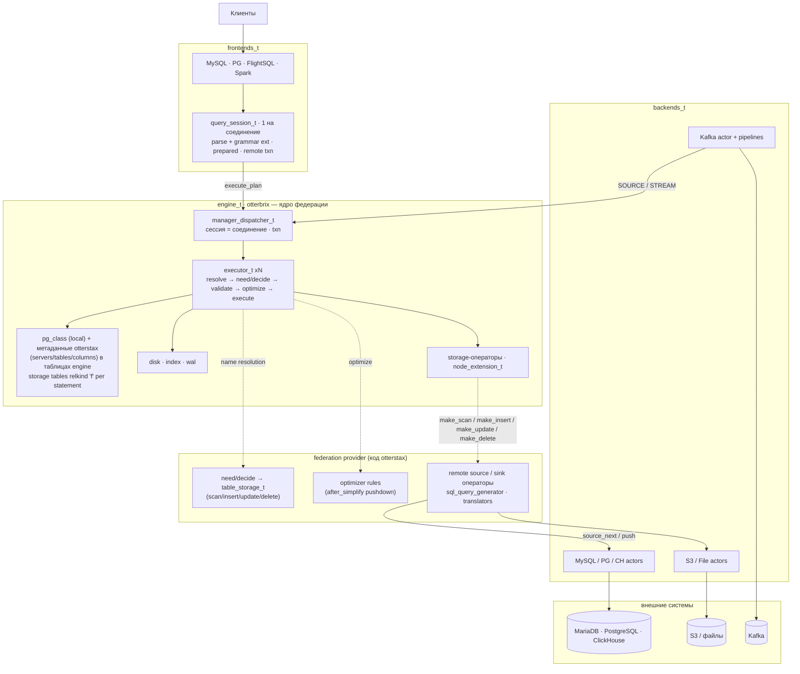

# Встраивание otterbrix в OtterStax: что ещё нужно от движка

> **Статус:** предложение, для обсуждения с мейнтейнерами otterbrix.
>
> **Кому:** мейнтейнерам otterbrix (engine, dispatcher, planner, executor) и actor-zeta.
>
> **База:** ветка otterbrix `feat/otterstax-embedding` (`46fba865`). Большая часть прежних запросов на ней уже
> сделана, часть — другим дизайном; этот документ описывает только то, что осталось. OtterStax переходит на эту
> ветку, как только с неё будет снят релизный тег (OtterStax потребляет только теги). Сейчас OtterStax `main`
> (`0b15739`) сидит на `1.0.0b2-rc-3` (`cf8edb88`) и actor-zeta `1.2.0`.
>
> **Контракт хоста на ветке:** `docs/embedding-host-api.md` в репозитории otterbrix. Здесь он не пересказывается.

Нотация ссылок: `fe:<path>:<line>` — otterbrix на `46fba865` (`feat/otterstax-embedding`); `rc-3:<path>:<line>` —
otterbrix на теге `1.0.0b2-rc-3`; `otx:<path>:<line>` — OtterStax `main`.

Парный документ — [`scheduler-to-otterbrix-migration.md`](scheduler-to-otterbrix-migration.md): план работ OtterStax
(этапы, WP). ID задач и этапы в обоих документах совпадают.

---

## 1. Контекст

### 1.1 Как OtterStax встраивает otterbrix сейчас (rc-3)

- **Движок.** OtterStax наследуется от `base_otterbrix_t` (`otx:integration/otterbrix/otterbrix_engine.hpp:26-35`);
  весь локальный путь идёт через синхронный `wrapper_dispatcher_t` под mutex'ом `OtterbrixManager`
  (`otx:integration/otterbrix/otterbrix_manager.cpp:108-126`), с новым `session_id_t()` на каждый вызов
  (`otx:otterbrix/operators/execute_plan.cpp:294` и ещё 7 мест). Транзакций между statement'ами нет.
- **Федерация.** `Worker::run_pipeline` по очереди спрашивает MySQL → PG → ClickHouse
  (`otx:scheduler/worker.cpp:939-982`) и подменяет удалённые узлы плана на `node_raw_data`
  (`otx:integration/sql/connection_manager.cpp:315-327`). Движок об удалённых источниках не знает.
- **Каталог.** Свой `store_` / `connection_registry_` (`otx:catalog/catalog_manager.hpp:134`, `:147`), удалённые
  таблицы — «зеркала» в базе uid плюс манифест `__otterstax_tables`
  (`otx:integration/otterbrix/otterbrix_manager.hpp:27-37`).

Обходы в OtterStax и что с ними на ветке:

| Обход в OtterStax | Где | На `feat/otterstax-embedding` |
|---|---|---|
| `guard_node` (агрегаты над константами) | `otx:otterbrix/operators/execute_plan.cpp:244-264` | **не нужен**: исправлено, `test_constant_aggregates.cpp` |
| `remote_affected_rows`, 0-колоночный carrier | `otx:types/otterbrix.hpp:37-56`, `:83-106` | **не нужен**: `cursor_t::affected_rows()` / `is_write()` (`fe:components/cursor/cursor.hpp:59-62`); конец потока — `std::nullopt` (`fe:services/collection/executor.cpp:2326-2328`) |
| манифест `__otterstax_tables`, зеркала | `otx:integration/otterbrix/otterbrix_manager.hpp:27-37` | **не нужен**: метаданные хоста — в обычных таблицах engine, удалённые имена отвечает `decide` (§1.3) |
| вендорная копия `otterbrix_add_parser_extension` | `otx:cmake/otterbrix_parser_extension.cmake` | **не нужна**: модуль ставится с пакетом (`fe:conanfile.py:111-113`) |
| `static_assert` на layout `otterbrix_resource` | `otx:integration/otterbrix/otterbrix_engine.hpp:17-24` | **не нужен**: один layout (`fe:core/pmr.hpp:14-24`) |
| `create_collection` читает `table_oid()` с узла | `otx:otterbrix/operators/execute_plan.cpp:376-402` | остаётся → **OTB-reply** |
| `catalog_resolves` копируются при пересборке плана | `otx:otterbrix/operators/execute_plan.cpp:293` | не подтверждено → **OTB-reply** |
| LIMIT-0 пробы и чтение `output_types()` с узла | `otx:otterbrix/operators/schema_probe.hpp:25-46`, `otx:otterbrix/operators/execute_plan.cpp:325-368` | остаётся → **OTB-describe** |

### 1.2 Что уже сделано в `feat/otterstax-embedding`

Эти задачи из прежней версии документа закрыты или потеряли смысл и **удалены** из списка запросов.

| Было | Статус на ветке | Доказательство |
|---|---|---|
| OTB-embed: сборка движка без `base_otterbrix_t` | **сделано** иначе: `open_engine(resource, schedulers_t{general, exec, disk}, config, log, primitives)`; внутри — `flock` каталога, чтение и replay WAL, часы, tombstones, индексы; shutdown с финальным CHECKPOINT. Хост владеет resource и тремя **выделенными** пулами, которые живут дольше `engine_t`; движок сам их стартует и останавливает | `fe:services/engine/engine.hpp:21-52`; `fe:services/engine/engine.cpp:44-105` (lock), `:440-780` (bootstrap), `:784-805` (start), `:811-858` (shutdown); тесты `fe:services/engine/tests/test_engine.cpp` (`rows_survive_a_reopen_without_a_wrapper`, `a_second_owner_is_refused_across_threads`) |
| `base_otterbrix_t` как точка входа | тонкая обёртка `base_otterbrix_t::open(config, primitives)`, 66 строк | `fe:integration/cpp/base_spaces.cpp:25-51` |
| Заголовки `services/` в пакете | ставятся; цель `otterbrix::otterbrix` | `fe:integration/CMakeLists.txt:74`, `fe:conanfile.py:108-110` |
| pmr ABI | один класс `otterbrix_resource`, layout не зависит от sanitizer-макросов | `fe:core/pmr.hpp:14-24` |
| OTB-log | **сделано** вариантом: `make_log(name, dir)` ничего не регистрирует в spdlog, без `flush_every` / `set_default_logger`. `child(name)` нет: хост оборачивает свой `spdlog::logger` в `log_t` и делит sinks | `fe:components/log/log.cpp:34-55`, `fe:components/log/log.hpp:25-26`, `:127-131` |
| OTB-config | **сделано**: `executor_pool_size`, `pump{in_flight 5 мкс, idle 10 мс}`, `dml_flush_row_threshold`; неверные значения — отказ старта | `fe:components/configuration/configuration.hpp:55-67`; `fe:services/engine/engine.cpp:165-180` |
| OTB-fed-barrier | **сделано**: `extension_t` в `is_shape_breaking_child`; что видит каждая стадия правил — в тесте стадий | `fe:components/planner/optimizer/rules/pushdown_aggregate.cpp:26-39`; тесты `count_star_over_a_storage_table`, `barrier_where_above_join`, `test_host_optimizer_stages.cpp` |
| OTB-fed-payload | **сделано**: `node_extension_t` с payload, объявленными колонками и функцией оператора, без записи в каталоге | `fe:components/logical_plan/node_extension.hpp:29-66` |
| OTB-fed-sink | **сделано**: INSERT — `make_insert`-sink storage'а; UPDATE/DELETE — правилом хоста одним удалённым statement'ом или батчами по row id | `fe:components/logical_plan/table_storage.hpp:41-47`; тесты `insert_into_a_storage_table`, `update_and_delete_by_row_number`, `a_simple_update_or_delete_is_one_remote_statement`, `a_storage_write_error_reaches_the_cursor` |
| OTB-fed-kind (affected rows) | **сделано** иначе: счётчик `written()` у оператора, `affected_rows()` / `is_write()` в cursor; `extension_kind` не нужен | `fe:components/cursor/cursor.hpp:59-62`; `fe:services/collection/executor.cpp:2793` |
| OTB-fed-ctx (`host_ctx`) | **не нужно**: операторы получают сессию, транзакцию и параметры из `pipeline::context_t`; хуки — stateless указатели на функции | `fe:components/context/context.hpp:32-44`; `fe:components/planner/host_hooks.hpp:16-17` |
| OTB-fed-pushdown (хук до validate) | **не нужно**: имя разрешает `need`/`decide` до validate, а pushdown делает правило хоста на одной из 5 стадий после validate | `fe:components/planner/host_hooks.hpp:20-62`; `fe:components/planner/optimizer.cpp:61-122` |
| OTB-foreign (`pg_foreign_*`, `CREATE SERVER`) | **не нужно**: storage-таблица получает relkind `'f'` на один statement, без OID, в `pg_class` не попадает; серверы/таблицы/колонки хост держит в своих таблицах engine | `fe:components/catalog/catalog_codes.hpp:14`; `fe:components/logical_plan/node_catalog_resolve.hpp:49`, `:119` |
| OTB-fed-describe | снято: колонки storage-таблицы отвечает `decide`; остаётся общий OTB-describe | — |
| OTB-az2 | **сделано** (#661 в `main`): actor-zeta `2.0.0` | `fe:conanfile.py:52` |
| Bug-fix: constant aggregates | исправлено | `fe:integration/cpp/test/test_constant_aggregates.cpp` |
| Bug-fix: avg/sum | исправлено по правилам Trino: integer `avg` → DOUBLE, integer `sum` → BIGINT с ошибкой переполнения | `fe:integration/cpp/test/test_avg_sum_widening.cpp:1-2` |
| Bug-fix: int32 ⋈ int64 | исправлено | `fe:integration/cpp/test/test_join_key_width.cpp` |
| Bug-fix: `CREATE TABLE` поверх существующей | отказ | `fe:integration/cpp/test/test_create_table_duplicate.cpp` |
| Bug-fix: drain-sentinel | убран: `source_next` заканчивается `std::nullopt`, пустой chunk — данные | `fe:services/collection/executor.cpp:2326-2328`; тест `an_empty_batch_is_not_the_end` |
| Bug-fix: EXPLAIN теряется | план строится только через `transform_result::finalize()` | `fe:components/sql/transformer/transform_result.hpp:51` |
| Bug-fix: `DROP a, b` | отказ с перечнем объектов вместо молчаливого пропуска | `fe:components/sql/transformer/impl/transform_table.cpp:166-195` |
| Bug-fix: `side_t::left` | исправлено | `fe:integration/cpp/test/test_undefined_side_key.cpp` |

Сделано частично (остаток — в §3):

| Было | Что есть | Чего нет |
|---|---|---|
| OTB-sched | round-robin `next_executor_index()` и очередь statement'ов сессии `take_turn_` (#656 в `main`) — `fe:services/dispatcher/dispatcher.cpp:363-367`, `:1070-1108` | выбор по нагрузке; внутри явной транзакции `may_start_` пускает statement'ы одной сессии параллельно (`:1095-1108`), так что хост обязан слать их по одному |
| OTB-txn-mode | семантика PostgreSQL: ошибка откатывает транзакцию, сессия в `failed_sessions_`, дальше только ROLLBACK, COMMIT превращается в ROLLBACK — `fe:services/dispatcher/dispatcher.cpp:455-458`, `:980-989`, `:1018` | statement-level rollback (MySQL), `SAVEPOINT` (`fe:components/sql/transformer/impl/transform_transaction.cpp:3`, `:26`) → **OTB-txn-mode** |
| OTB-reply | `affected_rows()` / `is_write()` в cursor | OID созданного объекта; `catalog_resolves` всё ещё поле плана (`fe:components/logical_plan/execution_plan.hpp:64`) → **OTB-reply** |
| OTB-fed-concurrent | все источники плана открываются (`open_impl`) и ожидаются вместе — `fe:services/collection/executor.cpp:2489-2499`; тест `sources_open_in_parallel` | build-стороны JOIN'а материализуются по очереди (`fe:services/collection/executor.cpp:2444-2457`); готовность future находится опросом цикла dispatcher'а (`fe:services/dispatcher/dispatcher.cpp:171-190`, `:205-209`) → **OTB-notify** |

### 1.3 Модель встраивания на ветке (кратко)

Подробно — `docs/embedding-host-api.md`. Для OtterStax важно:

- **Открытие.** `open_engine(resource, schedulers, config, log, primitives)`; `primitives_t{optimizer_rules,
  name_resolution{need, decide}}` читается один раз и копируется в каждый executor
  (`fe:components/planner/host_hooks.hpp:84-93`). `create_plan_rule` и `optimizer_pass_t` больше не существуют.
- **Имена.** Если после каталога в statement'е остались неразрешённые имена, executor зовёт `need` (хост
  возвращает логические планы чтения своих таблиц, например `otterstax.remote_columns`), выполняет их в снимке
  statement'а, затем зовёт `decide`: на каждое имя `{columns, table_storage}` или «не моё»
  (`fe:services/collection/executor.cpp:516-552`). Имя приходит целиком, со слотом uid (тест
  `a_uid_name_reaches_the_host_whole`). Флаг `explicit_transaction` = statement внутри `BEGIN … COMMIT`.
- **Storage.** `table_storage_t` живёт один statement и строит операторы `make_scan` / `make_insert` /
  `make_update` / `make_delete`; `owner()` — тег хоста, по нему правило узнаёт свои таблицы
  (`fe:components/logical_plan/table_storage.hpp:30-61`).
- **Pushdown.** Правило хоста (`optimizer_rule_t{stage, fn}`) получает валидированное дерево и может заменить
  поддерево своим `node_extension_t` (`fe:components/planner/optimizer.cpp:61-122`).
- **Ограничения для хоста.**
  - Хуки — указатели на функции без состояния; их зовут с нескольких потоков executor'ов одновременно, так что они
    reentrant, а любой реестр хоста (stub'ы, кэш схем) — глобальный и потокобезопасный.
  - `need` / `decide` **синхронные** (возвращают `result_wrapper_t`, не future) и не должны блокировать поток.
    Значит, схему удалённой таблицы нельзя узнать внутри `decide`: discovery идёт заранее (на старте) или после
    ошибки «does not exist» с повтором statement'а.
  - Пулы, переданные в `open_engine`, — выделенные: движок вызывает у них `start()` и `stop()`
    (`fe:services/engine/engine.cpp:799-801`, `:854-856`).

### 1.4 Этапы OtterStax и что им нужно

| Этап | Суть | Нужно от otterbrix |
|---|---|---|
| 1 | структурный перенос на тег с ветки: `open_engine`, прямой send в dispatcher, сессия на соединение, центральный каталог (метаданные хоста + storage-таблицы) | **OTB-tag** (блокер), OTB-session; желательно OTB-reply, OTB-txn-mode |
| 2 | полные сканы удалённых таблиц через `make_scan` вместо prefetch | желательно OTB-notify |
| 3 | запись через storage-sink'и, pushdown правилом `after_simplify`, prepare без LIMIT-0 | OTB-describe, OTB-txn-storage; желательно OTB-host-ctx |
| 4 | удаление старого пути | ничего нового |

---

## 2. Целевая схема



Пунктирные стрелки — точки встраивания, которые реализует OtterStax. Сплошные — сообщения акторов.

---

## 3. Оставшиеся задачи

| ID | Суть | Приоритет | Этап OtterStax |
|---|---|---|---|
| OTB-tag | релизный тег линии b2 с `feat/otterstax-embedding` в conan-remote | P0 | 1 (блокер) |
| OTB-session | `close_session`, настройки на сессию (`SET autocommit` / `TIME ZONE`), idle-in-transaction timeout | P0 | 1 |
| OTB-describe | `explain_type::describe`: схема результата и типы `$n` без открытия storage-операторов | P0 | 3 (до него — LIMIT-0) |
| OTB-txn-storage | транзакционный контракт для записи в storage (#663): pre-commit / post-abort, откат, половинные flush'и | P0 | 3 |
| OTB-reply | OID созданного объекта в cursor; повторное выполнение плана без ручного копирования `catalog_resolves` | P1 | 1 |
| OTB-txn-mode | режим MySQL: откат только упавшего statement'а | P1 | 1 |
| OTB-notify | пробуждение по готовности future вместо опроса (#679 / actor-zeta#186) + параллельные build-стороны | P1 | 2 |
| OTB-host-ctx | контекст statement'а (session id) в `need` / `decide` / правилах | P1 | 3 |
| OTB-embed-pools | shutdown на живых пулах хоста (#680); `_sync`-методы bootstrap не публичные (#686) | P2 | — |
| OTB-pushdown-offers | структурированные pushdown-предложения на `table_storage_t` (#695) | P2 | 3 |
| OTB-storage-ddl | хук DDL над storage-именами (удалённый DDL) | P2 | 3 |
| OTB-sink-flush | порог flush'а storage-sink'а на statement | P2 | 3 |
| OTB-sched-load | выбор executor'а по нагрузке (по желанию) | P2 | — |
| Позже | PREPARE (#682), streaming cursor (#683), STREAM/SOURCE (#684), CTAS (#675) | P2 | — |

---

## 4. Задачи

### 4.1 OTB-tag — релизный тег с ветки

**Проблема.** OtterStax потребляет otterbrix только по тегу из conan-remote `https://conan.otterbrix.com`,
запиненному по ревизии рецепта (`otx:conanfile.py:57`). Всё из §1.2 есть только на `feat/otterstax-embedding`.

**Просим.** Влить ветку и выпустить тег линии `1.0.0b2-*` (вместе с actor-zeta `2.0.0` в том же remote).

**Критерии приёмки.** OtterStax собирается с `otterbrix/<tag>` и `actor-zeta/2.0.0` из remote; в пакете есть
`services/engine/engine.hpp`, `components/planner/host_hooks.hpp`, модуль `otterbrix_parser_extension.cmake`.

**Приоритет / этап:** P0, блокер этапа 1. **Зависимости:** нет.

### 4.2 OTB-session — жизненный цикл и настройки сессии

**Проблема (на ветке)**
- API закрытия сессии нет: в `services/` и `components/` нет `close_session`. Состояние сессии
  (`session_order_`, `failed_sessions_`, открытая транзакция в `txn_manager_`) живёт, пока его не снимет statement
  (`fe:services/dispatcher/dispatcher.hpp:269-271`). Клиент, отключившийся посреди `BEGIN`, держит горизонт MVCC, если
  хост не пришлёт ROLLBACK.
- Настройки глобальные: `// TODO: settings for the session`, `session_settings(session)` возвращает
  `default_settings_` (`fe:services/dispatcher/dispatcher.hpp:277-283`). Туда же входит `autocommit`, по нему
  выбирается scope транзакции (`fe:services/dispatcher/dispatcher.cpp:990-992`). `SET autocommit = 0` или
  `SET TIME ZONE` в одном соединении меняет поведение всех.
- Таймаута простоя в транзакции нет.

**Предложение / API sketch**
```cpp
struct session_options_t {
    std::chrono::milliseconds idle_in_transaction_timeout{0};  // 0 = off
    components::catalog::session_catalog_t initial_settings;   // tz, autocommit, …
    // + txn_error_mode (OTB-txn-mode)
};
unique_future<core::error_t> open_session(session_id_t session, session_options_t options); // optional
unique_future<void>          close_session(session_id_t session);
// close_session: ROLLBACK of the open transaction, drop settings, session_order_ and failed_sessions_ entries.
// Idempotent. Statements still queued for the session get an error.
```
- `session_settings(session)` — настройки сессии или значения по умолчанию; `SET` меняет только свою сессию.
- Idle-in-transaction: цикл dispatcher'а проверяет время последнего statement'а у сессий с открытой транзакцией и
  откатывает её с отдельным кодом ошибки (аналог `idle_in_transaction_session_timeout` в PG).

**Критерии приёмки**
- `BEGIN; INSERT …;` → `close_session` → строка не видна, горизонт продвигается.
- `SET TIME ZONE` и `SET autocommit = off` в сессии A не меняют поведение сессии B.
- Таймаут 100 мс: `BEGIN; INSERT` → пауза 200 мс → следующий statement получает ошибку таймаута, данных нет.
- `close_session` неизвестной или закрытой сессии — no-op.

**Пока нет:** OtterStax шлёт ROLLBACK при disconnect и перехватывает `SET autocommit` / `SET TIME ZONE` в
`query_session_t`, не пропуская их в движок.

**Приоритет / этап:** P0, этап 1. **Зависимости:** нет.

### 4.3 OTB-describe — схема результата без выполнения

**Проблема (на ветке)**
- Протоколам нужна схема до выполнения: PG `Describe`, MySQL `COM_STMT_PREPARE`, FlightSQL `GetFlightInfo`, Spark
  `AnalyzePlan`. У `explain_type` три значения: `none`, `plan`, `analyze`
  (`fe:components/logical_plan/execution_plan.hpp:41-46`); режима describe нет.
- OtterStax обходится LIMIT-0 пробами (`otx:otterbrix/operators/schema_probe.hpp:25-46`,
  `otx:scheduler/worker.cpp:660-680`). С storage-таблицами проба дорожает: executor открывает каждый источник плана
  до pump'а (`fe:services/collection/executor.cpp:2489-2499`), так что LIMIT-0 по удалённой таблице стартует
  удалённый запрос, если storage или правило хоста не обрежут его сами.

**Предложение / API sketch**
```cpp
enum class explain_type { none, plan, analyze, describe };
// describe: resolve (incl. need/decide) → validate → optimize; no physical plan, no make_* call, nothing read
// or written. The cursor carries the result columns (type_data) and the $n types; unbound $n are allowed.
```

**Критерии приёмки**
- `SELECT` с JOIN, агрегатами, VIEW, CTE: те же типы и имена, что `type_data()` выполнения.
- DML с `RETURNING` (включая `UPDATE … FROM`) описывается без записи и без WAL.
- Над storage-таблицей не вызывается ни один `make_*` (счётчик в тестовом хосте = 0).
- Несвязанные `$n` не мешают; `$n` в позиции с известным типом получает этот тип.

**Приоритет / этап:** P0, этап 3 (этапы 1–2 живут на LIMIT-0). **Зависимости:** нет.

### 4.4 OTB-txn-storage — транзакционный контракт записи в storage (#663)

**Проблема (на ветке)**
- Запись в storage-таблицу внутри `BEGIN … COMMIT` не отклоняется: `decide` узнаёт о транзакции по флагу и решает
  сам (`fe:components/planner/host_hooks.hpp:55-62`, тест `a_storage_learns_of_an_explicit_transaction`).
- Но: ROLLBACK не откатывает то, что записал storage; UPDATE/DELETE, чей sink сбрасывается во время скана, может
  остаться записанным наполовину, если поздний раунд упал (`docs/embedding-host-api.md`, раздел «Transactions»).
- У хоста нет точки, где движок сообщает «commit / abort транзакции сессии», поэтому удалённую транзакцию
  OtterStax завершает сам, отдельно от движка.

**Предложение / API sketch**
- Колбэки транзакции для storage (или для хоста целиком): `pre_commit(session, txn)` — может отказать, и тогда
  COMMIT становится ROLLBACK; `post_abort(session, txn)` — откат удалённой стороны. Оба асинхронные (future),
  вызываются из пайплайна COMMIT / ROLLBACK.
- Упавший statement в явной транзакции зовёт `post_abort` до перевода сессии в `failed_sessions_`.
- Для половинных flush'ей: storage получает признак «финальный раунд» (как `dml_flush_is_final`,
  `fe:components/context/context.hpp:62`), чтобы буферизовать до конца или писать в удалённую транзакцию.

**Критерии приёмки**
- `BEGIN; INSERT INTO remote …; ROLLBACK` → тестовый storage видит `post_abort`, строк нет.
- `pre_commit` с отказом → COMMIT отвечает ошибкой, локальные записи откатаны.
- UPDATE с mid-flush и ошибкой во втором раунде → storage получает abort, а не половину записи.

**Пока нет:** запись в удалённую таблицу внутри транзакции идёт по модели postgres_fdw, но COMMIT/ROLLBACK
удалённого соединения шлёт `query_session_t` до и после команды движку.

**Приоритет / этап:** P0, этап 3. **Зависимости:** OTB-host-ctx (сессия в колбэке).

### 4.5 OTB-reply — OID и повторное выполнение плана

**Проблема (на ветке)**
- В cursor есть `affected_rows()` / `is_write()` (`fe:components/cursor/cursor.hpp:59-62`), но нет OID созданного
  объекта: OtterStax читает `create->table_oid()` с отправленного узла (`otx:otterbrix/operators/execute_plan.cpp:383-400`).
  При асинхронной отправке это чтение памяти другого актора.
- `catalog_resolves` — поле `execution_plan_t` (`fe:components/logical_plan/execution_plan.hpp:64`), конструктор
  `(resource, node, params)` (`:51`) его не заполняет. На rc-3 CONSTRAINT-записи при пересборке терялись, и OtterStax
  копирует resolves руками (`otx:types/otterbrix.hpp:58-80`). Исправлено ли это на ветке — не проверено.

**Просим**
- `created_objects()` в cursor: `{kind, dbname, name, oid}` для CREATE TABLE / VIEW / INDEX / ….
- Подтвердить тестом (или сделать), что план из `(node, params)` соблюдает CHECK и FK и что один `execution_plan_t`
  выполняется дважды с одинаковым результатом.

**Критерии приёмки.** `CREATE TABLE` возвращает OID в ответе; тест на CHECK/FK без копирования resolves; TSAN чист
при асинхронной отправке.

**Приоритет / этап:** P1, этап 1. **Зависимости:** нет.

### 4.6 OTB-txn-mode — режим MySQL

**Проблема.** На ветке — только семантика PostgreSQL (§1.2). MySQL/InnoDB откатывает лишь упавший statement, и
клиенты MySQL на это рассчитывают. `SAVEPOINT` / `ROLLBACK TO` движок не поддерживает
(`fe:components/sql/transformer/impl/transform_transaction.cpp:3`, `:26`), так что снаружи это не эмулировать.

**Предложение.** `txn_error_mode_t{abort_transaction, rollback_statement}` в `session_options_t` (OTB-session);
для `rollback_statement` — неявная точка отката в начале statement'а (откат подмножества undo-записей).

**Критерии приёмки**
- MySQL-режим: `BEGIN; INSERT (1); INSERT (dup) → err; INSERT (2); COMMIT` — видны 1 и 2, частичных эффектов
  упавшего многострочного `INSERT` нет; индексы согласованы.
- Две сессии в разных режимах одновременно.

**Пока нет:** обе протокольные стороны получают PG-семантику для локальных таблиц; для удалённых MySQL-фронтенд
ставит `SAVEPOINT` на закреплённом соединении.

**Приоритет / этап:** P1, этап 1. **Зависимости:** OTB-session.

### 4.7 OTB-notify — пробуждение вместо опроса, параллельные build-стороны

**Проблема (на ветке)**
- Готовность future, выполненного на чужом потоке (поток актора бэкенда OtterStax), находится опросом: цикл
  dispatcher'а перебирает `is_awaited_ready()` и спит `pump.in_flight` (5 мкс), пока есть ожидания
  (`fe:services/dispatcher/dispatcher.cpp:171-190`, `:205-209`). Колбэка готовности нет и в actor-zeta `2.0.0`
  (actor-zeta#186; в otterbrix — #679).
- `materialize_build_sides_` ждёт build-стороны JOIN'а по очереди (`fe:services/collection/executor.cpp:2444-2457`).
  Источники открываются вместе (`:2489-2499`), но JOIN K удалённых таблиц всё равно платит за материализацию
  каждой стороны последовательно.

**Предложение**
1. `unique_future<T>::on_ready(callback)` в actor-zeta: вызывается один раз на потоке производителя; dispatcher /
   executor ставят себя в очередь, хост делает `asio::post`.
2. Независимые build-стороны: сначала запустить все `drive_opened_subplan_`, потом ждать все.

**Критерии приёмки**
- JOIN из 4 storage-таблиц с задержкой 50 мс у каждой — ≈ 50 мс + ε, а не 200 мс.
- Задержка «promise выполнен → coroutine продолжена» не зависит от `pump.in_flight`.

**Приоритет / этап:** P1, этап 2 (бенчмарк этапа 2 даст замеры). **Зависимости:** выпуск actor-zeta.

### 4.8 OTB-host-ctx — контекст statement'а в хуках

**Проблема.** `need`, `decide` и `optimizer_rule_fn` получают только resource, дерево и имена
(`fe:components/planner/host_hooks.hpp:32`, `:42-62`). Операторы видят `pipeline::context_t::session`
(`fe:components/context/context.hpp:32`), а хуки — нет. Хосту нужна сессия, чтобы:
- в `decide` выбрать удалённое соединение, закреплённое за транзакцией сессии, или отказать в записи по правилам
  сессии;
- в правиле pushdown учесть настройки сессии (часовой пояс для удалённого SQL).

**Предложение.** Добавить в сигнатуры хуков `const statement_context_t&` с `session_id_t`, флагом явной транзакции и
`session_settings`. Хуки остаются stateless-указателями.

**Критерии приёмки.** Две сессии одновременно разрешают одно имя; `decide` каждой видит свою сессию; флаг
`explicit_transaction` переезжает в контекст.

**Приоритет / этап:** P1, этап 3. **Зависимости:** нет.

### 4.9 OTB-embed-pools — пулы хоста и bootstrap (#680, #686)

**Проблема.** `open_engine` стартует, а shutdown останавливает переданные пулы
(`fe:services/engine/engine.cpp:799-801`, `:854-856`): общий с хостом пул (например, `sharing_scheduler`
бэкендов OtterStax) передать нельзя, нужны три выделенных. `_sync`-методы bootstrap'а (`*_sync` у
`manager_disk_t`, `manager_index_t`, dispatcher'а) публичны, хотя легальны только до старта пулов.

**Просим.** Режим «пулы уже запущены хостом» (движок их не стартует и не останавливает, shutdown только снимает
своих акторов); `_sync`-методы — непубличные (friend `open_engine`).

**Приоритет / этап:** P2. OtterStax работает с тремя выделенными пулами. **Зависимости:** нет.

### 4.10 OTB-pushdown-offers — структурированный pushdown (#695)

**Проблема.** Правило хоста сопоставляет дерево образцами само (`push_whole_modify` в тестовом хосте): каждый
хост повторяет обход дерева и проверки формы.

**Просим.** Вариант #695: движок предлагает storage'у фильтр / проекцию / LIMIT / агрегат, storage отвечает,
что берёт. Правила хоста остаются для того, что не укладывается в предложения (JOIN одного бэкенда целиком).

**Приоритет / этап:** P2, этап 3. **Зависимости:** нет.

### 4.11 OTB-storage-ddl — DDL над storage-именами

**Проблема.** `need` / `decide` вызываются для таблиц SELECT / INSERT / UPDATE / DELETE и тел VIEW
(`docs/embedding-host-api.md`, «When»). `CREATE TABLE m2.shop.t …`, `DROP TABLE m2.shop.t`, `ALTER TABLE` над
удалённым именем движок выполнит как локальный DDL.

**Просим.** Хук, через который DDL над именем, не принадлежащим каталогу (или по префиксу uid), отдаётся хосту:
хост отвечает оператором, выполняющим удалённый DDL, или «не моё».

**Приоритет / этап:** P2, этап 3. До него OtterStax разбирает удалённый DDL сам, до движка. **Зависимости:** нет.

### 4.12 OTB-sink-flush — порог flush'а storage-sink'а на statement

**Проблема.** `dml_flush_row_threshold` — один на движок (`fe:components/configuration/configuration.hpp:61-64`,
`fe:services/collection/executor.cpp:2429-2430`). Удалённому бэкенду нужен свой размер пачки (ClickHouse любит
большие вставки, MySQL ограничен `max_allowed_packet`).

**Просим.** Порог, который задаёт storage (например, `table_storage_t::flush_rows()` или поле оператора-sink'а).

**Приоритет / этап:** P2, этап 3. **Зависимости:** нет.

### 4.13 OTB-sched-load — выбор executor'а по нагрузке (по желанию)

Round-robin `next_executor_index()` (`fe:services/dispatcher/dispatcher.cpp:363-367`) снимает hot-spot
`hash(session) % N`, но длинный statement может задержать короткий на том же executor'е. Просьба — выбирать
executor с наименьшим числом выполняющихся statement'ов, если бенчмарк OtterStax покажет проблему. P2.

### 4.14 Позже (P2)

- **PREPARE / EXECUTE в движке (#682)** — prepared plan на сессию с повторным bind; опирается на OTB-reply и
  OTB-describe.
- **Streaming cursor (#683)** — выдача пачками для больших выборок FlightSQL / Spark.
- **STREAM / SOURCE (#684)** — Kafka как объект движка; сейчас это актор OtterStax с фоновыми pipeline'ами.
- **CTAS (#675)** — `CREATE TABLE … AS SELECT`, в том числе из storage-таблиц.

---

## 5. Открытые вопросы

1. **OTB-tag.** Когда ветка вливается и какой тег получит? Входит ли в тот же релиз actor-zeta `2.0.0` в
   conan-remote otterbrix?
2. **OTB-session.** Явный `open_session` с опциями или неявное открытие на первом statement'е плюс `SET`?
3. **OTB-describe.** Режим `explain_type::describe` или отдельный handler dispatcher'а? Нужен ли вид statement'а в
   ответе?
4. **OTB-txn-storage.** Колбэки на `table_storage_t` (он живёт один statement) или на хосте целиком
   (`primitives_t`), с ключом `(session, txn)`?
5. **OTB-txn-mode.** Сколько стоит statement-level undo? Если дорого — готовы ли принять его позже, чем OTB-session?
6. **OTB-host-ctx.** Расширить сигнатуры `need` / `decide` / правил или передавать контекст одним указателем?
7. **OTB-storage-ddl.** Отдавать хосту DDL по признаку «имени нет в каталоге» или по явной регистрации префикса
   (uid)?
