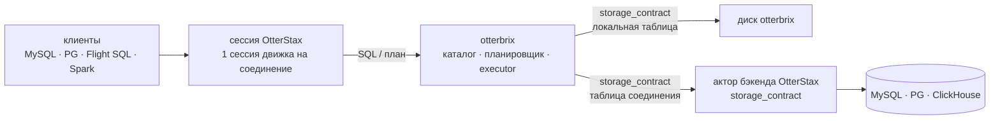

# Встраивание otterbrix в OtterStax: что ещё нужно от движка

## 0. Шапка

> **Статус:** предложение, для обсуждения с мейнтейнерами otterbrix.
>
> **Кому:** мейнтейнерам otterbrix (dispatcher, executor, planner, transformer, disk). Просьбы к actor-zeta — в
> [`actor-zeta.md`](actor-zeta.md).
>
> **База:** ветка `feat/otterstax-requests` @ `61aa43d6` (PR #850 «OtterStax requests and one storage road») и её
> описание для хоста `docs/embedding-host-api.md`. OtterStax пока работает на `46fba865` (`feat/otterstax-embedding`,
> модель с хуками `need` / `decide`); его переход на контракт #850 — **порт**, otterstax/otterstax#55 (закрытие сессий —
> otterstax/otterstax#53). Ревью #850 со стороны OtterStax — `otx:docs/PR850-REVIEW-FINAL-4.md`.

Нотация ссылок:

- `ob:<path>:<line>` — otterbrix `61aa43d6`; `ob-doc:<line>` — `docs/embedding-host-api.md` там же;
- `otx:<path>[:<line>]` — OtterStax (`04c205a`), только как иллюстрация;
- `ревью N` — раздел N ревью #850 (`otx:docs/PR850-REVIEW-FINAL-4.md`);
- `#N` — `otterbrix/otterbrix`; `otterstax#N` — `otterstax/otterstax`.

Шаблон записи:

- **Просим** — что сделать в otterbrix;
- **Зачем** — сценарий OtterStax;
- **Доказательство** — код и документ со ссылками;
- **Блокирует порт** — `да` (без неё порт не закончить без временного кода), `регресс` (порт возможен, но OtterStax
  теряет то, что умеет сейчас), `нет`.

Строка **Обход OtterStax** — только там, где обход переживёт порт. Приоритеты: **P0** — блокирует порт или подключение
клиентов; **P1** — OtterStax работает, но платит (неверный ответ в редком случае, регресс, лишний код); **P2** — по
желанию.

---

## 1. Контекст

**OtterStax** — SQL-сервер федеративных запросов: клиенты MySQL, PostgreSQL, Arrow Flight SQL и Spark Connect пишут
SQL, в котором встречаются таблицы удалённых баз (MySQL / MariaDB, PostgreSQL, ClickHouse), локальные таблицы и внешние
источники (S3, файлы, Kafka). Каждый statement выполняет встроенный otterbrix; на соединение клиента — одна сессия
движка.

**Модель #850.** Удалённая база — строка `pg_database` с `datconnection`, её схемы и таблицы — обычные строки каталога;
имя `c.d.s.t` — таблица базы `d` соединения `c` (`ob-doc:3-13`, `:73`). Все имена разрешает каталог, все statement'ы
планирует движок. Хост при `open_engine` передаёт только карту «соединение → адрес актора бэкенда»
(`ob:components/planner/host_hooks.hpp:16-26`). Операторы движка ходят к хранилищу таблицы одними и теми же
сообщениями контракта (`ob:services/disk/storage_contract.hpp:90-201`): диску otterbrix — для своей таблицы, актору
бэкенда — для таблицы соединения. Pushdown — предложение блоков плана владельцу (`storage_offer`), транзакции —
`storage_prepare` / `storage_release_prepared` / `abort_transaction`. Свои параметры таблицы (удалённое имя, вид
сервера) хост держит в своих таблицах otterbrix по oid (`ob-doc:181-184`).

---

## 2. Сводная таблица

| ID | P | Суть | Блокирует порт | Issue |
|---|---|---|---|---|
| OTB-tag | P0 | релизный тег с #850 в conan-remote | нет (CI, релиз) | — |
| OTB-append-omitted | P0 | `storage_append` — только записанные колонки, иначе DEFAULT / serial бэкенда теряются | да | — |
| OTB-driver-settings | P0 | `SET` / `SHOW` / `BEGIN …`, которые драйверы шлют при подключении | нет (обход) | — |
| OTB-txn-storage | P1 | остаток #663: окно in-doubt после prepare; DDL соединения внутри блока | регресс | #663 |
| OTB-ctx-block | P1 | флаг «внутри блока» в `execution_context_t` | нет | — |
| OTB-ctx-scan | P1 | `execution_context_t` в `storage_fetch_next_batch` / `storage_close_cursor` | нет | — |
| OTB-insert-block | P1 | INSERT / INSERT … SELECT одного бэкенда — предлагаемый блок | регресс | — |
| OTB-no-row-ids | P1 | флаг «нет номеров строк» в `backend_address_t` | нет | — |
| OTB-storage-index | P1 | CREATE / DROP INDEX таблицы соединения через контракт | регресс | — |
| OTB-abort-refused | P1 | отказ бэкенда в откате — ошибка, а не лог | нет | — |
| OTB-host-rows-many | P1 | несколько таблиц хоста в `ddl_reply_t` | нет | — |
| OTB-contract-comments | P2 | комментарии `storage_contract.hpp:94`, `:107` расходятся с кодом | нет | — |
| OTB-register-table | P2 | регистрация / «забывание» таблицы соединения без DDL на бэкенде | регресс | — |
| OTB-cascade-mixed | P2 | `DROP … CASCADE` таблицы соединения с локальным зависимым | нет | — |
| OTB-backend-map-check | P2 | проверка карты бэкендов при открытии | нет | — |
| OTB-connection-name-reserved | P2 | имя соединения не совпадает с локальной базой (`main` и др.) | нет | — |
| OTB-reply-width | P2 | ответы бэкенда (RETURNING, `host_rows_t`) сверять по колонкам и типам | нет | — |
| OTB-awaits-publish | P2 | `awaits_publish` читать только у диска | нет (обход) | — |
| OTB-session-settings | P1 | остаток настроек на сессию → OTB-show, OTB-driver-settings, OTB-idle-timeout | — | — |
| OTB-show | P1 | `SHOW` / `SHOW ALL` / `current_setting` / `set_config` | нет | — |
| OTB-discard | P1 | `DISCARD ALL` / `PLANS` / `SEQUENCES` / `TEMP` (сброс сессии пулом соединений) | нет | — |
| OTB-idle-timeout | P1 | таймаут простоя в транзакции, `statement_timeout` | нет | — |
| OTB-cancel | P1 | отмена выполняющегося statement'а | нет | — |
| OTB-qualifier-text | P1 | квалификатор колонки сравнивается как написанный текст | нет | — |
| OTB-set-code | P2 | неизвестный параметр `SET` — 42704, а не `sql_parse_error` | нет | — |
| OTB-error-object | P2 | части отсутствующего имени и oid блокирующего объекта — полями ошибки | нет | — |
| OTB-sqlstate | P2 | публичная таблица `error_code_t` → SQLSTATE | нет | — |
| OTB-name-case | P2 | `search_path` теряет регистр, имя соединения сравнивается побайтно | нет (обход) | — |
| CTAS | P1 | `CREATE TABLE … AS SELECT` | регресс | #675 |
| OTB-sink-root | P1 | COPY / S3 / file / Kafka как хранилища через контракт | нет (обход) | — |
| OTB-create-options | P1 | WITH-опции CREATE TABLE до `create_storage_disk` | нет | — |
| OTB-numeric-literal | P1 | `SELECT 0x41` — столбец `x41` со значением 0 | нет | — |
| OTB-describe-untyped | P2 | `$n` в UNION / CTE / производной таблице — 42P18 | регресс | — |
| OTB-flight-levels | P2 | трёхуровневое имя для таблицы соединения (Flight SQL) | нет | — |
| OTB-alter-if-not-exists | P2 | `ALTER TABLE … ADD COLUMN IF NOT EXISTS` | нет | — |
| OTB-implicit-cast | P2 | признак «приведение вставил движок» | нет | — |
| OTB-bytes-literal | P2 | байтовый литерал, приведение к BLOB, физический тип BLOB | нет | — |
| OTB-nul-text | P2 | байт 0 обрезает текст запроса или литерал | нет | — |
| OTB-notify | P1 | циклы без опроса по таймеру; build-стороны JOIN разом | нет | #693 |
| OTB-total-rows | P2 | `storage_total_rows`: txn, рассылка разом, не на EXPLAIN | нет | — |
| OTB-sched-load | P2 | выбор executor'а по нагрузке | нет | — |

Сделанное в #850 — §8, отклонённое и устаревшее — §9.

---

## 3. P0

### OTB-tag — релизный тег (P0)

- **Просим.** Влить #850 и выпустить тег линии `1.0.0b2-*` в `conan.otterbrix.com`, требующий `actor-zeta/2.0.0`
  (он в remote уже есть, `actor-zeta.md`, §4).
- **Зачем.** OtterStax потребляет otterbrix только по тегу, запиненному по ревизии рецепта. Сейчас Docker-образы
  собирают otterbrix из архива локального рецепта (`otx:scripts/conan/export_local_packages.sh`), а CI из чистого
  checkout собрать его не может.
- **Доказательство.** `46fba865` не предок `61aa43d6` (общая база — `b18b898d`): ветка `feat/otterstax-embedding`
  целиком заменена веткой #850, тега ни у одной нет.
- **Блокирует порт:** нет — порт идёт на локальном пакете; блокирует CI и релиз OtterStax.

### OTB-append-omitted — INSERT теряет DEFAULT бэкенда (P0)

- **Просим.** `storage_append` таблице соединения шлёт только записанные statement'ом колонки (`attoids` — их
  attoid), опущенные заполняет бэкенд. Если так нельзя — разрешить у таблицы соединения объявленный DEFAULT, как у
  foreign table PostgreSQL, чтобы хост мог повторить DEFAULT бэкенда.
- **Зачем.** `INSERT INTO pg.shop.public.orders (customer, amount) VALUES (…)` в таблицу с `id serial` / `AUTO_INCREMENT`
  / `DEFAULT now()`: бэкенд получает `id = NULL`. NOT NULL — отказ `not_null_violation`, без NOT NULL — строка с NULL
  вместо значения по умолчанию. Сейчас OtterStax пишет на бэкенд INSERT с одними записанными колонками, и это
  работает.
- **Доказательство.**
  - План INSERT берёт attoid всех колонок таблицы (`ob:components/physical_plan_generator/impl/create_plan_insert.cpp:19-26`);
    оператор дописывает опущенные колонки значением по умолчанию или NULL «so storage_append/WAL/constraints see one
    full-width row» (`ob:components/physical_plan/operators/operator_insert.cpp:97-116`).
  - Документ: «NULL in an omitted column (a connection's table declares no defaults). `storage_append` gets full rows»
    (`ob-doc:211-213`, тест `an_omitted_column_is_null`, `ob:integration/cpp/test/test_host_name_resolution.cpp:726`);
    DEFAULT у таблицы соединения отклоняется (`ob-doc:122-123`).
  - Комментарий контракта говорит обратное: «`attoids` name the chunk's columns: the ones the statement wrote, the
    others the storage fills itself» (`ob:services/disk/storage_contract.hpp:107`) — см. OTB-contract-comments.
- **Блокирует порт:** да.

### OTB-driver-settings — что драйверы шлют при подключении (P0)

- **Просим** (по приоритетам):
  - **P0 — без этого клиент не подключается.** Принимать на сессию «косметические» параметры клиентов
    (`application_name`, `client_encoding` = UTF8, `DateStyle` = ISO, `IntervalStyle`, `extra_float_digits`,
    `standard_conforming_strings` = on) и отвечать на них `SHOW` (OTB-show); `version()` / `pg_catalog.version()`;
    `DISCARD ALL` (сбросить настройки, prepared statements, курсоры сессии).
  - **P1.** Режимы транзакции: `BEGIN [TRANSACTION] ISOLATION LEVEL …`, `BEGIN READ WRITE | READ ONLY`, `SET
    TRANSACTION …` — принять уровень, который движок даёт (или ближайший строже), READ ONLY — проверять; числовое
    значение `SET` (`SET extra_float_digits = 3`); часовые пояса с DST (база IANA) и знак `UTC+5` по POSIX, как в
    PostgreSQL; признак «изменился reportable-параметр» в ответе (хост шлёт ParameterStatus); настройки сессии из
    StartupMessage — одним вызовом при открытии сессии.
  - **P2 (pg_dump).** `SET statement_timeout = 0`, `lock_timeout`, `idle_in_transaction_session_timeout`,
    `row_security`, `SET TRANSACTION ISOLATION LEVEL REPEATABLE READ, READ ONLY`,
    `SELECT set_config('search_path', '', false)`.
- **Зачем.** Что шлют драйверы:
  - pgjdbc — `SET application_name = 'PostgreSQL JDBC Driver'` на каждом подключении: ошибка обрывает подключение;
  - SQLAlchemy (psycopg2) — `show transaction isolation level`, `show standard_conforming_strings`,
    `select pg_catalog.version()` при первом подключении;
  - psqlODBC — `SHOW DateStyle`;
  - Npgsql — `BEGIN TRANSACTION ISOLATION LEVEL READ COMMITTED` при `BeginTransaction()`, `DISCARD ALL` при возврате
    соединения в пул;
  - lib/pq — `BEGIN READ WRITE` при `BeginTx` с опциями;
  - pg_dump — `SET extra_float_digits`, `SET DATESTYLE = ISO`, `SET INTERVALSTYLE = POSTGRES`, `SET statement_timeout =
    0` и др., `SET TRANSACTION ISOLATION LEVEL REPEATABLE READ, READ ONLY`, `set_config('search_path', '', false)`.
  - MySQL-провод (фронтенд OtterStax переводит синтаксис MySQL в канонический `SET name = 'value'` движка, ответ —
    движка; без поддержки параметра в движке драйвер не подключается):
    - `SET NAMES utf8mb4 [COLLATE …]` (→ `client_encoding`) — PyMySQL ≥ 1.1 и mysql-connector-python на каждом
      подключении, Connector/J и go-sql-driver — при несовпадении кодировки, MariaDB C/J — в общем `set`;
      `SET character_set_results = NULL` — Connector/J;
    - `SET AUTOCOMMIT = 0` (PyMySQL на каждом подключении), `SET @@session.autocommit = OFF` (mysql-connector-python),
      `set autocommit=1, sql_mode=CONCAT(@@sql_mode, ',STRICT_TRANS_TABLES')` (MariaDB C/J) — `autocommit` движок
      знает, но числовое значение отклоняет (переводит фронтенд), `sql_mode` — нет;
    - `SET SESSION TRANSACTION ISOLATION LEVEL …` / `READ ONLY` (Connector/J `setTransactionIsolation` /
      `setReadOnly`, Django — `READ COMMITTED` на каждом подключении), `START TRANSACTION READ ONLY` (go-sql-driver);
    - `time_zone` (→ `timezone`, ISO-знак `+00:00`, `SYSTEM`) — mysqldump `/*!40103 SET TIME_ZONE='+00:00' */`,
      MariaDB C/J, Sequelize;
    - mysqldump: `/*!40100 SET @@SQL_MODE='' */`, `SET SESSION information_schema_stats_expiry=0`,
      `SET SESSION NET_READ_TIMEOUT / NET_WRITE_TIMEOUT`, `FOREIGN_KEY_CHECKS`, `UNIQUE_CHECKS`, `SQL_NOTES`;
    - Connector/J `setMaxRows` → `SET SQL_SELECT_LIMIT`; Django — `SET SQL_AUTO_IS_NULL = 0`; Rails —
      `@@SESSION.wait_timeout`, `sql_auto_is_null`;
    - чтения: `SELECT @@autocommit`, `@@time_zone`, `@@sql_mode`, `@@transaction_isolation` (без SHOW в движке
      фронтенд отвечает по последнему успешному SET своей сессии — OTB-show).
- **Доказательство.**
  - Параметров сессии три: `timezone`, `autocommit`, `search_path` (`ob:components/catalog/settings.cpp:21-23`); любой
    другой — `sql_parse_error` «SET <name> is not supported» (`ob:components/sql/transformer/impl/transform_set_setting.cpp:20-23`).
  - Значение не-строка — отказ «requires a string constant» (`…/transform_set_setting.cpp:50-53`); список в
    `search_path` — отказ (`:41-45`).
  - Режимы транзакции — `unimplemented_yet` «transaction modes are not supported»
    (`ob:components/sql/transformer/impl/transform_transaction.cpp:21-24`); `SET TRANSACTION …` становится параметром
    с именем `TRANSACTION` (`ob:components/sql/parser/gram.y:2088-2094`) и получает тот же отказ, что неизвестный.
  - `DISCARD` разбирается (`gram.y:2465-2471`), транслятор отвечает «Unsupported node type»
    (`ob:components/sql/transformer/transformer.cpp:247-250`); функций `version`, `current_setting`, `set_config` нет
    (`ob:components/compute/function.hpp:408-428`).
  - Часовые пояса — фиксированные смещения без DST («Standard (non-DST) offsets», `ob:core/date/timezones.cpp:14`;
    `america/new_york` = −18000, `:176`); `utc±HH` читается по ISO (`:887`), PostgreSQL читает `UTC+5` по POSIX.
- **Обход OtterStax:** нет (решение 2026-11-02). Любой `SET` / `RESET` уходит в движок (MySQL — после перевода
  синтаксиса); параметр, которого движок не знает, — ошибка клиенту. Драйверы из списка выше не подключаются до этой
  просьбы.
- **Блокирует порт:** нет.

---

## 4. Контракт хранилища и транзакции

### OTB-txn-storage — остаток #663 (P1)

Сделано в #850: участники транзакции, `storage_prepare` / `storage_release_prepared` / `abort_transaction`, ROLLBACK
TO, «одно место записи» (`ob:services/disk/storage_contract.hpp:146-155`, `ob-doc:265-294`; COMMIT —
`ob:components/physical_plan/operators/operator_commit_transaction.cpp:203-240`).

- **Просим.** (а) Закрыть окно in-doubt: бэкенд подготовил и закоммитил свою часть, а WAL-маркер не записался —
  нужен двухфазный исход (`PREPARE TRANSACTION` / `XA PREPARE` на тех же сообщениях и восстановление после сбоя);
  (б) DDL таблицы соединения внутри блока и при `autocommit = off` — бэкенд как участник, `ddl_reply_t` в той же
  транзакции.
- **Зачем.** (а) Клиент получает ошибку COMMIT, а строки на бэкенде остались. (б) Сейчас OtterStax выполняет удалённый
  DDL и внутри `BEGIN` (бэкенд фиксирует сразу); после порта такой DDL — отказ. Без (б) нельзя и COPY TO одним
  statement'ом (OTB-sink-root).
- **Доказательство.** «The window of #663 … the backend's outcome is in doubt until #663» (`ob-doc:282-283`;
  `operator_commit_transaction.cpp:203-204`, отказ маркера — `:237-239`). DDL — «only supports DDL in autocommit»
  (`ob:services/collection/executor.cpp:558-564`, вторая копия `:1867-1872`; `ob-doc:260-261`). Ещё одно окно (ревью 3):
  бэкенд выполнил DDL, а запись `host_rows_t` или WAL-маркера упала — каталог откатан, объект на бэкенде остался.
- **Блокирует порт:** регресс (DDL внутри `BEGIN`).

### OTB-ctx-block — флаг «внутри блока» (P1)

- **Просим.** В `execution_context_t` — признак «транзакция кончается вместе с этим statement'ом» (autocommit) или
  «открыт блок».
- **Зачем.** Autocommit-statement — тоже транзакция (`ob-doc:272-273`), и бэкенд не отличает её от блока: он вынужден на
  каждый statement брать соединение, открывать удалённую транзакцию и ждать `storage_release_prepared`, хотя
  одиночный удалённый statement мог бы выполниться в autocommit бэкенда — на один-два round trip'а меньше.
- **Доказательство.** `execution_context_t` = `session`, `txn`, `session_tz`, `table_oid`, `database_oid`
  (`ob:components/context/execution_context.hpp:23-29`); признака блока нет.
- **Блокирует порт:** нет.

### OTB-ctx-scan — контекст в сообщениях скана (P1)

- **Просим.** `storage_fetch_next_batch` и `storage_close_cursor` получают `execution_context_t`, как остальные
  сообщения.
- **Зачем.** Бэкенд ведёт состояние транзакции (открытые курсоры, undo) по `ctx.txn.transaction_id` (`ob-doc:138-140`), а
  закрытие курсора приходит без транзакции; скану нужен и часовой пояс сессии (`session_tz`) для перевода
  `TIMESTAMP` / `DATETIME` бэкенда.
- **Доказательство.** `storage_fetch_next_batch(session, oid, cursor_id, limit, projected_cols, txn)`,
  `storage_close_cursor(session, oid, cursor_id)` (`ob:services/disk/storage_contract.hpp:95-103`).
- **Блокирует порт:** нет.

### OTB-insert-block — INSERT одного бэкенда как блок (P1)

- **Просим** (ревью 2.4). Предлагать владельцу INSERT … VALUES и INSERT … SELECT, если источник читает только таблицы
  того же бэкенда; взятый — `storage_run_write`.
- **Зачем.** `INSERT INTO pg.db.public.a SELECT … FROM pg.db.public.b`: сейчас OtterStax выполняет его одним удалённым
  statement'ом; после порта строки едут в otterbrix и обратно порциями `storage_append`.
- **Доказательство.** В блок входят aggregate, group, match, sort, limit, having, select, join, update, delete
  (`ob:components/logical_plan/detached_block.cpp:243-259`); корень блока — aggregate / join / update / delete
  (`ob:services/collection/executor.cpp:758-761`). Поведение закреплено тестом
  `an_insert_flushes_on_the_storage_threshold` (`ob:integration/cpp/test/test_host_name_resolution.cpp:696-707`). В follow-up'ах #850 (#849) этого нет.
- **Блокирует порт:** регресс (производительность).

### OTB-no-row-ids — бэкенд без номеров строк (P1)

- **Просим.** Флаг в `backend_address_t` (или на таблице): «номеров строк нет». Тогда скан не нумерует строки, а
  UPDATE / DELETE, который бэкенд не взял блоком, отклоняется при планировании понятной ошибкой.
- **Зачем.** ClickHouse и таблица без первичного ключа не меняют строку по номеру. Без флага бэкенд для каждого скана
  обязан помнить «номер → ключ» на случай записи (`ob-doc:201-203`), а отказ приходит уже после скана.
- **Доказательство.** Отказ — только на сообщении записи: `a_storage_without_row_numbers_refuses_the_batch_path`
  (`ob:integration/cpp/test/test_host_name_resolution.cpp:915`, `ob-doc:217-218`); в `backend_address_t` — только
  `connection`, `address`, `max_rows_per_write` (`ob:components/planner/host_hooks.hpp:16-20`).
- **Блокирует порт:** нет.

### OTB-storage-index — индексы таблицы соединения (P1)

- **Просим.** `CREATE INDEX` / `DROP INDEX` таблицы соединения — сообщения контракта (по образцу `add_storage_column`),
  в каталоге — строки индекса без данных.
- **Зачем.** Сейчас OtterStax выполняет `CREATE` / `DROP INDEX` удалённой таблицы на бэкенде; после порта — отказ.
- **Доказательство.** `case create_index_t` → `unimplemented_yet` «indexes and constraints are not kept for a table of
  connection» (`ob:services/collection/executor.cpp:1818-1822`; `ob-doc:122-123`).
- **Блокирует порт:** регресс.

### OTB-abort-refused — отказ бэкенда в откате (P1)

- **Просим** (ревью 2.3). Отказ участника в `abort_transaction`: ROLLBACK TO — ошибка, блок становится упавшим;
  ROLLBACK — ошибка клиенту; `close_session` — ответ хосту. В тестовый бэкенд — рычаг «отказать в abort».
- **Зачем.** `BEGIN; SAVEPOINT s; INSERT INTO pg.d.s.t …; ROLLBACK TO s;` — бэкенд отказал, клиент видит успех, COMMIT
  фиксирует на бэкенде откатанные пользователем строки.
- **Доказательство.** `revert_transaction` возвращает `void`, отказ уходит в лог
  (`ob:components/physical_plan/operators/transaction_teardown.cpp:32-57`); «A refused rollback reaches only the log»
  (`ob-doc:431-432`); тестовый бэкенд всегда отвечает успехом (`ob:integration/cpp/test/test_host_actor.hpp:791-808`).
- **Блокирует порт:** нет.

### OTB-host-rows-many — несколько таблиц хоста в ответе DDL (P1)

- **Просим.** `ddl_reply_t::rows` — список `host_rows_t`, по одному на таблицу хоста.
- **Зачем.** Параметры таблицы и параметры колонок (удалённое написание, тип сервера) OtterStax держит в разных
  таблицах; CREATE TABLE должен записать обе в своей транзакции.
- **Доказательство.** `ddl_reply_t{awaits_publish, rows}` с одним `host_rows_t` (`ob:services/disk/storage_contract.hpp:70-73`),
  у которого одна `table` (`ob:components/context/host_rows.hpp:14-21`); внутри executor уже пишет список
  (`write_host_rows_`, `ob:services/collection/executor.cpp:635-638`).
- **Обход OtterStax.** Одна широкая таблица параметров.
- **Блокирует порт:** нет.

### OTB-contract-comments — комментарии контракта (P2)

- **Просим.** Поправить два комментария `storage_contract.hpp` под код (или код под комментарий для `:107`,
  OTB-append-omitted).
- **Зачем.** Бэкенд, написанный по заголовку, ошибается: страница полной ширины получает отказ «answered a page of other
  columns» на каждом скане с проекцией.
- **Доказательство.** `:94` — «a column outside the set is a buffer-less stub», а движок ждёт только спроецированные
  колонки (`ob:components/physical_plan/operators/scan/guard_chunk.cpp:28`, `ob-doc:196-197`); `:107` — «the others
  the storage fills itself», а план шлёт все колонки (OTB-append-omitted).
- **Блокирует порт:** нет.

### OTB-register-table — регистрация и «забывание» без DDL на бэкенде (P2)

- **Просим** (ревью 4). Каталожные планы «зарегистрировать таблицу соединения», «забыть таблицу», «добавить / убрать
  колонку в каталоге» без сообщения бэкенду — как `make_node_create_schema` для схем (`ob-doc:103-108`).
- **Зачем.** Таблица, созданная или удалённая на сервере в обход OtterStax, и колонка, добавленная там. Сейчас OtterStax
  находит новую таблицу сам при первом обращении; после порта — только рестартом и `CREATE TABLE`, который бэкенд
  должен понять как «принять существующую», а убрать — только `DROP TABLE`, неотличимым от пользовательского.
- **Доказательство.** «otterbrix has no registration of its own. A table gone from the backend is taken away by an
  ordinary `DROP TABLE`» (`ob-doc:258-259`).
- **Блокирует порт:** регресс.

### Мелочи ревью (P2)

| ID | Просим | Зачем | Доказательство |
|---|---|---|---|
| OTB-cascade-mixed (ревью 2.5) | штамповать адреса всех таблиц замыкания DROP, локальным — диск | локальное материализованное представление над `c.d.s.t` → `DROP TABLE c.d.s.t CASCADE` — `internal_error` | `ob:components/physical_plan/operators/operator_dynamic_cascade_delete.cpp:366-382`, фильтр `:844`; тест-предпосылка `ob:integration/cpp/test/test_host_name_resolution.cpp:311`. Рядом (не наше): открытый курсор под `DROP … CASCADE` — дополнить #887 (ревью 4) |
| OTB-backend-map-check (ревью 2.8) | при `open_engine` отказывать на пустом адресе, пустом и повторном имени соединения | пустой адрес — `std::abort()` на первом скане; повтор — работает первая запись, `max_rows_per_write` второй молча теряется | `ob:services/engine/engine.cpp:165-201` (проверяет только пулы и лог); копия карты `ob:services/collection/executor.cpp:314-318`; `abort` — `ob:services/disk/storage_contract.hpp:227-230` |
| OTB-connection-name-reserved | при `open_engine` отказывать на имени соединения, совпадающем с именем локальной базы — прежде всего базы по умолчанию `main` (место сессии `main.public`) — и в `CREATE DATABASE` локальной базы с именем соединения карты | `main.public.t` (локальная) и `main.db.public.t` (соединение `main`) различаются только числом частей — люди их путают; хост не может защитить локальную базу, созданную до появления соединения | `ob:services/collection/executor.cpp:569-584` (`storage_of_connection_` сравнивает только имя соединения); `ob:services/engine/engine.cpp:165-201` (`refuse_host_arguments` карту не проверяет). Обход OtterStax: alias `main` зарезервирован в `config.yaml` (`otx:config/connections/connection_config_reader.hpp`), `CREATE DATABASE <alias>` отклоняет сессия (`otx:catalog/ownership.cpp`) |
| OTB-reply-width (ревью 2.9) | ответы бэкенда (RETURNING, `host_rows_t`) сверять по числу колонок и типам, как страницы скана; тип сверять с параметрами (DECIMAL scale, LIST, STRUCT) | бэкенд вернул меньше колонок → чтение за концом чанка; DECIMAL другого масштаба проходит | `check_chunk_width` — только число строк (`ob:components/physical_plan/operators/scan/guard_chunk.cpp:41-52`); сравнение страниц — только логический тип (`:28-31`); `ob:services/collection/executor.cpp:723` |
| OTB-awaits-publish (ревью 2.10) | читать `awaits_publish` только у дискового адреса и записать это в контракт | флаг от бэкенда пишет в WAL удаление с oid таблицы соединения, шлёт диску undo / publish чужого oid | `ob:services/disk/storage_contract.hpp:48-71`; `ob:components/physical_plan/operators/operator_delete.cpp:376`, `operator_insert.cpp:199`, `operator_update.cpp:678`, `operator_create_collection.cpp:49-58`. Обход OtterStax: актор бэкенда всегда отвечает `false` |

---

## 5. Сессия, настройки, ошибки

### OTB-session-settings — остаток (P1)

Сделано в #850: `SET` / `RESET` / `SET LOCAL` на сессию для `timezone`, `autocommit`, `search_path`, откат с
транзакцией, `ALTER SYSTEM` для значений по умолчанию (`ob-doc:80-85`, `:558-580`;
`ob:components/catalog/settings.cpp:21-23`). Остаток вынесен в OTB-show, OTB-driver-settings, OTB-idle-timeout.

### OTB-show — чтение настроек (P1)

- **Просим.** `SHOW name`, `SHOW ALL`, `current_setting(name [, missing_ok])`, `set_config(name, value, is_local)`.
- **Зачем.** Драйверы и ORM читают настройки при подключении (OTB-driver-settings); внутри блока ошибка `SHOW`
  проваливает блок.
- **Доказательство.** Грамматика строит `VariableShowStmt` (`ob:components/sql/parser/gram.y:2392-2425`), транслятор —
  «Unsupported node type» (`ob:components/sql/transformer/transformer.cpp:247-250`); функций нет
  (`ob:components/compute/function.hpp:408-428`).
- **Блокирует порт:** нет.

### OTB-discard — сброс сессии (P1)

- **Просим.** `DISCARD ALL | PLANS | SEQUENCES | TEMP[ORARY]` на сессию движка, с семантикой PostgreSQL: `ALL` вне
  блока = `CLOSE ALL` (курсоры сессии) + `RESET ALL` + `DEALLOCATE ALL` (PREPARE движка) + `DISCARD PLANS` +
  `DISCARD SEQUENCES` (кеш `currval` / `lastval`) + `DISCARD TEMP`; `ALL` внутри блока — отказ 25001.
- **Зачем.** pgbouncer (`server_reset_query = DISCARD ALL` по умолчанию), pgpool и пулы соединений приложений сбрасывают
  соединение перед выдачей следующему клиенту; без этого следующий клиент пула видит курсоры, настройки и `currval`
  предыдущего.
- **Доказательство.** Грамматика строит `DiscardStmt` (`ob:components/sql/parser/nodes/parsenodes.h:3180-3183`),
  транслятор — «Unsupported node type» (`ob:components/sql/transformer/transformer.cpp:247-250`); курсоры и
  последовательности живут в движке (`ob:components/sql/transformer/transformer.cpp:179-180` — `CREATE SEQUENCE`).
- **Обход OtterStax.** Нет (решение 2026-11-02): фронтенд PG отдаёт отказ движка; в блоке — 25001, как PostgreSQL.
  Фронтенд сам ведёт только свои параметры протокола (`RESET ALL` сбрасывает `application_name`,
  `extra_float_digits`, `client_encoding`) и свои подготовленные операторы (`DEALLOCATE ALL`). Для pgbouncer:
  `server_reset_query = 'RESET ALL; DEALLOCATE ALL'` (курсоры и `currval` при этом не сбрасываются).
- **Блокирует порт:** нет.

### OTB-idle-timeout — таймауты сессии (P1)

- **Просим.** `idle_in_transaction_session_timeout`: dispatcher откатывает (с `abort_transaction` участникам) блок
  сессии, простаивающий дольше порога, отдельным кодом (PostgreSQL 25P03); `statement_timeout` (вместе с OTB-cancel).
- **Зачем.** Брошенный блок держит горизонт MVCC и соединения бэкендов; окно выборки в autocommit держит транзакцию,
  пока не придёт следующий statement (ревью 3).
- **Доказательство.** `statement_timeout`, `idle_in_transaction_session_timeout`, `lock_timeout` нет ни в
  `components/`, ни в `services/`, ни в `core/`; параметров сессии три (`ob:components/catalog/settings.cpp:21-23`).
- **Обход OtterStax.** Spark закрывает сессию после `session_timeout_s` без RPC; для MySQL / PG — таймаут чтения
  соединения.
- **Блокирует порт:** нет.

### OTB-cancel — отмена statement'а (P1)

- **Просим.** `cancel_statement(session)`: executor прекращает выполнение, закрывает операторы (и курсоры бэкендов),
  statement отвечает ошибкой отмены (57014); внутри блока — блок упавший.
- **Зачем.** PG `CancelRequest`, Spark `Interrupt`, таймаут ожидания фронтенда должны останавливать statement, а не
  только перестать его ждать: иначе он держит executor и соединение бэкенда.
- **Доказательство.** API нет (по `cancel` / `interrupt` / `kill` — только комментарии про отмену сообщений
  actor-zeta); `begin_shutdown` ждёт выполняющийся statement (`ob:services/dispatcher/dispatcher.cpp:396-412`, `:403`) и
  отклоняет новые (`:546-555`).
- **Обход OtterStax.** Statement с истёкшим ожиданием выполняется до конца; внутри блока фронтенд проваливает блок.
- **Блокирует порт:** нет.

### OTB-qualifier-text — квалификатор как написанный текст (P1)

- **Просим** (ревью 2.6). Сопоставлять квалификатор колонки с достроенным именем элемента FROM (место сессии,
  соединение), а не с текстом.
- **Зачем.** `SELECT public.orders.id FROM orders`, `SELECT main.public.orders.id FROM orders` — ошибка, в PostgreSQL
  работает; самоссылка `REFERENCES public.t` в `CREATE TABLE t` — «referenced relation does not exist». Клиенты и BI
  пишут полностью квалифицированные колонки.
- **Доказательство.** `answers()` сравнивает слоты как написаны (`ob:components/sql/transformer/utils.cpp:53-64`,
  отказ `:106-108`); тест закрепляет это (`ob:integration/cpp/test/test_name_resolution.cpp:381`); самоссылка —
  `ob:components/sql/transformer/impl/transform_table.cpp:135`.
- **Блокирует порт:** нет.

### OTB-set-code — код неизвестного параметра (P2)

- **Просим.** Неизвестный параметр `SET` — `undefined_object` (42704) «unrecognized configuration parameter», как в
  PostgreSQL.
- **Зачем.** Синтаксически верный `SET` с кодом синтаксической ошибки путает клиентов; фильтру OtterStax нужен код,
  а не разбор текста.
- **Доказательство.** `sql_parse_error` «SET <name> is not supported»
  (`ob:components/sql/transformer/impl/transform_set_setting.cpp:20-23`).
- **Блокирует порт:** нет.

### OTB-error-object — структурированные части ошибки (P2)

- **Просим.** Поля ошибки: части отсутствующего имени (соединение, база, схема, таблица, колонка) и oid / имя
  блокирующего объекта (`dependent_objects_still_exist`), как поля `s`, `t`, `c`, `n` ErrorResponse PostgreSQL.
- **Зачем.** На `relation "my.shop.orders" does not exist` OtterStax подсказывает «удалённые таблицы пишутся
  `my.shop.public.orders`», если первая часть — соединение (ревью 7.5); фронтенд PG заполнил бы поля ErrorResponse.
  Сейчас это только разбор текста.
- **Доказательство.** `error_t` = `type`, `position`, `what` (`ob:core/result_wrapper.hpp:96-103`).
- **Блокирует порт:** нет.

### OTB-sqlstate — таблица SQLSTATE (P2)

- **Просим.** Публичная функция `sqlstate(error_code_t)` → пять символов (и в C ABI).
- **Зачем.** Фронтенды OtterStax отдают SQLSTATE; таблицу сейчас приходится повторять по комментариям. errno MySQL
  остаётся у OtterStax.
- **Доказательство.** SQLSTATE — только в комментариях к `error_code_t` (`ob:core/result_wrapper.hpp:14-87`); C ABI
  отдаёт номер `error_code_t` (`ob:integration/c/otterbrix.h:105`); соответствие проверяют только тесты
  (`ob:integration/cpp/test/test_sqlstate_codes.cpp`).
- **Блокирует порт:** нет.

### OTB-name-case — регистр в `search_path` и имени соединения (P2)

- **Просим** (ревью 2.7). Разбирать кавычки в `search_path` по правилам идентификаторов; имя соединения проверять при
  открытии (OTB-backend-map-check).
- **Зачем.** Схема `"Sales"` недостижима как место; соединение `Sales` не находится по `Sales.x.y.z` без кавычек.
- **Доказательство.** `search_path` целиком в нижний регистр (`ob:components/catalog/place.cpp:66-69`); имя соединения
  сравнивается побайтно (`ob:services/collection/executor.cpp:574`).
- **Обход OtterStax.** Соединения, базы, схемы и таблицы регистрируются в нижнем регистре, настоящее написание — в
  таблице параметров (ревью 7.3).
- **Блокирует порт:** нет.

---

## 6. SQL и внешние хранилища

### CTAS — `CREATE TABLE … AS SELECT` (#675) (P1)

- **Просим.** CTAS: колонки из схемы SELECT, создание и вставка — один statement; цель — локальная таблица или
  таблица соединения, источник — любой.
- **Зачем.** `CREATE EXTERNAL TABLE` OtterStax — это CTAS локальной таблицы из скана S3 / файла; `COPY (…) TO` —
  CTAS таблицы соединения S3 / file (OTB-sink-root).
- **Доказательство.** «CREATE TABLE AS is not supported yet (#675)» (`ob:components/sql/transformer/transformer.cpp:191-199`);
  `CREATE TABLE … AS EXECUTE` — так же (`ob-doc:485`).
- **Блокирует порт:** регресс (сейчас загрузка идёт мимо движка).

### OTB-sink-root — COPY / S3 / file / Kafka через контракт (P1)

- **Просим.** Принять модель «S3 / file / Kafka — соединения»: актор хоста реализует контракт хранилища, таблица такого
  соединения — объект (файл, префикс, топик), её параметры — WITH-опции CREATE TABLE (OTB-create-options). Тогда
  `CREATE EXTERNAL TABLE` = CTAS локальной таблицы из таблицы соединения; `COPY (q) TO 's3://…'` = CTAS таблицы
  соединения (или `INSERT … SELECT` в неё); Kafka SOURCE — скан таблицы соединения. Нужно от движка: CTAS (#675),
  WITH-опции, DDL соединения в транзакции (OTB-txn-storage, б).
- **Зачем.** Сейчас `CREATE EXTERNAL TABLE` и `COPY … TO` выполняют акторы OtterStax на отдельной сессии движка, вне
  транзакции клиента; Kafka DDL — прямые вызовы из сессии. Через контракт они получают транзакцию клиента, pushdown и
  EXPLAIN.
- **Доказательство.** Узла-расширения хоста больше нет: `node_extension_t` удалён в `829b233d`, в `node_type` его нет
  (`ob:components/logical_plan/forward.hpp:7-92`); неизвестный узел плана хоста — `default` валидатора
  (`ob:services/dispatcher/validate_logical_plan.cpp:3702-3706`); COPY транслятор не знает.
- **Обход OtterStax.** Прежний путь через свои акторы до выполнения просьбы.
- **Блокирует порт:** нет.

### OTB-create-options — WITH-опции до бэкенда (P1)

- **Просим.** `CREATE TABLE … WITH (k = v, …)` таблицы соединения: опции доходят до `create_storage_disk` (список
  ключ / значение), хост сам решает, что принять.
- **Зачем.** Расположение и формат файла, `s3_alias`, топик Kafka, движок таблицы ClickHouse (`ENGINE`).
- **Доказательство.** `storage` — «option has been removed», остальные — `unimplemented_yet` «… is not implemented; no
  table was created» (`ob:components/sql/transformer/impl/transform_table.cpp:65-86`); у `create_storage_disk` опций нет
  (`ob:services/disk/storage_contract.hpp:126-132`).
- **Блокирует порт:** нет.

### OTB-numeric-literal — число, слитое с буквами (P1)

- **Просим.** Минимум — ошибка разбора, если за числом сразу идут буквы или `_` (как PostgreSQL 15); лучше —
  `0x` / `0o` / `0b` и `_` между цифрами (как PostgreSQL 16).
- **Зачем.** Тихо неверный ответ: `SELECT 0x41` → столбец `x41` = 0, `SELECT 12abc` → `abc` = 12. Тексты PG, Flight SQL и
  Spark идут в движок как есть.
- **Доказательство.** Сканер знает только десятичные `integer` / `decimal` / `real` (`ob:components/sql/parser/scan.l:369-374`,
  `{integer}` — `:941`); правил trailing junk нет.
- **Обход OtterStax.** MySQL-фронтенд переписывает `0x..` / `0b..` строковым литералом; другие протоколы не защищены.
- **Блокирует порт:** нет.

### OTB-describe-untyped — `$n` без типа (P2)

- **Просим.** Типизировать `$n` в ветке UNION, CTE, производной таблице, `INSERT … SELECT $n`, `= ANY($n)`, как
  PostgreSQL 18.
- **Зачем.** PG Parse / MySQL `COM_STMT_PREPARE` таких statement'ов сейчас описывает своё вычисление схемы OtterStax;
  после порта на `describe_sql` они получат 42P18.
- **Доказательство.** «Not typed yet … a `$n` in a UNION branch, a CTE or a derived table … otterbrix answers 42P18»
  (`ob-doc:681-696`).
- **Блокирует порт:** регресс.

### OTB-flight-levels — трёхуровневое имя таблицы соединения (P2)

- **Просим** (ревью 7.6). Локальное имя `d.s.t` для таблицы соединения, через которое можно и читать, и писать
  (синоним или автообновляемое представление, как в PostgreSQL).
- **Зачем.** Flight SQL `GetTables` знает три уровня (каталог, схема, таблица); таблица соединения — четыре, и BI,
  строящий имя из метаданных, её не прочитает.
- **Доказательство.** Уровни имён `ob-doc:73`; трёхуровневые метаданные — `otx:frontend/flight_sql/session_engine.cpp:391-393`.
  Представление над таблицей соединения в локальной схеме создать можно (`ob-doc:119-120`); запись через него не
  проверяли.
- **Блокирует порт:** нет.

### Мелкие просьбы к SQL (P2)

| ID | Просим | Зачем | Доказательство |
|---|---|---|---|
| OTB-alter-if-not-exists | `ALTER TABLE … ADD COLUMN IF NOT EXISTS` | миграция таблиц параметров OtterStax при обновлении без пересоздания | грамматика — только `ADD columnDef` / `ADD COLUMN columnDef` (`ob:components/sql/parser/gram.y:2682`, `:2690`); `AT_AddColumn` не читает `missing_ok` (`ob:components/sql/transformer/impl/transform_alter_table.cpp:351-381`), DROP COLUMN читает (`:394`) |
| OTB-implicit-cast | признак у приведения «вставил валидатор» / «написано в запросе» (`cast_kind::implicit` или флаг) | бэкенд OtterStax переводит предложенный блок в удалённый SQL: приведение движка удалённой базе не нужно, пользовательское выбрасывать нельзя | `cast_kind { cast, try_cast }` (`ob:components/casts/cast_function.hpp:12-16`); валидатор вставляет `cast_kind::cast` (`ob:services/dispatcher/validation/resolve_expression.cpp:40-49`), пользовательский CAST — тот же вид (`ob:components/sql/transformer/impl/transfrom_common.cpp:413`) |
| OTB-bytes-literal | физический тип BLOB; `X'..'` / `'\x..'::bytea`; приведение строки к BLOB | двоичные значения клиентов (`X'..'`, `bytea`, BINARY(16) UUID) и двоичные колонки бэкендов | `XCONST` / `BCONST` → битовая строка (`ob:components/sql/parser/gram.y:15755-15766`) → «unsupported constant kind» (`ob:components/sql/transformer/utils.cpp:1316-1322`); `'abc'::blob` — `unimplemented_yet` (`:1188-1192`); приведений BLOB в `components/casts` нет; физического типа нет (`ob:components/types/types.cpp:16-48`) |
| OTB-nul-text | `raw_parser` с длиной текста: байт 0 — ошибка разбора; байт 0 в литерале после escape — ошибка, как в PostgreSQL | движок выполняет не тот текст: `DELETE FROM t<0> WHERE …` = `DELETE FROM t`; `SELECT E'a\000b'` → `a` | `raw_parser(const char*)` (`ob:components/sql/parser/parser.h:15-18`), `strlen` (`ob:components/sql/parser/scan.l:1159`); ошибка `pg_verifymbstr` закомментирована (`ob:components/sql/parser/pg_functions.cpp:213`, `:222`), результат не читается (`scan.l:548-550`); escape кладёт байт 0 (`:655-669`) |

---

## 7. Производительность

### OTB-notify — без опроса по таймеру, build-стороны разом (P1)

- **Просим.** (1) Когда в actor-zeta появится waker (`actor-zeta.md`, AZ-waker): циклы dispatcher, диска, индекса и
  WAL будятся им вместо сна `pump.in_flight`; `wait_ready` ждёт на семафоре (#693, этап 2). (2) Build-стороны JOIN —
  сначала запустить все, потом ждать все; от actor-zeta не зависит.
- **Зачем.** JOIN K таблиц соединений платит за материализацию каждой build-стороны последовательно. Цена опроса
  (CPU и задержка) измерена у OtterStax — таблица замеров в `actor-zeta.md`, AZ-park.
- **Доказательство.**
  - Циклы опрашивают `is_awaited_ready()` и спят `pump.in_flight` (5 мкс) / `pump.idle` (10 мс)
    (`ob:components/configuration/configuration.hpp:50-57`): dispatcher — `ob:services/dispatcher/dispatcher.cpp:186`,
    `:219`; диск — `ob:services/disk/manager_disk.cpp:418`, `:443`; индекс — `ob:services/index/manager_index.cpp:324`,
    `:356`; WAL — `ob:services/wal/manager_wal_replicate.cpp:210`, `:242`. `wait_ready` спит 100 мкс
    (`ob:core/executor.hpp:54-62`).
  - `materialize_build_sides_` ждёт стороны по одной (`ob:services/collection/executor.cpp:4537-4551`, `:4544`).
    Источники уже открываются разом (`open_sources_`, `:4586-4597`; `ob-doc:194-196`).
- **Блокирует порт:** нет.

### OTB-total-rows — оценка размера таблиц (P2)

- **Просим** (ревью 2.11). `storage_total_rows` с `execution_context_t` (транзакция); рассылать всем таблицам разом, как
  предложения блоков; не слать на EXPLAIN без ANALYZE.
- **Зачем.** Перед hash join каждая таблица соединения — отдельный round trip к бэкенду, по очереди, вне транзакции
  statement'а, и даже на EXPLAIN, который «runs nothing».
- **Доказательство.** Цикл `co_await` по таблицам (`ob:services/collection/executor.cpp:3734-3751`); сообщение без
  транзакции (`ob:services/disk/storage_contract.hpp:105-106`); `ob-doc:634-635`.
- **Блокирует порт:** нет.

### OTB-sched-load — выбор executor'а по нагрузке (P2)

- **Просим.** Выбирать executor по нагрузке, если бенчмарк OtterStax покажет, что длинный statement задерживает
  короткие.
- **Доказательство.** Round-robin `next_executor_++ % executors_.size()` (`ob:services/dispatcher/dispatcher.cpp:381-385`);
  сессия с порталами привязана к executor'у портала (`:752-787`, `:833`).
- **Блокирует порт:** нет.

---

## 8. Сделано в #850

| ID | Коммит | Где (`61aa43d6`) |
|---|---|---|
| OTB-storage-ddl | `df5cfe07`, `829b233d` | `ob-doc:242-263`; `operator_create_collection.cpp:36`, `operator_alter_column_add.cpp:197`, `operator_dynamic_cascade_delete.cpp:616`, `:759`; тест `test_remote_ddl.cpp:37` |
| OTB-dml-uid | `df5cfe07` | `ob:components/sql/transformer/utils.hpp:133-138`; тест `test_host_name_resolution.cpp:395`, `:419`, `:867` |
| OTB-resolve-uid (G1) | `df5cfe07` | база по `(datname, datconnection)`: `ob:components/physical_plan/operators/catalog_name_lookup.cpp:70-85`; `ob-doc:73`; тест `test_remote_databases.cpp:65`, `:298` |
| OTB-session | `8f4b2441` | `close_session`: `ob:services/dispatcher/dispatcher.cpp:928`; `ob-doc:423-436`; тест `test_close_session.cpp:96` |
| OTB-txn-status | `1d2d2dad` | `ob:components/cursor/cursor.hpp:100`; `ob-doc:387-405`; тест `test_transaction_status.cpp:28` |
| OTB-describe | `27e2a8fa`, `0def481a` | `explain_type::describe` (`ob:components/logical_plan/execution_plan.hpp:46-52`), `describe_sql`; `ob-doc:647-697` |
| OTB-reply | `0039f9fc` | `created_oid()` (`ob:components/cursor/cursor.hpp:93`); `register_plan_targets` (`ob:services/dispatcher/enrich_logical_plan.cpp:704`); `ob-doc:356-362`, `:608-613` |
| OTB-sink-count | `f47ff750` | `written()` (`ob:components/physical_plan/operators/operator.hpp:198`); тест `the_count_is_what_the_sink_reports_written` (`test_host_name_resolution.cpp:461`) |
| OTB-null-operand | `d6f20b6e` | `ob:components/sql/transformer/impl/transfrom_common.cpp:1416-1419`; тест `components/sql/test/test_errors.cpp:234-251` |
| OTB-select-param | `27e2a8fa` | `$n` типизируется контекстом (`ob-doc:671-680`); тест `test_describe.cpp:141`, `:499` |
| OTB-hash-join-cast | `0f3dedb8` | `ob:components/planner/optimizer/rules/hash_join.cpp:21`, `:41`; тест `test_join_key_width.cpp:133` |
| OTB-order-qualifier | `66139d58`, `3cf0348a` | `bind_grouped_order` (`ob:services/dispatcher/validate_logical_plan.cpp:965`); тест `test_clause_answers.cpp:272` |
| OTB-order-alias | `66139d58`, `3cf0348a` | `bind_ungrouped_order` (`validate_logical_plan.cpp:735`); тест `test_clause_answers.cpp:354` |
| OTB-savepoint | `08e06c6d` (#739), `829b233d` | `ob:components/sql/transformer/impl/transform_transaction.cpp:30-40`; ROLLBACK TO у бэкенда — `ob-doc:284-286`; тест `test_savepoint.cpp:60` |
| OTB-struct-eq | `7526639f` | `ob:components/types/types.cpp:723-733`; тест `test_types.cpp:327` |
| OTB-block-uninit | `ae5fdb34` | сегмент пишет только записанные байты (`column_segment.cpp:1129`, `column_checkpoint_state.cpp:354`); тест `test_checkpoint_load.cpp:1911` |
| OTB-eviction-queue | `fedca435` | чистка, когда мёртвых узлов больше живых (`ob:components/table/storage/buffer_pool.cpp:40-50`); тест `test_eviction_queue_bound.cpp:97` |
| OTB-scalar-subquery-type | `27e2a8fa` | `ob-doc:657-658`; тест `test_describe.cpp:181` |
| OTB-pushdown-offers (#695) | `829b233d`, `f33e0725` | `storage_offer` / `block_take_t` (`ob:services/disk/storage_contract.hpp:80-85`, `:159-180`); `ob-doc:296-339` |
| OTB-sink-flush | `9d9c4b00`, `829b233d` | `backend_address_t::max_rows_per_write` (`ob:components/planner/host_hooks.hpp:19`); `ob-doc:219-229`; тест `test_host_name_resolution.cpp:513` |
| PREPARE (#682) | `4005a23d` | `ob-doc:452-492`; тест `test_prepare.cpp:67` |
| streaming cursor (#683) | `77289cc3` | `fetch_window`, `portal_id`, `fetch_next` (`ob:components/logical_plan/execution_plan.hpp:110`); `ob-doc:494-556` |
| OTB-embed-pools, пп. 3–5 | `a755cb25`, `ab08bf1d`, `8b59ee7c` (#686) | `open_engine` → `result_wrapper_t` без исключений (`ob:services/engine/engine.hpp:48`; CI `scripts/CI/run-check-no-exceptions.sh`); проверка ресурса, лога и пулов — `invalid_parameter` (`ob:services/engine/engine.cpp:165-202`); `_sync`-методы закрыты фасадом `bootstrap_t` |

Тесты без пути — в `ob:integration/cpp/test/`.

---

## 9. Не приняли и устарело

**Не приняли.**

| ID | Решение otterbrix | Что делает OtterStax |
|---|---|---|
| OTB-embed-pools, пп. 1–2 (пулы под управлением хоста, один пул на все роли) | движок сам вызывает `start()` / `stop()` пулов (`ob:services/engine/engine.cpp:906-908`, `:962-964`; контракт `ob:services/engine/engine.hpp:19-20`) и отказывает, если один пул передан на две роли (`engine.cpp:191-198`); снятие акторов движка на живом пуле (#680) упирается в actor-zeta#187 | держит отдельные пулы движка, отданные одному движку (`otx:runtime/runtime.hpp`); общих пулов движка и хоста нет |

**Удалено как устаревшее.**

| ID | Причина |
|---|---|
| OTB-host-ctx | сделано иначе: `execution_context_t` в сообщениях контракта (`ob:components/context/execution_context.hpp:23-29`); хуков `need` / `decide` и правил хоста больше нет |
| OTB-rule-params | правил оптимизатора хоста нет; параметры statement'а приходят в `storage_offer` (`ob:services/disk/storage_contract.hpp:157-162`) |
| OTB-decimal-cast | `logical_value_t` удалён (в `components/` его нет); остаток — сверка типа DECIMAL в ответах бэкенда, OTB-reply-width |
| STREAM / SOURCE (#684) | объекты Kafka — через OTB-sink-root |
| OTB-txn-mode | снято OtterStax: семантика транзакций PostgreSQL на всех протоколах |

---

## 10. Открытые вопросы

1. **OTB-tag.** Когда #850 вливается и какой тег получит?
2. **OTB-append-omitted.** Слать только записанные колонки или разрешить DEFAULT у таблицы соединения (как у foreign
   table PostgreSQL)? Первое проще для хоста: DEFAULT, serial и триггеры бэкенда работают без копирования.
3. **OTB-txn-storage.** Двухфазный исход на тех же трёх сообщениях (prepare = `PREPARE TRANSACTION` / `XA PREPARE`) с
   восстановлением по журналу otterbrix — приемлемо? Когда DDL соединения войдёт в транзакцию?
4. **OTB-sink-root.** Согласны ли с моделью «S3 / file / Kafka — соединения хоста» и CTAS как формой COPY TO?
5. **OTB-driver-settings.** Белый список «косметических» параметров в движке или ответ хоста на неизвестный параметр?
6. **OTB-no-row-ids.** Флаг на соединение или на таблицу (таблица MySQL без первичного ключа)?
7. **OTB-ctx-block / OTB-ctx-scan.** Одно расширение `execution_context_t` для всех сообщений или поля по месту?
