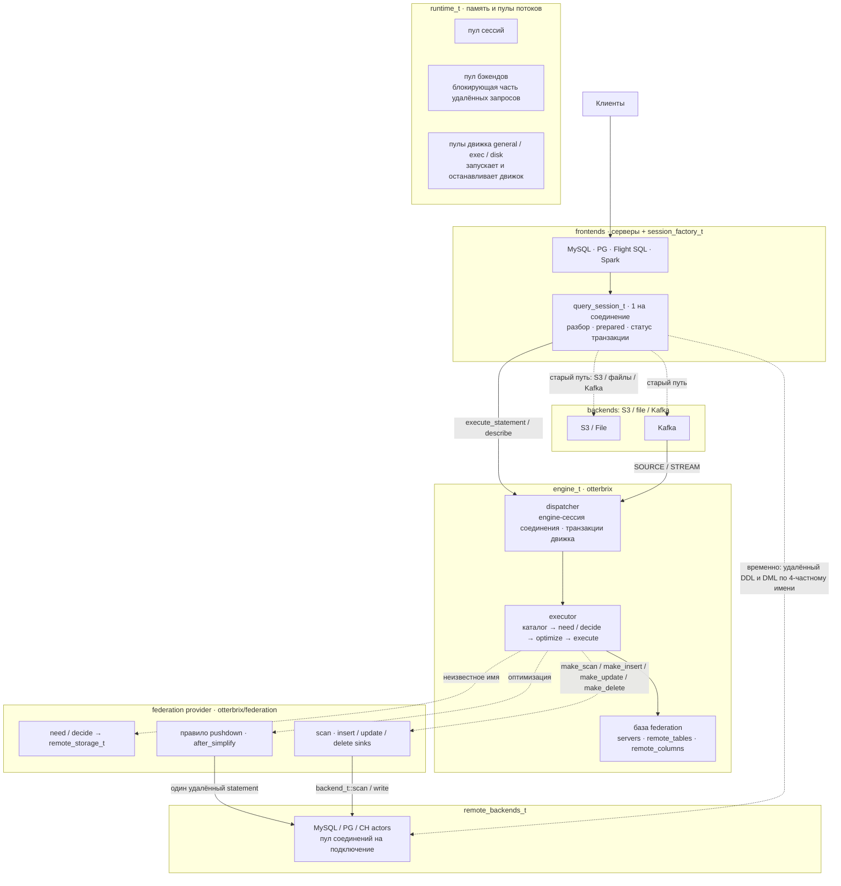
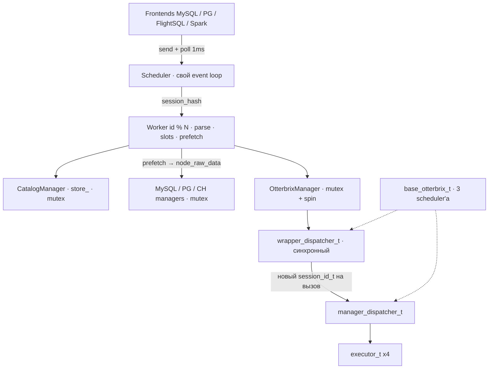
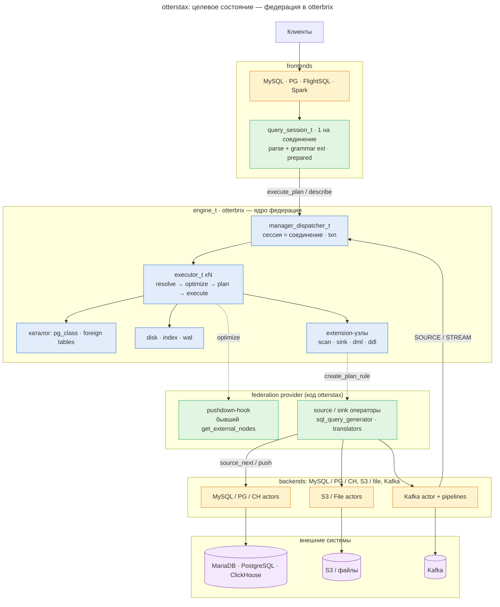
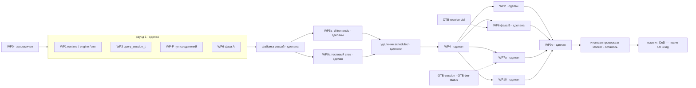

# Миграция: Scheduler/Worker → встроенный otterbrix как ядро федерации

**Статус (2026-10-11):** этап 1 сделан в коде; этапы 2 и 4 сделаны почти целиком; этап 3 сделан частично — то, что
ждёт otterbrix, пока работает временным путём в сессии (список — §3, «Временные пути вне схемы»). Всё лежит в рабочем
дереве ветки `docs/otterbrix-embedding-proposal` и **не закоммичено**. Что осталось до коммита — §8.4.

**Текущая база:** локальный пакет otterbrix `1.0.0b2-embedding.46fba865` и actor-zeta `2.0.0` (переход на них — WP0,
коммит `dc3f970`). Ссылки `file:line` без префикса — OtterStax в рабочем дереве. §2 описывает исходный путь (Scheduler /
Worker): его файлов в рабочем дереве уже нет, ссылки там — на последний коммит ветки (`e150549`), ссылки `rc-3` —
прежняя версия движка.

**Целевая база:** релизный тег otterbrix, снятый с ветки `feat/otterstax-embedding` (`46fba865`), — задача OTB-tag.
Ссылки `fe:<path>:<line>` — otterbrix на `46fba865`. Контракт хоста — `docs/embedding-host-api.md` в репозитории
otterbrix.

**Документы-просьбы** (каждый читается сам по себе, без этого плана):

- [`otterbrix-embedding.md`](otterbrix-embedding.md) — что ещё нужно от otterbrix (задачи `OTB-*`);
- [`actor-zeta.md`](actor-zeta.md) — что нужно от actor-zeta (задачи `AZ-*`: пробуждение по готовности future,
  уничтожение актора на живом пуле, перезапуск пула, доступ к исключению из future).

Здесь задачи `OTB-*` и `AZ-*` только упоминаются по ID, рядом — одной фразой, что это.

Словарь коротких слов, которые встречаются ниже:

- **WP** (work package) — пакет работ; номер — просто имя пакета.
- **engine-сессия** — сессия движка otterbrix (`session_id_t`); у каждого клиентского соединения своя.
- **storage** (хранилище) — `table_storage_t` otterbrix: объект хоста, через который движок читает и пишет чужую
  таблицу (у нас — удалённую таблицу MySQL / PostgreSQL / ClickHouse).
- **pushdown** — отправка части запроса на удалённую базу одним SQL-запросом вместо чтения всей таблицы в движок.
- **sink** — оператор, которому движок отдаёт строки для записи.
- **TSAN** — сборка с ThreadSanitizer (ищет гонки потоков); **ASAN** — с AddressSanitizer (ошибки памяти).
- **DoD** (definition of done) — критерии готовности этапа.

---

## 0. Где мы сейчас

| Этап | Суть | Состояние |
|---|---|---|
| WP0 | переход на ветку otterbrix и actor-zeta 2.0 | сделан, закоммичен (`dc3f970` и хвосты) |
| 1 | структурный перенос: модули вместо `ComponentManager`, `query_session_t` вместо `Scheduler` / `Worker`, прямая отправка в dispatcher движка, сессия на соединение, локальные транзакции, центральный каталог `federation.*` | сделан в коде; ждёт OTB-tag (релизный тег) и итоговой проверки (§8.4) |
| 2 | полные сканы удалённых таблиц через `make_scan` вместо предзагрузки | сделан (предзагрузка удалена целиком) |
| 3 | запись, pushdown, DDL, S3 / файлы / Kafka через движок | частично: pushdown и запись сделаны; транзакции хранилищ, удалённый DDL, запись по 4-частному имени, S3 / файлы / Kafka ждут otterbrix |
| 4 | удаление старого пути | сделано, кроме прямых вызовов S3 / файлов / Kafka из сессии (ждут этапа 3) |

Как устроен процесс сейчас (фактическая схема; каноническая целевая — §3):



Пунктир от `query_session_t` — то, что ещё не ушло в движок (§3, «Временные пути вне схемы»).
Подграфы `frontends` и `backends` — логические группы, а не классы: серверы, `session_factory_t` и
акторы S3 / file / Kafka — локальные переменные `main.cpp` (порядок объявления — порядок создания,
обратный — порядок разрушения).

---

## 1. Контекст и цель

До миграции otterstax использовал otterbrix как «чёрный ящик» поверх собственной надстройки:

- у otterstax был свой маршрутизатор (`Scheduler`) и свой пул исполнителей (`Worker`);
- свой каталог (`CatalogManager::store_` плюс зеркала таблиц и manifest-коллекции в движке);
- своя федерация: предзагрузка (prefetch) данных бэкендов в `node_raw_data` до вызова движка;
- движок вызывался через синхронный `wrapper_dispatcher_t` под mutex, на каждый вызов создавалась новая
  `session_id_t`.

Ветка otterbrix `feat/otterstax-embedding` дала почти всё, что нужно для встраивания (сводка —
[`otterbrix-embedding.md` §1](otterbrix-embedding.md#1-контекст)): `open_engine` с переданными пулами, `make_log`,
разрешение имён хостом (`need` / `decide` → `table_storage_t`), правила оптимизатора хоста, запись в storage (INSERT
sink, UPDATE/DELETE), `affected_rows()` в cursor, семантику транзакций PostgreSQL, исправления багов, из-за которых в
OtterStax жили обходы.

**Цель:**

- otterbrix встроен в otterstax через `open_engine`, лишних обёрток нет; пулы потоков создаёт, запускает и
  останавливает otterstax, движок только ставит на них свои акторы;
- каталог один: локальные таблицы — `pg_class` движка, удалённые — метаданные в базе `federation` движка, которые
  движок читает через `need` / `decide`;
- engine-сессия = соединение клиента; транзакцию ведёт dispatcher otterbrix, внешние системы участвуют в ней через
  хуки хранилища;
- федерация (планирование, pushdown, чтение и запись удалённых таблиц) — внутри otterbrix, через storage-таблицы и
  правила хоста;
- otterstax — frontends, `query_session_t` (только разбор SQL и prepared statements) и «federation provider»:
  коннекторы, SQL-диалекты, трансляторы. Бэкенды одного уровня: MySQL / PG / CH, S3 / файлы, Kafka.

**Как шли:** по этапам. Каждый этап проверяется существующими тестами.

**Правило плана:** в плане только целевая архитектура. Если в otterbrix чего-то не хватает, план просит это у
otterbrix (парный документ, задачи `OTB-*`). Там, где без ответа otterbrix нельзя было удалить старый код, в сессии
временно оставлен минимальный прямой путь; каждый такой путь назван в §3 вместе с задачей otterbrix, после которой он
удаляется.

---

## 2. Исходный flow (до миграции; код удалён)

Раздел оставлен как справка: на него ссылаются §6 и §7. Файлы `scheduler/`, `component_manager/`, `integration/otterbrix/`,
`catalog/catalog_manager.*` в рабочем дереве удалены; ссылки — на коммит `e150549`.

### 2.1 Схема



### 2.2 Сборка процесса

| Шаг | Где | Что |
|---|---|---|
| Логгеры | `main.cpp:36`, `utility/logger.hpp:81` | `initialize_all_loggers` — глобальные spdlog-логгеры otterstax, отдельно от логгера otterbrix |
| Engine | `component_manager/component_manager.cpp:22-24` | `new db::otterbrix_engine_t(config)` — наследник `otterbrix::base_otterbrix_t` (`integration/otterbrix/otterbrix_engine.hpp`); ресурс памяти берётся у dispatcher'а engine |
| Планировщики engine | otterbrix `integration/cpp/base_spaces.cpp:32-34` (rc-3) | три `actor_zeta::shared_work(3, 1000)`: общий, dispatcher, disk |
| `OtterbrixManager` | `component_manager.cpp:35` | актор поверх `IDataManager` → `OtterbrixDataManager` → `base_otterbrix_t*` |
| Kafka | `component_manager.cpp:38-40`, `:121` | `KafkaManager` получает адрес dispatcher'а engine напрямую (`engine_dispatcher_address()`); `recover()` после инициализации |
| Каталог и бэкенды | `component_manager.cpp:43-75` | `CatalogManager`, три `ConnectorManager`, три integration-актора, `set_backend_managers` |
| Пул Worker'ов | `component_manager.cpp:99-103` | `worker_count = max(2, hardware_concurrency)`, `sharing_scheduler`, `spawn<Scheduler>` |
| Соединения | `main.cpp:94`, `main.cpp:101` | `ComponentManager cmanager(...)`, `register_connections(config.connections, retry)` |

### 2.3 Выполнение запроса (`execute`)

| # | Шаг | Где | Что происходит |
|---|---|---|---|
| 1 | Frontend | `frontend/mysql_server/connection/packet_processing.cpp:217-224`; `frontend/postgres_server/connection/packet_processing.cpp:92-97`; `frontend/flight_sql/scheduler_engine.cpp:99-105` | **Новый `session_id` на каждый statement**, `send(scheduler_, &Scheduler::execute, id.hash(), sql)`, ожидание через `await_future_blocking` |
| 2 | Ожидание | `frontend/common/asio_future_bridge.hpp:41`, `:91` | Опрос `take_ready()` с шагом `AWAIT_POLL_STEP{1}` мс на приватном `io_context`; Spark — gRPC-вариант `frontend/spark_connect_server/await_future.hpp` |
| 3 | Scheduler | `scheduler/scheduler.cpp:161-168` | `enqueue_impl` кладёт сообщение в lock-free inbox и будит `loop_thread_` |
| 4 | Event loop | `scheduler/scheduler.cpp:70-143` | Свой цикл: создать behavior → возобновить готовые → удалить завершённые; сон 100 мкс |
| 5 | Маршрутизация | `scheduler/scheduler.cpp:195-204` | `route`: `idx = id % workers_.size()`, `send` в Worker, при необходимости `scheduler_->enqueue` |
| 6 | Parse | `scheduler/worker.cpp:402-418`, `:1130-1150` | `Worker::execute` → `parse_sql`: единственное место с `try/catch` вокруг `IParser::parse` |
| 7 | Extraction | `otterbrix/parser/parser.cpp:420` | `prepare_sql` (`subquery_extractor`): федеративные подзапросы вынимаются в stubs `__otterstax_subq_N` |
| 8 | Raw parse | `otterbrix/parser/parser.cpp:432` | `run_raw_parser(..., registry_)` — свой registry grammar-extensions (s3/file/kafka регистрируются в конструкторе, `parser.cpp:376-400`) |
| 9 | Тип extension | `otterbrix/parser/parser.cpp:456-465` | `ExtensionNode.extension_id`: s3/file → `external`, kafka → `kafka` |
| 10 | Transform | `otterbrix/parser/parser.cpp:509-525` | `transformer` → `binder.node_ptr()` (на rc-3 это `sub_queries.back()`; исправлено в WP0) |
| 11 | `catalog_resolves` | `otterbrix/parser/parser.cpp:551-557` | `finalize()` только при всех связанных параметрах; иначе — позже, после Bind |
| 12 | Slots / batches | `otterbrix/parser/parser.cpp:259-340`, вызов `:560` | `get_external_nodes`: BFS по плану; таблица с пустым `unique_identifier` — локальная, пропускается (`:286-288`); повтор uid в batch уводит слот в следующий batch (`:322-336`, `TODO: remove this segment when connection pool will be added`) |
| 13 | Stubs | `otterbrix/parser/parser.cpp:571` | `swap_stubs_into_schema_nodes` — stub'ы подзапросов → `schema_node_t` |
| 14 | Extension-корни | `scheduler/worker.cpp:423-487` | external → `handle_external_statement`; kafka DDL → `KafkaManager::execute`; `INSERT INTO kafka.x` → `produce` / `add_stream_insert` |
| 15 | Классификация | `scheduler/worker.cpp:491-524` | `classify_and_run`: `guard_database_ddl` (`:998`), затем при `external_nodes_count > 0` — `CatalogManager::update_backend_type`, иначе `Otterbrix` |
| 16 | Каталог | `catalog/catalog_manager.cpp:339`, `:191-290`, `:292` | Ленивая регистрация (`ensure_external_targets_registered`), OID из `store_` на узлы (`:243-256`), `backend_type` / `node_backend_types` (`:259-285`). Все handler'ы под `mutex_` в `enqueue_impl` (`:156-158`) |
| 17 | Prefetch | `scheduler/worker.cpp:938-982` | `run_pipeline`: MySQL → PG → CH строго по очереди (для `Mixed` — все три) |
| 18 | Backend manager | `integration/sql/connection_manager.cpp:184-330` | Batches с конца (`:198`); `generate_slot_statement` (`:83-96`, вызов `:255`) → `executeQuery` → `tsl::mysql_to_chunk` (`:267`) → `capture_remote_dml_count` (`:321`) → `make_node_raw_data` подменяет узел плана (`:326-327`). Mutex в `enqueue_impl` (`:47-49`) |
| 18' | PG / CH | `integration/postgresql/connection_manager.cpp:248`, `:403`; `integration/clickhouse/connection_manager.cpp:290`, `:460` | То же самое на своём диалекте |
| 19 | Engine-актор | `integration/otterbrix/otterbrix_manager.cpp:108-125` | `enqueue_impl`: `lock_guard(mutex_)`, behavior выполняется до конца **на потоке отправителя**, ожидание — `std::this_thread::yield()` |
| 20 | Remote DML | `integration/otterbrix/otterbrix_manager.cpp:487-491`; `types/otterbrix.hpp:55-56` | Если DML полностью выполнен на бэкенде, engine обходится, счётчик — из `remote_affected_rows` |
| 21 | Engine | `integration/otterbrix/otterbrix_manager.cpp:493` → `otterbrix/operators/execute_plan.cpp:271-295` | `guard_node` (constant aggregates, `:276-282`), план из текущего корня, `catalog_resolves` копируются руками (`:293`), `dispatcher()->execute_plan(otterbrix::session_id_t(), plan)` (`:294`) — **новая сессия на вызов** |
| 22 | Executor | otterbrix `services/dispatcher/dispatcher.hpp:182`, `dispatcher.cpp:432` | Пул из 4 `executor_t`, выбор `hash(session) % 4` |
| 23 | Форма результата | `integration/otterbrix/otterbrix_manager.cpp:494-520` | DML без RETURNING → carrier-счётчик; row-producing без колонок → `schema_error` |
| 24 | Ответ | `scheduler/worker.cpp:1171-1187` | `take_payload` → `session_payload` → future → frontend |

### 2.4 Prepare (`prepare_schema` / `prepare_plan`)

- `Worker::prepare_schema` (`scheduler/worker.cpp:612-645`) разбирает SQL. External-корень отвечает пустой схемой,
  Kafka DDL — отказом `unimplemented_yet` (`:631-641`). Дальше — `describe_parsed` (`:647`).
- `describe_parsed`:
  - `guard_database_ddl`;
  - локальный запрос (`external_nodes_count == 0`) → `OtterbrixManager::get_schema` (`:698`, `:758`). Для
    параметризованного запроса — `LIMIT 0` probes по `plan_dependencies`;
  - удалённый → `CatalogManager::get_catalog_schema` (`:771`), затем `describe` бэкендов в порядке
    `run_pipeline` (`:823`, `:832`, `:841`), затем снова `get_schema` для JOIN-корня (`:873`).
- Prepared statement одноразовый: `metadata_map_` Worker'а, `execute_statement` (`:526-570`) забирает план и
  стирает запись.
- `close_statement` (`:885`) идемпотентен. Frontends закрывают незавершённые statement'ы в `finish_impl`
  (`mysql_server/connection/packet_processing.cpp:587`, `postgres_server/connection/packet_processing.cpp:733`).

### 2.5 Extension-statement'ы, COPY, Kafka

| Statement | Маршрут | Где |
|---|---|---|
| `CREATE EXTERNAL TABLE` (s3) | `S3Manager::download` → `FileManager::add_file` → engine | `worker.cpp:1037-1074` |
| `CREATE EXTERNAL TABLE` (файл) | `FileManager::add_file` | `worker.cpp:1063` |
| `COPY (<sql>) TO` | повторный `parse_sql` внутреннего SQL → `S3Manager::upload` / `FileManager::dump_file` → `OtterbrixManager::execute`. **Без каталога и без `run_pipeline`** | `worker.cpp:1076-1127` |
| Kafka DDL | `KafkaManager::execute` | `worker.cpp:428-441` |
| `INSERT INTO kafka.x VALUES` | `KafkaManager::produce` | `worker.cpp:471-486` |
| `INSERT INTO kafka.x SELECT` | `KafkaManager::add_stream_insert` (continuous query) | `worker.cpp:452-469` |
| Kafka pollers / streams | собственные потоки, `kafka_query_session` шлёт в dispatcher engine напрямую | `integration/kafka/detail/kafka_reader.hpp:111` |

### 2.6 Где была сериализация и состояние

| Место | Механизм | Следствие |
|---|---|---|
| `Scheduler` | свой event loop, сон 100 мкс | лишний hop + латентность на каждый запрос |
| `Worker` | sticky `id % N`, `metadata_map_` без блокировок | prepared-состояние привязано к Worker'у, а не к соединению |
| `CatalogManager` | `mutex_` в `enqueue_impl`, handler до конца на потоке отправителя | все классификации последовательны |
| `MySQL/PG/CH` managers | `mutex_` в `enqueue_impl` | все запросы к бэкенду одного типа последовательны |
| `OtterbrixManager` | `mutex_` + spin (`yield`) | **весь engine-трафик последовательный**, поток отправителя крутится |
| `wrapper_dispatcher_t` | синхронный, новый `session_id_t` на вызов | нет сессий, нет транзакций между statement'ами |
| Frontends | новый `session_id` на statement; PG `transaction_manager` — только состояние для `ReadyForQuery`; MySQL `SET autocommit` → «just ok, no transactions» (`mysql_server/connection/packet_processing.cpp:306-309`) | транзакций фактически нет |

---

## 3. Целевое состояние

Каноническая схема — https://l.mermaid.ai/OG3kcs, ниже дословно, кроме подписей подграфов `frontends` и
`backends`. При расхождении правится она, а сюда копируется. В канонической схеме они подписаны
`frontends_t` / `backends_t` — это логические группы, а не классы: классов `frontends_t` / `backends_t`
нет, их части — локальные переменные `main.cpp` (§4, решение 3).



**Узлы схемы в API ветки otterbrix и в коде OtterStax:**

| Узел схемы | Где сейчас | Состояние |
|---|---|---|
| `query_session_t` (parse + grammar ext · prepared) | `session/query_session.*`: cooperative-актор на соединение на пуле сессий `runtime_t`; разбор с grammar-extensions, prepared statements, одна engine-сессия | сделан (WP3, WP5a–d). Сверх схемы сессия пока ведёт статус транзакции (`session/transaction_state.hpp`, ждёт OTB-txn-status — запрос статуса транзакции у движка) и временные пути из списка ниже |
| `manager_dispatcher_t` (сессия = соединение · txn) | `engine_t::dispatcher_address()` (`runtime/engine.*`); запросы — свободные функции `otterbrix/operators/engine_requests.*`; транзакцию ведёт dispatcher | сделан (WP1, WP4, WP7a). Закрытия сессии в движке нет — сессия сама шлёт ROLLBACK при закрытии (OTB-session) |
| executor: resolve | хуки `need` / `decide` (`otterbrix/federation/name_resolution.*`) | сделан (WP6). Открыт баг движка G1 — локальная таблица перехватывает удалённое имя (OTB-resolve-uid) |
| каталог `pg_class · foreign tables` | локальные — `pg_class`; удалённые — строки `federation.remote_tables` / `remote_columns` (с `key_position` — позицией колонки в первичном ключе), на statement — relkind `'f'` через `decide` (постоянных `'f'` в otterbrix нет намеренно, #664); интроспекция клиентов — `pg_class` ∪ `federation.remote_tables` (`catalog/introspection.*`, Spark `catalog_relations.cpp`) | сделан (WP6 фазы A и B) |
| extension-узел scan | `remote_storage_t::make_scan` → `remote_scan_t` (`otterbrix/federation/remote_storage.*`) | сделан (WP6, WP10, WP11). Бэкенд отдаёт результат целиком, движку он выдаётся окнами ≤ `DEFAULT_VECTOR_CAPACITY` строк |
| extension-узлы sink / dml | `make_insert` / `make_update` / `make_delete` у `remote_storage_t`; построчные UPDATE / DELETE по первичному ключу | запись сделана (WP15) **без транзакции**: каждая запись фиксируется на бэкенде сразу. Участие в транзакции — после OTB-txn-storage (хуки транзакций хранилищ) |
| extension-узел ddl | хука DDL в движке нет | ждёт OTB-storage-ddl (движок отдаёт хосту DDL над его именами); до него удалённый DDL выполняет сессия напрямую (ниже) |
| `create_plan_rule` | в ветке otterbrix удалён (`8ab8325f`): оператор строит `node_extension_t` или `make_*` у storage | — |
| pushdown-hook (бывший `get_external_nodes`) | правило оптимизатора `rules::pushdown`, стадия `after_simplify` (`otterbrix/federation/rules/pushdown.*`) | сделан (WP14). Значений параметров правило не видит — см. OTB-rule-params |
| source / sink операторы | `otterbrix/federation/` (`remote_query_t`, `remote_statement_t`, `remote_scan_t`, sinks) поверх `sql_query_generator` и трансляторов | сделан |
| MySQL / PG / CH actors | integration-акторы реализуют `federation::backend_t` (`scan` / `write`); блокирующая часть (взять соединение из пула, ждать ответ) идёт на пуле бэкендов `runtime_t` (`integration/statement_executor.hpp`); у каждого подключения пул из `pool_size` соединений (`connectors/common/connection_pool.hpp`), ClickHouse тоже | сделан (WP-P). Закрепление соединения за транзакцией (`lease_registry`) удалено: будет написано заново под хуки OTB-txn-storage |
| OPS → S3 / File, OPS → Kafka | хранилища otterbrix: `CREATE EXTERNAL TABLE` — чтение из хранилища «S3/файлы» + вставка в локальную таблицу, `COPY … TO` — запись в него, `INSERT INTO kafka.x` — запись в хранилище «Kafka», создание / удаление Kafka-объектов — DDL, который otterbrix передаёт хосту | не начато (WP21): ждёт OTB-storage-ddl, CTAS (#675), OTB-sink-root; до него — старый путь сессии |
| Kafka → dispatcher (SOURCE / STREAM) | уже так: Kafka-актор шлёт в dispatcher | — |

**Временные пути вне схемы.** Каждый — минимальный прямой путь в `query_session_t`, оставленный до ответа otterbrix;
после названной задачи он удаляется.

| Путь | Где | Почему так | Что удаляет |
|---|---|---|---|
| удалённый DDL (`CREATE` / `DROP TABLE`, `CREATE` / `DROP INDEX` над удалённым именем) генерируется в диалекте бэкенда и выполняется сессией на integration-акторе, затем метаданные обновляются | `query_session_t::run_parsed` → `execute_ddl` | DDL до хуков хоста не доходит (`fe:services/collection/executor.cpp`, `host_resolves_names`) | OTB-storage-ddl (WP16) |
| INSERT / UPDATE / DELETE с целью из 4 частей (`uid.db.schema.table`) выполняется сессией на бэкенде; `RETURNING` там — отказ | `query_session_t::run_remote_dml` | транслятор otterbrix не хранит слот uid на цели INSERT / UPDATE / DELETE, так что движок не может спросить о ней хост | OTB-dml-uid (слот uid на цели DML) |
| запись в удалённую таблицу внутри `BEGIN` фиксируется на бэкенде сразу, ROLLBACK её не откатывает | `remote_storage_t` sinks, `remote_statement_t`, `run_remote_dml` | у `table_storage_t` нет транзакционных хуков | OTB-txn-storage (WP15, вторая половина) |
| `CREATE EXTERNAL TABLE`, `COPY … TO`, Kafka DDL и `INSERT INTO kafka.x` — прямые вызовы `S3Manager` / `FileManager` / `KafkaManager`; выполняются вне транзакции соединения | `query_session_t::handle_external_statement`, Kafka-ветки `execute_body` | нет передачи DDL хосту, CTAS, sink'а в корне statement'а | OTB-storage-ddl, CTAS (#675), OTB-sink-root (WP21), затем удаление (WP19) |
| статус транзакции (idle / в блоке / провален) сессия выводит сама, повторяя правила dispatcher'а | `session/transaction_state.hpp`, `query_session_t::settle` | движок не отдаёт статус транзакции сессии | OTB-txn-status |
| при закрытии соединения внутри блока сессия шлёт ROLLBACK (`end_session`) | `query_session_t::close` | в движке нет `close_session` (по исходникам otterbrix ROLLBACK снимает всё состояние сессии, так что это не утечка); не откатывается только сессия, чью задачу выбросил остановленный пул при shutdown — движок закрывается вместе с ней | OTB-session |
| describe: план-only EXPLAIN над **вторым** разбором текста (план переписывается на месте); с параметрами и для UNION — пробы `LIMIT 0` по каждой таблице корня | `otterstax::engine::describe`, `schema_utils` | в движке нет режима describe, EXPLAIN портит план | OTB-describe |
| правило pushdown само строит план поддерева через `services::planner::create_plan`, когда значение параметра не записывается литералом в диалекте | `rules/pushdown.cpp` | правило не видит значений параметров; функция экспортирована, но не объявлена частью API хоста | OTB-rule-params |
| `CREATE TABLE` для загрузки файлов читает OID с отправленного узла после ответа; `catalog_resolves` копируются в план руками | `engine_requests.cpp` (`create_collection`, `statement_plan`) | в cursor нет OID созданного объекта | OTB-reply |

**Что куда переехало:**

| Было | Стало | Этап | Состояние |
|---|---|---|---|
| `Scheduler` + пул `Worker` (`scheduler/`) | `query_session_t` — cooperative-актор на соединение (`session/`) | 1 | сделано, `scheduler/` удалён |
| `ComponentManager` (`component_manager/`) | модули `runtime_t` → `remote_backends_t` → `engine_t`, затем акторы S3 / file / Kafka, `session_factory_t` и серверы — всё локальные переменные `main.cpp` (классов `backends_t` / `frontends_t` нет; шаги старта — свободные функции `backends::register_s3_aliases` / `publish_federation_metadata`, `session::make_session_services`) | 1 | сделано, `component_manager/` удалён |
| `base_otterbrix_t`, `otterbrix_engine_t`, `wrapper_dispatcher_t` | `services::engine::open_engine` на пулах `runtime_t`, прямой `send` в `engine_t::dispatcher_address()` | 1 | сделано; пулы движка пока запускает и останавливает движок (OTB-embed-pools) |
| `OtterbrixManager`, `IDataManager`, `OtterbrixDataManager`, `guard_node` | свободные функции `otterbrix/operators/engine_requests.*`; форма результата — `session/result_shape.*` | 1 | сделано, `integration/otterbrix/` удалён |
| `CatalogManager::store_`, `connection_registry_`, `schema_store`, зеркала в базе uid, manifest `__otterstax_tables` | таблицы `federation.remote_tables` / `remote_columns` + `need` / `decide`; интроспекция — `pg_class` ∪ `federation.remote_tables`; реестр подключений — неизменяемый `federation::registry()` | 1 | сделано; оставшаяся от старой версии база-зеркало удаляется на старте |
| `session_id_t()` на вызов | engine-сессия на соединение; локальные транзакции | 1 | сделано |
| logger otterstax + logger otterbrix | общие sinks: `log_t` движка поверх `spdlog::logger` otterstax (`runtime/engine.cpp`) | 1 | сделано |
| PG `transaction_manager` фронтенда | статус блока из сессии (`query_session_t::transaction_state()`) | 1 | сделано, файл удалён |
| prefetch `run_pipeline` → `node_raw_data`, batches | `remote_storage_t::make_scan` | 2 | сделано, удалено |
| `get_external_nodes`, `subquery_extractor`, `name_resolution` парсера, `INSERT … SELECT` в бэкенд | правило `after_simplify` (pushdown целого блока) + `make_insert` / `make_update` / `make_delete` | 3 | сделано, удалено |
| удалённый DML старым путём, `remote_affected_rows`, `capture_remote_dml_count` | запись через движок; счётчик — `cursor->affected_rows()` | 3–4 | сделано, удалено; запись пока вне транзакции (OTB-txn-storage) |
| удалённый DDL старым путём | хук DDL otterbrix (OTB-storage-ddl) | 3 | временно — прямой путь сессии (выше) |
| прямые вызовы S3 / File / Kafka из сессии | хранилища otterbrix «S3/файлы» и «Kafka»; Kafka DDL — через хост | 3 (перевод), 4 (удаление) | не начато |
| LIMIT-0 пробы в prepare | план-only describe движка | 3 | в основном сделано (EXPLAIN без выполнения); пробы остались для statement'ов с параметрами и UNION (OTB-describe) |

---

## 4. Решения

| # | Решение | Почему | Состояние |
|---|---|---|---|
| 1 | **Frontends.** `query_session_t` — cooperative-актор, один на соединение, в `session/`: разбор SQL с grammar-extensions и prepared statements. В итоге о транзакциях он ничего не знает. `scheduler/` удаляется. | Состояние соединения принадлежит соединению, а не Worker'у по хешу. `Scheduler` был чистым hop'ом без собственной логики. Cooperative-актор берёт следующий statement только после ответа на предыдущий, отдельная очередь не нужна. | сделано. Пока сессия сама ведёт статус транзакции (до OTB-txn-status) |
| 2 | **Engine и пулы потоков.** Пулы создаёт по `config.yaml` otterstax (`runtime_t`, `service.runtime`); он же их запускает и останавливает последним. В цели пулы общие для движка, сессий и бэкендов; otterbrix только ставит на них свои акторы. `engine_t` = `services::engine::open_engine(resource, schedulers, config, log, primitives)` (`fe:services/engine/engine.hpp:48-52`). Остановка: серверы → сессии (`~session_factory_t`) → акторы S3 / file / Kafka (Kafka первой, до движка) → движок (финальный CHECKPOINT, потоки ещё работают) → удалённые бэкенды → остановка пулов → память. | Bootstrap, воспроизведение журнала (WAL), блокировка каталога и shutdown с CHECKPOINT живут в otterbrix — копировать нечего. У пулов один владелец: число потоков задаёт конфигурация, порядок остановки — один модуль. | частично. Пулы сессий и бэкендов `runtime_t` запускает и останавливает сам. Три пула движка (`general` / `exec` / `disk`) `runtime_t` создаёт, но запускает и останавливает их движок (`fe:services/engine/engine.cpp:799-801`, `:854-856`), поэтому они служат одному движку и не делятся с акторами хоста — ждёт OTB-embed-pools (пулы под управлением хоста), а та — AZ-teardown (actor-zeta#187, [`actor-zeta.md`](actor-zeta.md)). Исключение из `open_engine` и негодный `log_t` `engine_t::open` пока ловит и проверяет сам |
| 3 | **Сборка.** Модули `runtime_t` → `remote_backends_t` → `engine_t` вместо `ComponentManager`, дальше — акторы S3 / файлов / Kafka, `session_factory_t` и четыре сервера; всем владеет `main.cpp` напрямую, порядок объявления = порядок создания. `remote_backends_t` (коннекторы MySQL / PG / CH, их акторы, discovery на старте, реестр федерации) собирается **до** движка: хуки `need` / `decide` читают реестр, который он устанавливает. После открытия движка — свободные функции `backends::register_s3_aliases` и `backends::publish_federation_metadata` (метаданные `federation.*`), `kafka->recover()`, `session::make_session_services`. Остановку сессий делает `~session_factory_t` (ожидание, `runtime_t::stop_sessions`, reap), серверы останавливаются в своих деструкторах. | Явный порядок создания и обратный порядок разрушения. Тестовый стек (`tests/system/session_stack.hpp`) собирается из тех же модулей в том же порядке. | сделано (`main.cpp`, `test_process_assembly.cpp`) |
| 4 | **Каталог.** Локальные таблицы — `pg_class` / `pg_attribute`. Удалённые таблицы и их колонки (с удалённым написанием и позицией в первичном ключе, `key_position`) — обычные таблицы движка в базе `federation`: `federation.remote_tables`, `federation.remote_columns`. Удалённое имя разрешает `decide`, отвечая колонками и `table_storage_t`: relkind `'f'` на один statement (постоянных таблиц с чужим storage в otterbrix нет намеренно, #664). Интроспекция клиентов (Flight SQL `GetTables`, `spark.catalog`) — объединение `pg_class` и `federation.remote_tables`. Подключения берутся из `config.yaml` (реестр `federation::registry()`); строки подключения, которого больше нет в конфиге, удаляются на старте. Имя `federation` зарезервировано: подключение с таким alias конфиг отклоняет. | Так задуман контракт хоста. Каталог разрешает имя первым (`fe:services/collection/executor.cpp:519-520`): любая таблица движка с удалённым именем перехватила бы его у `decide`, поэтому зеркал нет. У удалённой таблицы нет OID, в `pg_class` её нет. | сделано. Открыт баг движка G1 (OTB-resolve-uid): пользовательская локальная база с именем удалённой базы перехватывает имя (§7.5) |
| 5 | **Сессия.** Одна engine-сессия на соединение; executor выбирается round-robin (сделано в otterbrix, `fe:services/dispatcher/dispatcher.cpp:363-367`). Закрытие сессии при отключении, `SET` на сессию (autocommit, часовой пояс) и таймаут простоя в транзакции просим у otterbrix (OTB-session, OTB-session-settings). | Транзакции и настройки на сессию невозможны при новой сессии на вызов. Время жизни и настройки сессии — состояние движка, а не обёртки. | engine-сессия на соединение сделана. Закрытия в движке нет: сессия при закрытии внутри блока сама шлёт ROLLBACK (временно, до OTB-session). `SET` / `RESET` любого параметра на всех протоколах в движок не уходит и отвечает OK без эффекта (`session/statement_kind.hpp`); `SHOW` движок не поддерживает; таймаута простоя нет |
| 6 | **Транзакции.** Транзакцию ведёт dispatcher otterbrix: `клиент → COMMIT → frontend → query_session_t → dispatcher → хук хранилища (код otterstax) → MySQL / PG`. Хуки хранилища сразу трёхфазные: prepare (может отказать) / commit / abort, каждый ровно один раз — просим у otterbrix (#663, OTB-txn-storage, P0). Пока одно место записи на транзакцию; несколько мест — позже, двухфазным коммитом (MySQL XA, PG `PREPARE TRANSACTION`) на тех же хуках. После ошибки транзакция остаётся aborted до ROLLBACK — семантика PostgreSQL для всех протоколов. Соединение бэкенда, закреплённое за транзакцией, понадобится этим хукам; его код пишем вместе с ними. Kafka / S3 внутри транзакции (вариант — transactional outbox) решаем на этапе 3. | Транзакция одна и у одного владельца — dispatcher'а; трёхфазные хуки позволяют потом перейти к нескольким местам записи без смены контракта. Одна семантика ошибок для всех протоколов: движок другой не умеет, эмулировать её снаружи — временное решение. | локальные BEGIN / COMMIT / ROLLBACK над таблицами движка работают на всех протоколах (WP7a). Запись в удалённые таблицы внутри BEGIN фиксируется сразу (ждёт OTB-txn-storage). Код закрепления соединений (`connectors/common/lease_registry`, написанный заранее и не подключённый) удалён по решению пользователя: напишем заново, когда otterbrix даст хуки транзакций хранилищ |
| 7 | **Федерация — в otterbrix, поэтапно**: имена (этап 1) → полные сканы (2) → запись, pushdown, S3 / файлы / Kafka через хранилища (3) → удаление старого пути (4). | Большой одномоментный перенос не проверить. | этапы 1, 2 и 4 сделаны; этап 3 частично (§0) |
| 8 | **S3 / файлы / Kafka** — бэкенды того же уровня, что MySQL / PG / CH. В конце их выполняет otterbrix через хранилища: `CREATE EXTERNAL TABLE` — чтение из хранилища «S3/файлы» + вставка в локальную таблицу, `COPY … TO` — запись в это хранилище, `INSERT INTO kafka.x` — запись в хранилище «Kafka», создание / удаление Kafka-объектов — DDL, который otterbrix передаёт хосту. Переводим, когда otterbrix передаёт DDL хосту (OTB-storage-ddl), умеет `CREATE TABLE … AS SELECT` (#675) и sink в корне statement'а (OTB-sink-root). | Один путь для всех внешних систем: разбор — в сессии, выполнение и транзакция — в движке. Grammar-extensions остаются только разбором. | не начато: работает старый код сессии без изменений поведения |
| 9 | **Logger** — общие sinks: otterstax создаёт `spdlog::logger` с sinks своих логгеров и передаёт его движку как `log_t` (`fe:components/log/log.hpp:26`); движок ничего не регистрирует в spdlog. | `child(name)` в otterbrix нет, а глобального состояния у `make_log` больше нет. | сделано (`runtime/engine.cpp`) |
| 10 | **Удалённый DDL** (`CREATE` / `DROP` / `ALTER` над удалённым именем) идёт через хук DDL otterbrix (OTB-storage-ddl): движок отдаёт хосту DDL над именем, которого нет в его каталоге. В цели сессия удалённый DDL не разбирает. | Иначе движок выполнит его как локальный DDL, а разбор в сессии дублирует resolve движка. | временно: сессия сама узнаёт удалённую цель `CREATE` / `DROP TABLE`, `CREATE` / `DROP INDEX` по разобранному имени (`ddl_target`), генерирует DDL в диалекте бэкенда и выполняет его, затем обновляет метаданные; `ALTER TABLE` над удалённым именем не поддержан. Удаляется после OTB-storage-ddl |
| 11 | **Запись в удалённые таблицы** — через storage движка. Блок одной базы (`INSERT … VALUES`, `INSERT … SELECT` из таблицы той же базы, простой `UPDATE` / `DELETE`, в том числе `UPDATE … FROM` / `DELETE … USING` по таблице той же базы) правило pushdown превращает в один удалённый statement. Всё остальное — sinks: `INSERT` из любого источника — пачкой `INSERT … VALUES` на порцию; `UPDATE` / `DELETE`, которые решает движок, — по одному statement'у на строку, строка названа своим первичным ключом, и каждый statement обязан изменить ровно одну строку (0 — `write_conflict`: строку изменили на бэкенде после чтения; больше 1 — `invalid_constraint`). Без первичного ключа, с ключом из FLOAT / DOUBLE / BLOB / вложенных типов и в ClickHouse построчная запись отклоняется на этапе плана. | Строку, выбранную движком, на бэкенде можно назвать только тем, что её однозначно определяет; физического адреса строки у удалённой таблицы нет. | сделано (WP15, без транзакции) |

---

## 5. Этапы

### Переход на ветку otterbrix (WP0) — сделан

`dc3f970`: otterbrix `1.0.0b2-embedding.46fba865` и actor-zeta `2.0.0`, `finalize()`, `qualified_name_t`, ожидания
тестов под исправления движка. Хвосты: `002546f` (подзапросы целиком, CREATE TABLE без `public`), `e150549` (ASAN без
обхода). До OTB-tag остаётся сборка локального рецепта otterbrix внутри Docker-образов (`09bd00a`); actor-zeta
`2.0.0` из неё убран — он берётся из conan-remote (AZ-release).

### Этап 1 — структурный перенос — сделан в коде

**Scope.** Решения 1–5 и 9, каталог (решение 4) и локальные транзакции (часть решения 6). По ходу этапа в него вошли
и полные сканы (этап 2), и удаление предзагрузки (этап 4): после WP6 фазы B старому пути не на что было опираться.

**Нужно от otterbrix:** OTB-tag (блокер критериев готовности), OTB-embed-pools (общие пулы; от actor-zeta ей нужен
AZ-teardown, желательно AZ-pool-lifecycle — [`actor-zeta.md`](actor-zeta.md)), OTB-resolve-uid (баг G1); желательно OTB-session (явное закрытие сессии), OTB-session-settings (`SET` на сессию), OTB-txn-status (статус
транзакции), OTB-reply (OID в ответе), OTB-cancel (отмена statement'а).

#### Пакеты работ

| WP | Содержание | Статус |
|---|---|---|
| WP1 | `runtime/`: `runtime_t` (память + пулы по ролям, `service.runtime`), `engine_t` = `open_engine` (`service.engine`), лог движка поверх sinks otterstax; тесты повторного открытия и блокировки каталога | сделан |
| WP3 | `session/`: `query_session_t` на cooperative-акторе | сделан |
| WP-P | `connectors/common/`: пул соединений на подключение (`connection_pool.hpp`, `pooled_query.hpp`), `pool_size` в `connections:`; MySQL, PG и ClickHouse | сделан. Код закрепления соединений за транзакцией (`lease_registry`) удаляется — будет написан заново под хуки OTB-txn-storage |
| WP6 фаза A | `otterbrix/federation/`, `catalog/remote_*`: метаданные `federation.*`, `need` / `decide`, `remote_storage_t` с `make_scan`, повторный discovery после «does not exist» | сделан |
| фабрика сессий | `session_factory_t`: `query_session_t` на соединение, `session_services_t` из модулей | сделана |
| WP5a–d | frontends MySQL (a), PG (b), Flight SQL (c), Spark (d) на `query_session_t` | сделаны. Flight SQL: сессия на RPC, у prepared statement — своя до закрытия, BEGIN отклоняется. Spark: сессия на Spark-сессию, закрывается в `ReleaseSession` или по таймауту простоя |
| WP9a | тестовый стек `tests/system/session_stack.hpp` (вместо `scheduler_stack.hpp`) | сделан |
| удаление `scheduler/` | `scheduler/`, адреса `Scheduler` во frontends | сделано |
| WP4 | прямой `send` в `dispatcher_address()` (`otterbrix/operators/engine_requests.*`); удалены `integration/otterbrix/`, `IDataManager`, `guard_node`, carrier старого пути, `CatalogManager`; параллельный движок | сделан |
| WP2 | модули в `main.cpp`; `component_manager/` удалён; `connection_retry.hpp` переехал в `backends/` | сделан |
| WP6 фаза B | удалены `store_`, `schema_store`, registry, manifest, зеркала (оставшаяся база-зеркало удаляется на старте); интроспекция `pg_class` ∪ `federation.remote_tables`; резерв имени `federation`; строки отключённых подключений удаляются на старте | сделан, не дожидаясь OTB-resolve-uid: от перехвата удалённого имени защищают проверка владения базами (`catalog/ownership.*` отклоняет пользовательский DDL над именами подключений) и удаление базы-зеркала. Не защищена пользовательская база с именем удалённой базы (§7.5) |
| WP7a | локальные BEGIN / COMMIT / ROLLBACK через сессию на соединение (семантика PG для всех протоколов); ошибка до движка (разбор, bind, проверки сессии) сообщается движку через `refuse_statement`, так что проваливает открытый блок; ReadyForQuery PG из статуса сессии; SAVEPOINT отклоняется (`0A000` / `ER_NOT_SUPPORTED_YET`) | сделан. `SET` на сессию и закрытие в движке — после OTB-session / OTB-session-settings |
| WP10 | `remote_scan_t`: удалённый запрос стартует в `open()`, источники открываются вместе, результат отдаётся окнами ≤ `DEFAULT_VECTOR_CAPACITY` строк | сделан. Бэкенд отвечает целиком (потокового курсора у бэкенда нет) |
| WP9b | тесты транзакций, сессий и каталога (`tests/system/`, `tests/session/`, `tests/federation/`, `tests/runtime/`, python) | сделан; мок движка (`tests/mock/otterbrix.hpp`) удалён — везде настоящий движок во временном каталоге |
| документация | `CLAUDE.md` и `*/CLAUDE.md` под новую архитектуру | сделана |



Пунктир — задачи otterbrix, которых ждёт часть пакета; сам пакет сделан без них (что осталось — в таблице выше).

#### Тесты этапа 1

- **Тестовые бинарники:** `test_system`, `test_session`, `test_runtime`, `test_federation`, `test_unit_connectors`,
  `test_parser`, `test_schema`, `test_utils`, `test_unit_translators`, `test_unit_config`,
  `test_unit_spark_connect`, `test_kafka_grammar`, `test_mysql_front`.
- **Удалены вместе со старым кодом:** `test_scheduler*.cpp`, `test_worker_exception_safety.cpp`,
  `test_catalog_manager.cpp`, `test_component_manager_lifecycle.cpp`, `test_otterbrix_manager.cpp`,
  `test_subquery_extractor.cpp`, `test_replace_qualifiers.cpp`, `test_chunk_batch_reader.cpp`,
  `test_flight_ticket.cpp`, `test_session.cpp` (утилиты).
- **Новые:** повторное открытие и `.lock` для `open_engine` (`tests/runtime/`); сборка и разборка модулей три раза
  подряд и shutdown с INSERT в полёте (`test_process_assembly.cpp`); локальные транзакции по PG и MySQL wire, abort до
  ROLLBACK, COMMIT провалившегося блока, разрыв соединения посреди statement'а (`test_frontend_transactions.cpp`);
  параллельные сессии (`test_concurrent_sessions.cpp`); закрытие сессии и порядок statement'ов
  (`tests/session/test_session_lifetime.cpp`); области сессий Flight SQL (`test_flightsql_session_scope.cpp`);
  разрешение имён, сканы, pushdown по диалектам, запись, JOIN'ы, повторный discovery (`tests/federation/`); каталог и
  интроспекция (`test_catalog.cpp`); пул соединений (`tests/unit/connectors/`).
- **Скрытый тест открытого бага движка:** `[.engine-defect-uid-capture]` в `tests/federation/test_federation_engine.cpp`
  (G1, OTB-resolve-uid) — снимаем точку, когда otterbrix исправит.

#### Риски этапа 1 (что из них осталось)

| Риск | Чем закрыт / что осталось |
|---|---|
| Код полагается на синхронность движка | везде `co_await`; синхронное ожидание (`execute_plan_blocking`) — только на старте и в тестах. Итоговый прогон TSAN `test_system` — §8.4 |
| Cooperative-актор занимает поток пула, пока ждёт future опросом | осталось: пробуждение вместо опроса — AZ-waker / AZ-park в actor-zeta ([`actor-zeta.md`](actor-zeta.md)) и OTB-notify в otterbrix; замер — бенчмарк §8.4 |
| Блокирующие integration-акторы | блокирующая часть удалённых запросов вынесена на пул бэкендов (`integration/statement_executor.hpp`); пул соединений на подключение |
| Клиент отключился внутри `BEGIN` | сессия шлёт ROLLBACK при закрытии (после ROLLBACK в движке по id сессии ничего не остаётся — проверено по исходникам); явное закрытие без очереди statement'ов — OTB-session |
| Клиенты MySQL с `autocommit=False` | `SET autocommit` отвечает OK без эффекта (в движок не уходит), каждый statement без BEGIN фиксируется сам; на сессию — OTB-session-settings |
| `decide` не может спросить бэкенд | «does not exist» → повторный discovery → один повтор statement'а (`catalog/remote_rediscovery.*`) |
| Локальное имя перехватывает удалённое | частично закрыто проверкой владения базами и удалением базы-зеркала; полностью — OTB-resolve-uid (§7.5) |
| Чтение OID с отправленного плана | осталось в одном месте — `create_collection` загрузки файлов (OTB-reply) |

#### Критерии готовности этапа 1

- [ ] OtterStax собран на релизном теге otterbrix и actor-zeta 2.0 из conan-remote (OTB-tag; actor-zeta `2.0.0` в
  remote уже есть — `actor-zeta.md`, AZ-release).
- [x] grep по `Scheduler|Worker|ComponentManager|OtterbrixManager|IDataManager|OtterbrixDataManager|otterbrix_engine_t|wrapper_dispatcher_t|guard_node`
  пуст; нет `scheduler/`, `component_manager/`, `integration/otterbrix/`. (`__otterstax_tables` остаётся только как
  имя, по которому старт узнаёт и удаляет базу-зеркало старой версии.)
- [x] `main.cpp` собирает `runtime_t → remote_backends_t → engine_t`, затем акторы S3 / file / Kafka, `session_factory_t` и серверы (классов `backends_t` / `frontends_t` нет: всё — локальные переменные `main.cpp`).
- [ ] Все тестовые бинарники, `./docker-run-tests.sh`, PySpark-матрица, `tests/flightsql_e2e/` зелёные, TSAN
  `test_system` чистый — итоговый прогон, §8.4.
- [ ] Бенчмарк в пределах ±5% от исходного (baseline) — §8.4.
- [x] `CLAUDE.md` и `*/CLAUDE.md` описывают новую архитектуру.

### Этап 2 — полные сканы через `make_scan` — сделан

Предзагрузки (`run_pipeline` → `node_raw_data`) больше нет: любое удалённое имя доходит до движка, `decide` отвечает
storage'ем, данные идут через `make_scan` окнами (WP6, WP10). Маршрутизация «лист без pushdown → storage, остальное →
старый путь» (WP11) не понадобилась: старый путь удалён целиком, блок одной таблицы уходит на бэкенд правилом pushdown
(этап 3). Differential-тест старого и нового пути (WP12) не делался — старого пути не осталось; поведение сверяется
существующими python- и C++-тестами с неизменными ожиданиями. Бенчмарк с задержкой бэкенда (WP13) заменён общим
бенчмарком против baseline (§8.4).

**Что осталось:** источники открываются параллельно (`fe:services/collection/executor.cpp:2487-2496`), но
build-стороны JOIN'а материализуются по очереди, а готовность future находится опросом — OTB-notify (и AZ-waker /
AZ-park в [`actor-zeta.md`](actor-zeta.md)); замеры даст бенчмарк.

### Этап 3 — запись, pushdown, DDL и S3 / файлы / Kafka через otterbrix — частично

| WP | Содержание | Статус |
|---|---|---|
| WP14 | правило `after_simplify`: блок над одной удалённой таблицей (WHERE, GROUP BY / агрегаты, HAVING, ORDER BY, LIMIT / OFFSET, DISTINCT, проекция) — один удалённый запрос; типы результата — типы движка (`sum` над integer → BIGINT, `avg` → DOUBLE), ответ бэкенда приводится к ним (`conform_to_result`); NULL в ORDER BY и целочисленное деление — как в движке. JOIN не отправляется целиком: каждая сторона — свой блок | сделан |
| WP15 | запись (решение 11): VALUES / `INSERT … SELECT` одной базы и простой UPDATE / DELETE — одним statement'ом; из локальной таблицы и из других источников — sink; построчные UPDATE / DELETE по первичному ключу | сделан **без транзакции**: участие в транзакции через трёхфазные хуки — после OTB-txn-storage, вместе с заново написанным закреплением соединения. Одно место записи на транзакцию; ClickHouse отказывает в prepare |
| WP16 | удалённый DDL через хук DDL otterbrix | ждёт OTB-storage-ddl; временно — прямой путь сессии (§3) |
| — | INSERT / UPDATE / DELETE с целью из 4 частей через движок | ждёт OTB-dml-uid; временно — `run_remote_dml` в сессии, RETURNING отклоняется |
| WP17 | prepare без LIMIT-0 по удалённым таблицам | в основном сделан: план-only EXPLAIN движка, колонки удалённой таблицы — из `federation.remote_columns`, бэкенд не спрашивается. Пробы остались для statement'ов с параметрами и UNION; EXPLAIN переписывает план, поэтому описывается второй разбор текста — OTB-describe |
| WP18 | счётчик вызовов старого пути | не нужен: старого пути нет |
| WP21 | S3 / файлы / Kafka через хранилища otterbrix; поведение внутри транзакции (в том числе transactional outbox: событие пишется в таблицу в той же транзакции и отправляется после COMMIT) | не начат: ждёт OTB-storage-ddl, CTAS (#675), OTB-sink-root |

**Нужно в otterbrix:** OTB-txn-storage, OTB-storage-ddl, OTB-dml-uid (P0); OTB-describe, OTB-host-ctx,
OTB-rule-params, OTB-sink-count, CTAS (#675), OTB-sink-root (P1); по желанию OTB-pushdown-offers, OTB-sink-flush.

**Риски.** Открытая транзакция при `pool_size = 1` займёт единственное соединение бэкенда — размер пула под число
одновременных транзакций (когда появятся хуки). Построчные UPDATE / DELETE без транзакции: если упал statement в
середине, предыдущие строки остаются изменёнными на бэкенде.

**Критерии готовности.** Все запросы идут через storage, правила и хуки; в `query_session_t` нет прямых путей из §3.

### Этап 4 — удаление старого пути — почти сделан

Удалены: `run_pipeline`, prefetch / describe-ветки integration-акторов, подстановка `node_raw_data` (остался только в
Kafka-потоках и Spark `LocalRelation`, к федерации не относится), batches, `remote_affected_rows` / `no_remote_dml`,
`capture_remote_dml_count`, `get_external_nodes`, `subquery_extractor`, `name_resolution` парсера. Осталось: прямые
вызовы S3 / File / Kafka из сессии (WP19, после WP21) и временные пути из §3.

**Критерии готовности.** Кода старого пути нет; в `query_session_t` — только разбор и prepared; `CLAUDE.md` описывает
только flow через движок; бенчмарк не хуже этапа 3.

---

## 6. Изменения поведения

### 6.1 Параллелизм движка — сделано

**Было.** Трафик к движку сериализовал `OtterbrixManager::enqueue_impl`: mutex, behavior до конца на потоке
отправителя, `yield`-спин.

**Стало.** Запросы разных сессий идут в dispatcher одновременно, executor выбирается round-robin. Проверено
`test_concurrent_sessions.cpp`, `test_restart_reconciliation.cpp` (сверка `federation.*` с бэкендами до приёма
соединений), `test_file_ingestion.cpp`; итоговый TSAN-прогон — §8.4.

### 6.2 Сессия на соединение — сделано

| Аспект | Было | Стало |
|---|---|---|
| id сессии | новый `session_id` на statement и новая `session_id_t()` на вызов движка | одна engine-сессия на соединение (Flight SQL — на RPC или на prepared statement, Spark — на Spark-сессию) |
| Executor | `hash(session) % 4` (rc-3) | round-robin на каждый statement (`fe:services/dispatcher/dispatcher.cpp:363-367`) |
| Порядок statement'ов | — | cooperative-актор `query_session_t` берёт следующий statement после ответа на предыдущий |
| Prepared | `metadata_map_` Worker'а | map внутри `query_session_t`, одноразовый (фронтенды переподготавливают сами) |
| Настройки (`autocommit`, часовой пояс) | MySQL `SET autocommit` → OK без эффекта | `SET` / `RESET` любого параметра в движок не попадает: otterbrix применяет `SET` ко всем сессиям (`manager_dispatcher_t::default_settings_`) и сохраняет в `pg_settings`. `query_session_t` узнаёт такой statement по сырому дереву разбора (`VariableSetStmt`, `session/statement_kind.hpp`; по корню плана `set_setting_t` — тоже) и на всех протоколах отвечает OK без эффекта; открытый блок он не проваливает, в проваленном отклоняется как остальное. Передавать начнём, когда будет OTB-session-settings |
| Отключение клиента | `finish_impl` закрывает statement'ы | сессия закрывается; внутри блока шлёт ROLLBACK сама (`end_session`); закрытие в движке — OTB-session |
| Простой в транзакции | нет | нет; таймаут движка — OTB-session-settings. Spark закрывает сессию после `session_timeout_s` без запросов, что откатывает её блок |
| Statement, у которого истёк таймаут фронтенда | — | продолжает выполняться (отмены в движке нет); внутри блока фронтенд проваливает блок (`fail_transaction`), чтобы COMMIT не зафиксировал «отменённое» — отмена statement'а: OTB-cancel |

### 6.3 Транзакции — локальные сделаны, удалённые ждут otterbrix

**Было:** транзакций не было: MySQL `SET autocommit` отвечал OK «no transactions»; PG `BEGIN` доходил до движка, но
в одноразовой сессии.

**Направление.** Транзакцию ведёт dispatcher otterbrix:

```text
клиент → COMMIT → frontend → query_session_t → dispatcher → хук хранилища (код otterstax) → MySQL / PG
```

- Хуки хранилища трёхфазные с самого начала: prepare (может отказать — тогда COMMIT становится ROLLBACK) / commit /
  abort, каждый вызывается ровно один раз. Это просьба к otterbrix (#663, OTB-txn-storage, P0).
- Пока одно место записи на транзакцию. Несколько мест — позже, двухфазным коммитом (MySQL XA, PG
  `PREPARE TRANSACTION`) на тех же хуках.
- После ошибки транзакция остаётся aborted до ROLLBACK — семантика PostgreSQL для всех протоколов, MySQL тоже.
- PR otterbrix #677 (конкурентные транзакции над таблицами движка) хуков хранилища не даёт; хуки #663 ставятся в его
  конвейер COMMIT. Порядок слияния: ветка встраивания раньше #677.

| Источник | Чтение в транзакции | Запись в транзакции |
|---|---|---|
| otterbrix (локальные и загруженные из файлов таблицы) | да, снимок сессии | да, MVCC движка (сделано, WP7a) |
| MySQL / MariaDB | каждый statement отдельно, на соединении из пула | сейчас — фиксируется сразу, ROLLBACK не откатывает (§7.4); после OTB-txn-storage — через хуки, если это единственное место записи |
| PostgreSQL | так же, как MySQL | так же, как MySQL |
| ClickHouse | да (без гарантий снимка) | сейчас — фиксируется сразу; после хуков — **отказ** в prepare (транзакций у ClickHouse нет) |
| S3 / File (`CREATE EXTERNAL TABLE`, `COPY … TO`) | — | выполняются сразу, вне транзакции соединения (своя engine-сессия у FileManager); решаем в WP21 |
| Kafka (DDL, `INSERT INTO kafka.x`) | — | выполняются сразу; решаем в WP21 (вариант — outbox) |
| DDL над удалённой таблицей | — | выполняется сразу на бэкенде; поведение в транзакции решаем с OTB-storage-ddl |

**Ошибка внутри транзакции** — одно правило для всех протоколов: транзакция aborted, всё до ROLLBACK отклоняется
(PG — `25P02`, `ReadyForQuery` `E`), COMMIT отвечает ROLLBACK'ом. Ошибки до движка доходят до него через
`refuse_statement`. То, что выполняется не в движке (удалённый DDL, DML по 4-частному имени, S3 / файлы / Kafka),
в провалившемся блоке отклоняет сама сессия тем же текстом. Откат только упавшего statement'а (поведение InnoDB) не
делаем. SAVEPOINT / RELEASE / ROLLBACK TO отклоняются (в движке их нет — OTB-savepoint).

**DDL.** Локальный DDL выполняется в транзакции движка на всех протоколах; неявный COMMIT MySQL перед DDL не
эмулируется.

**Позже:** несколько мест записи (двухфазный коммит), `SERIALIZABLE` на удалённой стороне, транзакции Flight SQL
(сейчас BEGIN по Flight SQL отклоняется: ни одна область сессии не переживает RPC).

### 6.4 Центральный каталог — сделано

| Что было | Замена |
|---|---|
| OID внешней таблицы из `store_`, зеркала в базе uid | у удалённой таблицы OID нет; строка `federation.remote_tables`; движок видит storage-таблицу relkind `'f'` на statement |
| Промах в `connection_registry_` | неизменяемый реестр `federation::registry()` (из `config.yaml`) |
| STRUCT колонок для prepare (`schema_by_oid`) | `federation.remote_columns` (план-only EXPLAIN движка их читает); локальные — `pg_attribute` |
| Flight SQL `GetTables` из `store_` | объединение `pg_catalog.pg_class` / `pg_namespace` / `pg_attribute` и `federation.remote_tables` / `remote_columns` (`catalog/introspection.*`) |
| uid → тип бэкенда | `connections:` в `config.yaml` → реестр `federation::registry()` при старте |
| Manifest `<uid>.__otterstax_tables` | не нужен; база-зеркало старой версии удаляется на старте |
| `check_database_ownership` по registry | `catalog/ownership.*`: uid из конфигурации + `kafka` + `federation` |
| — | имя `federation` зарезервировано: alias подключения с этим именем конфиг отклоняет |
| — | подключение, убранное из конфига, не оставляет строк в `federation.*` и в `GetTables` |
| — | раскладка `remote_columns` старой версии (без `key_position`) — таблица пересоздаётся на старте: её строки — кэш discovery, который старт переписывает. Причина — в движке нет `ALTER TABLE … ADD COLUMN IF NOT EXISTS` (OTB-alter-if-not-exists) |

Проверено `test_catalog.cpp`, `test_restart_reconciliation.cpp`, `test_database_ownership_guard.cpp`,
`test_flightsql_schema_contract.cpp`; python — `test_spark_client_catalog.py` (в PySpark-матрице, §8.4).

---

## 7. Существующие особенности

### 7.1 `COPY (…) TO` не подтягивал удалённые таблицы — закрыто по устройству

- Раньше `Worker::copy_to` отдавал внутренний SELECT прямо в движок, без каталога и предзагрузки; движок видел зеркало
  без данных.
- Зеркал нет: удалённое имя во внутреннем SELECT разрешает `decide`, данные читает `make_scan` (внутренний SELECT
  выполняется на engine-сессии FileManager, движок открыт с хуками федерации).
- Теста `COPY (SELECT … FROM <удалённая таблица>) TO …` нет — добавить.

### 7.2 Prepared `INSERT INTO kafka.x` идёт мимо Kafka — открыто, закрывается этапом 3

- `kafka_write_target` проверяется только в `query_session_t::execute_body` (`session/query_session.cpp`), но не в
  `execute_statement_body`: prepared `INSERT INTO kafka.x VALUES ($1)` пишет в backing-таблицу `kafka.x`.
- На этапе 3 (WP21) `INSERT INTO kafka.x` — запись в хранилище «Kafka» внутри движка, одинаковая для простого и
  prepared statement'а.

### 7.3 INSERT в удалённую таблицу из локального источника; порядок Mixed — закрыто

- `INSERT INTO <remote> SELECT … FROM <local>` — sink удалённой таблицы получает строки, которые прочитал движок.
- `INSERT INTO <mysql> SELECT … FROM <pg>` — источник читает движок, цель получает строки через sink; фиксированного
  порядка «MySQL → PG → CH» больше нет.

### 7.4 Запись во внешние системы внутри `BEGIN` выполняется сразу — открыто

- Запись в удалённые таблицы (через движок и по 4-частному имени), удалённый DDL, `CREATE EXTERNAL TABLE`,
  `COPY … TO` и запись в Kafka фиксируются сразу; ROLLBACK их не откатывает.
- Запись в MySQL / PG закрывает WP15 после OTB-txn-storage; S3 / файлы / Kafka — WP21.

### 7.5 Локальное имя перехватывает удалённое (G1) — открыто, закрывается OTB-resolve-uid

- Каталог движка ищет локальную таблицу только по `(database, relation)`, слоты uid и schema не участвуют
  (`fe:components/physical_plan/operators/operator_resolve_table.cpp:115-159`); хосту уходят только имена, которые
  каталог не нашёл (`fe:services/dispatcher/enrich_logical_plan.cpp:690-704`). Поэтому локальная `bill.orders` молча
  отвечает на `sales.bill.public.orders`.
- Что сделано у нас: пользовательский DDL над именем подключения отклоняет проверка владения базами, база-зеркало
  старой версии удаляется на старте. Не закрыто: пользовательская база, названная как удалённая база
  (`CREATE DATABASE bill`), перехватывает `sales.bill.public.orders`.
- Закреплено скрытым тестом `[.engine-defect-uid-capture]` (`tests/federation/test_federation_engine.cpp`).

---

## 8. Исполнение и проверка

### 8.1 Агенты и модели

- Пакеты делали opus-агенты в **одном дереве** (без worktree): у каждого своя зона файлов и свой каталог сборки
  `build/<wp>`. Общие файлы (корневой `CMakeLists.txt`, `tests/CMakeLists.txt`) — только добавление своих строк.
  Переключение старого кода на новый, удаление старого кода и общие заголовки — основной агент на checkpoint'е.
- Checkpoint: сборка `build/Release`, все тестовые бинарники, независимое opus-ревью общего diff, коммит по команде
  пользователя.
- Workflow tool для оркестрации многих агентов — только с явного подтверждения пользователя.

### 8.2 Этапы работ

| Этап | Пакеты | Состояние |
|---|---|---|
| 1 — структурный перенос | WP0–WP10, WP-P, WP9a / WP9b, документация | сделан в коде; итоговая проверка §8.4; DoD — после OTB-tag |
| 2 — полные сканы | WP11–WP13 | сделан (WP11 и WP12 не понадобились, WP13 — бенчмарк §8.4) |
| 3 — запись, pushdown, DDL, S3 / файлы / Kafka | WP14–WP18, WP21 | WP14, WP15 (без транзакций), WP17 (в основном) сделаны; WP16, WP21, транзакции записи — по готовности OTB-storage-ddl, OTB-txn-storage, OTB-dml-uid, CTAS, OTB-sink-root |
| 4 — удаление старого пути | WP19, WP20 | сделан, кроме прямых вызовов S3 / File / Kafka и временных путей §3 |

### 8.3 Verification (на каждом этапе)

Все тестовые бинарники (по очереди: тесты делят каталоги в `/tmp`); `./docker-run-tests.sh -j <JOBS>`, PySpark-матрица,
`tests/flightsql_e2e/`; TSAN-сборка и прогон `test_system`; бенчмарк до и после
(`./benchmark/scripts/run_benchmark.sh --repetitions 5`). Число параллельных задач сборки — по памяти (корневой
`CLAUDE.md`, «Build resources»).

### 8.4 Что осталось до коммита

Код этапов 1, 2, 4 и сделанной части этапа 3 написан. До коммита — итоговая проверка:

1. Дождаться окончания удаления кода закрепления соединений (`connectors/common/lease_registry*` и связанного),
   пересобрать `build/Release` и прогнать все тестовые бинарники.
2. `./docker-run-tests.sh -j <JOBS>` — python-тесты интеграции в Docker.
3. PySpark-матрица (`tests/scripts/run_spark_matrix.sh`, 20 версий клиента) — в том же прогоне.
4. `tests/flightsql_e2e/` — оригинальные драйверы Flight SQL (pyarrow, ADBC, Go).
5. TSAN-сборка и прогон `test_system`.
6. Бенчмарк `./benchmark/scripts/run_benchmark.sh --repetitions 5` против baseline исходного кода: в пределах ±5%.
7. Коммит — только по команде пользователя, без обходов в новом коде, которые дублируют старый.

Документы: `file:line` otterbrix сверены с исходниками пакета `1.0.0b2-embedding.46fba865` (локальный conan-кэш);
Mermaid должен проходить валидацию.

---

## 9. Задачи otterbrix и actor-zeta по этапам

Описание, API и критерии приёмки — в [`otterbrix-embedding.md`](otterbrix-embedding.md), §3–4, и для actor-zeta — в
[`actor-zeta.md`](actor-zeta.md), §2–3. Приоритет: **P0** —
без задачи нельзя закончить целевую архитектуру или в OtterStax живёт временный путь; **P1** — важно, но есть
рабочее поведение без обхода в новом коде (или обход маленький); **P2** — по желанию.

| Этап | Задача | Приоритет | Что ждёт / что работает до неё |
|---|---|---|---|
| 1 | **OTB-tag** — релизный тег с ветки встраивания | P0 | DoD этапа 1 (OtterStax потребляет только теги); до него — локальный пакет и сборка рецептов внутри Docker |
| 1 | **OTB-embed-pools** — пулы под управлением хоста | P0 | общие пулы `runtime_t` для движка, сессий и бэкендов; до него — три выделенных пула движка, которые движок запускает и останавливает сам; исключения `open_engine` и негодный `log_t` ловит `engine_t::open`. Зависит от actor-zeta: AZ-teardown (actor-zeta#187, use-after-free при уничтожении актора на живом пуле; от него зависит #680) и желательно AZ-pool-lifecycle (перезапуск пула, `stop()` у незапущенного; issue не заведено) — [`actor-zeta.md`](actor-zeta.md) |
| 1 | **OTB-resolve-uid** — локальное имя перехватывает удалённое (G1) | P0 | до него — проверка владения базами; пользовательская база с именем удалённой базы перехватывает имя |
| 3 | **OTB-txn-storage** — трёхфазные хуки транзакций хранилищ (#663) | P0 | WP15 (вторая половина) и заново написанное закрепление соединения; до него — запись в удалённые таблицы фиксируется сразу, а построчный UPDATE / DELETE не замечает параллельного изменения неключевых колонок (lost update) |
| 3 | **OTB-storage-ddl** — DDL над именами хоста отдаётся хосту | P0 | WP16, WP21; до него — удалённый DDL напрямую из сессии, Kafka / external — старый путь |
| 3 | **OTB-dml-uid** — слот uid на цели INSERT / UPDATE / DELETE | P0 | до него — `run_remote_dml` в сессии, RETURNING по 4-частной цели отклоняется |
| 1 | **OTB-session** — явное закрытие сессии в движке | P1 (было P0) | до него — ROLLBACK из `query_session_t::close` (снимает всё состояние сессии в движке); не откатывается сессия, чью задачу выбросил остановленный пул при shutdown |
| 1 | **OTB-session-settings** — `SET` / `SHOW` на сессию, таймаут простоя в транзакции | P1 | до него — любой `SET` / `RESET` в движок не уходит и отвечает OK без эффекта; `SHOW` — ошибка движка; таймаута нет |
| 1 | **OTB-txn-status** — статус транзакции сессии | P1 | до него — `session/transaction_state.hpp` повторяет правила dispatcher'а |
| 1 | **OTB-reply** — OID созданного объекта, план из `(node, params)` без ручного копирования | P1 | до него — OID с отправленного узла, `catalog_resolves` копируются руками |
| 1 | **OTB-cancel** — отмена выполняющегося statement'а | P1 | до него — таймаут фронтенда только проваливает блок, statement доходит до конца |
| 2 | **OTB-notify** — циклы движка без опроса по таймеру, параллельные build-стороны | P1 | до него — опрос готовности future: settled future в actor-zeta 2.0.0 никого не будит (`az:detail/future.hpp:112-125`), cooperative-актор на `co_await` перепоставляется каждым проходом пула (`az:actor/cooperative_actor.hpp:341-356`, `az:scheduler/worker.hpp:72-83`) — сессия и `executor_t` крутят пулы: 3,4 CPU-с за секунду ожидания, ~210 000 resume/с, 40 % сэмплов perf на `join_cross_engine`; JOIN'ы с ClickHouse +21–23 % к baseline (без опроса сессии — на уровне baseline). Корректного обхода у OtterStax нет: сессия оставляет `co_await`, скрытый тест `[.engine-defect-otb-notify]` ждёт исправления. Кручение актора убирают задачи actor-zeta AZ-waker (#186) и AZ-park (продолжение #186) — [`actor-zeta.md`](actor-zeta.md); otterbrix — свои циклы (#693, этап 2) и build-стороны |
| 3 | **OTB-describe** — схема результата без выполнения | P1 | до него — план-only EXPLAIN над вторым разбором; пробы для `$n` и UNION |
| 3 | **OTB-host-ctx** — контекст statement'а в хуках | P1 | нужен хукам транзакций (соединение сессии) и правилу pushdown (часовой пояс сессии) |
| 3 | **OTB-rule-params** — параметры в правиле / «спланируй поддерево» как API хоста | P1 | до него — правило зовёт недокументированную `services::planner::create_plan` |
| 3 | **OTB-sink-count** — счётчик записи берётся у sink'а | P1 | до него — `affected_rows` = строки, отданные sink'у, а не ответ бэкенда |
| 3 | **CTAS (#675)** — `CREATE TABLE … AS SELECT` | P1 | WP21: `CREATE EXTERNAL TABLE` через хранилище «S3/файлы» |
| 3 | **OTB-sink-root** — sink без таблицы в корне statement'а | P1 | WP21: `COPY … TO` через хранилище |
| 1 | **OTB-null-operand** — оператор без операнда (`SELECT ? + 1`) роняет процесс | P1 | до него — MySQL-фронтенд переписывает `?` в `$n` до разбора prepared-запроса; простой запрос PG, Flight SQL и Spark от падения не защищены |
| 1 | **OTB-select-param** — `SELECT $1` без типа; исключение в движке приходит как `interrupted` | P1 | до него — клиент получает «Interrupted system call»; обход — явный тип (`$1::bigint`) в запросе. Показать тип и текст дошедшего исключения позволит AZ-exception ([`actor-zeta.md`](actor-zeta.md)) |
| 2 | **OTB-hash-join-cast** — hash join по ключам, приведённым к общему типу | P1 | до него — JOIN по ключам разных типов (`UInt32` ClickHouse и `INT`) идёт nested-loop'ом: 5000 × 5000 строк — около 1000 мс против 18–25 мс hash join'а |
| 1 | **OTB-order-qualifier** — ORDER BY над группой теряет квалификатор ключа | P1 | до него — `ORDER BY o.name` при выходе `c.name` молча сортирует по `c.name`; с псевдонимом выхода порядок верный, но скрытый ключ приходит лишним столбцом |
| 1 | **OTB-order-alias** — ORDER BY по псевдониму выхода в блоке без группы | P1 | до него — ошибка `path: 'x' was not found`; обход — повторить выражение в ORDER BY |
| 1 | **OTB-numeric-literal** — число, слитое с буквами (`0x41`, `12abc`), молча читается как число и псевдоним | P1 | до него — MySQL-фронтенд пишет `0x..` / `0b..` строковым литералом; простой запрос PG, Flight SQL и Spark получают `0` под именем `x41` |
| 1 | **OTB-savepoint** — SAVEPOINT / RELEASE / ROLLBACK TO | P2 | до него — отказ `0A000` / `ER_NOT_SUPPORTED_YET` |
| 3 | **OTB-struct-eq** — сравнение STRUCT с именами полей | P2 | до него — свои сравнения в `conform_to_declared` / `conform_to_result` |
| 1 | **OTB-alter-if-not-exists** — `ALTER TABLE … ADD COLUMN IF NOT EXISTS` | P2 | до него — `remote_columns` старой раскладки пересоздаётся на старте |
| 3 | **OTB-implicit-cast** — признак «приведение вставил движок» | P2 | до него — генератор считает каждое приведение пользовательским; сужающее приведение в MySQL / ClickHouse считает движок поверх скана |
| — | **OTB-block-uninit** — неинициализированные байты в блоке чекпоинта (Valgrind) | P2 | к сведению; на корректность, насколько видно, не влияет |
| 3 | **OTB-decimal-cast** — `logical_value_t::cast_as` без DECIMAL → DECIMAL другой ширины / масштаба | P2 | до него `conform_to_result` (`otterbrix/federation/remote_storage.cpp`) перемасштабирует DECIMAL ядром движка `components::casts::kernels::detail::rescale_decimal` (значение по модулю ≥ 10^38 отказывается до него): `cast_as` молча отвечает NULL |
| 1 | **OTB-bytes-literal** — байтовый литерал, приведение строки к BLOB, физический тип у BLOB | P2 | до него — MySQL-фронтенд пишет двоичные литералы строкой, если это UTF-8 без байта 0, иначе `ER_NOT_SUPPORTED_YET`; двоичные колонки бэкендов — строки движка |
| 1 | **OTB-nul-text** — байт 0 молча обрезает текст запроса или литерал | P2 | до него — MySQL-фронтенд отклоняет байт 0; Flight SQL и Spark не защищены, `E'a\000b'` становится `a` на всех путях, кроме MySQL |
| 3 | **OTB-scalar-subquery-type** — тип колонки скалярного подзапроса при describe statement'а с `$n` | P2 | до него — колонка описывается NA (схема по корню плана), выполнение отдаёт тип подзапроса |
| 3 | **OTB-pushdown-offers** (#695) | P2 | правило хоста сопоставляет дерево само |
| 3 | **OTB-sink-flush** | P2 | общий `dml_flush_row_threshold` движка |
| — | **OTB-sched-load** | P2 | round-robin |
| — | PREPARE (#682), streaming cursor (#683), STREAM/SOURCE (#684) | P2 | prepared в `query_session_t`; результат целиком; Kafka-актор |

Задачи actor-zeta (`otterbrix/actor-zeta`; описание и критерии — [`actor-zeta.md`](actor-zeta.md)):

| Этап | Задача | Приоритет | Что ждёт / что работает до неё |
|---|---|---|---|
| 1 | **AZ-release** — `actor-zeta/2.0.0` в conan-remote | P0 | сделано: `actor-zeta/2.0.0#887bc992…` на `conan.otterbrix.com` (проверено 2026-10-12); локальная сборка рецептов нужна только ради otterbrix (OTB-tag) |
| 1 | **AZ-teardown** — уничтожение актора с задачей в очереди живого пула (#187) | P0 | OTB-embed-pools через otterbrix #680; до него — движок останавливает свои пулы до смерти акторов, у `runtime_t` три выделенных пула движка |
| 1 | **AZ-pool-lifecycle** — перезапуск пула, `stop()` у незапущенного и повторный | P1 | issue не заведено; до него — флаги «запущен» и автомат «свежий / одолжен / израсходован» в `runtime_t` |
| 2 | **AZ-waker** — waker на `unique_future` (#186) | P1 | OTB-notify (циклы движка), мосты фронтендов; до него — опрос по таймеру (1 мс; Spark 16 мкс → 1 мс) |
| 2 | **AZ-park** — ждущий кооперативный актор паркуется (продолжение #186) | P1 | issue не заведено; ждёт AZ-waker и AZ-teardown; до него — сессия и `executor_t` крутят пулы (3,4 CPU-с за секунду ожидания) |
| 1 | **AZ-exception** — неброскового доступа к исключению из future, свой код ошибки | P1 | issue не заведено; до него — мост фронтенда подменяет «Interrupted system call» своим текстом, тип и `what()` теряются |
| 1 | **AZ-await-outcome** — дождаться исхода future внутри актора без `abort()` на коде ошибки | P1 | issue не заведено; до него — строгий порядок завершения (сессии раньше движка) |

Порядок слияния в otterbrix: ветка встраивания раньше #677 (конкурентные транзакции движка); хуки #663 — в конвейер
COMMIT #677.
