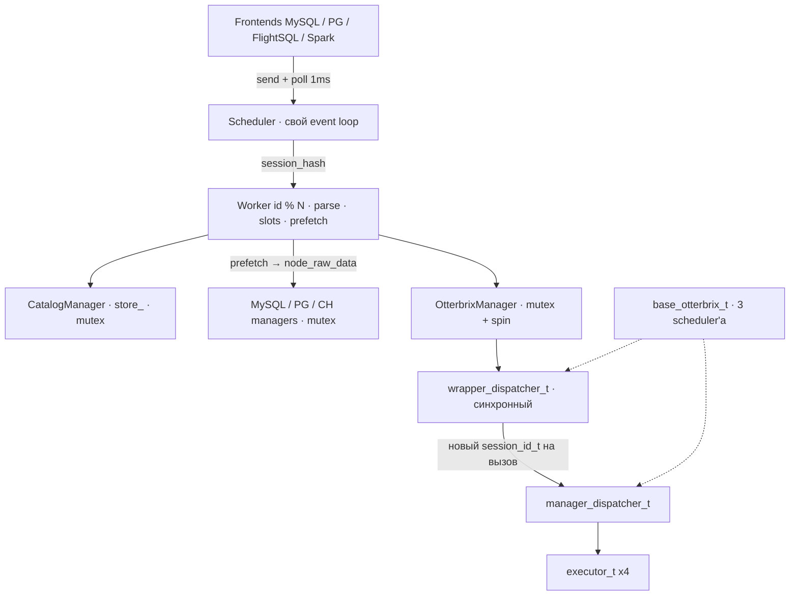
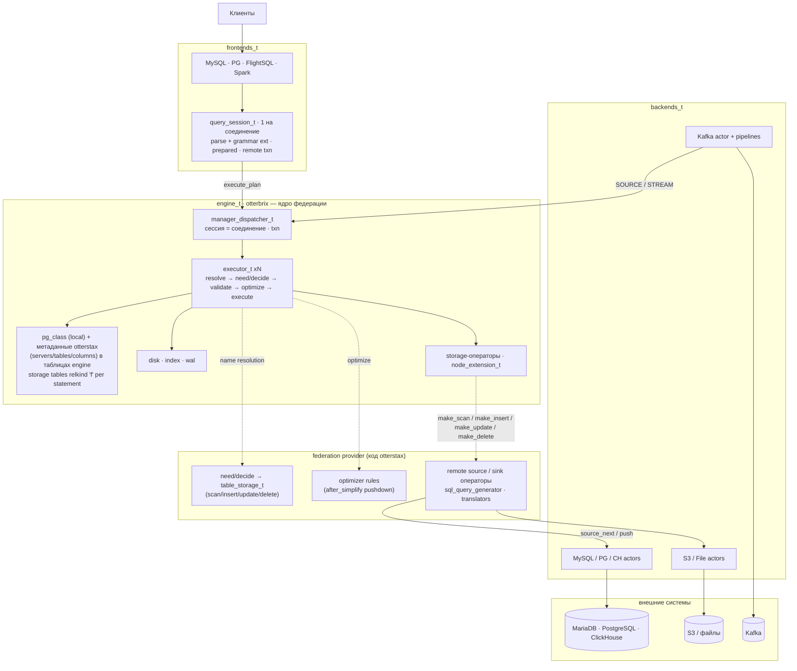
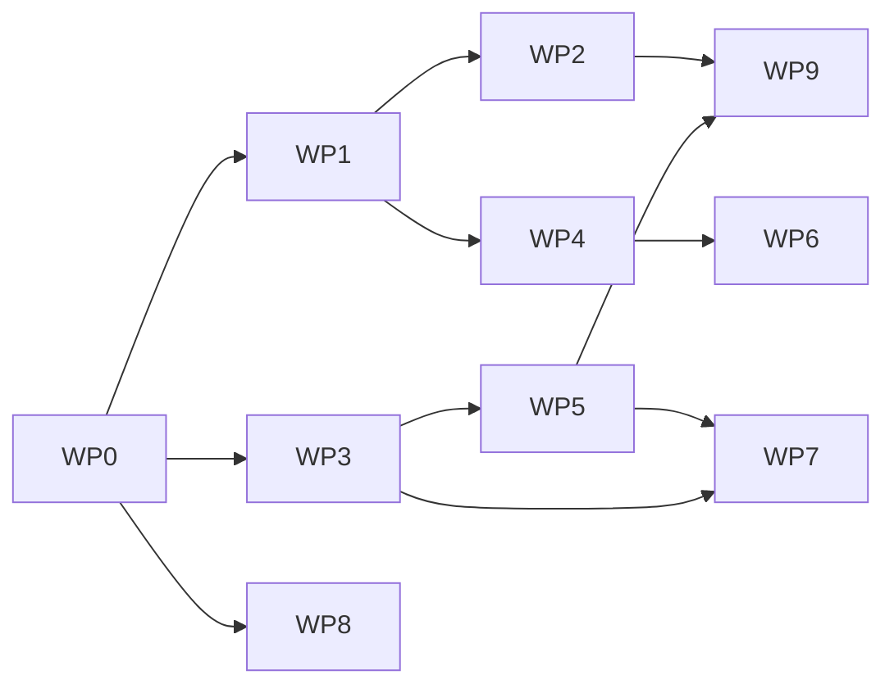

# Миграция: Scheduler/Worker → встроенный otterbrix как ядро федерации

**Статус:** предложение (план работ otterstax).
**Текущая база:** `origin/main` (`0b15739`: Spark Connect #22, in-house Flight SQL #32, quick start #30) на otterbrix
`1.0.0b2-rc-3` и actor-zeta `1.2.0`. Ссылки `file:line` без префикса — OtterStax `main`; §2 описывает текущий код
на rc-3.
**Целевая база:** релизный тег otterbrix, снятый с ветки `feat/otterstax-embedding` (`46fba865`), и actor-zeta
`2.0.0`. Ссылки `fe:<path>:<line>` — otterbrix на `46fba865`. Контракт хоста — `docs/embedding-host-api.md` в
репозитории otterbrix.
**Парный документ:** [`otterbrix-embedding.md`](otterbrix-embedding.md) — что ещё нужно от otterbrix (задачи
`OTB-*`). Здесь задачи `OTB-*` только упоминаются по ID.

---

## 1. Контекст и цель

Сейчас otterstax использует otterbrix как «чёрный ящик» поверх собственной надстройки:

- у otterstax свой маршрутизатор (`Scheduler`) и свой пул исполнителей (`Worker`);
- свой каталог (`CatalogManager::store_` плюс зеркала и manifest-коллекции в engine);
- своя федерация: prefetch бэкендов в `node_raw_data` до вызова engine;
- engine вызывается через синхронный `wrapper_dispatcher_t` под mutex, на каждый вызов создаётся новый `session_id_t`.

Ветка otterbrix `feat/otterstax-embedding` уже даёт почти всё, что нужно для встраивания (сводка —
[`otterbrix-embedding.md` §1.2](otterbrix-embedding.md#12-что-уже-сделано-в-featotterstax-embedding)):
`open_engine` с пулами хоста, `make_log`, разрешение имён хостом (`need` / `decide` → `table_storage_t`), правила
оптимизатора хоста, запись в storage (INSERT sink, UPDATE/DELETE), `affected_rows()` в cursor, PG-семантику
транзакций, исправления багов, из-за которых в OtterStax живут обходы.

**Цель:**

- otterbrix встроен в otterstax через `open_engine`, лишних обёрток нет;
- каталог один: локальные таблицы — `pg_class` engine, удалённые — метаданные otterstax в обычных таблицах engine,
  отвечаемые через `need` / `decide`;
- сессия engine = соединение клиента, транзакции настоящие;
- федерация (планирование, pushdown, source/sink) — внутри otterbrix, через storage-таблицы и правила хоста;
- otterstax — frontends + «federation provider»: коннекторы, SQL-диалекты, трансляторы.

**Как идём:** гибрид по этапам. Каждый этап проверяется существующими тестами и откатывается отдельно.

---

## 2. Текущий flow (по коду)

### 2.1 Схема

### 2.2 Сборка процесса

| Шаг | Где | Что |
|---|---|---|
| Логгеры | `main.cpp:36`, `utility/logger.hpp:81` | `initialize_all_loggers` — глобальные spdlog-логгеры otterstax, отдельно от логгера otterbrix |
| Engine | `component_manager/component_manager.cpp:22-24` | `new db::otterbrix_engine_t(config)` — наследник `otterbrix::base_otterbrix_t` (`integration/otterbrix/otterbrix_engine.hpp`); ресурс памяти берётся у dispatcher'а engine |
| Планировщики engine | otterbrix `integration/cpp/base_spaces.cpp:32-34` (rc-3) | три `actor_zeta::shared_work(3, 1000)`: общий, dispatcher, disk |
| `OtterbrixManager` | `component_manager.cpp:35` | актор поверх `IDataManager` → `OtterbrixDataManager` → `base_otterbrix_t*` |
| Kafka | `component_manager.cpp:38-40`, `:121` | `KafkaManager` получает адрес dispatcher'а engine напрямую (`engine_dispatcher_address()`); `recover()` после инициализации |
| Каталог и бэкенды | `component_manager.cpp:43-75` | `CatalogManager`, три `ConnectorManager`, три integration-актора, `set_backend_managers` |
| Пул Worker'ов | `component_manager.cpp:99-103` | `worker_count = max(2, hardware_concurrency)`, `sharing_scheduler`, `spawn<Scheduler>` |
| Соединения | `main.cpp:94`, `main.cpp:101` | `ComponentManager cmanager(...)`, `register_connections(config.connections, retry)` |

### 2.3 Выполнение запроса (`execute`)

| # | Шаг | Где | Что происходит |
|---|---|---|---|
| 1 | Frontend | `frontend/mysql_server/connection/packet_processing.cpp:217-224`; `frontend/postgres_server/connection/packet_processing.cpp:92-97`; `frontend/flight_sql/scheduler_engine.cpp:99-105` | **Новый `session_id` на каждый statement**, `send(scheduler_, &Scheduler::execute, id.hash(), sql)`, ожидание через `await_future_blocking` |
| 2 | Ожидание | `frontend/common/asio_future_bridge.hpp:41`, `:91` | Опрос `take_ready()` с шагом `AWAIT_POLL_STEP{1}` мс на приватном `io_context`; Spark — gRPC-вариант `frontend/spark_connect_server/await_future.hpp` |
| 3 | Scheduler | `scheduler/scheduler.cpp:161-168` | `enqueue_impl` кладёт сообщение в lock-free inbox и будит `loop_thread_` |
| 4 | Event loop | `scheduler/scheduler.cpp:70-143` | Свой цикл: создать behavior → возобновить готовые → удалить завершённые; сон 100 мкс |
| 5 | Маршрутизация | `scheduler/scheduler.cpp:195-204` | `route`: `idx = id % workers_.size()`, `send` в Worker, при необходимости `scheduler_->enqueue` |
| 6 | Parse | `scheduler/worker.cpp:402-418`, `:1130-1150` | `Worker::execute` → `parse_sql`: единственное место с `try/catch` вокруг `IParser::parse` |
| 7 | Extraction | `otterbrix/parser/parser.cpp:420` | `prepare_sql` (`subquery_extractor`): федеративные подзапросы вынимаются в stubs `__otterstax_subq_N` |
| 8 | Raw parse | `otterbrix/parser/parser.cpp:432` | `run_raw_parser(..., registry_)` — свой registry grammar-extensions (s3/file/kafka регистрируются в конструкторе, `parser.cpp:376-400`) |
| 9 | Тип extension | `otterbrix/parser/parser.cpp:456-465` | `ExtensionNode.extension_id`: s3/file → `external`, kafka → `kafka` |
| 10 | Transform | `otterbrix/parser/parser.cpp:509-525` | `transformer` → `binder.node_ptr()` (это `sub_queries.back()`, см. §7.1) |
| 11 | `catalog_resolves` | `otterbrix/parser/parser.cpp:551-557` | `finalize()` только при всех связанных параметрах; иначе — позже, после Bind |
| 12 | Slots / batches | `otterbrix/parser/parser.cpp:259-340`, вызов `:560` | `get_external_nodes`: BFS по плану; таблица с пустым `unique_identifier` — локальная, пропускается (`:286-288`); повтор uid в batch уводит слот в следующий batch (`:322-336`, `TODO: remove this segment when connection pool will be added`) |
| 13 | Stubs | `otterbrix/parser/parser.cpp:571` | `swap_stubs_into_schema_nodes` — stub'ы подзапросов → `schema_node_t` |
| 14 | Extension-корни | `scheduler/worker.cpp:423-487` | external → `handle_external_statement`; kafka DDL → `KafkaManager::execute`; `INSERT INTO kafka.x` → `produce` / `add_stream_insert` |
| 15 | Классификация | `scheduler/worker.cpp:491-524` | `classify_and_run`: `guard_database_ddl` (`:998`), затем при `external_nodes_count > 0` — `CatalogManager::update_backend_type`, иначе `Otterbrix` |
| 16 | Каталог | `catalog/catalog_manager.cpp:339`, `:191-290`, `:292` | Ленивая регистрация (`ensure_external_targets_registered`), OID из `store_` на узлы (`:243-256`), `backend_type` / `node_backend_types` (`:259-285`). Все handler'ы под `mutex_` в `enqueue_impl` (`:156-158`) |
| 17 | Prefetch | `scheduler/worker.cpp:938-982` | `run_pipeline`: MySQL → PG → CH строго по очереди (для `Mixed` — все три) |
| 18 | Backend manager | `integration/sql/connection_manager.cpp:184-330` | Batches с конца (`:198`); `generate_slot_statement` (`:83-96`, вызов `:255`) → `executeQuery` → `tsl::mysql_to_chunk` (`:267`) → `capture_remote_dml_count` (`:321`) → `make_node_raw_data` подменяет узел плана (`:326-327`). Mutex в `enqueue_impl` (`:47-49`) |
| 18' | PG / CH | `integration/postgresql/connection_manager.cpp:248`, `:403`; `integration/clickhouse/connection_manager.cpp:290`, `:460` | То же самое на своём диалекте |
| 19 | Engine-актор | `integration/otterbrix/otterbrix_manager.cpp:108-125` | `enqueue_impl`: `lock_guard(mutex_)`, behavior выполняется до конца **на потоке отправителя**, ожидание — `std::this_thread::yield()` |
| 20 | Remote DML | `integration/otterbrix/otterbrix_manager.cpp:487-491`; `types/otterbrix.hpp:55-56` | Если DML полностью выполнен на бэкенде, engine обходится, счётчик — из `remote_affected_rows` |
| 21 | Engine | `integration/otterbrix/otterbrix_manager.cpp:493` → `otterbrix/operators/execute_plan.cpp:271-295` | `guard_node` (constant aggregates, `:276-282`), план из текущего корня, `catalog_resolves` копируются руками (`:293`), `dispatcher()->execute_plan(otterbrix::session_id_t(), plan)` (`:294`) — **новая сессия на вызов** |
| 22 | Executor | otterbrix `services/dispatcher/dispatcher.hpp:182`, `dispatcher.cpp:432` | Пул из 4 `executor_t`, выбор `hash(session) % 4` |
| 23 | Форма результата | `integration/otterbrix/otterbrix_manager.cpp:494-520` | DML без RETURNING → carrier-счётчик; row-producing без колонок → `schema_error` |
| 24 | Ответ | `scheduler/worker.cpp:1171-1187` | `take_payload` → `session_payload` → future → frontend |

### 2.4 Prepare (`prepare_schema` / `prepare_plan`)

- `Worker::prepare_schema` (`scheduler/worker.cpp:612-645`) разбирает SQL. External-корень отвечает пустой схемой,
  Kafka DDL — отказом `unimplemented_yet` (`:631-641`). Дальше — `describe_parsed` (`:647`).
- `describe_parsed`:
  - `guard_database_ddl`;
  - локальный запрос (`external_nodes_count == 0`) → `OtterbrixManager::get_schema` (`:698`, `:758`). Для
    параметризованного запроса — `LIMIT 0` probes по `plan_dependencies`;
  - удалённый → `CatalogManager::get_catalog_schema` (`:771`), затем `describe` бэкендов в порядке
    `run_pipeline` (`:823`, `:832`, `:841`), затем снова `get_schema` для JOIN-корня (`:873`).
- Prepared statement одноразовый: `metadata_map_` Worker'а, `execute_statement` (`:526-570`) забирает план и
  стирает запись.
- `close_statement` (`:885`) идемпотентен. Frontends закрывают незавершённые statement'ы в `finish_impl`
  (`mysql_server/connection/packet_processing.cpp:587`, `postgres_server/connection/packet_processing.cpp:733`).

### 2.5 Extension-statement'ы, COPY, Kafka

| Statement | Маршрут | Где |
|---|---|---|
| `CREATE EXTERNAL TABLE` (s3) | `S3Manager::download` → `FileManager::add_file` → engine | `worker.cpp:1037-1074` |
| `CREATE EXTERNAL TABLE` (файл) | `FileManager::add_file` | `worker.cpp:1063` |
| `COPY (<sql>) TO` | повторный `parse_sql` внутреннего SQL → `S3Manager::upload` / `FileManager::dump_file` → `OtterbrixManager::execute`. **Без каталога и без `run_pipeline`** | `worker.cpp:1076-1127` |
| Kafka DDL | `KafkaManager::execute` | `worker.cpp:428-441` |
| `INSERT INTO kafka.x VALUES` | `KafkaManager::produce` | `worker.cpp:471-486` |
| `INSERT INTO kafka.x SELECT` | `KafkaManager::add_stream_insert` (continuous query) | `worker.cpp:452-469` |
| Kafka pollers / streams | собственные потоки, `kafka_query_session` шлёт в dispatcher engine напрямую | `integration/kafka/detail/kafka_reader.hpp:111` |

### 2.6 Где сейчас сериализация и состояние

| Место | Механизм | Следствие |
|---|---|---|
| `Scheduler` | свой event loop, сон 100 мкс | лишний hop + латентность на каждый запрос |
| `Worker` | sticky `id % N`, `metadata_map_` без блокировок | prepared-состояние привязано к Worker'у, а не к соединению |
| `CatalogManager` | `mutex_` в `enqueue_impl`, handler до конца на потоке отправителя | все классификации последовательны |
| `MySQL/PG/CH` managers | `mutex_` в `enqueue_impl` | все запросы к бэкенду одного типа последовательны |
| `OtterbrixManager` | `mutex_` + spin (`yield`) | **весь engine-трафик последовательный**, поток отправителя крутится |
| `wrapper_dispatcher_t` | синхронный, новый `session_id_t` на вызов | нет сессий, нет транзакций между statement'ами |
| Frontends | новый `session_id` на statement; PG `transaction_manager` — только состояние для `ReadyForQuery`; MySQL `SET autocommit` → «just ok, no transactions» (`mysql_server/connection/packet_processing.cpp:306-309`) | транзакций фактически нет |

---

## 3. Целевое состояние

Каноническая версия схемы — https://l.mermaid.ai/OG3kcs; при расхождении правится она, а сюда копируется.

**Что куда переезжает:**

| Сейчас | Цель | Этап |
|---|---|---|
| `Scheduler` + пул `Worker` (`scheduler/`) | `query_session_t` на соединение (в `frontend/common/`) | 1 |
| `ComponentManager` (`component_manager/`) | RAII-модули `runtime_t` → `engine_t` → `backends_t` → `frontends_t`, композиция в `main.cpp` | 1 |
| `base_otterbrix_t`, `otterbrix_engine_t`, `wrapper_dispatcher_t` | `services::engine::open_engine` с пулами `runtime_t`, прямой `send` в `engine_t::dispatcher_address()` | 1 |
| `OtterbrixManager`, `IDataManager`, `OtterbrixDataManager` | удаляются; форма результата — функции `query_session_t`; `guard_node` удаляется (исправлено в движке) | 1 |
| `CatalogManager::store_`, `connection_registry_`, зеркала в базе uid, manifest `__otterstax_tables` | таблицы `otterstax.servers` / `otterstax.remote_tables` / `otterstax.remote_columns` в engine + `need` / `decide` | 1 |
| `session_id_t()` на вызов | `engine_session_id` на соединение, транзакции | 1 |
| logger otterstax + logger otterbrix | общие sinks: `log_t` движка оборачивает `spdlog::logger` otterstax | 1 |
| prefetch `run_pipeline` → `node_raw_data` для полных сканов | `table_storage_t::make_scan` | 2 |
| `get_external_nodes`, `subquery_extractor`, remote DML, `INSERT … SELECT` в бэкенд | правило хоста `after_simplify` (pushdown целого поддерева) + `make_insert` / `make_update` / `make_delete` | 3 |
| `run_pipeline`, batches, `remote_affected_rows` | удаляются | 4 |

---

## 4. Решения

| # | Решение | Почему |
|---|---|---|
| 1 | **Frontends.** `query_session_t` — одна на соединение: parse с grammar-extensions, prepared statements, `session_id`, транзакция, закреплённые удалённые соединения. `scheduler/` удаляется. | Состояние соединения принадлежит соединению, а не Worker'у по хешу. `Scheduler` — чистый hop без собственной логики. |
| 2 | **Engine.** `engine_t` OtterStax — это `services::engine::open_engine(resource, schedulers_t{general, exec, disk}, config, log, primitives)` (`fe:services/engine/engine.hpp:48-52`). Три пула — выделенные, их создаёт `runtime_t` и держит дольше `engine_t`: движок их стартует и останавливает (`fe:services/engine/engine.cpp:799-801`, `:854-856`). `base_otterbrix_t`, `wrapper_dispatcher_t`, `otterbrix_engine_t`, `OtterbrixManager`, `IDataManager` удаляются. | Bootstrap, WAL replay, lock каталога и shutdown с CHECKPOINT живут в otterbrix — копировать нечего. |
| 3 | **Сборка.** Модули `runtime_t` (resource + пулы) → `engine_t` → `backends_t` → `frontends_t` вместо `ComponentManager`. | Явный порядок создания и обратный порядок разрушения. Тестовый стек собирается из тех же модулей. |
| 4 | **Каталог.** Локальные таблицы — `pg_class` / `pg_attribute`. Серверы, удалённые таблицы и их колонки (с удалённым написанием) — обычные таблицы engine в базе `otterstax`; удалённое имя разрешает `decide`, отвечая колонками и `table_storage_t`. Зеркала, `store_`, `connection_registry_` и manifest удаляются. | Так задуман контракт хоста (`docs/embedding-host-api.md`, «Column names and their case»). Каталог разрешает имя первым (`fe:services/collection/executor.cpp:519-520`): любая таблица engine с удалённым именем перехватила бы его у `decide`. У удалённой таблицы нет OID: relkind `'f'` на один statement, в `pg_class` её нет. |
| 5 | **Сессия.** Один `engine_session_id` на соединение. При disconnect — ROLLBACK (и `close_session` после OTB-session). Executor выбирается round-robin (`fe:services/dispatcher/dispatcher.cpp:363-367`). | Транзакции и per-session настройки невозможны при новой сессии на вызов. |
| 6 | **Транзакции.** Чтение — из любых источников, запись — в одно место, без 2PC. Локальная запись — транзакционная, PG-семантика движка. MySQL/PG — по модели postgres_fdw; COMMIT/ROLLBACK удалённых соединений шлёт `query_session_t` (хука commit в движке нет, OTB-txn-storage). CH / S3 / File / Kafka / COPY / external DDL внутри `BEGIN` — отказ. | Один пишущий участник делает 2PC ненужным; нетранзакционные приёмники честнее отклонить. |
| 7 | **Федерация — в otterbrix, поэтапно**: имена (этап 1) → полные сканы (2) → запись и pushdown (3) → удаление старого пути (4). | Большой одномоментный перенос не проверить; differential-тест старого и нового пути на каждом этапе. |
| 8 | **Kafka, S3/File, COPY** остаются grammar-extensions OtterStax. Позже S3/File можно отдавать как read-only storage, а `INSERT INTO kafka.x` — как `make_insert`-sink. | У Kafka своя модель долговечности; S3/File — загрузка в engine, а не удалённое чтение. |
| 9 | **Logger** — общие sinks: otterstax создаёт `spdlog::logger` с sinks своих логгеров и передаёт его движку как `log_t` (`fe:components/log/log.hpp:26`); движок ничего не регистрирует в spdlog (`fe:components/log/log.cpp:34-55`). | `child(name)` в otterbrix нет, а глобального состояния у `make_log` больше нет. |

---

## 5. Этапы

### Стоимость перехода с rc-3 на тег с ветки

Делается в начале этапа 1 (WP0), до структурных изменений:

- **conan:** `otterbrix/<tag>` и `actor-zeta/2.0.0` вместо `1.0.0b2-rc-3` и `1.2.0` (`conanfile.py:57-59`).
- **actor-zeta 2.0:** блокирующие `get()` / `wait()` у future удалены — все ожидания через `co_await` или
  `take_ready()`.
- **Парсер:** план — только через `transform_result::finalize()` (`fe:components/sql/transformer/transform_result.hpp:51`);
  `binder.node_ptr()` (`otterbrix/parser/parser.cpp:525`) больше нет. Заодно закрывается §7.1.
- **Имена:** `qualified_name_t` из строго типизированных `core::dbname_t` / `schema_t` / `relname_t`
  (`fe:components/base/collection_full_name.hpp:32-66`), конструкторы узлов принимают его
  (`fe:components/logical_plan/node_aggregate.hpp:60`); правятся вызовы вроде `otterbrix/operators/schema_probe.hpp:133`, `:147`.
- **Engine:** наследование `base_otterbrix_t` (`integration/otterbrix/otterbrix_engine.hpp:26-35`) невозможно —
  `base_otterbrix_t::open` (`fe:integration/cpp/base_spaces.hpp:26-27`); на этапе 1 его всё равно заменяет `open_engine`.
- **Удаляются обходы:** `guard_node` (`otterbrix/operators/execute_plan.cpp:244-264`), вендорная копия
  `cmake/otterbrix_parser_extension.cmake`, `static_assert` на layout ресурса
  (`integration/otterbrix/otterbrix_engine.hpp:17-24`). Документы-запросы
  `docs/otterbrix_request_constant_aggregates.md` и `docs/otterbrix_request_avg_integer_division.md` можно закрыть:
  исправлено (`fe:integration/cpp/test/test_constant_aggregates.cpp`, `fe:integration/cpp/test/test_avg_sum_widening.cpp`);
  записи о них в «Known Constraints» корневого `CLAUDE.md` удаляются.
- **Ожидания тестов**, которые меняются осознанно: `avg` над integer теперь DOUBLE, `sum` над integer — BIGINT с
  ошибкой переполнения; equi-JOIN int32 ⋈ int64 больше не пустой; `CREATE TABLE` поверх существующей — ошибка.

### Этап 1 — структурный перенос на тег с ветки

**Scope.** Решения 1–6 и 9. Prefetch `run_pipeline` → `node_raw_data` для запросов, которые парсер OtterStax уже
выносит, не меняется: он переезжает из `Worker` в `query_session_t` как есть.

**Инварианты этапа:**

- существующие тесты проходят без изменения ожиданий, кроме перечисленных выше;
- добавляются тесты транзакций и сессий;
- бенчмарк не хуже базового (ожидается лучше: минус hop через `Scheduler`, минус mutex engine).

**Нужно от otterbrix:** OTB-tag (блокер), OTB-session; желательно OTB-reply, OTB-txn-mode.

#### Пакеты работ

| WP | Содержание | Зависит от | Исполнитель | Параллельно с |
|---|---|---|---|---|
| WP0 | bump на тег с ветки: conan, actor-zeta 2.0, `finalize()`, `qualified_name_t`, удаление обходов | OTB-tag | основной агент | — |
| WP1 | `engine_t` = `open_engine` с пулами `runtime_t` и `log_t` otterstax; reopen-тесты | WP0 | основной агент + ревью opus | WP3, WP8 |
| WP2 | модули `runtime_t` / `engine_t` / `backends_t` / `frontends_t` вместо `ComponentManager`; тестовый стек на модулях | интерфейс WP1 | opus | WP3 |
| WP3 | `future_await` + `query_session_t` (перенос `Worker` 1:1) | WP0 | opus | WP1, WP2 |
| WP4 | прямой `send` в `dispatcher_address()`; удаление wrapper / `OtterbrixManager` / `IDataManager`; параллельный engine + TSAN | WP1 | основной агент + ревью opus | WP5 |
| WP5 | frontends MySQL / PG / FlightSQL / Spark → session; удаление `scheduler/` | WP3 | opus | WP4, WP6 |
| WP6 | центральный каталог: метаданные `otterstax.*` + `need` / `decide` → storage со `make_scan`; удаление зеркал / `store_` / registry / manifest | WP4 | основной агент + ревью opus | WP5, WP7 |
| WP7 | сессия на соединение, PG-семантика транзакций, ROLLBACK при disconnect, перехват `SET`, remote-запись по модели postgres_fdw | WP3, WP5 | основной агент + ревью opus | WP6 |
| WP8 | logger: общие sinks, `log_t` движка поверх `spdlog::logger` otterstax | WP0 | haiku | всё |
| WP9 | миграция тестов `scheduler_stack.hpp` → модули; новые тесты транзакций, сессий, каталога | WP2, WP5 | opus | WP6, WP7 |

**Критические пути:** WP0 → WP1 → WP4 → WP6 (engine → параллельность → каталог); параллельно WP3 → WP5 → WP7.

#### Содержание пакетов

**WP1 — `engine_t`.**
- `services::engine::open_engine(resource, schedulers_t{general, exec, disk}, config, log, primitives)`; ошибка
  старта (занятый `.lock`, нечитаемый WAL, неверный `config.execution`) — ошибка `main`, как сейчас для конфига.
- Пулы — три выделенных `shared_work` в `runtime_t`, живут дольше `engine_t` (OTB-embed-pools — позже). Пул
  бэкендов и frontends — отдельный.
- `config.execution.executor_pool_size` и `pump` (`fe:components/configuration/configuration.hpp:55-67`) выводятся в
  `config.yaml` OtterStax (`service.engine`).
- На этапе 1 `primitives` = `need` / `decide` WP6, правил оптимизатора нет.
- Reopen-тесты: запись → разрушение `engine_t` (финальный CHECKPOINT) → открытие на том же каталоге → данные на месте;
  второй `open_engine` на занятом каталоге получает отказ.

**WP2 — модули.**
- `runtime_t`: `std::pmr` resource, три пула движка, `sharing_scheduler` бэкендов (сейчас `component_manager.cpp:99-100`).
- `backends_t`: connector managers, integration-акторы MySQL / PG / CH, S3 / File, Kafka (с `recover()`),
  регистрация соединений из `config.yaml` (`connection_retry.hpp` переезжает сюда).
- `frontends_t`: серверы + фабрика `query_session_t`. `main.cpp` собирает модули по порядку, разрушение — в обратном.

**WP3 — `query_session_t`.**
- Перенос `Worker` 1:1: `parse_sql`, `classify_and_run`, `describe_parsed`, `run_pipeline`, `guard_database_ddl`,
  extension/Kafka-маршруты, prepared-метаданные.
- Объект соединения, а не актор; корутины на executor'е соединения (asio strand / gRPC context), ожидание через
  `future_await` — обобщение `asio_future_bridge.hpp` и `spark_connect_server/await_future.hpp`.
- Parser — один на сессию. Prepared: map внутри сессии; одноразовость — до OTB-reply / PREPARE в движке.
- **Statement'ы сессии шлются строго по одному:** внутри явной транзакции dispatcher пускает statement'ы одной
  сессии параллельно (`fe:services/dispatcher/dispatcher.cpp:1095-1108`).

**WP4 — прямой send, параллельный engine.**
- `query_session_t` шлёт `execute_plan` в `engine_t::dispatcher_address()` (`fe:services/engine/engine.hpp:40`).
- Форма результата: DML без RETURNING — `cursor->affected_rows()` / `is_write()`
  (`fe:components/cursor/cursor.hpp:59-62`) вместо carrier'а; правило формы (`otterbrix_manager.cpp:494-520`) —
  свободная функция в `otterbrix/operators/`.
- Удаляются `OtterbrixManager`, `IDataManager` / `OtterbrixDataManager`, `integration/otterbrix/otterbrix_engine.*`,
  `guard_node`. `FileManager` / `S3Manager` / Kafka получают адрес dispatcher'а.

**WP5 — frontends.**
- MySQL, PG, Spark: `session_id` создаётся при установке соединения
  (`mysql_server/connection/packet_processing.cpp:219`, `:320`, `:549`; `postgres_server/connection/packet_processing.cpp:94`,
  `:234`, `:445`).
- Flight SQL: `SchedulerEngine` → адаптер над `query_session_t`, сессия на RPC (autocommit). `BeginTransaction` вне scope.
- Spark: сессия на `session_id` Spark Connect, закрывается в `ReleaseSession` (сейчас no-op, `service_misc.cpp`).
- Удаляются `scheduler/` и `Scheduler`-адреса в `frontend_server_config` / `flight::server::config_t`.

**WP6 — центральный каталог.** Таблица замен — §6.4.
- Таблицы engine: `otterstax.servers` (uid, тип бэкенда, из `config.yaml` при старте), `otterstax.remote_tables`
  (uid, db, schema, table, удалённое написание), `otterstax.remote_columns` (колонка в нижнем регистре, удалённое
  написание, тип engine). Заполняются discovery на старте.
- `need`: план чтения `otterstax.remote_tables` / `remote_columns` по неразрешённым именам. `decide`: колонки +
  `remote_storage_t` (тег владельца — адрес static OtterStax). На этапе 1 storage умеет `make_scan` (полный
  `SELECT <cols>` через backend-актор); `make_insert` / `make_update` / `make_delete` отказывают «not supported yet».
  ClickHouse всегда отказывает в update/delete по row id.
- `need` / `decide` синхронные и не должны блокировать: discovery удалённой схемы — только заранее (старт, явное
  обновление) или после ошибки «does not exist» с повтором statement'а в `query_session_t`. Хуки stateless и
  вызываются с нескольких потоков — общий кэш схем потокобезопасен.
- Зеркала в базах uid удаляются (иначе каталог разрешил бы имя раньше `decide`, решение 4). Старый путь (prefetch)
  ставит узлам идентификатор строки `otterstax.remote_tables` вместо OID зеркала (`catalog_manager.cpp:243-256`) —
  проверить все читатели OID в `sql_query_generator` (`generate_insert`, `:2047-2051`).
- FlightSQL `GetTables` / `spark.catalog`: локальные таблицы — SQL по `pg_catalog`, удалённые — по `otterstax.*`.
- Неразрешённое имя без uid-префикса `decide` отвечает «не моё» — ошибка «does not exist» от движка.

**WP7 — сессии и транзакции.** Правила — §6.2–6.3.
- PG-семантика уже в движке (`fe:services/dispatcher/dispatcher.cpp:455-458`, `:980-989`); PG `transaction_manager`
  берёт `I` / `T` / `E` из ответов движка, а не эмулирует их.
- Ошибка разбора внутри транзакции отправляется в движок через `refuse_statement`
  (`fe:services/dispatcher/dispatcher.hpp:98-100`), чтобы сессия перешла в failed так же, как при ошибке выполнения.
- `SET autocommit` и `SET TIME ZONE` в движке глобальные (`fe:services/dispatcher/dispatcher.hpp:277-283`):
  `query_session_t` перехватывает их и держит у себя (autocommit off = явный `BEGIN` перед следующим statement'ом),
  пока нет OTB-session.
- ROLLBACK при disconnect: `finish_impl` шлёт ROLLBACK в движок и удалённым соединениям.
- Удалённые соединения: `connectors/{mysql,postgresql}` — пул на uid вместо одного соединения
  (`connections_` в `connectors/mysql/manager.hpp`); закрепление за `(session, server)` — по
  `pipeline::context_t::session` в операторе (`fe:components/context/context.hpp:32`). COMMIT/ROLLBACK удалённой
  стороны шлёт `query_session_t` до и после команды движку (OTB-txn-storage).

**WP8 — logger.** `spdlog::logger` с sinks otterstax → `log_t` движка; `initialize_all_loggers` без глобальных
side-effect'ов (`utility/logger.hpp:42-111`).

**WP9 — тесты.**
- `tests/system/scheduler_stack.hpp` → стек на модулях WP2; ожидания в `tests/system/` не меняются, кроме
  перечисленных в «Стоимости перехода»; точка входа — `session.execute(...)`.
- Моки `tests/mock/otterbrix.hpp` заменяются реальным engine на временном каталоге.

#### Затронутые файлы (этап 1)

| Область | Файлы | Действие |
|---|---|---|
| Сборка зависимостей | `conanfile.py`, `cmake/otterbrix_parser_extension.cmake` | тег с ветки, actor-zeta 2.0; удалить вендорную копию |
| Scheduler | `scheduler/{scheduler,worker}.{hpp,cpp}`, `scheduler/session_data.hpp`, `scheduler/CMakeLists.txt`, `scheduler/CLAUDE.md` | удалить (логика → `query_session_t`) |
| Сборка | `component_manager/{component_manager.{hpp,cpp},connection_retry.hpp,CMakeLists.txt}`, `main.cpp` | заменить модулями |
| Engine | `integration/otterbrix/{otterbrix_engine,otterbrix_manager}.{hpp,cpp}`, `otterbrix/operators/execute_plan.{hpp,cpp}`, `otterbrix/operators/schema_probe.hpp` | удалить / свести к свободным функциям |
| Парсер | `otterbrix/parser/parser.cpp` | `finalize()`, `qualified_name_t` |
| Каталог | `catalog/{catalog_manager,schema_store,discovery}.{hpp,cpp}`, `catalog/CLAUDE.md` | `otterstax.*` + `need` / `decide`, без зеркал |
| Federation provider | новый `otterbrix/federation/` | `remote_storage_t`, `need` / `decide`, scan-оператор |
| Коннекторы | `connectors/{mysql,postgresql}/{manager,connector}.{hpp,cpp}` | пул + закрепление на транзакцию |
| Integration | `integration/{sql,postgresql,clickhouse}/connection_manager.{hpp,cpp}`, `integration/s3/s3_manager.*`, `connectors/file/manager.*` | адрес dispatcher'а; handler порций для scan |
| Frontends | `frontend/common/*`, `frontend/mysql_server/connection/*`, `frontend/postgres_server/connection/*`, `frontend/flight_sql/scheduler_engine.*`, `frontend/spark_connect_server/{await_future.hpp,service_*.cpp,catalog_relations.cpp}` | `query_session_t` |
| Kafka | `integration/kafka/kafka_manager.*` | адрес dispatcher'а / сборка в `backends_t` |
| Утилиты | `utility/logger.hpp`, `utility/session.hpp` | WP8, id сессии |
| Тесты | `tests/system/scheduler_stack.hpp`, `tests/system/drive_future.hpp`, `tests/mock/otterbrix.hpp`, `tests/system/test_*.cpp` | WP9 |
| Документация | `CLAUDE.md`, `*/CLAUDE.md`, `docs/otterbrix_request_*.md` | новая архитектура; запросы закрыть |

#### Тесты этапа 1

- **Должны остаться зелёными:** `test_system`, `test_unit_*`, `test_mysql_front`, `test_parser`,
  `test_unit_spark_connect`; `./docker-run-tests.sh -j <JOBS>`, PySpark matrix, `tests/flightsql_e2e/`. Особое
  внимание: `test_restart_reconciliation.cpp`, `test_file_ingestion.cpp`, `test_scheduler_concurrent.cpp`,
  `test_prepared_reexecute.cpp`, `test_database_ownership_guard.cpp`, `test_frontend_shutdown.cpp`,
  `test_kafka_runtime.cpp`.
- **Новые:**
  - reopen и `.lock` для `open_engine` (WP1);
  - `BEGIN` / `COMMIT` / `ROLLBACK` локально (PG и MySQL wire); PG: после ошибки всё до ROLLBACK отклоняется,
    COMMIT отвечает ROLLBACK'ом;
  - ошибка разбора внутри транзакции переводит сессию в failed (`refuse_statement`);
  - `SET autocommit = 0` / `SET TIME ZONE` в одном соединении не влияет на другое;
  - запись в MySQL / PG внутри транзакции: commit, rollback, откат при ошибке по правилам фронтенда;
  - отказ CH / S3 / File / Kafka / COPY / external DDL внутри `BEGIN`;
  - ROLLBACK при disconnect; параллельные сессии под TSAN; изоляция незакоммиченной записи;
  - имя удалённой таблицы разрешается через `decide` и читается `make_scan` (WP6); неизвестное имя — «does not exist».

#### Риски этапа 1

| Риск | Где проявится | Смягчение |
|---|---|---|
| Код полагается на синхронность engine | `CatalogManager`, регистрация на старте, `test_restart_reconciliation`, `test_file_ingestion` | везде `co_await`; TSAN на весь `test_system` |
| Утечка состояния сессий без `close_session` | долгоживущий сервер | ROLLBACK при disconnect; метрика числа сессий; OTB-session |
| Глобальные `SET autocommit` / `TIME ZONE` | MySQL-клиенты с `SET autocommit=0` | перехват в `query_session_t` до OTB-session |
| Параллельные statement'ы одной сессии внутри транзакции | клиент с pipelining (PG extended protocol) | `query_session_t` шлёт строго по одному |
| `decide` не может спросить бэкенд | таблица, созданная на бэкенде после старта | «does not exist» → discovery → повтор statement'а |
| Чтение OID / типов с отправленного плана | `schema_probe.hpp`, `create_collection` | порядок «validate → reply» сохраняется; уходит с OTB-reply / OTB-describe |
| Большой diff фронтендов | WP5 | перенос по одному протоколу, каждый — отдельный merge |

#### Definition of done (этап 1)

- OtterStax собран на теге с ветки и actor-zeta 2.0; `scheduler/`, `component_manager/`, `integration/otterbrix/`,
  `IDataManager`, зеркала и manifest удалены.
- `main.cpp` собирает `runtime_t → engine_t → backends_t → frontends_t`.
- Все существующие тесты зелёные (ожидания меняются только по списку «Стоимости перехода»), TSAN `test_system` чистый.
- Новые тесты транзакций, сессий и каталога зелёные; бенчмарк не хуже базового.
- `CLAUDE.md` и `*/CLAUDE.md` описывают новую архитектуру.

### Этап 2 — полные сканы через `make_scan`

**Scope.**
- Удалённые таблицы, которые и сейчас забираются целиком (листья JOIN'а, `SELECT * FROM t`), парсер OtterStax
  больше не выносит: имя доходит до движка, `decide` отвечает storage'ем, данные идут через `make_scan`
  (WP6 этапа 1 уже это умеет).
- Запросы к одному бэкенду с pushdown (агрегаты, фильтры, DML) остаются на старом пути.
- Маршрутизация явная, по типу slot'а: «лист без pushdown» → storage, всё остальное → `run_pipeline`.

**Файлы.**

| Файл | Изменение |
|---|---|
| `otterbrix/parser/parser.cpp` (`get_external_nodes`) | slot «полный скан» не выносится |
| `otterbrix/federation/` | scan-оператор отдаёт порции ≤ `DEFAULT_VECTOR_CAPACITY` строк, запрос стартует в `open_impl` |
| `otterbrix/translators/input/{mysql,pg,ch}_to_chunk.*`, `chunk_windows.*` | вызываются из scan-оператора порциями |
| `integration/{sql,postgresql,clickhouse}/connection_manager.*` | handler «открыть курсор / следующая порция»; future выполняется на потоке backend-актора |

**Тесты.** Все тесты этапа 1; differential-тест старого и нового пути (кросс-бэкенд JOIN'ы
`tests/test_cross_backend_queries*.py`, `step_4.sql`, JOIN'ы с external); бенчмарк до и после.

**Риски.** Источники открываются параллельно (`fe:services/collection/executor.cpp:2489-2499`), но build-стороны
материализуются по очереди (`:2444-2457`), а готовность future находится опросом — OTB-notify, с замерами бенчмарка.

**Definition of done.** Differential-тест зелёный; бенчмарк не хуже старого пути (иначе маршрутизация остаётся на
старом пути по флагу); замеры переданы в OTB-notify.

### Этап 3 — запись и pushdown через storage и правила

**Scope.**
- **Pushdown:** правило хоста на стадии `after_simplify` находит поддерево, все таблицы которого — storage одного
  бэкенда (по `owner()`), и заменяет его одним `node_extension_t` с удалённым SQL. Колонки — типы engine: результат
  `sum` над integer приводится к BIGINT, `avg` — к DOUBLE (как считает движок). Логика `get_external_nodes` /
  `subquery_extractor` переезжает в это правило.
- **Запись:** `make_insert` (включая `INSERT … SELECT` из любых источников, Mixed и из локальных таблиц),
  `make_update` / `make_delete` по row id; простой UPDATE / DELETE — правилом одним удалённым statement'ом
  (как `a_simple_update_or_delete_is_one_remote_statement` в тестовом хосте otterbrix). `affected_rows()` — из cursor.
- **Raw-SQL stub'ы** — только для SQL, который понимает лишь диалект бэкенда. Реестр stub'ов глобальный для процесса
  (хуки stateless) и потокобезопасный.
- **Prepare** без LIMIT-0 по storage-таблицам — после OTB-describe.
- Kafka / external tables / COPY — без изменений (решение 8).

**Нужно в otterbrix:** OTB-describe, OTB-txn-storage; желательно OTB-host-ctx; по желанию OTB-pushdown-offers,
OTB-storage-ddl, OTB-sink-flush.

**Файлы.**
- `otterbrix/parser/{parser,subquery_extractor,name_resolution}.*` → правило `after_simplify`.
- `otterbrix/query_generation/*` — генерация по поддереву правила и по storage-оператору записи.
- `integration/*/connection_manager.*` → операторы provider'а (scan / insert / update / delete / remote statement).

**Тесты.** Differential по всем категориям: pushdown-агрегаты `tests/test_*_backend*.py`; DML `*_mutable.py`,
`test_dml_result_shape.cpp`, `test_clickhouse_dml_count.cpp`; prepare `test_single_backend_prepare_schema.cpp`;
закрытие §7.4 новыми тестами.

**Definition of done.** Все запросы идут через storage и правила; старый путь не вызывается ни одним тестом
(счётчик вызовов `run_pipeline` = 0 в `test_system` и docker-прогоне).

### Этап 4 — удаление старого пути

**Scope.** Удалить `run_pipeline` и prefetch-ветки backend managers, подстановку `node_raw_data`, batches,
`remote_affected_rows` / `no_remote_dml` (`types/otterbrix.hpp:55-56`), `capture_remote_dml_count`, `schema_utils`
в части, которую заменил describe движка.

**Тесты.** Полный прогон этапа 3; differential-тест удаляется вместе со старым путём.

**Definition of done.** Кода старого пути нет; `CLAUDE.md` описывает только flow через engine; бенчмарк не хуже
этапа 3.

---

## 6. Изменения поведения и решения по ним

### 6.1 Параллелизм engine

**Было.** Engine-трафик сериализован `OtterbrixManager::enqueue_impl` (`otterbrix_manager.cpp:108-125`): mutex,
behavior до конца на потоке отправителя, `yield`-спин.

**Станет.** Запросы разных сессий идут в dispatcher одновременно, executor выбирается round-robin. Прямая отправка
уже используется Kafka (`kafka_query_session`).

**Что проверить:** `test_restart_reconciliation.cpp` (сверка метаданных `otterstax.*` с бэкендами — до приёма
соединений), `test_file_ingestion.cpp` (порядок «CREATE → INSERT» в одной сессии), `test_scheduler_concurrent.cpp` →
тест параллельных сессий, TSAN на весь `test_system`.

**Решение.** Параллельность включается в WP4 одним изменением; откат — сериализация через одну сессию (флаг на
время этапа 1).

### 6.2 Сессия на соединение

| Аспект | Сейчас | Станет |
|---|---|---|
| id сессии | новый `session_id` на statement и новый `session_id_t()` на вызов engine (`execute_plan.cpp:294`) | один `engine_session_id` на соединение (Flight SQL — на RPC, Spark — на Spark-сессию) |
| Executor | `hash(session) % 4` (rc-3) | round-robin на каждый statement (`fe:services/dispatcher/dispatcher.cpp:363-367`) |
| Порядок statement'ов | — | `query_session_t` шлёт по одному; dispatcher упорядочивает очередь сессии (`take_turn_`) |
| Prepared | `metadata_map_` Worker'а | map внутри `query_session_t` |
| Настройки (`autocommit`, часовой пояс) | MySQL `SET autocommit` → OK без эффекта | в `query_session_t` до OTB-session (в движке они глобальные) |
| Disconnect | `finish_impl` закрывает statement'ы | ROLLBACK (engine + закреплённые remote-соединения) → `close_session` после OTB-session |
| Idle-in-transaction | нет | `read_timeout` соединения; timeout движка — OTB-session |

### 6.3 Транзакции

**Сейчас транзакций нет:** MySQL `SET autocommit` отвечает OK «no transactions»
(`mysql_server/connection/packet_processing.cpp:306-309`); PG `BEGIN` доходит до engine
(`postgres_server/connection/packet_processing.cpp:112-117`), но в одноразовой сессии.

**Правило: читать откуда угодно, писать в одно место, без 2PC.**

| Источник | Чтение в транзакции | Запись в транзакции |
|---|---|---|
| otterbrix (локальные и external-загруженные таблицы) | да, снимок сессии | да, MVCC engine |
| MySQL / MariaDB | да, закреплённое соединение, `REPEATABLE READ` | да, если это единственная цель записи |
| PostgreSQL | да, закреплённое соединение, `REPEATABLE READ` | да, если это единственная цель записи |
| ClickHouse | да (без гарантий снимка) | **отказ** (`decide` при `explicit_transaction`) |
| S3 / File (`CREATE EXTERNAL TABLE`, `COPY … TO`) | — | **отказ** |
| Kafka (DDL, `INSERT INTO kafka.x`) | — | **отказ** |
| DDL над external / remote | — | **отказ** (кроме implicit commit MySQL) |

**Модель postgres_fdw для MySQL/PG:**
1. Первый доступ к uid внутри транзакции закрепляет соединение из пула uid за `(session, uid)`:
   `START TRANSACTION ISOLATION LEVEL REPEATABLE READ` (PG: `BEGIN ISOLATION LEVEL REPEATABLE READ`). Storage-операторы
   находят его по `pipeline::context_t::session`.
2. Все чтения и запись этого uid в транзакции идут через закреплённое соединение.
3. Первая запись фиксирует цель записи сессии; запись во вторую — `invalid_parameter` «write to a second target
   inside a transaction».
4. COMMIT: `query_session_t` сначала коммитит пишущего удалённого участника, затем шлёт COMMIT движку и read-only
   участникам; ошибка удалённого COMMIT → ROLLBACK движку. Хука commit в движке нет (OTB-txn-storage); ROLLBACK
   движка не откатывает записанное storage'ем, поэтому откат удалённой стороны — тоже на `query_session_t`.
5. ROLLBACK, ошибка в PG-режиме или disconnect: откат всех закреплённых соединений и engine, возврат соединений в пул.

**Ошибка внутри транзакции:**

| Frontend | Поведение | Локально (engine) | Remote |
|---|---|---|---|
| PostgreSQL | транзакция aborted (`E`), всё до ROLLBACK — `25P02` | семантика движка; ошибки разбора — через `refuse_statement` | откат при ROLLBACK |
| MySQL | откатывается только упавший statement | до OTB-txn-mode — PG-семантика движка (известное расхождение) | `SAVEPOINT` перед statement'ом, `ROLLBACK TO SAVEPOINT` при ошибке |

**DDL в MySQL-frontend.** MySQL неявно коммитит транзакцию перед DDL; MySQL-frontend повторяет это. В PG-frontend
локальный DDL выполняется в транзакции engine, remote DDL внутри `BEGIN` отклоняется.

**Что не входит:** 2PC, запись в несколько целей, `SERIALIZABLE` на remote, транзакции Flight SQL.

### 6.4 Центральный каталог

| Что было | Где | Замена |
|---|---|---|
| OID внешней таблицы из `store_`, зеркала в базе uid | `catalog/catalog_manager.hpp:134`, `catalog_manager.cpp:243-256` | у удалённой таблицы OID нет; строка `otterstax.remote_tables`; движок видит storage-таблицу relkind `'f'` на statement |
| Промах в `connection_registry_` | `catalog_manager.hpp:147` | множество uid в `backends_t` + `otterstax.servers` |
| STRUCT колонок для prepare (`schema_by_oid`) | `catalog_manager.cpp:402` | `otterstax.remote_columns`; локальные — `pg_attribute` (после OTB-describe — describe движка) |
| FlightSQL `GetTables` из `store_` | `catalog_manager.cpp:668-680`, `frontend/flight_sql/scheduler_engine.cpp:334-339` | локальные — SQL по `pg_catalog.pg_class` / `pg_namespace` (как `frontend/spark_connect_server/catalog_relations.cpp`), удалённые — по `otterstax.remote_tables` |
| uid → тип бэкенда | `catalog_manager.cpp:142-153` | `connections:` в `config.yaml` → `otterstax.servers` при старте |
| Manifest `<uid>.__otterstax_tables` | `integration/otterbrix/otterbrix_manager.hpp:37`, `otterbrix_manager.cpp:176-270` | не нужен |
| `check_database_ownership` по registry | `catalog_manager.cpp:589-600` | по uid из конфигурации + `kafka` + `otterstax` |

**Что проверить:** `test_catalog_manager.cpp`, `test_restart_reconciliation.cpp` (сверка `otterstax.*` с бэкендами
вместо reuse/recreate/drop зеркал), `test_database_ownership_guard.cpp`, `test_flightsql_schema_contract.cpp`,
`test_spark_client_catalog.py`. Служебные таблицы (`kafka.__sources`, `*__offsets`, `otterstax.*`) из `GetTables`
исключаются.

---

## 7. Существующие особенности

Для каждой — characterization-тест. Исправления — там, где они естественно ложатся на новый путь.

### 7.1 Подзапросы в WHERE могли теряться — закрывается WP0

- `otterbrix/parser/parser.cpp:525` берёт `binder.node_ptr()`, на rc-3 это `plan_.sub_queries.back()`
  (`rc-3:components/sql/transformer/transform_result.cpp:304`): отдельный элемент `sub_queries` отбрасывался бы.
- На ветке `node_ptr()` нет, есть только `finalize()` → весь `execution_plan_t`
  (`fe:components/sql/transformer/transform_result.hpp:51`). После WP0 парсер отдаёт план целиком.
- **Проверка:** тест `SELECT … WHERE x IN (SELECT …)` над локальными таблицами до и после WP0.

### 7.2 `COPY (…) TO` не подтягивает remote-таблицы — закрывается WP6

- `Worker::copy_to` (`scheduler/worker.cpp:1076-1127`) отдаёт внутренний SELECT прямо в engine, без каталога и
  `run_pipeline`; engine видит зеркало без данных.
- После WP6 удалённое имя во внутреннем SELECT разрешает `decide`, и данные читает `make_scan`. Ожидание
  characterization-теста меняется осознанно.

### 7.3 Prepared `INSERT INTO kafka.x` идёт мимо Kafka

- `kafka_write_target` проверяется только в `Worker::execute` (`scheduler/worker.cpp:446`), но не в `prepare_schema`
  (`:631-641`) и не в `execute_statement` (`:554-569`): prepared `INSERT INTO kafka.x VALUES ($1)` пишет в
  backing-таблицу `kafka.x`.
- В `query_session_t` (WP3) переносится как есть; исправление — отдельной задачей после этапа 1.

### 7.4 INSERT в remote из локального источника; порядок Mixed — закрывается этапом 3

- `INSERT INTO <remote> SELECT … FROM <local>`: `generate_insert` отклоняет источник без OID («INSERT..SELECT child
  aggregate has no table_oid stamped», `otterbrix/query_generation/sql_query_generator.cpp:2047-2051`).
- `INSERT INTO <mysql> SELECT … FROM <pg>`: `run_pipeline` исполняет бэкенды в порядке MySQL → PG → CH
  (`scheduler/worker.cpp:940-981`) независимо от ролей.
- На этапе 3 источник читает движок (любой: локальный, storage, Mixed), цель получает строки через `make_insert`
  (`insert_into_a_storage_table` в тестовом хосте otterbrix).

---

## 8. Исполнение и проверка

### 8.1 Агенты и модели

- **Каждый WP** — отдельный агент в своём git worktree (`isolation: "worktree"`) от общей интеграционной ветки.
  WP вливаются последовательно: сборка + целевые тесты → merge. Интеграцию и конфликты разрешает основной агент.
- **Роли:**

| Роль | Кто | Что делает |
|---|---|---|
| Основной агент (Opus, весь контекст обсуждения) | — | сложные WP и интеграция: WP0, WP1, WP4, WP6, WP7 |
| opus-агенты (эксперименты и ревью) | эксперименты и ревью | эксперименты (storage-сканы, правило pushdown, бенчмарки); независимое ревью diff'ов: конкурентность, транзакции, каталог |
| opus-агенты | механика | WP2, WP3, WP5, WP9 |
| haiku | тривиальное | WP8, сверка ссылок |

- **Ограничение по RAM.** Одновременно собирают не больше 2 агентов, у каждого
  `--parallel = floor(RAM_MB / 1536) / 2` (формула `JOBS` из «Build resources» корневого `CLAUDE.md`).
- **Ревью.** После каждого WP независимый агент проверяет diff на регрессии по §6. Все WP ревьюит независимый
  opus-агент.
- **Workflow tool** для оркестрации многих агентов — только с явного подтверждения пользователя.

### 8.2 Этапы работ

| Этап | Агенты | Результат |
|---|---|---|
| 0 — документы | этот документ и `otterbrix-embedding.md`, сверка `file:line` и Mermaid | проверенные документы |
| 1 — структурный перенос | WP0–WP9 (§5) после OTB-tag | DoD этапа 1 |
| 2 — полные сканы | opus-агент: маршрутизация листьев на `make_scan`, differential-тест, бенчмарк; замеры для OTB-notify | DoD этапа 2 |
| 3–4 | по итогам этапа 2 и готовности OTB-describe / OTB-txn-storage; правило pushdown и запись — основной агент | DoD этапов 3–4 |

### 8.3 Verification

**На каждом этапе:** `test_system`, `test_unit_*`, `test_mysql_front`, `test_parser`, `test_unit_spark_connect`;
`./docker-run-tests.sh -j <JOBS>`, PySpark matrix, `tests/flightsql_e2e/`; TSAN-сборка и прогон `test_system`;
бенчмарк до и после (`./benchmark/scripts/run_benchmark.sh --repetitions 5`).

**Этап 1:** reopen и `.lock` для `open_engine`; транзакции локально и с записью в MySQL / PG; ROLLBACK при disconnect;
изоляция `SET`; параллельные сессии; отказы внутри `BEGIN`; разрешение удалённых имён через `decide`.

**Этапы 2–3:** differential-тест старого и нового пути, пока старый путь не удалён.

**Документы:** `file:line` сверены с `origin/main`, тегом `1.0.0b2-rc-3` и `feat/otterstax-embedding` (`46fba865`);
Mermaid проходит валидацию; коммит — только по команде пользователя.

---

## 9. Задачи otterbrix по этапам

Описание, API и критерии приёмки — в [`otterbrix-embedding.md`](otterbrix-embedding.md), §3–4.

| Этап | Задача | Приоритет | Что без неё делает otterstax |
|---|---|---|---|
| 1 | **OTB-tag** | P0 | этап 1 не начинается (OtterStax потребляет только теги) |
| 1 | **OTB-session** | P0 | ROLLBACK при disconnect; `SET autocommit` / `TIME ZONE` в `query_session_t`; idle — `read_timeout` |
| 1 | **OTB-reply** | P1 | OID / типы с плана после ответа (`schema_probe.hpp`), `catalog_resolves` копируются руками |
| 1 | **OTB-txn-mode** | P1 | PG-семантика движка и для MySQL-фронтенда; remote — `SAVEPOINT` |
| 2 | **OTB-notify** | P1 | опрос; полные сканы через storage — только там, где бенчмарк не хуже |
| 3 | **OTB-describe** | P0 | prepare через LIMIT-0 (по storage-таблице это удалённый запрос) |
| 3 | **OTB-txn-storage** | P0 | COMMIT/ROLLBACK удалённой стороны шлёт `query_session_t` |
| 3 | **OTB-host-ctx** | P1 | сессия известна только операторам; `decide` решает без неё |
| 3 | **OTB-pushdown-offers** | P2 | правило хоста сопоставляет дерево само |
| 3 | **OTB-storage-ddl** | P2 | удалённый DDL разбирает `query_session_t` до движка |
| 3 | **OTB-sink-flush** | P2 | общий `dml_flush_row_threshold` движка |
| — | **OTB-embed-pools** | P2 | три выделенных пула в `runtime_t` |
| — | **OTB-sched-load** | P2 | round-robin |
| — | PREPARE (#682), streaming (#683), STREAM/SOURCE (#684), CTAS (#675) | P2 | prepared в `query_session_t`; результат целиком; Kafka-актор |
